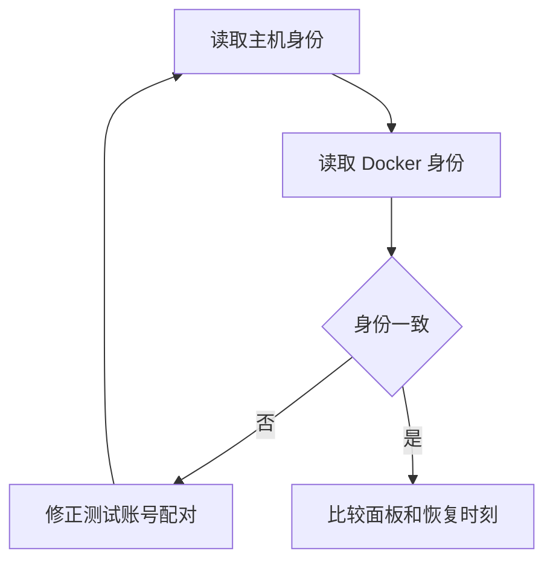

# Claude 自动选账号验证

目标是确认探测身份与实际运行身份一致，并验证无可用账号时在创建 worker 前报错。仅在测试 Mac mini 使用专用测试账号。遵循 mini-op 的规则。安装步骤见 [install-ensemble.md](install-ensemble.md)。

## 已知证据与限制

源码中，主机探测清除外部 API（应用程序编程接口）凭据，再读取账号的 `dir`；Docker 启动按同名账号从 broker 注入 setup-token。账号名相同不能证明凭据属于同一 Claude 账号，见 [common.py](../../src/ensemble/session/clients/claude/common.py)、[客户端](../../src/ensemble/session/clients/claude/__init__.py) 和 [start.go](../../src/broker/internal/launcher/start.go)。

本次没有 2026-10-29 的原始输出或现场身份信息，不能确认 frank.wang6356 的误判原因。已有录制面板的百分比解析正确，缓存跨过恢复时刻却仍命中旧读数的问题已由假时钟测试复现，见 [accounts_test.py](../../tests/session/unit/engine/accounts_test.py)。恢复时间已过不代表服务端已更新用量。

## 准备与身份核对

1. 记录待测提交和 `claude --version`。仅在 mini 安装此分支。使用两个专用测试账号，记录账号名和 `dir`，不在报告中保存 token、凭据文件或 Keychain 内容。
2. 对每个 `dir`，在 mini 的独立终端清除 `ANTHROPIC_*` 和 `CLAUDE_CODE_OAUTH_TOKEN`，设置 `CLAUDE_CONFIG_DIR`，打开 `claude` 的 `/status`。记录非敏感的账号身份和组织标识。默认账号使用 mini 的 `~/.claude`，并清除 `CLAUDE_CONFIG_DIR`。不要在用户 Mac 上执行。
3. 使用同一个账号名显式启动 Docker 测试会话，命令形状为 `ensemble-session start <新名称> --client claude --host docker --account <测试账号名> --cwd <测试仓库绝对路径> --prompt 'Say hi and wait.'`。在该会话打开 `/status`，比较账号和组织标识。只在报告中给出“一致”或“不一致”，不要输出容器环境或秘密挂载。
4. 若身份不同，记录哪个账号名的主机目录与 broker 注册身份不同。通过 mini 的正规登录流程重新配对测试凭据，再重复核对；不要据此更改用户机器的凭据。若一致，继续检查原始面板与恢复时刻。

身份的比较仅使用 `/status` 显示的非敏感字段。

## 用例

每次实际探测在 mini 的 `~/.ensemble/usage/probes/` 留下一份 JSON（JavaScript 对象表示法）记录，字段为 `at`、`client`、`accounts`、`identity` 和 `output`。`identity` 为探测目录；`accounts` 可包含共享该目录的多个别名。非池探测的这两个字段为空。文件权限为 `0600`，目录为 `0700`，见 [hosted_session.py](../../src/ensemble/session/engine/hosted_session.py)。

| 用例 | 操作 | 通过标准 |
|---|---|---|
| 身份一致 | 比较同一测试账号的主机与 Docker `/status` | 身份和组织一致；不一致单独报告 |
| 恢复边界 | 在测试账号已知恢复时刻前后触发自动选择 | 旧缓存越过恢复时刻即重新探测；记录新面板 |
| 恢复后仍耗尽 | 服务端面板仍显示耗尽时观察自动选择，30 秒后重试 | 不推断可用；耗尽账号不被自动选中；短缓存后重新探测 |
| 全部不可用 | 专用测试池全部达到阈值后，以空 `account` 启动 | 明确显示 `no available account`；无新 worker |
| hold | 测试 run 真正触发 usage limit 后，再自动启动 | hold 有效期间跳过该账号；全部 hold 时明确拒绝 |
| 原始记录 | 比较探测面板、记录与 `~/.ensemble/usage/claude.json` | 百分比与恢复时间一致；未知面板也保存；执行失败的 `output` 为 `null` |
| 凭据脱敏 | 在 mini 私下检查记录与权限 | 无 token、API key、Bearer 凭据或密码；不把未审核记录上传 |

不要人为耗尽付费配额；不具备真实耗尽条件的用例标记“未运行”，使用单元测试证据。记录只在实际执行探测时产生，缓存命中和 hold 跳过不产生新记录。自动选择使用五小时低于 90%、周用量低于 100% 的阈值；显式选择仍保留操作者的决定。

## 诊断与报告

先保留 mini 上同一时刻的探测记录、用量缓存和 hold 截止时间。对比 `output` 与缓存的百分比，核对 `at` 是否早于窗口恢复时刻。若原始百分比正确但运行身份不同，归因于账号配对；若身份一致且新面板仍耗尽，报告服务端读数滞后，不假定可用。解析不一致时，去除敏感字段后把该面板作为新的回归 fixture（测试样本）。

报告包含提交、Claude 版本、身份核对结果、每个用例的通过／失败／未运行、对应记录时间和脱敏摘要。不要报告秘密值。历史 frank 事件只有获得当时证据才能作确定归因。
