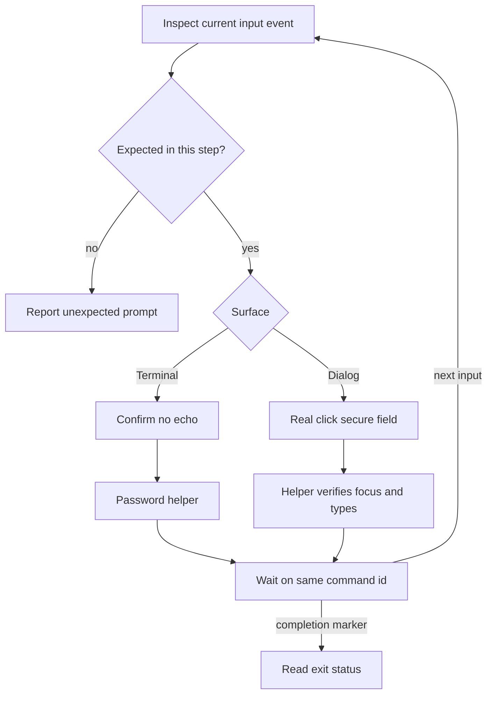

# Gotchas: ensemble's test environment on the mini

The mini's own gotchas (its keychain, OpenCLI, the Terminal, screenshots, key chords, a locked screen) come with mini-op's rules (the `mini-op` skill loads them). Item names: the request or the mini's `~/.ensemble/config.local.toml`.

## Outlook

- **Microsoft blocks sign-up under OpenCLI.** With Chrome under CDP control, the last step fails with "We ran into a problem"; a plain window with keystrokes passes to the human check.
- **Long Outlook addresses come back "isn't available".** Three random addresses failed; a short one passed at once.
- **Outlook signs itself out between sessions.** Sign in again from the Outlook keychain item with `secfield`, then go straight to `outlook.live.com/mail/0/` past "Help protect your account".

## Linear

- **Finding the Linear login mail.** `click --text "Login for Linear"` matches every such row, and a lookup right after the request returns the previous, used link (`/auth/error`). Outlook put most login mails in Junk Email (2026-10-25), and a list read before it renders finds nothing, so a delivered mail looked like "no new mail". `~/apm/bin/maillink` reads the Inbox and Junk Email, each once its list or empty state has rendered, and takes only a mail whose id (`data-convid`, else the row id; never the label, which changes once read) was not marked before the request. Its `follow` and `code` refuse without a mark, and `~/apm/bin/linearlogin` stops when `mark` fails. If Outlook changes its empty-folder text, or a Linear row has no id, `mark` stops with "did not render".
- **Use the Linear login code, not the link.** Links in Junk Email mails do not work, and a link login twice landed on linear.app logged out (2026-10-25); the code worked. `~/apm/bin/linearlogin --code` clicks Enter code manually and has `~/apm/bin/maillink code` type the mail's 10-character code into `input[name=authToken]` with `secfield`.
- **Two runs fight over the tabs.** One script at a time. A loop on the user's Mac must be stopped there first (TaskStop), then the script on the mini (`pkill -f 'apm/.*<script>'`): killing only the mini side lets the loop start the next one.
- **Join must be clicked.** After the login link the workspace picker shows Join; skipping it leaves the invite unaccepted and settings pages bounce to the login form.
- **`linear.app/logout` does not log out.** For a logged-in browser it shows the workspace picker with a "Log out" button; until that is clicked, the login form never appears. `~/apm/bin/linearlogin` clicks it and checks each page before going on.
- **Linear rate-limits logins.** About a dozen logins and retries within half an hour brought a "Verify you are human" check (the user clicks it, over Screen Sharing: mini-op's `setup-test-env` runbook 1.4), then a link that logged in without keeping the session, then `/auth/error` "You're trying to login too fast". Log each account in once, a few minutes apart; after the error, wait 30 minutes.
- **A leftover `linear.app/logout` tab logs every new login out.** `o open https://linear.app/logout` can open a second tab; it stayed on /logout and signed the session out within a second of each login link (Chrome history showed /auth/email, then /logout). `~/apm/bin/linearlogin` closes every /logout tab first and navigates its own tab with `location.href`. When a login fails, read the tab list and Chrome history before trying again; never request link after link.
- **An engineer issue needs a `Repo:` line in its description.** Without one it bounces at claim, with a comment saying so.

## GitHub

- **GitHub refuses Outlook addresses.** Since late September 2026 GitHub pauses new sign-ups with Outlook/Hotmail addresses; the form says "Email domain could not be verified" (not a rate limit, not automation). Sign GitHub up with another provider.
- **GitHub's Authorize button needs real focus and mouse input**: use the gh login procedure in `install-ensemble.md` 6.2.5; a DOM `.click()` on the disabled button does nothing.

## Strata and OpenCode

- **Strata has one slot.** Every OpenCode session on the LAN (the user's Mac's, the mini's manager, its workers) queues on the same slot; `/ensemble:manage`'s first turn took 4 minutes.
- **OpenCode Zen's free tier is no stand-in for Strata.** It rejects external clients (403 `FreeTierError`) and has no API key.
- **OpenCode takes `!` as shell mode.** A message typed into the OpenCode TUI with a `!` in it ran as a shell command (`(eval):1: command not found: Create`). Write messages to an OpenCode manager without `!`.

## Ensemble install, broker and board

- **Docker's container dirs need Full Disk Access.** `~/Library/Containers/com.docker.docker` cannot be deleted from Terminal ("Operation not permitted"); ssh can (sshd has Full Disk Access). macOS 27 also denies Terminal `~/Library/Group Containers/group.com.docker`, so `install-cleanup.sh` asks Full Disk Access for both.
- **Broker checks over ssh always fail.** `ensemble-broker probe-provider` reads the provider key from the login keychain, which is locked in an ssh session: over ssh it says `login_required`. Run them in the mini's Terminal (`printf '%s\n' '<cmd> > /tmp/x 2>&1' | mini run`, then read the file over ssh), or in tmux session `apmtest` when the user wants to watch (`tmux send-keys -t apmtest:0.0 '<cmd>' Enter`, read with `tmux capture-pane -p -t apmtest:0.0`). The same holds for router runs: start them from the mini's Terminal (mini-op uses tmux session `b1`).
- **A Python local-network prompt.** On 2026-10-21 an ensemble Python command reaching the LAN raised "Allow “Python” to find devices on local networks?" (UserNotificationCenter; which command was not pinned down): Allow, since the usage probe needs Strata.

### macOS password prompts during installs and logins

**Expected password prompts** below belong to the verifier run. Answer them with the mini account's password through mini-op, never by asking the user to type it. Apply this only to the named step currently running. For the no-UI check, follow [broker-keychain.md step 3](broker-keychain.md) instead. Other runbooks' explicit prompt-failure criteria still apply.

| Step | Expected prompt | Route below |
| --- | --- | --- |
| Install, cleanup or broker rebuild at `sudo` | Terminal `Password:` (or sudo's account-qualified password prompt) | Terminal |
| `ensemble-broker login github …`, `login claude <name>`, `login codex`, `login opencode …`, `login env …` or `retrust` | Terminal `Login keychain password, to make … (hidden):` | Terminal |
| Install's Linear apps step, `ensemble-broker login linear …` | Terminal `Login keychain password, to make this Linear client secret trust only the broker (hidden):` | Terminal |
| Those broker login or re-trust steps, when macOS asks to use a Keychain item or change its access | SecurityAgent / Keychain password dialog, sometimes repeated | Dialog |

Commands below run inside the mini-op image, whose runtime is `/opt/windroc/mini-op`. For another checkout, use the runtime root verified by the mini-op skill. Sources are mini-op's [runtime discovery](https://github.com/windroc/mini-op/blob/2d434e576d7ebae904405ae0841d52df6e9b98c4/skills/mini-op/SKILL.md#runtime-prerequisite), [password helpers](https://github.com/windroc/mini-op/blob/2d434e576d7ebae904405ae0841d52df6e9b98c4/README.md#scripts), [waiting and answering](https://github.com/windroc/mini-op/blob/2d434e576d7ebae904405ae0841d52df6e9b98c4/README.md#waiting-and-answering) and [focus and screenshot gotchas](https://github.com/windroc/mini-op/blob/2d434e576d7ebae904405ae0841d52df6e9b98c4/README.md#gotchas).

The expected-step scope comes from the table; the input event alone does not authorize an answer.

**Terminal.** Start the public interactive install/login with mini-op's `run … --until-input`. Inspect its `termwait: input:` event and confirm a fresh no-echo password prompt from the expected program. Then run `/opt/windroc/mini-op/ctl/mini pw`. The helper reads `/run/ensemble/secrets/env/mini-password` into SSH stdin and types it with `keys.js --front Terminal --secret --enter`. The mini password is not a Linear client secret, provider API key or browser password; those keep their own protected input routes.

**Dialog.** Inspect `ssh mini '~/apm/bin/dialogs'` and match the request to the current broker step. Real-click its secure password field with `ssh mini 'osascript -l JavaScript ~/apm/js/click.js 512 422'`, mini-op's documented field position; use the field's current coordinates if it moved. Then run `/opt/windroc/mini-op/ctl/mini pw --sa`. Its [secure-field guard](https://github.com/windroc/mini-op/blob/2d434e576d7ebae904405ae0841d52df6e9b98c4/mini/ts/keys.ts) confirms SecurityAgent is frontmost and its single `AXSecureTextField` is focused **before typing**, verifies the characters reached it, then clicks Allow. A `field not focused; typed nothing` refusal means real-click the field and retry this route; it is the run's recovery to perform. The helper answers one immediate focused repeat and reports `answered 1` or `answered 2`; inspect any later dialog as a new event. Do not choose Always Allow. If no dialog appears, continue on command completion without waiting for one.

After either route, wait on the original command id with `ssh mini '~/apm/bin/termwait 120 --after <id> --until-input'`. Keep that id through input events and timeouts; only its completion marker proves success or failure. Never restart the install merely because a password prompt's text stays unchanged.

Keep the password only on the helpers' protected stdin path. Never print, log, echo, put it in argv or an environment variable, or send it as a new `run`/`exec` command. Do not screenshot a Terminal containing tokens; use mini-op's documented field position without a screenshot, and clear secret-bearing scrollback before any permitted screenshot. A missing password file is a credential setup failure to report, not a request for the user to answer the mini's prompt.

## sbx

- **`sbx` over ssh needs the keychain unlocked.** Without it: "SBX could not read Docker credentials because macOS Keychain denied access". Unlock in the same ssh session first, or run `sbx` in a mini tmux pane.
- **`sbx exec` reads stdin.** In a script piped to `zsh -s` it swallows the rest of the script: give it `</dev/null`. `sbx secret rm` without a terminal needs `--force`.
- **A new sandbox runs its own `apt-get` at boot.** An immediate `apt-get install` inside it fails with "Could not get lock /var/lib/apt/lists/lock": wait for the boot run to finish. The shell template has no tmux.
- **`sbx reset` leaves state behind**: `~/.sbx`, `~/Library/Application Support/com.docker.sandboxes` and `~/.local/share/llmman`. Trash them after the reset.
- **`sbx`'s first network-policy choice is global.** The first `sbx create`/`run` asks 1 Open, 2 Balanced, 3 Locked Down; the choice applies to every sandbox (`sbx policy reset` to change it).
