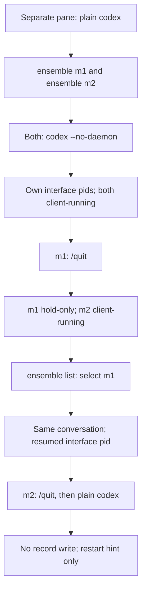

# Manager on the mini

Gotchas for this environment: `gotchas.md` beside this runbook.

Strata is a PC on the LAN with one slot: run at most one OpenCode manager and one OpenCode worker at a time (the user, 2026-10-21), and close both when a test ends.
0. Screen: only two windows, Terminal and Chrome; never move or resize one (mini-op's rules, which the `mini-op` skill loads › Rules). Close Chrome's extra "New Tab" window first, and every window a step no longer needs. The worker's pane needs to be wider than 37 columns: if the Terminal is narrower, tell the user rather than resizing it.
   Docker Desktop's first launch leaves a Containers window: use System Events, in process `Docker Desktop`, to click that window's button whose `subrole` is `AXCloseButton` (inspect the process/window names first). Docker keeps running. After every step check Terminal and Chrome for extra windows or tabs and close the extras. Terminal's AppleScript window list may keep closed windows with `tabs=0`; use the windows visible to System Events as the authority.
1. From the mini's Terminal: `mkdir -p ~/manager && source ~/.zprofile && ensemble mini`; in it `cd ~/manager && claude --model sonnet` (the user, 2026-10-21: the test manager runs Sonnet at most; never in the home directory). Trust `~/manager`, then `/ensemble:manage`.
2. Drive it with `tmux send-keys -t '=mini:' …` and read it with `tmux capture-pane -p -t '=mini:'` (`/opt/homebrew/bin/tmux`); keystrokes through System Events can land in another Terminal window.
3. Its first start raises macOS folder prompts for Terminal (Downloads, Documents, Desktop, Photos): Don't Allow each (System Events: click button "Don’t Allow" in process UserNotificationCenter).

## Codex manager isolation

Run on the test mini only, never on the user's Mac. Use `~/manager` in every pane; submit a turn after each Codex start to trigger SessionStart.

Keep the separate plain `codex` open throughout. For the pid checks, read `~/.ensemble/managers/m1/session.json` and `~/.ensemble/managers/m2/session.json`, compare with `ps -A -ww -o pid= -o ppid= -o tty= -o args=` and `tmux list-panes -a -F '#{session_name} #{pane_tty}'`. Each `pid` must name its own pane's interface, never the shared daemon. After selecting m1, its process command must include `--no-daemon`.

Save both records before starting plain `codex` in m2 and compare them after its first turn; neither may change. The hook must output “this Codex runs on the shared daemon, so ensemble can't tell which manager it belongs to; /quit and restart with `codex --no-daemon`” without re-arm instructions. This hint must work even when the separate daemon inherited no manager environment. Exit the test clients and close the test panes when done.
