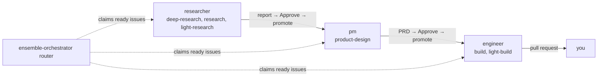
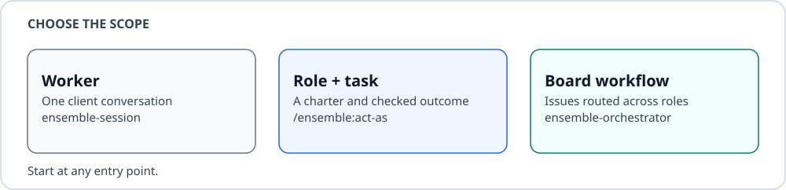
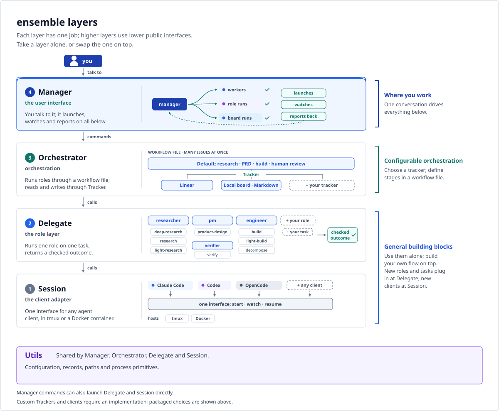
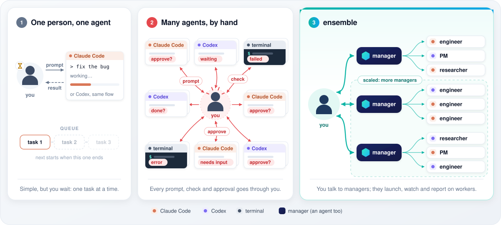

<div align="center">

# Ensemble

English · [中文](docs/readme/README.zh-CN.md) · [日本語](docs/readme/README.ja.md) · [한국어](docs/readme/README.ko.md) · [Español](docs/readme/README.es.md) · [Français](docs/readme/README.fr.md) · [Português](docs/readme/README.pt.md)

[](https://github.com/windroc-labs/ensemble/actions/workflows/test.yml?query=branch%3Amain) [](https://github.com/windroc-labs/ensemble/actions/workflows/worker-image.yml?query=branch%3Amain) [](LICENSE)

</div>

Runs coding agents (Claude Code, Codex, OpenCode on the host's Ollama models) unattended from a Linear board or a local board of Markdown issue files. Orchestrator reads and writes issues through a replaceable Tracker; `[orchestrator] tracker` selects `local` (the default) or `linear`. A workflow file defines the stages and their roles. Each role works up to `max_runs` issues at once and hands its output back for your review. Once you approve, the next role takes it.

Developers: `AGENTS.md`.



## Five levels of mastering AI agents

Working with coding agents is a ladder: each level adds an engineering discipline on top of the ones below, and the skill is matching the level to the problem.



| Level | Discipline | What it means |
|---|---|---|
| 1. Drive | prompt and context engineering | Conversational prompting, context management, knowing which model fits which job. |
| 2. Equip | tools, skills, MCP | Give the agent tools to reach and act on the world (files, APIs, a browser, MCP servers), within permissions and a sandbox. |
| 3. Systematize | state engineering | One workflow run as a state machine: defined stages, retries, idempotent steps, handoffs. |
| 4. Orchestrate | loop engineering | Many agents: fan-out, planner and verifier, routing, concurrency and quota limits. |
| 5. Master | environment engineering | Guardrails and an agent-oriented environment: tools, checks and verification built for agents, not humans, so the easiest path is the right path (an idea from Lauren Tan). |

Not at level 3 yet? Check out [updraft](https://github.com/windroc-labs/updraft): it gets you there, at least. ensemble's layers ([Layered architecture](#layered-architecture)) climb further: Session runs the agent's conversation and gives it a host to act in (levels 1–2), Delegate runs one role on one task as a checked workflow (3), and the Orchestrator, with the manager on top, coordinates many agents (between 4 and 5). Put you on top, setting the environment, boundaries and gates, and that is Master, though ensemble's verification is still a bit thin. The goal is level 5 and beyond.

## Layered architecture

ensemble is built in layers: each does one job and calls only the one below. Take the bottom two, Session and Delegate, on their own as general building blocks, or build your own orchestration on top. In Orchestrator, change the workflow file to define your stages, or implement the Tracker interface for another board. To extend it, plug a new agent client in at Session, or add roles and tasks at Delegate.



| Layer | What it does | Start at |
|---|---|---|
| Manager | A driver for the layers below: an agent you talk to that launches workers, role runs and board runs, watches them and reports back. | [Demo](#demo-one-manager-many-workers) |
| Orchestrator | Runs roles through a workflow file, with replaceable trackers: Linear or a local Markdown board. | [Boards](docs/board.md) |
| Delegate (core) | Runs a role on one task through a session and returns a checked outcome. A Claude Code and Codex plugin you can use alone. | [Install](#install) |
| Session | Starts, watches and resumes a coding agent (Claude Code, Codex, OpenCode) in tmux or a Docker container, the same way for every client. | [Sessions](docs/architecture.md#session-settings) |

The packaged workflow reflects my philosophy of how agents should work (research, then a PRD, then a build, with a human review between each stage). `[orchestrator] workflow` selects another workflow file; an empty value uses the packaged one. The roles and tasks themselves are yours to edit too ([Customizing roles and tasks](docs/customizing-roles-and-tasks.md)).

## Why ensemble



One agent keeps you waiting; many agents by hand route every prompt, check and approval through you. With ensemble you talk to a manager, which launches, watches and reports on the workers.

## System structure

Each session runs on a Host you pick: the local one (tmux), where the client runs on your Mac as you, or the Docker Host, where it runs isolated in its own container. The broker, on the Mac, keeps the logins in the login keychain and hands each container only its own credentials (GitHub tokens that last an hour), taking them back when the container closes.

![Flexible hosts: each session runs on a Host you pick, locally (tmux, not isolated) or in its own Docker container (isolated, so the client runs in yolo mode by default). The broker keeps the logins and gives each container only its own credentials: GitHub tokens valid an hour and revoked at close, a Codex access token without its refresh token, a Claude setup-token copy. The container cannot reach the host keychain, optional Linear app tokens, gh login or Docker socket, and reaches public destinations through the egress proxy; local/LAN services need explicit host:port exceptions; its work leaves only through GitHub](docs/images/system.svg)

Details: [Docker host](docs/docker-host.md), [Credentials](docs/architecture.md#credentials).

## Demo: one manager, many workers

Without the board, you can run ensemble by talking to one agent, the manager. Open its session with `ctmux <name>`, start Claude Code, Codex or OpenCode in it and invoke `/ensemble:manage`. You give it work in plain words; it launches a worker for each task, watches their events, checks their pull requests and reports back.

Commands: [Quick start](#quick-start).

## Install

On an Apple silicon Mac, from nothing installed up to a working ensemble, in one command:

```bash
curl -fsSL https://raw.githubusercontent.com/windroc-labs/ensemble/<tag>/scripts/install.sh | bash
```

`<tag>` is the release the `windroc` marketplace pins: the `ref` of `ensemble` in its
[`.claude-plugin/marketplace.json`](https://github.com/windroc-labs/agent-plugins-marketplace/blob/main/.claude-plugin/marketplace.json).
That release's installer installs that release's plugins and broker; another installer may not fit them.

`scripts/install.sh`, in order:

1. installs the dependencies: Homebrew with the Command Line Tools, `gh`, tmux, git, Python 3.11+, iTerm2;
2. asks which clients you use (Claude Code, Codex, OpenCode) and whether workers run in Docker, and writes `~/.ensemble/config.local.toml`;
3. installs and logs in only what that configuration needs: the clients with ensemble, [`updraft`](https://github.com/windroc-labs/updraft) for host Claude Code/Codex only without Docker ([host support and Docker plugins](docs/docker-host.md#plugins)), OpenCode with its provider and its ensemble plugin (`opencode plugin -g`), Docker Desktop and the broker with the chosen clients' broker logins, `ctmux --install`, and the selected [board](docs/board.md#setup). A local board confirms `tracker = "local"` and creating missing board and `unassigned/` directories, without asking for Linear apps or contacting Linear. A Linear board sets up transport-owned harness, manager and role apps with Client IDs, hidden client secrets and Keychain tokens, then reads its config from Linear. Already-enrolled apps with [`renewal = "broker"`](docs/upgrading.md#linear-broker-renewal) use the installed broker's maintenance and published access tokens without reading or asking for client secrets. Either board can optionally install the router and promote launchd jobs.

It asks the `sudo` password once per run and keeps it only in memory, for every `sudo` the run makes (Homebrew's included), runs each login on the spot (`gh`, Claude Code and Codex open your browser; the broker's `claude setup-token` and its paste run on the terminal's alternate screen, cleared once the broker has the token, so it stays out of the scrollback), and shows and asks before it writes your shell profile, the config or launchd jobs. A rerun keeps your last answers, skips what is done and finishes an interrupted install. Before upgrading, see [Upgrading](docs/upgrading.md).

Each run refreshes the selected Claude Code/Codex marketplaces and updates ensemble to the served ref before
reading installed plugin files. If a client cannot reach that version, installation stops with its name and reason.

For OpenCode, it reuses an executable on `PATH` that runs the minimum version or a newer stable 1.x release,
and records its path in `[session.clients.opencode] executable`. Otherwise it installs the private copy
in `~/.ensemble/opencode`. Plugin setup and login use the selected executable; cleanup preserves an existing installation.

It shows the installation checklist only when clients or Docker has no flag or saved answer. `--clients`, `--docker`/`--no-docker` and saved choices together skip it; for example, `--docker --board linear` skips it when clients were saved. When it appears, flags pre-tick their choices, with saved choices and existing config filling the other ticks (each client, Docker workers, Board; Board starts unticked unless saved or selected with `--board`): arrow keys move, space ticks, Enter confirms. With no saved choice or existing setup, selecting Board asks local or Linear (default local), then whether to install launchd jobs (default no). A rerun keeps the tracker and job choices and skips completed setup; flags change them. When no choice is saved, existing tracker config, installed jobs and an OpenCode provider already in config.local.toml or `opencode.json(c)` are kept without asking. Skipping Board or jobs leaves existing config and jobs in place; uninstall jobs as [documented](docs/board.md#setup). Flags pre-answer its questions: `curl -fsSL …/scripts/install.sh | bash -s -- <flags>`.

| Flag | Does |
|---|---|
| `--ref <ref>` | installs the plugins and the broker from this branch or tag of `windroc-labs/ensemble` (default `<tag>`, the release the `windroc` marketplace pins). Claude Code and Codex install `ensemble@windroc` from that marketplace, which serves one ref, so with them only that ref; another ref needs `--clients opencode`: a release tag downloads its broker, a branch builds it locally. The installed commands select this install’s plugin even when other client caches exist. |
| `--clients <list>` | comma-separated `claude`, `codex`, `opencode`; any one alone works |
| `--docker`, `--no-docker` | workers in Docker (Docker Desktop, the broker) or on the local tmux Host |
| `--board <local\|linear>`, `--no-board` | sets up a local or Linear board, or skips board setup (first-run default) |
| `--launchd`, `--no-launchd` | router/promote jobs; see [Board setup](docs/board.md#setup) |
| `--opencode-provider <name>`, `--opencode-url <url>`, `--opencode-model <model>`, `--opencode-context <tokens>` | OpenCode's OpenAI-compatible provider, e.g. a LAN model server; its base URL ends `/v1`; its context window (default 65536). A provider other than the saved one needs its own `--opencode-url` and takes nothing from the saved one |
| `--opencode-key-stdin` | reads the provider's API key from stdin; Docker imports the same key from local OpenCode's `auth.json` into the broker |
| `--password-stdin` | reads the `sudo` password from stdin, before the key |

With Docker, before client setup, it checks the served ref against its release broker's protocol. After refreshing
Claude Code/Codex plugins, it checks their installed copies too. OpenCode's installed copy counts only while at the
`--ref`'s commit; otherwise it checks `--ref` on GitHub. For installed copies it uses the installed broker when it came
from that plugin and speaks its protocol, else the plugin's release (`v` + its version). A mismatch names both protocols.

With a stdin flag, stdin cannot also carry the script: download it first, so its text is not a process argument
other users can read:

```bash
(f=$(mktemp) && trap 'rm -f "$f"' EXIT && curl -fsSL -o "$f" https://raw.githubusercontent.com/windroc-labs/ensemble/<tag>/scripts/install.sh && security find-generic-password -s <item> -w | bash "$f" --password-stdin)
```

What it sets up, for reference or by hand:

| Client | Plugin install |
|---|---|
| Claude Code | `/plugin marketplace add windroc-labs/agent-plugins-marketplace`, then `/plugin install ensemble@windroc` |
| Codex 0.156.0+ | `codex plugin marketplace add windroc-labs/agent-plugins-marketplace` (to refresh an added one: `codex plugin marketplace upgrade windroc`), then `codex plugin add ensemble@windroc`. `codex plugin list -m windroc` must show it installed and enabled. |
| OpenCode 1.x | In `~/.config/opencode/opencode.json`, `"plugin": ["ensemble@git+https://github.com/windroc-labs/ensemble.git#v<version>"]` (a release tag), then restart OpenCode. Commander only, without idle notifications: [OpenCode commander](docs/architecture.md#opencode-commander). |

Set up by hand, nothing checks these: a missing one fails the agent run.

| Requirement | For |
|---|---|
| `claude` CLI, Python 3.11+ | every agent run |
| the [`updraft`](https://github.com/windroc-labs/updraft) plugin for host workers: Claude Code `/plugin marketplace add windroc-labs/agent-plugins-marketplace`, then `/plugin install updraft@windroc`; Codex `codex plugin marketplace add windroc-labs/agent-plugins-marketplace`, then `codex plugin add updraft@windroc`. Docker workers install it in the image ([Plugins](docs/docker-host.md#plugins)). | the engineer's build tasks (`/updraft:build`, `/updraft:light-build`) and the PM's PRD review (`/updraft:review`). Not needed otherwise. |
| tmux 3.3–3.8 | tui runs on the `tmux` Host |
| [Ollama](https://ollama.com) on `127.0.0.1` with its context length at least 65536 and the tier model pulled; on `tmux` also OpenCode 1.x (`npm install -g opencode-ai@1.19.3`) | OpenCode runs only ([Docker host › OpenCode](docs/docker-host.md#opencode), [OpenCode sessions](docs/customizing-roles-and-tasks.md#opencode-sessions)) |
| `git`, `gh` logged in | coding (checkouts, pull requests) and GitHub destinations. Not needed otherwise. |
| iTerm2 running | the default iTerm2 split |
| Docker Desktop running; the broker `B` (`/usr/local/libexec/ensemble/ensemble-broker`), installed by `sh <plugin dir>/src/broker/install.sh` (needs `sudo` and `gh` logged in); one login each: `B login claude` (paste a `claude setup-token`), `B login github ensemble-broker-bot`, and for Codex `sudo B install-codex <version>`, then `B login codex`; OpenCode needs none | the Docker Host only ([Docker host](docs/docker-host.md)); no Node on the host. What each credential grants, where it lives and how to revoke it: [Credentials](docs/architecture.md#credentials). |

How the sessions ensemble starts load your settings, and why some commands refuse inside them: [Session settings](docs/architecture.md#session-settings).

### Commands

| Command | Does |
|---|---|
| `ctmux <name>` | Open the commander's tmux session: native windows in iTerm2, a plain tmux attach in other terminals, a switch from inside tmux. `ctmux --install` puts ctmux and the four commands `ensemble-crew`, `ensemble-session`, `ensemble-delegate` and `ensemble-orchestrator` in `~/.ensemble/bin/`: run them by that path, or add it to `PATH`. `--install` records this plugin’s absolute path in `~/.ensemble/plugin-root`; all five commands run from that selection, including after an OpenCode-only `--ref` install with other client caches present. Rerun the installer to select another ref, including older refs whose own launchers predate selection support. If a plugin update removes the selected directory, the next command records and runs the newest installed copy from the same client and reports its path on stderr; no installer rerun is needed. For OpenCode that copy must hold the same ref (its package's `#<ref>`, none meaning `main`), so another ref's leftover copy never replaces the installed one. A missing command in an existing directory, or no remaining copy from the selected client (OpenCode: of the selected ref), keeps the selected-plugin error and `~/.ensemble/plugin-root`; rerun the installer. Launchers without a source record retain Claude Code → newest Codex → newest OpenCode discovery; equal versions use ascending path order. |
| `/ensemble:manage` | Launch and direct workers, role runs and pipeline runs, with the commander's guidelines. |
| `/ensemble:act-as <role>[:<task>] <input>` | Run a core role in this conversation. |
| `/ensemble:board` | Read, find, create, edit, move and archive board issues with fixed `ensemble-orchestrator issue` commands. |
| `ensemble-delegate run --list` | List every role and task. |

## Quick start

1. [Install](#install) the plugin.
2. In a new Claude Code session, check it: `/ensemble:act-as dummy-tester:echo hello` echoes `hello`.
3. Run a role: `/ensemble:act-as researcher <question>`. With no local config the report is saved in `~/.ensemble/adhoc/<date>-researcher-<name>/agent/prompt.md`; to publish it instead, set the role's destination ([Customizing roles and tasks](docs/customizing-roles-and-tasks.md#change-a-roles-run-settings)).
4. To run roles from a Linear or local Markdown board: [Boards](docs/board.md).

## Customize roles and tasks

- Run settings per role (model tier, effort, client, destination, commands): `[delegate.roles.<role>]` in `~/.ensemble/config.local.toml`.
- Your own roles, tasks and templates: a team dir listed in `[delegate] team_dirs`. It only adds; it never changes a built-in role.
- Check: `ensemble-delegate run --list`, then `ensemble-delegate run --role <role> --input <text> --dry-run`.

Formats, rules and the board's limits: [Customizing roles and tasks](docs/customizing-roles-and-tasks.md).

## Docs

| Page | Covers |
|---|---|
| [Customizing roles and tasks](docs/customizing-roles-and-tasks.md) | run settings, team dirs, role and task files, checks, OpenCode sessions |
| [Board](docs/board.md) | setup, issue states and task labels, operating the router, Agent labels (client per issue), the local board (`tracker`, `ENSEMBLE_BOARD_DIR`, layout, file format) |
| [Upgrading](docs/upgrading.md) | upgrade steps; Linear presets, broker renewal and live checks |
| [Core architecture](docs/architecture.md) | layers and packages (developers); session settings, `ensemble-session`, run limits, the session harness, recalling a closed run, role runs' client flags, every credential (storage, readers, lifetime, revocation), the OpenCode commander |
| [Tests](docs/tests.md) | lint, test suites, coverage, live tests a local model can gate (developers) |
| [Docker host](docs/docker-host.md) | install `ensemble-broker`, log in, build, start and close a worker container, run workers on the Docker Host, OpenCode on the host's Ollama, risks |
