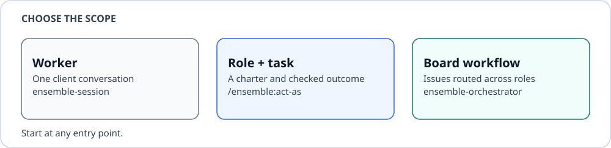
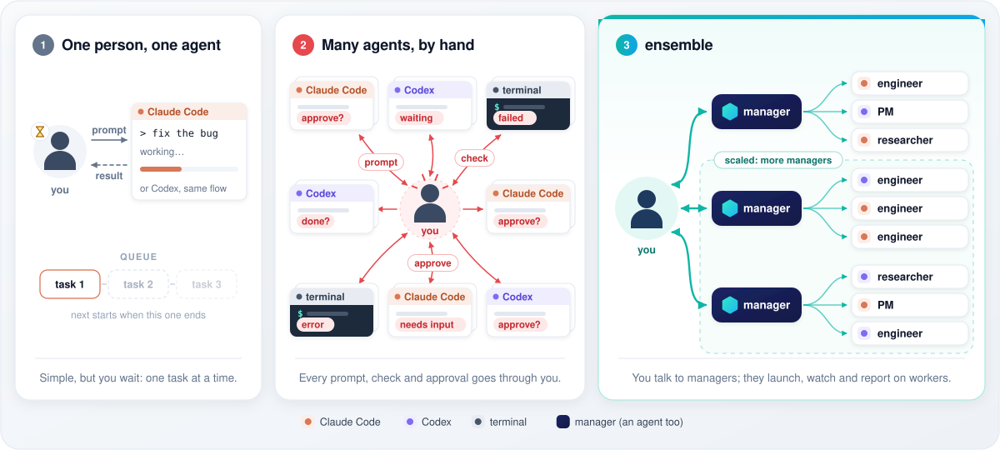
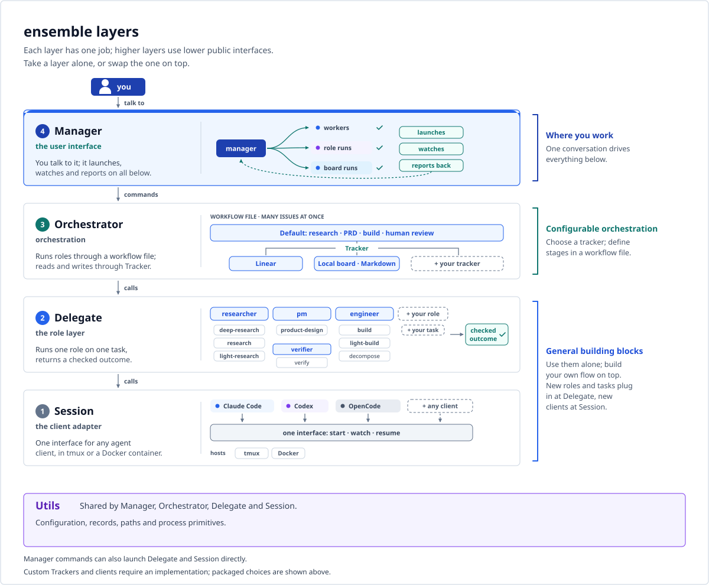
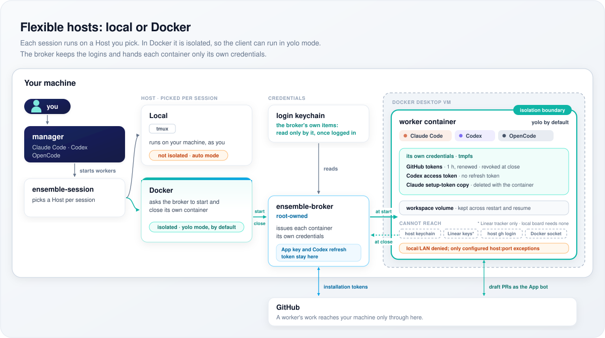

# Ensemble

[Español](docs/readme/README.es.md) · [Français](docs/readme/README.fr.md) · [日本語](docs/readme/README.ja.md) · [한국어](docs/readme/README.ko.md) · [Português](docs/readme/README.pt.md) · [简体中文](docs/readme/README.zh-CN.md)

Ensemble lets you work with coding agents as a crew. Talk to a commander, delegate a task to a role,
or let a board route work across roles. Claude Code, Codex and OpenCode share the same session controls.

<a id="what"></a>
## What you can run



Choose the scope you need. A worker is a client conversation; a role adds a charter, task and outcome;
a board schedules role runs and writes their results back to issues. The board can be Linear or local Markdown.

<a id="why"></a>
## Why a crew



Separate agent runs need someone to route work and follow their replies. A commander uses Crew to launch,
inspect and resume those runs from one conversation. You still decide what work to authorize and review.

<a id="how-it-works"></a>
## How it works





Control, credential delivery and network paths are distinct. The [architecture overview](docs/architecture.md)
explains ownership and trust; implementation details live in the linked source.

<a id="install"></a>
## Install

On an Apple silicon Mac, run the installer for the release pinned by the
[windroc marketplace](https://github.com/windroc-labs/agent-plugins-marketplace/blob/main/.claude-plugin/marketplace.json).
Replace `<tag>` with ensemble's `source.ref` from that file:

```sh
curl -fsSL https://raw.githubusercontent.com/windroc-labs/ensemble/<tag>/scripts/install.sh | bash
```

To supply the `sudo` password from Keychain, download the script first; stdin cannot also carry script text. Replace `<item>` with its Keychain service:

```bash
(f=$(mktemp) && trap 'rm -f "$f"' EXIT && curl -fsSL -o "$f" https://raw.githubusercontent.com/windroc-labs/ensemble/<tag>/scripts/install.sh && security find-generic-password -s <item> -w | bash "$f" --password-stdin)
```

| Flag | Reads |
|---|---|
| `--password-stdin` | The `sudo` password from stdin, before the provider key |

The installer asks which clients to use, whether workers run locally or in Docker, and whether to set up a
board. It installs the selected dependencies/plugins, requests the needed logins and sets up the `ensemble` command.
Rerun it to finish an interrupted install. For options, use `bash scripts/install.sh --help` in a checkout;
for an existing installation, read [Upgrading](docs/upgrading.md) first.

Use the model account/provider required by your selected client. OpenCode provider and network setup lives
in [Customizing roles and tasks](docs/customizing-roles-and-tasks.md#opencode-sessions).
Host `gh` needs push/PR access to target repositories: classic tokens need `repo`, `read:org` and `gist`;
fine-grained tokens also need Actions read for checks.

### GitHub App

Docker workers with a declared `github` credential use a GitHub App. The installer does not create the App.
In GitHub Settings › Developer settings › GitHub Apps, create a private App installable only on your account,
with webhooks off. Its repository permissions must cover the engineer role's credential declaration, written
by the installer in `[orchestrator.roles.engineer.credentials.github]`. Install it only on repositories workers
may push to, including document output repositories. Undeclared Docker runs receive no GitHub token; see
[explicit GitHub credentials](docs/upgrading.md#broker-protocol-35-explicit-github-credentials) for direct workers
and verifier output access.

Generate a private key, note the App ID and import them:

```sh
/usr/local/libexec/ensemble/ensemble-broker login github ensemble-broker-bot \
  --key-file KEY.pem --app-id APP_ID
```

Delete the PEM after import. [Credential rotation](docs/upgrading.md#credential-rotation) covers replacement and revocation.

### Push leak scan

In a Docker worker, every `git push` to a repository GitHub does not report private or internal is refused
when what it publishes (commits, annotated tags, ref names) carries a home path, a non-noreply email, a private name or a junk file
(`__pycache__`, `node_modules`, `*.pyc`). Without your private-name list, every such push is refused.
One-time setup, as the owner:

1. Write the list to a file outside any checkout: one literal per line (names, hosts, private repo names),
   at most 16 KiB. Tracker ids may go public; a bare team key in the list still blocks its ids.
2. Store it and delete the file:

   ```sh
   /usr/local/libexec/ensemble/ensemble-broker login env repo-guards-private-names < LIST
   ```

3. Declare it in `~/.ensemble/config.local.toml`; an environment with its own `env` list (such as `mini-op`)
   replaces this one, so repeat the entry there for its runs that push:

   ```toml
   [[delegate.environment.docker.credentials.env]]
   item = "ensemble-broker-env/repo-guards-private-names"
   file = "repo-guards-private-names"
   ```

A repository's own `core.hooksPath` (husky and the like) does not skip it; its hooks still run.
`git push --no-verify`, `git -c core.hooksPath=…` and calling a git binary by its path skip the scan.

<a id="quick-start"></a>
## Quick start

For one task in your installed client's conversation:

```text
/ensemble:act-as researcher:light-research What does tmux's remain-on-exit option do?
```

For a crew, open a commander shell and start your client:

```sh
ensemble work
claude
```

Use `codex --no-daemon` or `opencode` instead of `claude` if that is your client. In that conversation, invoke:

```text
/ensemble:manage
```

Describe the work and desired deliverable. The commander coordinates workers and role runs through Crew.
To come back to `work` later, run `ensemble list` in a terminal and pick it: you return to its session and conversation.
For board work, `/ensemble:board` operates issues; [workflow customization](docs/customizing-roles-and-tasks.md#on-the-board)
explains how to choose stages.

<a id="docs"></a>
## Docs

| Read when you need… | Where |
|---|---|
| The system's layers, execution and trust boundaries | [Architecture](docs/architecture.md) |
| Models, providers, role settings, your own tasks or workflow | [Customizing roles and tasks](docs/customizing-roles-and-tasks.md) |
| Changes needed by an existing installation | [Upgrading](docs/upgrading.md) |
| Contributor conventions and check entry points | [AGENTS.md](AGENTS.md) |
