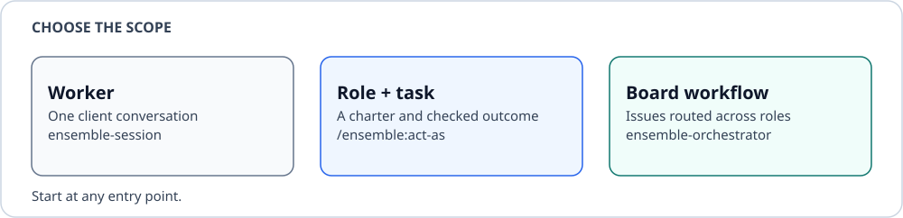
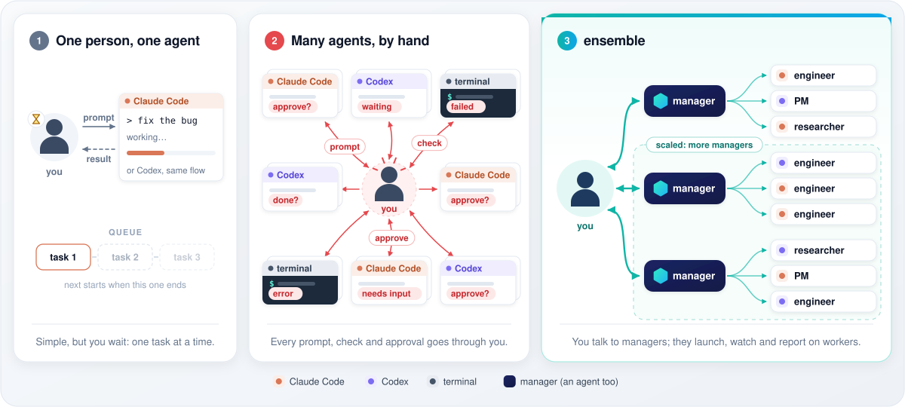
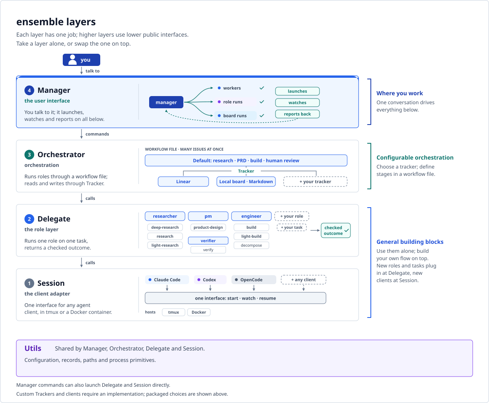
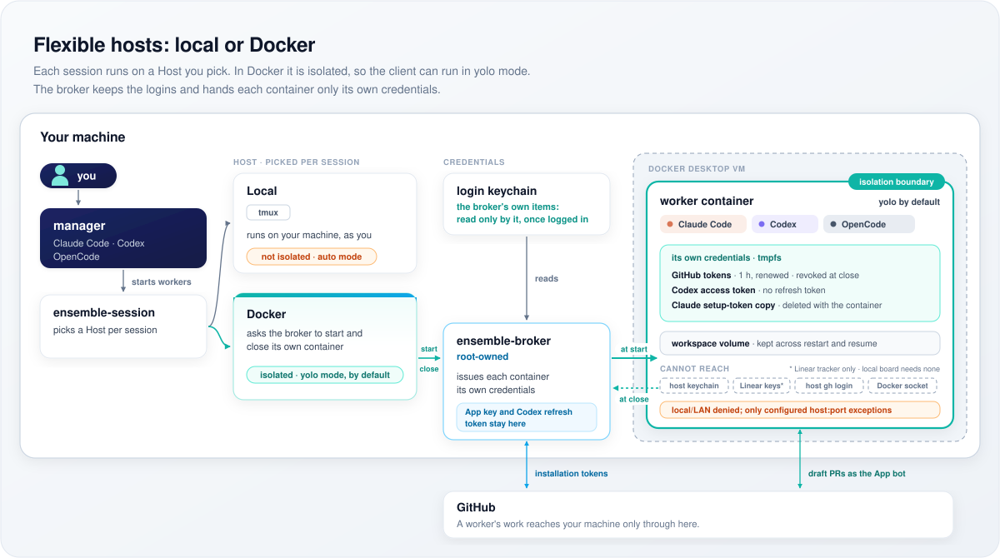

# Ensemble

[Español](docs/readme/README.es.md) · [Français](docs/readme/README.fr.md) · [日本語](docs/readme/README.ja.md) · [한국어](docs/readme/README.ko.md) · [Português](docs/readme/README.pt.md) · [简体中文](docs/readme/README.zh-CN.md)

Ensemble lets you work with coding agents as a crew. Talk to a manager, delegate a task to a role,
or let a board route work across roles. Claude Code, Codex and OpenCode share the same session controls.

<a id="what"></a>
## What you can run



Choose the scope you need. A worker is a client conversation; a role adds a charter, task and outcome;
a board schedules role runs and writes their results back to issues. The board can be Linear or local Markdown.

<a id="why"></a>
## Why a crew



Separate agent runs need someone to route work and follow their replies. A manager uses Crew to launch,
inspect and resume those runs from one conversation. You still decide what work to authorize and review.

<a id="how-it-works"></a>
## How it works





Control, credential delivery and network paths are distinct. The [architecture overview](docs/architecture.md)
explains ownership and trust; implementation details live in the linked source.

<a id="install"></a>
## Install

On an Apple silicon Mac, run the installer for the release pinned by the
[windroc marketplace](https://github.com/windroc-labs/agent-plugins-marketplace/blob/main/.claude-plugin/marketplace.json).
Replace `<tag>` with ensemble's `source.ref` from that file:

```sh
curl -fsSL https://raw.githubusercontent.com/windroc-labs/ensemble/<tag>/scripts/install.sh | bash
```

To supply the `sudo` password from Keychain, download the script first; stdin cannot also carry script text. Replace `<item>` with its Keychain service:

```bash
(f=$(mktemp) && trap 'rm -f "$f"' EXIT && curl -fsSL -o "$f" https://raw.githubusercontent.com/windroc-labs/ensemble/<tag>/scripts/install.sh && security find-generic-password -s <item> -w | bash "$f" --password-stdin)
```

| Flag | Reads |
|---|---|
| `--password-stdin` | The `sudo` password from stdin, before the provider key |

The installer asks which clients to use, whether workers run locally or in Docker, and whether to set up a
board. It installs the selected dependencies/plugins, requests the needed logins and sets up the `ensemble` command.
Rerun it to finish an interrupted install. For options, use `bash scripts/install.sh --help` in a checkout;
for an existing installation, read [Upgrading](docs/upgrading.md) first.

### Docker sessions from before state volumes

A Docker session started before broker protocol 40 keeps its client state in the Mac directory
`~/.ensemble/docker-state/<name>/<client>` (`<client>`: `claude`, `codex` or `opencode`), which workers no longer
read. A session with no target record, as such a session has, belongs to the local Docker Desktop: its resume on a
remote target fails, naming the local Docker Desktop as its target. To keep its conversation, copy that directory into
its state volume once, with the Docker target unset (no `~/.ensemble/docker/target.json`) and the session closed.
In a Mac terminal, set `name` and `client`, then run the block as a whole; it stops at the first failing step:

```sh
name=<name> client=<client>
(
  set -eu
  docker() { command docker --host "unix://$HOME/.docker/run/docker.sock" "$@"; }  # never DOCKER_HOST or a context
  docker info --format '{{.ID}}'  # the local Docker Desktop answers, or nothing below runs
  from="$HOME/.ensemble/docker-state/$name/$client"
  [ -d "$from" ]
  [ ! -L "$from" ]
  if docker volume inspect "ensemble-state-$name" >/dev/null 2>&1; then exit 1; fi  # a new start made one
  image=$(docker image ls --filter reference=ensemble-worker --format '{{.Repository}}:{{.Tag}}' | head -n 1)
  owner=$(docker image inspect --format \
    '{{index .Config.Labels "ensemble.agent-uid"}}:{{index .Config.Labels "ensemble.agent-gid"}}' "$image")
  docker volume create --label "ensemble.state=$name" --label "ensemble.state-owner=$owner" "ensemble-state-$name"
  docker run --rm --pull never --network none --cap-drop ALL --cap-add CHOWN --cap-add DAC_OVERRIDE \
    --cap-add FOWNER --security-opt no-new-privileges --user 0:0 \
    --mount "type=bind,source=$from,target=/from,readonly" \
    --mount "type=volume,source=ensemble-state-$name,target=/state" \
    --entrypoint /bin/sh "$image" -c 'mkdir -p "/state/$1" && cp -a /from/. "/state/$1/" && chown -hR "$2" /state' \
    sh "$client" "$owner"
)
```

The copy runs in a container from the worker image already on the Mac, with no network, reading the directory
read-only: its content was written by a worker, so its links are copied as links and never followed. Then resume the
session as usual (`ensemble-crew resume <name>`); once its conversation continues, delete
`~/.ensemble/docker-state/<name>/<client>`.

Use the model account/provider required by your selected client. OpenCode provider and network setup lives
in [Customizing roles and tasks](docs/customizing-roles-and-tasks.md#opencode-sessions).
Host `gh` needs push/PR access to target repositories: classic tokens need `repo`, `read:org` and `gist`;
fine-grained tokens also need Actions read for checks.

### GitHub App

Docker workers with a declared `github` credential use a GitHub App. The installer does not create the App.
In GitHub Settings › Developer settings › GitHub Apps, create a private App installable only on your account,
with webhooks off. Its repository permissions must cover the engineer role's credential declaration, written
by the installer in `[orchestrator.roles.engineer.credentials.github]`. Install it only on repositories workers
may push to, including document output repositories. Undeclared Docker runs receive no GitHub token; see
[explicit GitHub credentials](docs/upgrading.md#broker-protocol-35-explicit-github-credentials) for direct workers
and verifier output access.

Generate a private key, note the App ID and import them:

```sh
/usr/local/libexec/ensemble/ensemble-broker login github ensemble-broker-bot \
  --key-file KEY.pem --app-id APP_ID
```

Delete the PEM after import. [Credential rotation](docs/upgrading.md#credential-rotation) covers replacement and revocation.

### Host GitHub App

The manager, harness, local workers and board jobs on your Mac can call `gh`, and git over https, as a GitHub App
of their own instead of your user. That App's API quota is separate from your user's and the Docker workers' App.
The installer puts `~/.ensemble/bin/gh` ahead of Homebrew's gh. The switch is the directory `~/.ensemble/host-gh`:
while it is missing, host App mode is off and that gh runs the real one unchanged, as whoever gh is logged in as.

One-time setup, by hand:

1. Keep every repository the host works on under one owner, so one installation serves them all: transfer
   documentation repositories there, and update output settings that name the old owner.
2. Create a private App as for Docker workers, with repository permissions Contents read and write, Pull
   requests read and write, Workflows write, Checks read, Actions read, Commit statuses read and Metadata read.
   Install it on all repositories of that owner. Add it to the bypass list of the `main` ruleset of each
   repository you merge with `--admin`.
3. Import its key: `/usr/local/libexec/ensemble/ensemble-broker login github ensemble-broker-host-bot --key-file KEY.pem --app-id APP_ID`.
4. Send git's GitHub credentials through the wrapper; gh's own setup wrote its absolute path:

   ```sh
   for url in https://github.com https://gist.github.com; do
     git config --global --replace-all "credential.$url.helper" ''
     git config --global --add "credential.$url.helper" '!gh auth git-credential'
   done
   ```

5. `brew pin gh`. In `~/.ensemble/config.local.toml`, set `[delegate] users` to your GitHub login: while host App
   mode is on, the gh login is the App's bot, which never counts as you.
6. Check: in a new login shell `command -v gh` prints `~/.ensemble/bin/gh`, and
   `git config --global --get-all credential.https://github.com.helper` prints an empty line and
   `!gh auth git-credential`.

**Switch on**: `mkdir -m 700 ~/.ensemble/host-gh`, then run `gh api rate_limit`: its first refresh logs gh in as
the App. Then drop your own login, so nothing falls back to it:
`gh auth logout --hostname github.com --user <your user>`.

**While on**, for every gh call that finds `~/.ensemble/bin/gh` first on PATH, and git over https to GitHub:

- They act as the App's bot (`<app>[bot]`), which opens the PRs, pushes and comments. Docker workers keep their
  own App.
- The wrapper runs the real gh as a child. Before the call, and every minute while it runs, it has the broker put a
  new App token into gh's keyring over stdin once the last is 50 minutes old; a token lasts an hour. gh rereads the
  keyring on every request, so a long `gh pr checks --watch` keeps working.
- A failed refresh prints a `gh (ensemble):` warning, and gh goes on with the current token; once that has expired,
  the call fails instead.
- The wrapper refuses to run with `GH_TOKEN` or `GITHUB_TOKEN` set, with a token in gh's plain-text `hosts.yml`, or
  with a gh other than the version its keyring behaviour was verified with.
- Calls that need a user fail: `gh api user` returns 403.

**Switch off**: `rm -r ~/.ensemble/host-gh`, then `gh auth login` as your user. From the next call the wrapper runs
gh unchanged on whatever account gh is logged in as; until you log in, that is the App with its last token, which
expires within the hour. PRs and pushes then come from your user again.

<a id="quick-start"></a>
## Quick start

For one task in your installed client's conversation:

```text
/ensemble:act-as researcher:light-research What does tmux's remain-on-exit option do?
```

For a crew, open a manager shell and start your client:

```sh
ensemble work
claude
```

Use `codex --no-daemon` or `opencode` instead of `claude` if that is your client. In that conversation, invoke:

```text
/ensemble:manage
```

Describe the work and desired deliverable. The manager coordinates workers and role runs through Crew.
To come back to `work` later, run `ensemble resume` in a terminal and pick it: you return to its session and conversation.
If you keep your own guidelines for the manager in a file, name it once in `~/.ensemble/config.local.toml` (an absolute or `~` path):

```toml
[manager]
guidelines = "~/path/to/your-guidelines.md"
```

After each compaction the manager is then told to read that file whole before handling events. Unset, missing or unreadable, nothing is added.
For board work, `/ensemble:board` operates issues; [workflow customization](docs/customizing-roles-and-tasks.md#on-the-board)
explains how to choose stages.

<a id="docs"></a>
## Docs

| Read when you need… | Where |
|---|---|
| The system's layers, execution and trust boundaries | [Architecture](docs/architecture.md) |
| Models, providers, role settings, your own tasks or workflow | [Customizing roles and tasks](docs/customizing-roles-and-tasks.md) |
| A Linux or Windows machine as the Docker target | [Remote Docker target](docs/remote-docker-target.md) |
| Changes needed by an existing installation | [Upgrading](docs/upgrading.md) |
| Contributor conventions and check entry points | [AGENTS.md](AGENTS.md) |
