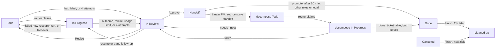

# Core architecture

## Session settings

Every session ensemble starts, agent runs and workers, loads your user settings with every plugin except `ensemble` (`[clients.<client>] flags` in `src/ensemble/session/config.toml`; OpenCode's plugin turns itself off: [OpenCode commander](#opencode-commander)): only a client you start, the commander, has `/ensemble:manage`. Each such session's client also carries `ENSEMBLE_AGENT_SESSION=1`, under which `ensemble-crew` `run`/`worker`/`reopen`/`issue`/`role`/`hold`/`resume`, `ensemble-session` `start`/`restart`/`resume`/`client-resume`, `ensemble-delegate` `run`/`resume` and `ensemble-orchestrator` `router`/`resume` exit 2 (their forms that start nothing, such as `--dry-run`, `--list` and `--brake`, still run), even run by a checkout's `bin/` path: a guard against slips, not isolation (`env -u` clears it). Agent runs load no MCP servers your Claude or Codex config names, user or project, so none can write past the outcome: `--strict-mcp-config` in `[policy.claude]`, `-c mcp_servers={}` in `[policy.codex]` (`src/ensemble/delegate/config.toml`; [Client policy](#client-policy)); workers keep them. A trusted cwd adds its project settings (`trusted_dirs` in `src/ensemble/delegate/config.toml`).

Codex sessions also start without its built-in browser, computer use, Apps and plugin suggestions, so a run cannot open a web page or a third-party service to act outside its outcome; web search, image generation, subagents and your own plugins stay. Checked against Codex 0.163.0, whose plugin ids can change with a release:

| Tool | Packaged `[clients.codex] flags` entry |
|---|---|
| Browser and Chrome (MCP server `node_repl`) | `-c plugins.<id>@openai-bundled.enabled=false`, `<id>` each of `browser`, `chrome`, `chrome-dev`, `chrome-internal` |
| Computer use (`node_repl`, `cua_repl`) | the same, `<id>` each of `computer-use`, `unified-computer-use` |
| Apps (`codex_apps` connectors, the browser connector among them) | `--disable apps` |
| Plugin suggestions, which can install a plugin | `--disable tool_suggest` |

The feature flags `browser_use`, `computer_use` and `in_app_browser` do not turn these off, and `--disable plugins` would turn off your plugins too. To get a tool back, drop its entry from a `[session.clients.codex] flags` list in `~/.ensemble/config.local.toml`: a local list replaces the packaged one whole, so copy the rest. Every launch reads this list, a resume and `client-resume` included, so a change reaches sessions started before it.

A Codex resume keeps the run's own flags (`[policy.codex]` in `src/ensemble/delegate/config.toml`) from its start, where Claude's takes the current ones. Codex's recovery state records each session's launch, its writable grants among them, and a resume replays that record rather than take new grants or a new run policy from its caller. The list above is read again because it is the client's own setting, not the run's; it refuses `--add-dir` and `--`, so it can neither widen a session's grants nor pass literal arguments.

In the commander's Claude Code session the plugin's mod always hides Monitor tool-call rows and notices, plus Bash tool-call rows whose command contains `ensemble-crew next-event` or `ensemble-crew ack`. Other tools, Bash commands and notices draw as usual; the model's content is unchanged. Ctrl+o shows Monitor notices; the hidden tool-call rows stay hidden.

`ensemble-crew next-event` (including `--follow`) exits 1 on a malformed complete event line and reports its file path and physical line number. Inspect the file with `pending`; reads never acknowledge handling. A final line without a newline waits until completed.

A commander under `ensemble-crew hold` gets a re-arm prompt at startup, resume, compact and clear. Claude Code uses Monitor. Codex uses Manual mode: run `ensemble-crew pending --content` at the beginning of every active turn before status reports or new launches; there are no idle notifications. Only a background tool whose runtime contract guarantees notifications to this conversation may run `attach`'s `next-event:` command, without `--follow`; after handling and acking each event, run `attach` again and use its newly printed command. A commander restarted outside its `hold`, or one giving `--manager` to each command without `hold`, gets no prompt. OpenCode uses Manual mode too ([OpenCode commander](#opencode-commander)).

After installing or updating the Codex plugin, open `/hooks`, review and trust the ensemble SessionStart command before relying on this prompt; installation alone does not trust plugin hooks. A changed hook definition needs review and trust again. [Codex plugin hooks](https://developers.openai.com/plugins/build/plugins#bundled-mcp-servers-and-lifecycle-hooks) describes this trust requirement.

## ensemble-session

`bin/ensemble-session --help` lists its subcommands. `ls` prints a header, then one tab-separated row per session: `name`, `state` (`working`, `done`, `blocked`, `dead`, `unknown` when its host could not tell), `client`, `sid`, `display`, with `-` for an empty value.

Sessions run on `[session.hosts] default`: `tmux`, or `docker` ([Docker host](#docker-host)).

`start --account NAME` (also `ensemble-crew worker`'s) runs a Claude session on a registered Claude account
([Docker host › Claude accounts](#claude-accounts)). Restart and resume keep the account; `--env
ENSEMBLE_ACCOUNT=…` and a `[delegate.policy.<client>] env` naming it are refused (exit 2).

`start --display none` starts a worker without a pane, still opened by the caller, and hidden. Hidden (from that, `hide`, or closing its pane by hand; not from losing the manager's window or detaching its viewer) lasts through `restart` and `resume` until `show`. A display's tmux pane starts at `[hosts] hidden_size` (`src/ensemble/session/config.toml`, default 80x24; its window a row taller when the pane has a border) and a hide sets it back to that until the next viewer sizes it; the tmux Host passes it to the guard as `--size`, the Docker Host in its launch handoff, for the time before any display connects ([Guard protocol](#guard-protocol)).

Text sent to a Codex, Claude or OpenCode tui session mid-turn joins that turn. Codex takes it at once; Claude queues it until the running tool returns; OpenCode until its current step ends, its answer in that turn's `done`. A notice Claude injects mid-turn, such as a background task's completion, joins it too. Text sent after a Claude turn ended starts a new turn. When the session has an events file, `ensemble-crew pending --content` and `next-event --content` print a Codex or Claude session's mid-turn replies, which the turn's hooks or, for an answer no hook follows, its session harness's pump (once a second) announce; reply text stays for 30 days.

A Codex or Claude turn that fails ends a role run's attempt at once. A usage limit stays a usage limit.

## Run limits

Set a client's simultaneous session limit in `~/.ensemble/config.local.toml`:

```toml
[session.clients.opencode]
max_runs = 1

[session.clients.claude]
max_runs = 3
```

`max_runs` is a whole number >= 0. Zero (the packaged default) or an omitted key means unlimited. The setting belongs to the session layer's `[clients.<client>]` table in `src/ensemble/session/config.toml`, and is removed before configuration reaches the client adapter.

Every `Session.start` shares admission for that client across processes using the same user state directory, regardless of caller, Host, mode, name or resume flag. Board runs, `router --issue`, ad-hoc role runs and crew workers all count. The check and start hold one client admission lock; a full client raises the existing `SessionError` before launching or recording a new session, naming the client, limit and holding names (session ids for unnamed runs). There is no capacity queue. Preflight, inspect and attaching to an existing session reserve nothing.

TUI sessions count while their client is alive, including `done` between turns and `blocked`; an unknown state keeps its slot. On Docker, a generation whose owner lock is free is dead and frees its slot once its container is stopped or, in a running container, its guard has exited (admission probes it); one whose guard is live or unprobeable keeps it until a sweep removes the container. Close a retained TUI when it should stop using capacity. Headless and in-process modes hold a lease until their mode ends or is stopped/closed, even when nobody reads events. A failed start releases its reservation once shutdown is confirmed; an unconfirmed TUI shutdown retains its reservation until matching Host inventory proves the client is gone. TUI ownership survives its launcher; transient leases belong to their caller process, or to its session harness for a harnessed headless run. An abnormal caller exit does not add a recovery protocol for orphaned children.

Admission checks all configured Hosts; an unavailable inventory fails closed. Shared TUI reservations from a Host configuration the caller does not have remain counted until a caller with the matching configuration confirms the session ended. Close the original session or retry using its original Host configuration to reconcile it. Changing an unrelated Host setting changes that configuration's identity, so close its sessions before changing its settings.

The orchestrator's [role limits](#operating-the-board) and usage gate remain separate. Direct client commands outside `Session.start`, including `client-resume`'s native client handoff, do not create ensemble sessions.

## Recall a closed run

`ensemble-crew close <ID>` ends a board run's sessions and drops its roster entry once each session's owner confirmed its end; its conversation stays. A failed close keeps the entry, exits 1 and appends one JSON line (`at`, `name`, `sid`, `ctl`, `reason`) to `~/.ensemble/managers/<manager>/close-failures.jsonl`. To continue it:

```sh
ensemble-crew reopen [--work-dir <work_dir>] <ID> [--display D]
```

It reads the run record, `<work_dir>/work/<ID>/run/delegate.json` (`--work-dir` only when the board's `work_dir` is not `~/.ensemble`), and resumes its session id as worker `<agent name>` on the run's Host, client and cwd, its Claude account the session's choice ([Claude accounts](#claude-accounts)): a Docker run comes back in a new container with its client history and [workspace volume](#workspace-volumes). The worker is tracked like any other; `ensemble-crew close <agent name>` ends it. It brings back the conversation, not the run: where its start is owned (every built-in client's tui, on tmux or Docker), it runs under a [session harness](#session-harness) of its own with no handlers, so its events are only logged: no outcome or write-back, and the board is untouched. A conversation known only by its session id: `ensemble-crew worker <name> --resume <sid> --client <client> --cwd <cwd> [--host <host>]`.

These do not recall it:

- `ensemble-crew resume <ID>` resumes roster entries only, and `close` removed it: `not in roster; a closed issue run: ensemble-crew reopen --manager=<manager> <ID>`.
- `ensemble-orchestrator resume <ID>` continues an interrupted run only; a run with an outcome prints its Record, starts nothing and says so on stderr.
- The run comment's `ensemble-session client-resume …` runs the client on this machine, outside ensemble; a Docker run's history is not there.

`reopen` fails when:

- the issue finished and prune cleaned it: prune deletes the run's agent files, its cwd among them, at once ([State cleanup](#state-cleanup)), and the run record 7 days later;
- `work/<ID>/run/delegate.json` is gone (pruned, or deleted by hand): `no run record` (exit 1);
- the run, or a session holding its session id, is still alive, or its liveness is unknown (a status or the session listing failed): exit 2; close it first, or `ensemble-crew forget` an entry whose work is gone;
- its client history is gone: a Docker run's is in `~/.ensemble/docker-state/<agent name>/` (`no native history to resume`). A removed workspace volume comes back empty.

`reopen` brings back the issue's latest run; an earlier run's conversation: by its session id, above.

To check a recall, from the commander's `ensemble-crew hold` shell (elsewhere add `--manager <manager>` to each `ensemble-crew` command): close a finished dummy-tester run with `ensemble-crew close <ID>`, run `ensemble-crew reopen <ID>`, then `ensemble-session ls` shows `<agent name>` with the run's sid, and `ensemble-session send <agent name> 'What was your input?'` gets an answer from the earlier conversation (`ensemble-session read <agent name>`).

## Client policy

Role runs' client flags are `[policy.<client>]` in `src/ensemble/delegate/config.toml` (`[policy.claude]`, `[policy.codex]`; none packaged for OpenCode, so none unless a local `[delegate.policy.opencode]` sets them), after the session's `[clients.<client>] flags` and permission mode. Their system-prompt flag (`--append-system-prompt`, Codex's `developer_instructions`) tells a role run its final reply is the outcome block alone; OpenCode has no such flag, its config being the session's. A local list replaces the default whole: copy that flag into it, and the MCP one.

A Codex launch fails, naming the file, when a config layer is unreadable or invalid, or names an MCP server outside `[A-Za-z0-9_-]`: rename it. Servers defined by a `-c` flag, bundled in your Codex plugins, or managed by MDM still load. Turning a plugin off also drops its skills.

A role run's TUI turn end without an outcome gets one nudge, and later ones count toward giving up. Claude Code waits for reported background work; Codex reports none.

A Claude or Codex session's `client-resume` (its resume command, on this machine, in `auto` mode) replays its launch, these flags included. Codex's replays its snapshot, the config flags of its launch with them. Claude's replays the run's flags (`--strict-mcp-config`, the system prompt), Access (setting sources and the `--mcp-config` beside them, dirs, allowed tools), model, effort, name and env with this machine's current `[clients.claude] flags` and `allow`, since it runs here, not on the launch's Host; it opens the TUI without ensemble's hooks, which serve only an ensemble session.

Every session, crew workers and role runs, gets one permission mode from the Host it runs on: an `isolated` Host (`[hosts.docker] isolated = true`) `yolo`, every other Host `auto`. Each mode's flags are the client's, in `[clients.<client>.modes]` in `src/ensemble/session/config.toml`, the only home of permission flags; a start, restart and resume each get the mode of the Host they run on, and `client-resume` (this machine) `auto`:

| Client | `auto` | `yolo` |
|---|---|---|
| Claude | `--permission-mode auto` | `--dangerously-skip-permissions --settings '{"skipDangerousModePermissionPrompt": true}'` (no first-start dialog) |
| Codex | `-s danger-full-access -c approval_policy="on-request" -c approvals_reviewer="auto_review"` | `--dangerously-bypass-approvals-and-sandbox` |
| OpenCode | none: its config's `permission.bash = "ask"` asks for every shell call but the run's pre-approved commands; headless refuses the call, the TUI shows the ask and the session is `blocked` | `--auto`, plus backend `allow` for `bash`, `read`, `external_directory` and `doom_loop`; edit denies stay |

OpenCode's pre-approved commands match a command's text without its redirections, so an allowed `git status` also allows `git status > <file>`. An OpenCode run edits only its cwd and Access dirs, never `.git` or OpenCode's own config, and reads its Access reads without editing them; a refused call does not end its turn. External-directory grants cover both supplied symlink paths and resolved targets, so installed-plugin tasks under `~/.ensemble/links/` remain readable; read-only edit denies cover both spellings. Write-directory edit grants remain resolved-only: use the resolved path for writes through a supplied directory alias. OpenCode matches these paths case-sensitively: on a case-insensitive disk (macOS's default) only `.git` is denied in every spelling, so `OPENCODE.JSON` or a read dir spelled in another case stays editable, and its `apply_patch` tool (models named `gpt-…`) checks only a moved file's source.

`yolo` asks for nothing: no permission prompt, approval or sandbox; the container is the boundary ([Docker host](#run-workers)). OpenCode approves tools at the backend, so toggling its TUI approval mode cannot restore those prompts; question dialogs still wait for an answer. When the selected OpenCode mode includes `--auto`, permission requests emit no `blocked`; questions still do, as do permission requests in modes without `--auto`. Claude refuses it as root; the container's clients run as `agent`. `danger-full-access` ignores writable roots and team dirs; a Docker container cannot run Codex's sandbox ([Permissions](#run-workers)). For `workspace-write` outside the Docker Host:

```toml
[session.clients.codex.modes]
auto = ["-s", "workspace-write", "-c", 'approval_policy="on-request"', "-c", 'approvals_reviewer="auto_review"', "-c", "sandbox_workspace_write.network_access=false", "-c", "sandbox_workspace_write.writable_roots=[]"]
```

## Credentials

Every credential ensemble uses. `<B>` is `/usr/local/libexec/ensemble/ensemble-broker`; the logins and their dialogs:
[Docker host › Log in](#broker-logins); what a container gets: [Docker host › What a container
gets](#run-workers).

**Three-way readers**: a credential the broker hands to a container (the Claude setup-token copy, GitHub installation
tokens, the Codex access token, OpenCode provider API keys, environment secrets) can be read by the broker, by every
process in that container, and by any process running as the user: `<B> start --manifest <file>` does not check its
caller, and the Docker socket is the user's, so such a process can start a container or `docker exec` into one and
read `/run/ensemble/secrets/`. The App private key, Codex refresh token and enrolled Linear client secrets stay with
the broker; a provider API key or an environment secret is the same long-lived value in every container that lists
it. Each container copy is 0400 on the container's tmpfs and goes with the container.


| Credential | Host | Purpose | Stored at | Readers | Lifetime | Revoke |
|---|---|---|---|---|---|---|
| host `gh` login | `tmux`; the orchestrator and manager on either | target-repo check, docs fetch, duplicate search; the Delegate's ready gate (`gh pr ready`, `--undo`, Actions job and workflow-run reads); `repo.py`; the manager's PR reads. Push and PR rights on every target repo: a classic token needs `repo`, `read:org`, `gist`; a fine-grained one also Actions read | the system credential store, else a plain-text file (`gh auth status` says which) | any process running as the user; never a container | until revoked | github.com › Settings › Applications › GitHub CLI › Revoke access (every token gh made); `gh auth logout` is local only |
| Claude Code login | `tmux` | the user's own Claude Code: `claude`, then `/login` | macOS Keychain; `~/.claude/.credentials.json` (0600) if the Keychain refuses the write | Claude Code and any process running as the user the Keychain lets read it | refreshed by Claude Code | `/logout` |
| Claude setup-token | Docker | a container's Claude Code, model requests only: `claude setup-token` in each [account](#claude-accounts)'s subscription, pasted into `<B> login claude [<name>]` | `ensemble-broker-claude` / account name; copy `/run/ensemble/secrets/claude`, given to the client only as `CLAUDE_CODE_OAUTH_TOKEN` | item: the broker; copy: three-way | one year; starts refused past a known expiry ([Static secret expiry](#broker-logins)) | no documented route; on a leak, `claude setup-token` again and rerun `<B> login claude [<name>]` |
| Codex login | `tmux` | the user's own Codex: `codex login` | `~/.codex/auth.json`, or the OS store per `cli_auth_credentials_store` | Codex and any process running as the user | refreshed by Codex | `codex logout`, locally |
| Codex login | Docker | a container's Codex: the broker's own ChatGPT login, `<B> login codex` ([Codex](#broker-logins)) | full login, refresh token included: `ensemble-broker-codex` / `auth`; copy, access token only: `/run/ensemble/secrets/codex/auth.json` | refresh token: the broker, but during `login codex` and each renewal the full login sits in a 0700 temp dir under `/private/tmp` (a SIGKILL or host failure leaves it) that any process running as the user reads; copy: three-way | access token renewed 10 minutes before it expires; refresh token undocumented | no documented route; rerun `<B> login codex`, or delete the item |
| OpenCode provider API key | `tmux` | OpenCode's requests to a `[session.clients.opencode.providers.<name>]` provider: `opencode auth login` ([OpenCode sessions](customizing-roles-and-tasks.md#opencode-sessions)) | OpenCode's `auth.json`; ensemble reads its selected API entry for availability probes and broker import | OpenCode and any process running as the user | until the provider revokes it | at the provider; `opencode auth logout` removes it locally |
| OpenCode provider API key | Docker | the same, from a container | `ensemble-broker-opencode` / `<name>`; copy `/run/ensemble/secrets/opencode/<name>.key`, read through `{file:…}` in OpenCode's inline config, never env or argv | item: the broker; copy: three-way; on the network, anyone between the container and an `http://` `base_url` | until the provider revokes it, or its `--expires` date | at the provider, then `<B> login opencode <name>` with a new key; running containers keep the old copy until closed |
| GitHub App private key | Docker | signs the 9-minute JWT that issues installation tokens; one private App, installed only on repos agents may push to ([Create the GitHub App](#create-the-github-app)) | `ensemble-broker-bot` / App ID, from `<B> login github ensemble-broker-bot --key-file <pem> --app-id <ID>`; then delete the `.pem` | the broker; an item made otherwise trusts `/usr/bin/security` until that login; a `.pem` left on disk: any process running as the user | until deleted in the App's settings | generate a new key and delete the old in the App's settings; `security delete-generic-password -s ensemble-broker-bot`, then the login with the new `.pem` |
| GitHub installation tokens | Docker | git (credential helper) and `gh` (a wrapper setting `GH_TOKEN` for its own process) in a container: one per installation, covering every repo of it, with `[session.hosts.docker.github] permissions`; a [prefetching](#environments) run's container: one, its `github` output repo alone, `contents: write` | copy `/run/ensemble/secrets/github/<owner>` only; the broker keeps none | three-way | 1 hour; renewed 10 minutes before the first expires | `close` reads each from the container and revokes it before removing the container; its audit lines come from the container's own files, so they show what close attempted, not proof that every issued token was revoked. A token `maintain` replaced, or in a container gone without `close`, expires within the hour; a failed revocation is logged `unrevoked`, never retried |
| GitHub prefetch token | Docker | one [prefetch](#environments) clone, `contents: read` on that repo alone | the helper's tmpfs `HOME` only | the broker; the helper container's processes and any process that can `docker exec` into it, during the clone | until the helper exits, at most 1 hour | revoked when the helper exits, never stored; a failed revocation is logged `unrevoked` and the token expires within the hour |
| environment secret | Docker | whatever a container's tools use it for ([Environment secrets](#environments)); issue one for ensemble alone | `ensemble-broker-env/<name>` / `<name>`; copy `/run/ensemble/secrets/env/<file>` | item: the broker; copy: three-way, and any process running as the user can start a container listing any `ensemble-broker-env/*` item | until replaced or deleted, or its `--expires` date | rotate it at its source, then `<B> login env <name>`; `security delete-generic-password -s ensemble-broker-env/<name>` deletes it; running containers keep the old copy until closed |
| Linear harness app | host | router, promote, prune, a run's issue read and run comments; scopes `read,write` | client secret: `linear.harness.secret_service`; token and expiry (`{"access_token", "expires_at"}`): `linear.harness.token_service`; Client ID `linear.harness.client_id`, app user `linear.harness.user_id` | [Keychain items](#keychain-items) | token 30 days | transport: rotate the client secret in Linear › Settings › API › Applications (revoking every token of the app), `security add-generic-password -U -s <secret service> -a <secret service> -w` with the new one, then `security delete-generic-password -s <token service>`; broker: [Linear broker renewal](upgrading.md#linear-broker-renewal) |
| Linear manager app | host | the `ensemble-orchestrator issue` commands; scopes `read,write,app:assignable` | as the harness's: `linear.manager.secret_service`, `linear.manager.token_service`, `linear.manager.client_id`, `linear.manager.user_id` | [Keychain items](#keychain-items) | token 30 days | as the harness app's |
| Linear role apps | host; requested Docker runs |  role write-back: comments, state moves, subscriptions, attachments, retitles; scopes `read,write,app:assignable,app:mentionable` | `linear.roles.<role>.secret_service`, `linear.roles.<role>.token_service`, with `client_id` and `user_id` | [Keychain items](#keychain-items) | token 30 days | as the harness app's |
### Risks

Beside [Docker host › Risks](#docker-risks):

- **Three-way readers** of handed-out credentials: accepted by the user on 2026-10-18; the broker is unchanged.
- Transport-owned Linear client secrets and every published Linear access token trust `/usr/bin/security`: any process
  running as the user reads them without a dialog. Enrolled client secrets trust only the broker.
- Config picks a Docker Claude session's account ([Claude accounts](#claude-accounts)); it is no access
  control: any process running as the user can start a container with any logged-in account.
- An environment secret reaches whoever can start a container: any process running as the user can list any
  `ensemble-broker-env/*` item in a manifest and read the copy.
- `<B> probe-provider --provider NAME --base-url URL` does not check its caller either: any process running as the
  user can have the broker send a provider's stored API key to an endpoint it chooses.
- Neither the setup-token nor the Codex login has a documented upstream revocation.

## OpenCode commander

A commander can run in OpenCode 1.x (checked against 1.19.3), with ensemble's `plugin` entry in `~/.config/opencode/opencode.json` ([Install](../README.md#install); upgrading it: [Upgrading › OpenCode plugin by hand](upgrading.md#opencode-plugin-by-hand)), or a checkout's `"plugin": ["file://<checkout>/.opencode-plugin/ensemble.js"]`. `opencode plugin` installs npm packages only. Start `opencode` in the `ctmux` shell, then run `/ensemble:manage`.

The plugin adds:

- `/ensemble:act-as`, `/ensemble:board` and `/ensemble:manage`: commands with the corresponding skill text.
- this plugin's `bin/` first on the shell tool's `PATH`.
- the SessionStart re-arm ([Session settings](#session-settings)): for a commander under `ensemble-crew hold`, a prompt at startup, resume and after compaction. Sub-agent sessions get none.

It turns itself off, adding nothing, under `ENSEMBLE_AGENT_SESSION`: an OpenCode worker or role run on the tmux Host loads your global `opencode.json`, and `[clients.opencode] flags` cannot turn a plugin off.

Limits:

- Manual monitoring only (`/ensemble:manage` › Start): OpenCode has no Monitor, and its shell tool has no background mode and no completion notification. The commander reads events with `ensemble-crew pending --content` at the start of each active turn; nothing wakes an idle commander.
- The skills' `allowed-tools` and `disable-model-invocation` mean nothing to OpenCode: its own `permission` settings decide which commands ask. The three are commands, never skills the model loads itself.
- No mod hides the `ensemble-crew` tool calls.

## Board

The orchestrator runs the core from a board, chosen by `[orchestrator] tracker`: `"local"` (the default), a [local board](#local-board) of Markdown files, or `"linear"`, a Linear board.

### Board setup

[`scripts/install.sh`](../README.md#install) offers no Board (`--no-board`, the first-run default), a local board (`--board local`) or Linear (`--board linear`), and separately the router and promote launchd jobs (`--launchd`, `--no-launchd`; either without Board exits 2). Local never asks for Linear credentials. Linear asks for each transport-owned harness, manager and role app's Client ID and hidden client secret, stores them in Keychain, reads the team, states, labels, members and projects, and shows the config it fills; apps with [`renewal = "broker"`](upgrading.md#linear-broker-renewal) use the broker's published tokens instead. Reruns keep both choices and skip completed setup. `scripts/install-cleanup.sh` removes only what the installer created; a non-empty board directory stays.

By hand (macOS; the orchestrator runs this checkout's scripts; `<work_dir>` is `orchestrator.work_dir`):

1. Create `~/.ensemble/config.local.toml` from the `# local:` lines of each packaged `config.toml`, each under its layer's section, researcher's, pm's and verifier's `[output]` included. With `tracker = "linear"`, a required `[orchestrator.linear]` key left `""` stops every `ensemble-orchestrator` command:

   ```toml
   [orchestrator]                         # the tracker
   tracker = "linear"

   [delegate.roles.engineer]              # run settings
   tier = 2

   [orchestrator.roles.engineer]          # board settings
   max_runs = 1

   [orchestrator.linear.roles.engineer]   # Linear settings: its app
   client_id = "<engineer Client ID>"
   secret_service = "linear-app-engineer-secret"
   token_service = "linear-app-engineer-token"
   user_id = "<engineer app user UUID>"
   ```

2. Create the Linear presets, apps and Keychain items the keys above name, and fill their configuration: [Linear presets](upgrading.md#linear-presets).
3. Dry-run each job: `bin/ensemble-orchestrator router --dry-run`, `bin/ensemble-orchestrator promote --dry-run`.
4. Install the launchd jobs (router at :00 and :30, promote every 5 min); the plists hard-code this checkout's path and `~/.ensemble`:

   ```bash
   mkdir -p ~/.ensemble/logs   # launchd can't start a job without it
   for job in router promote; do
     launchctl bootout gui/$(id -u)/com.windroc.ensemble.$job 2>/dev/null   # fails harmlessly if none is loaded
     sed -e "s|@HOME@|$HOME|g" -e "s|@PATH@|$PATH|" \
       launchd/com.windroc.ensemble.$job.plist \
       > ~/Library/LaunchAgents/com.windroc.ensemble.$job.plist   # needs ctmux --install's ~/.ensemble/bin
     launchctl enable gui/$(id -u)/com.windroc.ensemble.$job
     launchctl bootstrap gui/$(id -u) ~/Library/LaunchAgents/com.windroc.ensemble.$job.plist
   done
   ```

   Uninstall a job: `launchctl bootout gui/$(id -u)/com.windroc.ensemble.<job>`, then remove its plist.

Document roles' `[output]` goes in `[delegate.roles.<role>.output]` (or `[orchestrator.core.roles.<role>.output]` for board runs only); an overlay replaces the whole table. `type = "github"` roles share `host` (default `github.com`), `repo` and `branch`, each with its own `dir`; `type = "local"` saves each run to `<work_dir>/docs/<role>/document-<issue>-<sid>.md`, referenced by `file://` and readable only on the board host. A build role's target host is its output's `host`, else the GitHub document host, else `github.com`; authenticate `gh` for each host. `[orchestrator.local_clones]` maps `"acme/app"` (or `"host/acme/app"`) to a clone.

### Using the board



Failure edges show the packaged defaults.

- **New work:** a Todo issue in the product's project, delegated to a role app (Linear's Agent field); the description is the brief. Add `Repo: <owner>/<name>` unless the project's `[orchestrator.linear.project_repos]` entry names it. The router claims by priority, then later role, then oldest; a blocked issue waits for its blockers to be Done, Canceled or Duplicate. On first claim it lists possible duplicates under `## Related work` in the agent's input, and inlines linked configured documents up to 50,000 bytes.
- **Approve:** move to Handoff and comment what's next; after 10 minutes promote creates the next role's issue. Linear PM handoffs create one engineer issue with the configured `decompose` task label; the PRD stays in Handoff. Other promotions, including local PM handoffs, mark the source Done.
- **Revise:** comment and move back to Todo; the agent resumes. An engineer issue's PR comments and reviews count too. After 4 attempts the issue goes to In Review; moving it to Todo restarts the count.
- **Who counts as you:** every Linear user but the harness and role apps and automation; the manager's app counts as you. Your comments are instructions: keep the team's membership and guest access tight.
- **Runs without an outcome** are written back as failures with the reason; a stopped or interrupted attempt stays In Progress for Recover.
- **Finish:** set Done, Canceled or Duplicate. On its next tick for Canceled or Duplicate, 2 hours later for Done, prune closes the run, removes its Docker workspace volumes, deletes its `agent/` dir and pushed branches, and archives the issue (Done only for pm or engineer issues; never while a sub-issue would stay); 7 days later it deletes the issue's workdir. An issue left in another state but Todo or In Progress for 7 days loses its checkouts and temp files (`agent/src`, `agent/publish`, `agent/tmp`). Uncommitted and unpushed work is lost.

### Task labels

A `Tasks` group label picks the role's task, mapped by `[task_labels]`; none: the agent picks and says why; a bad label sends the issue to In Review. To upgrade a report (Light Research → Research → Deep Research), set the next task's label (to Research: remove the label), comment the claims to verify, and move it back to Todo. `[orchestrator.task_tiers]` sets a task's model tier (`light-build = 3`, 1 the strongest).

Engineer `decompose` receives the source handoff, linked PRD, its own comments and project-to-repo mapping without a build target or branch. Its local output saves the ticket table to `run/out.md`; the host posts it on the decompose issue and completes the source PRD, then decompose. Missing output or source, or a source moved out of Handoff (unless already Done), leaves completion retryable. `needs_input` moves only decompose to In Review with questions and the configured human assignment; failure inherits the engineer stage's `first_failure` rule. Resume and write-back use the first run's recorded task. Ordinary build input, PR delivery and review states stay unchanged.

### Operating the board

```bash
bin/ensemble-orchestrator router --issue <ID>         # run one issue now, skipping role limits and usage gates
bin/ensemble-orchestrator router --issue <ID> --tui   # the same, attended in a TUI
bin/ensemble-orchestrator status <ID>
bin/ensemble-orchestrator attach-command <ID>
bin/ensemble-orchestrator close <ID>                  # the issue stays In Progress for Recover
bin/ensemble-orchestrator resume <ID>
```

`--help` lists each command's options; issue operations: `/ensemble:board` ([skills/board/SKILL.md](../skills/board/SKILL.md)). Keep `<work_dir>/logs/runs.jsonl`: deleting it breaks resume, Recover, write-back and the first-claim search. Router events go to `<work_dir>/logs/orchestrator.jsonl`. The commander needs no Linear MCP server (`/ensemble:board` replaces it): in the project you run it from, `/mcp` › the Linear entry › **Disable** turns it off there only. Move an issue out of In Progress before opening its session, or the router may resume it after 30 idle minutes.

Board role limits: `[orchestrator.roles.<role>] max_runs` (packaged 3 for researcher, pm and engineer), counting live runs in `runs.jsonl`; client limits are the session's ([Run limits](#run-limits)). For a client without a usage dashboard set `[orchestrator.usage_limit] <client> = "off"`. A host usage probe failure stops the tick with exit 2.

### Agent label

Copy `[orchestrator.linear]`'s `agent_label_group` and `[orchestrator.linear.agent_labels]` (one line per client, with label ids) from the `# local:` examples in `src/ensemble/orchestrator/config.toml`. No Agent label: the role's default client; one mapped label: its client; several or an unmapped one: a comment and In Review. `router --dry-run` prints each candidate's `client` and `client_source`.

An `OpenCode` label runs OpenCode, on the host's Ollama (live-test issues only) or a configured provider; it needs the [Docker host](#docker-host) ([Run workers](#run-workers)), the provider's egress exception ([OpenCode on Docker](#opencode-on-docker)), and for an engineer run the GitHub App on the target repo ([Create the GitHub App](#create-the-github-app)).

### Local board

`$ENSEMBLE_BOARD_DIR` (default `~/.ensemble/board/`) is one board; boards never sync. The router, `promote`, `prune` and `ensemble-orchestrator issue` run on it by the Linear rules above; without launchd jobs run `ensemble-orchestrator promote` (it prunes too) once an approved issue's 10-minute undo window has passed. Create the first issue with `ensemble-orchestrator issue create --title "First issue" --body-file <file>` (`LOC-1`; `[orchestrator.local] issue_prefix` picks another prefix).

```text
<board>/
├── .next-id                 the next issue number
├── .lock                    the board lock
├── .state/                  logs/ and work/<ID>/, in place of <work_dir>
├── unassigned/<state>/      assigned to no one
├── me/<state>/              assigned to you
├── <role>/<state>/          assigned to a role
└── archive/                 archived issue files, flat
```

`<state>`: `backlog`, `ready`, `running`, `review`, `approved`, `done`, `canceled`. A file's directory is its assignee and state: moving it from `review/` to `approved/` approves it, to `ready/` revises it. An issue file:

```markdown
---
id: LOC-12
title: "ENG: Session registry"
task: light-build
client: claude
priority: 2
created: 2026-10-19T14:02:00-04:00
blocked_by: [LOC-10]
related: [LOC-7]
parent: LOC-5
---

### Description
Repo: <owner>/<name>
Add a session registry.

### Comments

#### other · 2026-10-19 14:05
Read LOC-7 first.

###
My new comment.

### History
- 2026-10-19 14:02 ready other
```

`id`, `title` and `created` are required; `priority` 0 none … 4 low; `task` and `client` act as the Tasks and Agent labels. Comment by adding a `###` line at the end of Comments and your text below it. Only `<role>/ready/` issues are queued: one in `unassigned/` or `me/` never runs. A board file that cannot be read stops the router with `router.py: <path>: <reason>`, exit 2. A `dependency-cycle` diagnostic names a `blocked_by` cycle: remove its links. A `launch-error` (an issue's client missing or not executable) moves the issue to `review/`: fix the client choice or installation, then move it to `ready/`.

### State cleanup

ensemble keeps its state in `~/.ensemble/` (`work/` and `logs/` in `<work_dir>`, or `<board>/.state/` on a local board).

| Entry | Safe to delete by hand |
|---|---|
| `config.local.toml`, `logs/runs.jsonl`, board issue files and `.next-id`, `docker/worker/` | never |
| `work/<ID>/agent/` | no: prune also drops its worktrees, pushed branches and Docker workspace volumes |
| `work/<ID>/run/`, `work/<ID>/writeback.json` | once you won't resume or recover the run |
| `logs/orchestrator.jsonl`, `logs/prune.json`, `probe/`, `bin/`, `hidden/<name>.json` | any time (keep `logs/`) |
| `logs/router.lock`, `logs/router-starts.lock`, `logs/router/`, `board/.lock` | while no router runs, no program writes the board |
| `sessions/`, `workers/<sid>/`, `docker-state/<name>/` | once you won't restart or resume that session |
| `tui/<name>/` | no: closing the session removes it |
| `tui/<name>.lock` | while no session of that name starts or closes |
| `managers/<name>/` | while no manager holds it; its Roster is lost |
| `adhoc/` | a folder whose run is not running (`ensemble-delegate status <dir>`) |

## Docker host

`ensemble-broker` builds the worker image and starts and closes worker containers on macOS (Apple silicon) with Docker Desktop. It keeps the logins and the GitHub App key in the login keychain and delivers container credentials into tmpfs; Linear tokens also have protected host revocation records. `B` below is `/usr/local/libexec/ensemble/ensemble-broker`; `PKG` the installed ensemble plugin directory. Run every step as yourself.

### Docker install

`scripts/install.sh --docker` installs and starts Docker Desktop, the [egress proxy](#egress-proxy) and the broker, and runs the logins. By hand, with Docker Desktop running and `gh` logged in: `sh "$PKG/src/broker/install.sh"` (`--build` builds locally; needs Go and the Xcode command line tools). It installs the release's broker root-owned only when it matches its sha256 and the plugin's broker protocol, and seeds `~/.ensemble/docker/worker/Dockerfile` (your image, edit freely) if absent. To upgrade, rerun it, then `"$B" retrust`: a new broker build must re-trust each `ensemble-broker-*` keychain item (the login keychain password once; an item a broker of v0.4.1 or earlier wrote needs one Allow dialog). Docker Desktop file sharing must include `~/.ensemble/docker-state`.

### Egress proxy

Workers reach the network only through the `egress-proxy` container (private `windroc-labs/egress-proxy`, pinned, under `~/.egress/current`; config `~/.egress/config.local.yaml`, created by the installer with a `workers` network in denylist mode). It allows public destinations and denies private ranges, the Mac and LAN, `host.docker.internal` included, unless a `host:port` is in `networks.workers.exceptions`; each exception holds for every worker. `config.example.yaml` in the installed version defines the config, `networks.workers` included. Add the Mac's public IPv4 and global IPv6 prefix to `deny_ranges`.

| Operation | Command |
|---|---|
| Start; apply a config change | `~/.egress/current/start.sh` (before a first install, `scripts/install.sh --docker`) |
| After the Mac changes networks | `docker restart egress-proxy` |
| Health | `docker ps --filter name=egress-proxy`; `docker inspect --format '{{json .State.Health}}' egress-proxy` |
| Errors | `docker logs egress-proxy` |

A start without a healthy proxy fails `egress_unavailable` (exit 17): run `start.sh`, wait for `(healthy)`, then start, restart or resume again. A proxy restart breaks connections on every caller network.

### Broker logins

| Login | Stores |
|---|---|
| `"$B" login claude [<name>] [--fresh-token \| --issued <date> \| --expires <date>]` | a `claude setup-token`, pasted, for the `default` or a named [Claude account](#claude-accounts) |
| `"$B" login github ensemble-broker-bot --key-file <key>.pem --app-id <App ID>` | the [GitHub App](#create-the-github-app)'s private key (delete the `.pem` after); it prints the App slug for `[session.hosts.docker.github] app` |
| `"$B" login codex` | a Codex browser login; first `sudo "$B" install-codex <version>` (≥ 0.163.0; `update-codex` to update) |
| `"$B" login opencode <name> [--auth-file <auth.json>]` | each `[session.clients.opencode.providers.<name>]` API key (Ollama needs none) |
| `"$B" login env <name> [--expires <date>]` | an environment secret, 1–16384 bytes (pipe a long value) |

What each login hands a container: [Credentials](#credentials). Only a login or `retrust` shows a keychain dialog; a start that cannot read an item names the login or `retrust` to run. Claude tokens, OpenCode keys and environment secrets are static: the broker records their expiry, gives notices 30, 7 and 1 days before, and refuses a start with an expired one (`login_required`, exit 5). `"$B" status` lists credentials and static expiries. Every `start` and `close` is logged to `~/Library/Logs/ensemble/broker.jsonl`, never a secret.

### Create the GitHub App

`scripts/install.sh` does not create it. In GitHub › Settings › Developer settings › GitHub Apps › New GitHub App:

1. Owned by you, installable **Only on this account** (private): every session gets a token for every repo it is installed on.
2. Webhook off.
3. Repository permissions: Contents, Pull requests and Workflows **Read and write**; Checks, Actions, Commit statuses and Metadata **Read-only** (at least `github.permissions`).
4. Note its **App ID**, then **Generate a private key**.
5. **Install App** on only the repositories agents may push to, your docs repo included.

Then run `login github` ([Broker logins](#broker-logins)).

### Worker image

`"$B" build --ensemble "$PKG" [--base-image IMAGE] [--plugin SOURCE]... [--image-plugin NAME]... [--max-age SECONDS]` builds `ensemble-worker:<key>` from `~/.ensemble/docker/worker/Dockerfile` plus ensemble, the clients and plugins; starts build as needed. Each build pins Claude Code, Codex and OpenCode at their npm `latest`; an hourly detached `check-clients` rebuilds when one moves, and running workers keep theirs. A Claude Code or Codex your Dockerfile installs is never run.

#### Plugins

`[session.hosts.docker] plugins` lists the plugins each container's Claude Code and Codex install; the packaged default (`src/ensemble/session/config.toml`) pins updraft; `[]`: none. An entry is `name@plugin-owner/repo#commit::marketplace-owner/repo#commit`, both commits full 40-hex SHAs, or `name@marketplace-owner/repo#commit` for a self-contained marketplace. To upgrade one, review the target commit, set the pin (a local list replaces the packaged one whole), rebuild with `"$B" build --ensemble "$PKG" --plugin '<entry>' --max-age 0`, and check the build logs report that commit for both clients. OpenCode finds the same skills through `skills.paths`. The image never installs ensemble's own plugin; on the tmux Host, OpenCode has no `/updraft:*` commands.

#### Base images

`--base-image IMAGE` builds on a local image (never pulled) in place of `~/.ensemble/docker/worker`. It needs `apt-get` and `dpkg`, `node` and `npm`, `tmux` and `git`, and a non-root user `agent`; labels starting `windroc.` or `ensemble.` are refused. Tag your base images, or removing older images can delete them. An amd64-only base image needs Rosetta (`softwareupdate --install-rosetta`, then Docker Desktop › Settings › General › **Use Rosetta for x86_64/amd64 emulation on Apple Silicon**); Rosetta cannot be uninstalled. `--image-plugin NAME` adds a Claude Code plugin the image holds at `/opt/windroc/plugins/NAME/`. A base image is trusted like your Dockerfile.

### Run workers

```toml
[session.hosts]
default = "docker"   # role runs: the client in a container, their drive a local process on the host
```

`[session.hosts.docker]` keys: `docker` (the CLI, default `/usr/local/bin/docker`), `plugins`, `github.app` (the App slug; `""`: none), `github.permissions` (each token's permissions) and `isolated` (`true`: yolo mode, the container the boundary; `false`: auto mode). Then `ensemble-crew worker NAME --client claude|codex|opencode` starts NAME in its own container; the other verbs and the Viewer work as on tmux. Each start, restart or resume runs a new container from the current image; restart and resume keep the client history, a new start empties its client state dir, and all keep the [workspace volume](#workspace-volumes); `ensemble-session resume <name>` (never `client-resume`) continues a conversation. A container gets user `agent` with all capabilities dropped, no Docker socket, only its egress network, a workspace volume at cwd, credentials on tmpfs and, with GitHub configured, the App's bot identity; each checkout runs its own `.githooks/`.

Start reads the three build-verified client versions from image labels. One exec checks image content and bootstraps client state as `agent`; an optional separate root exec installs the hook. One credential exec delivers all client credentials, environment secrets and GitHub owners' tokens through stdin, confirming only completed writes. Providers return owned commands; the launcher erases their buffers and keeps the Codex account lock through delivery and expiry publication. Preparation failures deliver nothing; later failures revoke issued GitHub tokens and roll back the container. Each startup stage retains its own failure message.

Docker role runs refuse host `read`/`write` dirs, a role `cwd`, custom `team_dirs` roles and multiple or non-GitHub target repos. An engineer opens its draft PR as the App's bot.

#### Claude accounts

A Docker Claude session runs on one account: `default` unless the session selects another. Register more in `~/.ensemble/config.local.toml`, then `"$B" login claude work`:

```toml
[session.clients.claude.accounts.work]
dir = "~/.claude-work"   # its CLAUDE_CONFIG_DIR on the host, for the usage probe
account = "me@work"      # a display string
```

Selection is the session's alone: `ensemble-crew worker NAME --client claude --account work` for one worker, `[session.clients.claude] account = "work"` for every start that gives none; role and board runs take no account of their own (the delegate and orchestrator accounts tables are gone: [upgrading](upgrading.md#claude-account-selection-is-the-sessions)). With none selected and two or more registered, a start picks the account with the most usage left, under the usage-gate thresholds first (readings cached 5 minutes); the usage gate skips Claude runs only when every account is over (with an `account` fixed, when that one is). The probe reads an account's `dir`, not the setup-token its runs get, so a run that hits a usage limit holds its account over until that limit's reset (unknown: 5 hours; at most 7 days), unprobed, in `~/.ensemble/usage/claude-holds.json`. A start prints the account it picked to its harness log (`~/.ensemble/harness/<32 hex>/harness.log`). On tmux a selection is checked, then ignored.

#### OpenCode on Docker

OpenCode runs the host's Ollama models or a configured provider ([OpenCode sessions](customizing-roles-and-tasks.md#opencode-sessions)); provider keys come from `login opencode`. Add each local or LAN provider's `host:port` (Ollama: `host.docker.internal:11434`) to `networks.workers.exceptions` in `~/.egress/config.local.yaml`, then run `~/.egress/current/start.sh`; the installer does not. Host-side `probe-provider` bypasses the proxy, so it can pass while a worker still lacks its exception; Docker may also need macOS Local Network permission. An `http://` `base_url` sends the key in plaintext. Once, on the Mac: keep Ollama on `127.0.0.1`, set `OLLAMA_CONTEXT_LENGTH` to at least 65536 (`launchctl setenv OLLAMA_CONTEXT_LENGTH 65536`, then reopen the app), and pull every `ollama/` model of `[session.clients.opencode.tiers]` and `model`. Session state stays in `~/.ensemble/docker-state/<name>/opencode/`.

### Environments

A role's environment comes only from the trusted delegate config, never a run's input: `[delegate.environment.<host>]` (the Docker Host's default: `image`, `gateway`), `[delegate.environments.<name>]` (keys that differ), and `[delegate.roles.<role>.environment]` (`name` and overrides). Keys: `image` (a [base image](#base-images) or `"@worker"`), `gateway` (the egress caller network), `plugins`, `secrets` (`[[…secrets]]` of `item = "ensemble-broker-env/<name>"` and `file`, written 0400 to `/run/ensemble/secrets/env/<file>`), `lock` (one holder at a time: another start is busy, exit 75; a board run gets a normal failed attempt; a locked run's container, TUI, harness and lock stay after its outcome, `needs_input` included, until the user closes it (`ensemble-crew close`, `ensemble-session close`) or the client exits, and the Delegate claims the release (stderr `delegate: session <name> closed (lock <lock>)`, run log `release`) only once a close it asked for returns confirmed, a worker of unknown liveness included (a client's own exit claims none); `ensemble-crew resume --input` continues in that container; after rotating an environment secret, close the runs waiting on it), and `prefetch` (`true`: clone the input's `Repo:` at its `Ref:` into a new workspace; the container's only GitHub token is one for the run's `type = "github"` output repo alone, `contents: write`, none for another output). The packaged `[environments.mini-op]` is the `verifier`'s. Release a lock with `ensemble-session close <name>` or `docker stop <container>`. `ensemble-delegate run --dry-run` prints the resolved `environment`; `ensemble-delegate open <name> --environment <env>` opens one without a role.

### Workspace volumes

A worker's workspace is a Docker volume, `ensemble-ws-<name>`, mounted at its cwd; work reaches the host only through GitHub. A new start of the same name keeps it. Prune, cleaning a finished issue, first force-removes every volume at its `agent/` dir on its latest run's Host, unsaved work included, so a Canceled or Duplicate move cannot be undone for that work after prune's next tick; a refusal (`prune-error`) keeps the agent files for the next tick. `close` reclaims other volumes whose cwd is gone, keeping any with unsaved work (warnings in `~/.ensemble/docker-state/reclaim.log`). Remove one with `"$B" workspace-rm --volume <volume>` (exit 12 `workspace_dirty` names unpushed repos; `--force` skips the check). The check sees only git: ignored files (updraft plan docs, progress logs) go with the volume. A board issue that switches client gets a new name and an empty volume; the old one goes when the issue is pruned, so fetch its unpushed work by hand. A kept dirty volume takes disk until you act; anyone with Docker access can read volumes.

### Docker recovery

- **Container gone** or worker `dead`: `ensemble-session resume NAME` continues in a new container.
- **Older image** (`restart it to upgrade`): restart the worker.
- **`egress_unavailable`**: [Egress proxy](#egress-proxy).
- **`client_auth_expired`** (Codex): `"$B" login codex`, then `ensemble-session resume NAME`.
- **`login_required`** / **`keychain_failed`**: run the login or `retrust` the error names.

### Docker risks

- Container credentials are readable by every process in the container and by any process running as you ([Credentials](#credentials)).
- Every Docker session can push to any unprotected branch of every repo the App is installed on; a token the broker could not revoke stays valid up to an hour (logged `unrevoked` in `~/Library/Logs/ensemble/broker.jsonl`).
- A worker's branch can carry files your tools run: review a bot PR on GitHub before `gh pr checkout`, then read every change to `Makefile` and `package.json` scripts, `.claude/`, `.vscode/`, `.envrc` and hooks config (`.githooks/`, `.husky/`, `.pre-commit-config.yaml`, `core.hooksPath`, `core.fsmonitor`). For an output repo runs push to directly, `git diff --stat HEAD @{upstream}` before `git pull`. Require approval for workflow runs on target repos.
- Git in a container runs each checkout's `.githooks/` with the container's tokens in reach; image builds trust the client vendors' npm packages.
- Claude's client state is a read-write bind a worker can plant files in; host readers must not follow its symlinks.
- Docker passes no stdin EOF to a detached container when its `docker attach` dies (WDRC-347 on the test mini, Docker Desktop 4.96.3, Docker 29.9.2, tini via `--init`, 10 runs each: `docker run -d -i` (`StdinOnce=false`) then a killed `docker attach`, none within 10 s; a killed foreground `docker run -i` (`StdinOnce=true`), EOF in 3–4 ms; `create -i` then `start -ai` untested), so a dead harness reaches the guard only through the missing heartbeat: the guard ends its worker 5 s after the last frame, and a harness stalled that long ends it too.
- The client shares the guard's uid and can write the guard's stdin through `/proc`, forging heartbeats: its container then outlives a dead harness, keeping its lease and environment lock (resume is refused busy) until `ensemble-session close` or another start's sweep removes it. An accepted risk: the heartbeat guards against a dead harness, not a hostile client. Anyone with the Docker socket can attach, as they can `docker exec`.
- A start whose broker start and staging take over 60 s fails: its guard got no launch handoff in time.
- A headless run's output comes from its container, where client and tools share uid `agent`: a forged rate-limit line can end the run, notify a usage limit and move the issue to review, as can a forged transcript record for a TUI run, and hold its [Claude account](#claude-accounts) over for up to 7 days (delete `~/.ensemble/usage/claude-holds.json` to release it).
- A manual `docker start` of a stopped lock container runs no client (its guard gets no launch handoff and exits within 60 s) but holds the [lock](#environments) meanwhile: start through the broker.
- The audit log (`broker.jsonl`) is yours to change: it records what the broker did, not that nothing else happened.
- A resume after an upgrade runs a newer Claude than the one that wrote the conversation; if it cannot read it, the resume fails rather than starting anew. Claude may show an onboarding prompt after a rebuild.
- A bad egress policy section makes the whole proxy unhealthy (an edited config stays so until `start.sh` applies it) and blocks new workers.

### Docker live acceptance

Run `tests/session/live_docker.py` only through mini-op on the test Mac mini, from the repo root with `PYTHONPATH` as in [Tests](#tests), with the proxy healthy, the broker installed and logged in, `[session.hosts] default = "docker"` and a test repo with the App installed:

| Command | Checks |
|---|---|
| `python3 tests/session/live_docker.py worker --client claude\|codex\|opencode CWD [NAME]` | build reuse, container flags, egress isolation, restart, close then resume, `docker rm -f` then resume, GitHub token revocation at close |
| `python3 tests/session/live_docker.py role --repo OWNER/NAME [--timeout S] [NAME]` | a headless engineer run renews its token and opens a draft PR as the App's bot |
| `python3 tests/session/live_docker.py pr URL` | the PR was opened as a draft by the App's bot |

The main-process guard's kill, launch-deadline, `needs_input`, lock and log cases: `.mini-op/runbooks/docker-guard-main-process.md`.

The installer's proxy, Linear preset and Linear app checks stay manual ([Upgrading › Live checks](upgrading.md#live-checks)).

## Tests

```bash
export PYTHONPATH=.:.github:src   # from the repo root
```

Lint (tool versions pinned in `.github/workflows/test.yml`):

```bash
python3 .github/comment_budget.py
python3 .github/mini_op_guard.py
ruff check --no-cache
| one test file or complete test ID | `python3 .github/run_tests.py Integration <file or ID>` |
| one repository integration shard | `python3 .github/run_tests.py 'Repository integration 1' tests/integration --shard 1/8` |
| integration shard (labels in `.github/workflows/test.yml`) | `python3 .github/integration_jobs.py <N>` |
| Docker protocol fixtures (needs `jsonschema==4.26.0`) | `python3 .github/run_tests.py Protocol tests/unit/docker_broker_protocol_test.py` |
| Go broker, in `src/broker/` | `sh with-go-state.sh gofmt -l .`, `… go vet ./...`, `… go test ./...`, `… go run honnef.co/go/tools/cmd/staticcheck@v0.8.2 ./...` |

Run tests only through these supervised, sandboxed entries. Unit tests are pure logic with fakes: no processes, no sockets, writes only in the runner's temp dir. Integration tests run real tools in `tests/utils/sandbox.py`, tmux only on `tests/session/live_tmux.py` servers. A harness outlives the start that made it: `tests/session/harnesses.py`'s `end(home)` closes the harnesses under a HOME before cleanup, and `tests/delegate/drives.py`'s `end(root)` the detached drives under a temp root; a session class with injected fakes, which `_spawn` refuses, runs its harness on a test thread (`Threaded` there). Broker tests use fake credentials, never the real keychain.

A PR's added and changed `*/src` lines need unit coverage of at least `THRESHOLD` in `.github/coverage_gate.py` (CI job `Coverage`):

```bash
RUN_TESTS_COVERAGE=/tmp/coverage-data python3 .github/run_tests.py Unit --unit
python3 .github/coverage_gate.py /tmp/coverage-data origin/main
```bash
gh run download <run-id> --repo windroc-labs/ensemble --pattern 'integration-<run-id>-<attempt>-*' --dir /tmp/integration-samples/<attempt>
gh api repos/windroc-labs/ensemble/actions/runs/<run-id>/attempts/<attempt> > /tmp/integration-samples/<attempt>/run.json
python3 .github/integration_timings.py /tmp/integration-samples --output .github/integration_durations.json
python3 .github/integration_jobs.py --check
```

Live tests run a real client by hand, outside CI ([Docker live acceptance](#docker-live-acceptance)); OpenCode on the host's Ollama runs them without spending quota, gating only tests that need just a running agent, not ones that depend on the reply protocol.
