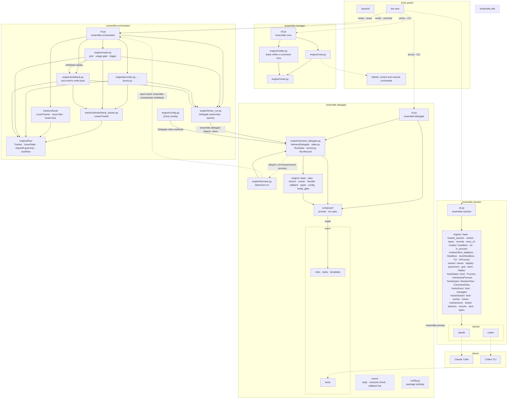
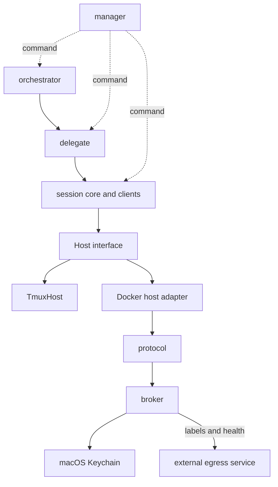
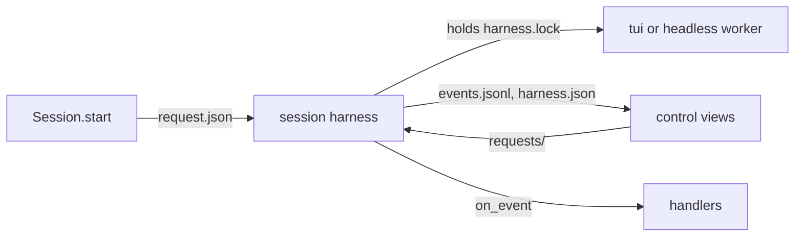
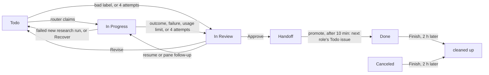

# Core architecture

Five layers in one source tree (`src/ensemble/`): utils < session < delegate < orchestrator < manager. Import rules: `AGENTS.md` › Import rules. The code, by package; terms in `CONTEXT.md`.

The session harness's tui and headless workers run under the standalone `harness/guard.py`: as managed local workers on tmux
(`hosts/tmux/managed.py`), over one `docker exec -i` per container on Docker (`hosts/docker/worker.py`).
The harness owns the lifecycle pipe; the guard directly parents the client and owns a tui client's PTY;
tmux runs only the display attachment. Handle readers drain the framed channel continuously.
A task attempt's ending closes no worker, a locked one's included: the run's user (a person, or a manager acting
for one) closes it, or its client exits; an environment lock goes with its container's confirmed removal
([Docker host › Environment config](#environments)).
Crash-resume limits and the extension Host migration are in
[Session harness interfaces](#session-harness-interfaces).



Solid arrow: an import, the only direction allowed, or a file read (`reads`); its label names the package imported, by its `__all__`. Dotted: runs a command or process. Dashed: shared modules, their imports not drawn.

A detached run's drive (`engine/harness.py`, `<agent>-drive`) is no session: `HarnessDelegate` starts it as a local process in a new session through `ProcessControl` (`src/ensemble/utils/process_control.py`), with `SIGNALS` blocked across the spawn, its stdout and stderr appended to `<workdir>/run/drive.log` (0600, a regular file only). `delegate.json` `drive` holds its control path, saved before it starts; the run is alive while the run lock is held or that control runs, and `close` sends its group SIGTERM, then SIGKILL 5 s later. On exit it appends `HH:MM:SS <agent>-drive exited <rc>` to the run's events file, after its `outcome` line (a SIGKILLed drive writes neither). A run's Record lists only its tui agent session, which carries it once its client runs (`ensemble-session ls --records`, from which `ensemble-crew attach` adopts a run whose crew died before committing it); on Docker the drive runs on the host beside the container, so no other Host is needed.

## Modules and replacement boundaries

Layer interactions are shown above; import contracts are in `AGENTS.md` › Import rules.
Keeping a module assumes Python, the clients and their command protocols remain available.
Each Host implementation supplies its process capabilities.

| Path | Responsibility | Dependencies | Environment change | Replacement boundary |
|---|---|---|---|---|
| `src/ensemble/orchestrator/` | Board scheduling, state and write-back | delegate, utils | Keep | Public delegate API; tracker contract in `engine/flow/tracker.py` |
| `src/ensemble/delegate/` | Prompts, run plans, harness and result protocol | session, utils | Keep | Public session API and `event/` progress and outcome formats |
| `src/ensemble/session/engine/`, `modes/`, `clients/` | Session lifecycle, run modes and client adapters | Host, utils, client commands | Keep session and client logic | Host, Process and InteractiveProcess capabilities in `hosts/base.py` and data types in `engine/types.py`; tmux operations remain in `engine/tmux_cli.py` and `viewer/` |
| `src/ensemble/session/harness/` | The session harness process that owns a built-in client's tui or headless worker on tmux or Docker, or an in_process adapter, its dir, handler dispatch and control view | session engine, utils | Keep | `Spec.handlers`, `EventCall` and the files in [Session harness](#session-harness) |
| `src/ensemble/session/hosts/tmux/` | Local processes and tmux sessions through `TmuxHost` | Host, `engine/tmux_cli.py`, utils, local tmux | Replace as a unit if local tmux is unavailable | Host start, enumeration, status, input and close semantics; display boundary shown above |
| `src/ensemble/session/hosts/docker/`, `src/broker/`, `src/broker/protocol/` | Docker adaptation, the guarded worker, worker image, containers and credential injection | Host, Docker Desktop, broker; broker uses macOS Keychain | Replace as a unit | Preserve Host for callers; retaining the broker also requires its protocol JSON schemas, versions, exit codes and shared fixtures |
| `src/ensemble/manager/`, `skills/manage/`, `hooks/` | Crew, Roster, event cursors and commander sessions | utils; commands to other layers | Keep scheduling logic; adapt local display and client hooks | Record ctl and resume commands, CLI output; import relationships shown above |
| `src/ensemble/utils/` | Configuration overlays, shared types, paths and process control | Python standard library | Keep, with the required OS process capabilities | Public exports and shared data formats |
| External `windroc-labs/egress-proxy` | Egress service, outside this repository | Docker labels and health, read by broker start ([`launcher/egress.go`](../src/broker/internal/launcher/egress.go)); `scripts/install.sh` fetches a pinned commit and starts the egress proxy | Replace the independent service as a unit | Versions, label meanings and health semantics in [docs/label-contract.md](https://github.com/windroc-labs/egress-proxy/blob/122d7454d738db4a9b7e0c4a89d2cfa5ff564339/docs/label-contract.md) |
| `src/broker/internal/broker/keychain_darwin.go` | Read credentials from macOS Keychain for broker injection into containers | macOS Security; storage interface in `keychain.go` | Replace the credential source as a unit | Credentials, CodexCredentials, ProviderKeys and Tokens in `launcher/host.go`; credential readers and lifecycle in [Credentials](#credentials) |
| `src/broker/internal/credential/` | Provider-neutral token lifecycle (records, renewal, release, revocation backlog) and the container delivery every credential shares | audit, docker, protocol; a Store and a Provider from its caller | Keep | The `Provider` contract and record JSON in `contract.go`; GitHub is its provider (`broker/github.go`), Codex its shared one (`broker/codex_grants.go`: each container's grant is withdrawn, never revoked) |

The **Host boundary** is defined by [`hosts/base.py`](../src/ensemble/session/hosts/base.py).
In [`config.toml`](../src/ensemble/session/config.toml), `[hosts.<name>] implementation = "module.path:Class"`
selects an implementation and `[hosts] default` selects the host. Preserving its capabilities,
return types and error semantics keeps upper session, delegate and orchestrator code unchanged.
Client adaptation remains in `clients/`.

The **egress boundary** is defined by the external [docs/label-contract.md (122d745)](https://github.com/windroc-labs/egress-proxy/blob/122d7454d738db4a9b7e0c4a89d2cfa5ff564339/docs/label-contract.md).
Callers depend only on the proxy's `windroc.egress.*` labels and Docker health, selecting an internal
network and proxy address from the network key's `.name` and `.proxy`. A replacement proxy preserves
the consumed contract version, label meanings and health semantics; the contract lists the complete
startup validation rules. [`launcher/egress.go`](../src/broker/internal/launcher/egress.go) applies them for `workers` before
every [`launcher/start.go`](../src/broker/internal/launcher/start.go) start.



Solid arrows show calls or data contracts; dotted arrows show commands.

## Session settings

Every session ensemble starts, agent runs and workers, loads your user settings with every plugin except `ensemble` (`[clients.<client>] flags` in `src/ensemble/session/config.toml`; OpenCode's plugin turns itself off: [OpenCode commander](#opencode-commander)): only a client you start, the commander, has `/ensemble:manage`. Each such session's client also carries `ENSEMBLE_AGENT_SESSION=1`, under which `ensemble-crew` `run`/`worker`/`reopen`/`issue`/`role`/`hold`/`resume`, `ensemble-session` `start`/`restart`/`resume`/`client-resume`, `ensemble-delegate` `run`/`resume` and `ensemble-orchestrator` `router`/`resume` exit 2 (their forms that start nothing, such as `--dry-run`, `--list` and `--brake`, still run), even run by a checkout's `bin/` path: a guard against slips, not isolation (`env -u` clears it). Agent runs load no MCP servers your Claude or Codex config names, user or project, so none can write past the outcome: `--strict-mcp-config` in `[policy.claude]`, `-c mcp_servers={}` in `[policy.codex]` (`src/ensemble/delegate/config.toml`; [Client policy](#client-policy)); workers keep them. A trusted cwd adds its project settings (`trusted_dirs` in `src/ensemble/delegate/config.toml`).

Codex sessions also start without its built-in browser, computer use, Apps and plugin suggestions, so a run cannot open a web page or a third-party service to act outside its outcome; web search, image generation, subagents and your own plugins stay. Checked against Codex 0.163.0, whose plugin ids can change with a release:

| Tool | Packaged `[clients.codex] flags` entry |
|---|---|
| Browser and Chrome (MCP server `node_repl`) | `-c plugins.<id>@openai-bundled.enabled=false`, `<id>` each of `browser`, `chrome`, `chrome-dev`, `chrome-internal` |
| Computer use (`node_repl`, `cua_repl`) | the same, `<id>` each of `computer-use`, `unified-computer-use` |
| Apps (`codex_apps` connectors, the browser connector among them) | `--disable apps` |
| Plugin suggestions, which can install a plugin | `--disable tool_suggest` |

The feature flags `browser_use`, `computer_use` and `in_app_browser` do not turn these off, and `--disable plugins` would turn off your plugins too. To get a tool back, drop its entry from a `[session.clients.codex] flags` list in `~/.ensemble/config.local.toml`: a local list replaces the packaged one whole, so copy the rest. Every launch reads this list, a resume and `client-resume` included, so a change reaches sessions started before it.

A Codex resume keeps the run's own flags (`[policy.codex]` in `src/ensemble/delegate/config.toml`) from its start, where Claude's takes the current ones. Codex's recovery state records each session's launch, its writable grants among them, and a resume replays that record rather than take new grants or a new run policy from its caller. The list above is read again because it is the client's own setting, not the run's; it refuses `--add-dir` and `--`, so it can neither widen a session's grants nor pass literal arguments.

In the commander's Claude Code session the plugin's mod always hides Monitor tool-call rows and notices, plus Bash tool-call rows whose command contains `ensemble-crew next-event` or `ensemble-crew ack`. Other tools, Bash commands and notices draw as usual; the model's content is unchanged. Ctrl+o shows Monitor notices; the hidden tool-call rows stay hidden.

`ensemble-crew next-event` (including `--follow`) exits 1 on a malformed complete event line and reports its file path and physical line number. Inspect the file with `pending`; reads never acknowledge handling. A final line without a newline waits until completed.

A commander under `ensemble-crew hold` gets a re-arm prompt at startup, resume, compact and clear. Claude Code uses Monitor. Codex uses Manual mode: run `ensemble-crew pending --content` at the beginning of every active turn before status reports or new launches; there are no idle notifications. Only a background tool whose runtime contract guarantees notifications to this conversation may run `attach`'s `next-event:` command, without `--follow`; after handling and acking each event, run `attach` again and use its newly printed command. A commander restarted outside its `hold`, or one giving `--manager` to each command without `hold`, gets no prompt. OpenCode uses Manual mode too ([OpenCode commander](#opencode-commander)).

After installing or updating the Codex plugin, open `/hooks`, review and trust the ensemble SessionStart command before relying on this prompt; installation alone does not trust plugin hooks. A changed hook definition needs review and trust again. [Codex plugin hooks](https://developers.openai.com/plugins/build/plugins#bundled-mcp-servers-and-lifecycle-hooks) describes this trust requirement.

## ensemble-session

`bin/ensemble-session --help` lists its subcommands. `ls` prints a header, then one tab-separated row per session: `name`, `state` (`working`, `done`, `blocked`, `dead`, `unknown` when its host could not tell), `client`, `sid`, `display`, with `-` for an empty value.

Sessions run on `[session.hosts] default`: `tmux`, or `docker` ([Docker host](#docker-host)).

`start --account NAME` (also `ensemble-crew worker`'s) runs a Claude session on a registered Claude account
([Docker host › Claude accounts](#claude-accounts)). Restart and resume keep the account; `--env
ENSEMBLE_ACCOUNT=…` and a `[delegate.policy.<client>] env` naming it are refused (exit 2).

`start --display none` starts a worker without a pane, still opened by the caller, and hidden. Hidden (from that, `hide`, or closing its pane by hand; not from losing the manager's window or detaching its viewer) lasts through `restart` and `resume` until `show`. A display's tmux session starts at 120x40 and a hide sets it back to that until the next viewer sizes it, so a hidden worker's screen text (`read`, events) stays unwrapped ([Guard protocol](#guard-protocol)).

Text sent to a Codex or Claude tui session mid-turn joins that turn. Codex takes it at once; Claude queues it until the running tool returns. A notice Claude injects mid-turn, such as a background task's completion, joins it too. Text sent after a Claude turn ended starts a new turn. When the session has an events file, `ensemble-crew pending --content` and `next-event --content` print mid-turn replies, which the turn's hooks or, for an answer no hook follows, its session harness's pump (once a second) announce; reply text stays for 30 days.

A Codex or Claude turn that fails ends a role run's attempt at once. A usage limit stays a usage limit.

## Run limits

Set a client's simultaneous session limit in `~/.ensemble/config.local.toml`:

```toml
[session.clients.opencode]
max_runs = 1

[session.clients.claude]
max_runs = 3
```

`max_runs` is a whole number >= 0. Zero (the packaged default) or an omitted key means unlimited. The setting belongs to the session layer's `[clients.<client>]` table in `src/ensemble/session/config.toml`, and is removed before configuration reaches the client adapter.

Every `Session.start` shares admission for that client across processes using the same user state directory, regardless of caller, Host, mode, name or resume flag. Board runs, `router --issue`, ad-hoc role runs and crew workers all count. The check and start hold one client admission lock; a full client raises the existing `SessionError` before launching or recording a new session, naming the client, limit and holding names (session ids for unnamed runs). There is no capacity queue. Preflight, inspect and attaching to an existing session reserve nothing.

TUI sessions count while their client is alive, including `done` between turns and `blocked`; an unknown state keeps its slot. On Docker, a generation whose owner lock is free is dead and frees its slot once its container is stopped or, in a running container, its guard has exited (admission probes it); one whose guard is live or unprobeable keeps it until a sweep removes the container. Close a retained TUI when it should stop using capacity. Headless and in-process modes hold a lease until their mode ends or is stopped/closed, even when nobody reads events. A failed start releases its reservation once shutdown is confirmed; an unconfirmed TUI shutdown retains its reservation until matching Host inventory proves the client is gone. TUI ownership survives its launcher; transient leases belong to their caller process, or to its session harness for a harnessed headless run. An abnormal caller exit does not add a recovery protocol for orphaned children.

Admission checks all configured Hosts; an unavailable inventory fails closed. Shared TUI reservations from a Host configuration the caller does not have remain counted until a caller with the matching configuration confirms the session ended. Close the original session or retry using its original Host configuration to reconcile it. Changing an unrelated Host setting changes that configuration's identity, so close its sessions before changing its settings.

The orchestrator's [role limits](#operating-the-board) and usage gate remain separate. Direct client commands outside `Session.start`, including `client-resume`'s native client handoff, do not create ensemble sessions.

## Session harness

Every tui or headless session, with or without `Spec.environment`, on every Host, runs under a session harness of its own; nothing starts or supervises a worker outside one. A Host whose class does not override `Host.worker` runs none, nor does a remote-tui Host (Docker) a tui whose client's `Tui._remote_owned` is false: `start` and `preflight` raise `ConfigError("<client> <mode> on host <host>: runs only under a session harness")` before anything is written. A harness builds its session class from configuration, so `start` (not `preflight`) of a class configured with an injected class loader, probe, Host factory or viewer factory raises `ConfigError("<client> <mode>: runs only under a session harness, which builds its session class from configuration, not injected callables")`. `Session.preflight` checks `Spec.events` and finds each handler module without importing it. An `in_process` session runs under one too (no Host).

`Session.start` writes the start to `~/.ensemble/harness/<32 hex>/request.json` (mode 0600; it holds `Spec.env`, and the harness deletes it once read), runs `python3 -P -s -m ensemble.session.harness.process [--caller FD] <dir>` detached (the caller's interpreter), and returns a control view once the harness runs the worker. A start error in the harness, or an interrupt at any point after the harness is spawned, is raised in the caller, the harness ended and its dir removed; SIGHUP, SIGTERM and SIGINT are held across the spawn itself, so one that arrives during it is handled the same way. The tui session's `session.json` names the dir as `owner`; a headless run, the harness's own child, has no `session.json` and stays nameless unless its spec names it. A harness that does not start is sent SIGTERM (headless) or killed.



The harness holds `harness.lock` for life. It records each event in `events.jsonl` before calling each handler's `on_event`; ids are `<generation>:<seq>` and turns `<generation>:t<n>`. A turn started while one is open fails that one (`TurnFailed("superseded")`); an exit mid-turn fails it (`TurnFailed("exited")`) before the one `Exited`. A handler that raises is retried with the same ids after 1 s, doubling to 30 s, while the others go on; `deliveries.jsonl` keeps failed attempts 1, 2, 4, … and the delivered one. A handler still running when the harness exits records nothing more. `Stderr` and `ClientBound` stay in the log. After the worker's exit the harness waits up to 30 s for its handlers, then writes `exited`, answers the waiting `stop` and `close` requests, and exits; `harness.json` says `starting`, `running`, `draining` (the worker ended, its handlers still called; with `returncode`), `exited` (with `returncode` and `pending`) or `failed` (with the start `error`), `opening` while the client's opening line is unsent, `up` once its guard reported the client up ([Guard protocol](#guard-protocol)), and `dialog`, the dialog the client waits on (the first `Blocked`'s reason until any event but `Blocked`, `Stderr`, `Reply` or `ClientBound`); each pump of the worker writes its status to `harness.json` before its events are logged, so a view acting on an event reads the status it came with, and a start ending on that status still says a dialog whose `Blocked` it has not read yet. SIGTERM and SIGHUP close the worker, as does EOF on a headless start's caller pipe (`--caller FD`); the harness unblocks the signals its caller held across the spawn.

The control view never owns the worker: for a tui session, its caller exiting, its `events()` iterator closing or a display detaching leaves the harness supervising. A headless run dies with its caller: the starting view holds the write end of a pipe whose read end only the harness has, so once the view is dropped or its process ends, even by SIGKILL, the harness closes the worker. `events()` reads `events.jsonl`, accepting only the worker's generation in order. `stop`, `close` and `Session.retire` (its sid checked against `session.json`) write a request to `requests/` and return once the harness confirms the worker ended and logged `Exited` and, past its handlers' drain, lets go of its lock (a handler's own request returns at the confirmed exit, since the drain waits for that handler), else raise `SessionError` (`Unanswered` when it cannot tell). `Session.retire` asks a bound owner before any Host probe, so a worker whose display is gone is still closed through it. A refused or unconfirmed stop or close leaves the harness supervising and sets `harness.json` `close_failed` (`op`, `error`, `at`); `ensemble-session close` then exits 1, even for a Record that looks stale on its Host. `send` (`{"text"}`, up to 1 MiB), `press` (`{"keys"}`, 1 to 64 key names) and `screen` (`{"lines"}`, null or 1 to 10000) of any tui worker, tmux included, are requests in `requests/` the harness serves through the worker; a bad field or a failure is a refusal that leaves the worker up, and after the exit they are refused (`ensemble-session read` with no running harness: `session NAME: its harness is gone`). Every tui `send` and `press` holds the session's send lock (`send.lock` in its tui dir) over its whole input, so senders in any thread or process never interleave; the harness types the opening under it, never waiting for it, and only once no turn runs, a launch prompt's turn has started, and every send went in before the hook of a turn's start or end began (its `hooks.jsonl` record carries the sends seen as that hook began, a Docker worker's as its harness took the hook from the guard), so it never lands inside a turn: a start with a prompt gets it once its first turn ends. A send failing after its first action raises `Unanswered`, never retried. A view's other reads use no Host process: `alive` from the owner (running and `harness.json` neither `draining` nor `exited`, else `Host.worker_liveness`), `status` and `record` from the worker dir (below), `show`, `hide` and `attach_command` through the Viewer and `Host.attach_target`. `display` (any worker, no fields), served as a request, opens the worker's display again where it is gone, answering `{"reopened"}`; a session of its name it does not own is refused, left alone. A headless view has no terminal: `send` and `press` raise `SessionError`, `screen`, `show` and `content` raise `NotShowable`; `alive` and `status` come from `harness.json`, `info` and `session_status` from the run's record, and an exception in its `events()` (not closing the iterator) stops the worker. `Session.attach` gives a control view only while the `owner` harness holds its lock and its `harness.json` names that session, sid and generation; any other `owner` is ignored, and a worker whose harness exited or died gets a view bound to its worker state, not alive, closed as below.

A tui worker runs under the guard ([Guard protocol](#guard-protocol)), and only its harness holds the guard's lifecycle pipe: `kill -9` of the harness ends guard and client, and its display (a tmux worker's: the tmux session of its name) ends no worker when killed. Its `session.json`, display and dir go only with their own worker generation. Resume (`ensemble-session resume`, a crew or delegate resume) of a worker whose harness runs returns its Record and starts nothing; it first asks that harness to open its display again where it was killed (a tmux worker's tmux session, or the `guard.py --attach` in it), on the same guard and generation, and shows a reopened one unless hidden; a refusal is said on stderr, the Record still returned; after a crash it starts a new harness, guard and client on the same sid, transcript, cwd, client, account and flags, waiting up to 10 s for a reaping guard. It is refused while the old generation is unknown (busy, exit 75; a guard killed before it confirmed its client's exit) and when the client keeps no transcript of the conversation (exit 2), never starting an empty one. `ensemble-session close` (and `Session.retire`) of a worker whose harness exited or died removes its worker dir and record only once `Host.worker_liveness(name, generation)` is `ABSENT`, then removes that generation's leftovers through the private `Host._release` (tmux: its display session while tagged with that generation; Docker: its container once its owner lock is free); it waits out reaping and fails busy (`SessionBusy`, exit 75), keeping both, while `LIVE` or `UNKNOWN`. A tmux worker's way out of a permanent unknown: once no client of it is left, remove its guard dir, `<ENSEMBLE_CONTROL_ROOT, else the temp dir>/eg-<uid>/<key>` (`hosts/tmux/managed.py` `location`).

A tui worker's dir, `~/.ensemble/tui/<name>/`, holds `session.json` (its worker state: `sid`, `generation`, `client`, `display`, `owner`), `hooks.jsonl`, `send.lock`, and two files read only for their own generation (0600, written by atomic replace; one that is not a regular file the user owns reads as absent): `activity` (`<generation> <word>`), which its harness sets for each newly read hook record whose label `session.json` `words` maps to `working`, `done` or `blocked`, and for a dialog its screen scan marks blocked, appending one `HH:MM:SS <name> <word>` line to `Spec.events`, when set, for `done` and `blocked` (a replayed record writes neither, on tmux and Docker alike); and `record` (`<generation>\t<Record line>`), the Record the crew worker writes after its start and resume. A client's hook command only journals `hooks.jsonl` and starts no process; the tmux display's border carries no state word (`@state`). `Session.list` rows, `ensemble-session ls`, `ensemble-session status` and a view's `status()` take a live worker's state from `activity` (no file: `working`); `ls --records` and a view's `record()` take its `record`.

A headless worker runs under the guard too (`Host.worker(name, launch, terminal=False)`, named by `Spec.name`, else `headless-<generation>`; Docker refuses a nameless one: [Harness-owned workers](#harness-owned-workers)), its input ended at start (an empty `i`), so `kill -9` of its harness ends its client as well (on Docker: [Harness-owned workers](#harness-owned-workers)). Its output is read as lines (UTF-8, undecodable bytes replaced, universal newlines); a line over 8 MiB (`modes/headless.py` `LINE_MAX`) fails the run. On tmux its guard dir is a one-shot dir, `<ENSEMBLE_CONTROL_ROOT, else the temp dir>/eg-<uid>/o<15 hex>` keyed by host and generation (`hosts/tmux/managed.py` `one_shot`), never a tui's: a headless run named like a tui leaves that tui's dir alone, and two of one name may run at once. Its starting process holds `owner.lock` there and removes the dir at the confirmed close; after that process died (`kill -9`), the next tmux worker start removes each one-shot dir over 60 s old whose owner lock and leases are free (`sweep`).

An `in_process` adapter runs on a thread of the harness, so it ends with the harness; its control view has no terminal (`send`, `press`, `screen`: `SessionError`; `show`, `hide`, `attach_command`: `NotShowable`) and is alive while its harness holds its lock and has not logged `Exited`.

Any process of the user that can write the 0700 harness dir can stop or close its worker, the same trust as the user's tmux socket: the harness serves every well-formed request and authenticates none.

## Session harness interfaces

Frozen (WDRC-199, WDRC-226): a session harness owns each worker from start to close and calls the handlers its caller registers. Every TUI and headless adapter yields `TurnStarted`. [Session harness](#session-harness) names the starts it owns. The harness launches a tui worker through its Host's `worker` (`TmuxHost.worker`, `DockerHost.worker`: the managed transport below, [Harness-owned workers](#harness-owned-workers)), a headless one with `terminal=False`.

**Handlers.** `Spec.handlers` is an ordered tuple of `HookCallback(module, state, roots)`, default `()`. The harness records each event before it calls each handler module's `on_event(EventCall)` in event order; a failure is retried with the same ids and never stops supervision. `EventCall` carries `session` (an `ensemble.session.Session` to send, stop or close through), `event`, `sid`, `generation` (the worker's start), `event_id`, `turn` (`None` outside a turn) and the handler's `state`. `on_event` returns `None`; returning or failing never closes the worker, only a close request through `session` does. Every event field (reply text, Blocked reason, TurnFailed detail) is untrusted worker output.

**Events.** `SessionEvent` is `TurnStarted | Activity | Reply | TurnEnd | TurnFailed | Blocked | LimitHit | Exited`. `TurnStarted` marks a turn its client accepted (the first prompt, a `send` or text typed into its terminal that starts a turn, not input joined to an open one), never a replayed record. Tui adapters normalize `HookKind.TURN_STARTED`; headless adapters derive acceptance from native structured records. In-process `run()` will yield it when that adapter is migrated. `TurnEnd(reply, pending)` carries the turn's full last reply; `TurnFailed` and `TurnEnd` exclude each other within a turn; `Exited` comes once, last.

Claude and Codex use accepted-prompt hooks; a Claude `UserPromptSubmit` while its turn is open (until `Stop` or `StopFailure`, or a usage limit the transcript shows last when the prompt's hook runs) is input Claude joins to that turn and yields no `TurnStarted`. Codex also observes native turn records, including failures without Stop. Codex turn ids reconcile the two sources and reject late old-turn terminal hooks. OpenCode starts a turn on a new root user message's first part, unless the message is one its compaction makes; re-saved user messages and busy/tool steps do not start turns, and asynchronous replies retain that id. A root `session.error` fails the turn only if idle follows with no busy after it (a context overflow's compaction goes on), and compaction summaries are no replies. Replay restores state without publishing a new `TurnStarted`.

Headless streams replies and diagnostics while retaining terminal candidates until both output streams drain and the exit code is known. Success requires native completion and exit 0. Nonzero exit, missing completion, native failure or an uninteractive permission request produces `TurnFailed` before `Exited`; a partial reply or EOF alone cannot succeed. Claude checks result subtype, error and permission-denial fields; Codex checks turn completion/failure; OpenCode requires a final `step_finish` with reason `stop`. A permission/question request stops the headless worker rather than waiting for an answer. OpenCode prints its session id only once its model streams, so a new headless OpenCode run titles its session `ensemble-<sid>` (its flags must not set `--title`): a resume (or session status) of a run whose harness died before that id finds the session by its title in `opencode.db` and binds it.

**Managed workers.** `Host.worker(name, launch, *, terminal, display=None, events=None, metadata=None) -> InteractiveProcess` launches every worker. `InteractiveProcess` is a standalone ABC, no longer a `Process`: `name`, `send(action: Paste | Key)`, `press(keys: Sequence[KeyPress])`, `screen(lines=None)`, `state() -> Liveness`, `close() -> None` and `returncode() -> int | None`, plus the channel members below; there is no parallel `WorkerHandle`. Managed `close()` returns only after confirmed worker exit, else raises `SessionError` (`Unanswered` when unknown); `returncode()` supplies the confirmed exit code, never a guessed SIGHUP code. Headless handles reject `send`, `press` and `screen` with `NotShowable`; their input uses `write`.

The channel members: `generation: str` identifies the worker start; `read(timeout: float) -> list[WorkerMessage]` returns ordered messages, `[]` on timeout and nothing after the last `WorkerExit`; a broken transport raises `Unanswered` until exit is confirmed. `write(data: bytes) -> None` writes headless stdin; `write(b"")` ends it, and a write after the exit is refused. `tick(now: float) -> float | None` runs the Host's periodic duty and returns its next due time (the default `None` means no duty). The local handle drains stdout continuously into an 8 MiB queue. Overflow closes its lifecycle pipe, continues draining, and reports `Unanswered`; it never silently drops output and reports success. The guard ([Guard protocol](#guard-protocol)) is the client's direct parent and owns its PTY when `terminal=True`.

The new channel records have no previous public owner: `WorkerHook(label: str, payload: Mapping[str, object], delivery_id: str)` replaces the Docker relay's hook envelope and retry identity, `WorkerOutput(data: bytes, stream: str="stdout")` replaces separate headless stdout/stderr pipe readers, and `WorkerExit(returncode: int)` replaces host exit probes. `WorkerMessage` is their union. All payloads are untrusted; retain size/shape, sid and generation binding checks (FR-36). `Host.worker_liveness(name, generation) -> Liveness` replaces attach/reclaim probes after a harness dies: `LIVE` or `UNKNOWN` refuses a second owner, `ABSENT` permits resume. Local admission serializes starts and checks the prior generation's lease and completion record. An unconfirmed guard death remains `UNKNOWN`, even after its known PIDs disappear. Missing, damaged or mismatched existing records also remain `UNKNOWN`; there is no live-process adoption. The session harness must validate the original transcript and preserve sid, workspace, client and account before constructing a new launch.

| Host | Channel | Display |
|---|---|---|
| tmux | the guard's stdin and stdout over local pipes | a tmux session running `guard.py --attach` on its display socket |
| Docker | `docker exec -i` into the container, the guard there | `docker exec -it … guard.py --attach`; `tick` returns the next time its maintenance thread calls the broker, never calling it |

A Docker handle reports `UNKNOWN` from a broken channel until its container's removal is confirmed, then `ABSENT`; `returncode()` is the guard's `x` code, `None` when none came; after the removal `read()` returns `[]`.

**Extension migration.** An extension Host implements `worker`, `worker_liveness` and the private `_release(name, generation)` (remove a confirmed-`ABSENT` generation's leftovers; base: no-op); without `worker` it runs no session ([Session harness](#session-harness)). Adapt an `InteractiveProcess` subclass to the guard channel and confirmed-close contract; the methods below are gone. Status and Record live in the worker dir ([Session harness](#session-harness)), display targeting in `Host.attach_target`; the base `Host.rows()` lists each `list()` name with its worker state and activity; a tmux Host also lists each of its workers whose display session is gone, unless `ABSENT`. A Tui maps its accepted-prompt hook to `HookKind.TURN_STARTED`; headless `events` and in-process `run` yield `TurnStarted` on accepted input. Native `on_hook(HookCall)` stays separate from registered `on_event(EventCall)`: the former converts client payloads, the latter receives normalized events. `EventCall` lives in `harness/types.py`, depending on `Session`; shared `engine.types` never imports the session API. Session users keep the default empty handlers tuple and handle the added event in exhaustive matches.

### End-state removals

Approved deletions, not deprecations. `InteractiveProcess` survives as the sole managed handle, a standalone ABC holding the preserved declarations.

| Removed interface | Replacement | Deletion owner |
|---|---|---|
| `Host.terminal`, `Host.detach`, `Host.pipe` | `Host.worker` (`terminal=True` or `False`) | `Host.pipe`: deleted (WDRC-312); `Host.terminal`, `Host.detach`: deleted (WDRC-323) |
| `Host.attach`, `Host.reclaim` | `Session.attach` control view and `Host.worker_liveness` for crash-resume admission | deleted (WDRC-323) |
| `Host.events_path`, `Host.prepare_events`, `Host.hook_callback` | harness-owned records/dispatch and worker-dir `activity`; `WorkerHook` on the guard channel; events-file checks `ensemble.utils.validate_events`/`events_file` | deleted (WDRC-323) |
| public `Process` (both session surfaces), `Interactive` (extension), their exported members | fold preserved `name`, `send`, `press`, `screen`, `state`, `close`, `returncode` into existing `InteractiveProcess` | deleted (WDRC-323) |
| `InteractiveProcess.alive`, `.wait_exit`, `.kill`, `.identity`, `.token`, `.session_identity`; `check_sid` | channel `state`, `generation`, `read`/`WorkerExit`, confirmed `close`, no caller-owned kill; the worker state's sid | deleted (WDRC-323) |
| `InteractiveProcess.activity`, `.status`, `.mark`, `.row`, `.record`, `.publish`, `.display` | harness event/state and crew-written Record in the worker dir; `Host.attach_target` retains display targeting | deleted (WDRC-323) |
| extension `Piped`, `Lines`, all their exported members; internal `LocalPiped` | `InteractiveProcess.read`/`write`, `WorkerOutput`/`WorkerExit` | deleted (WDRC-312) |
| Docker `supervisor.py` (`Supervisor`, `main`) and Host `_spawn_supervisor` | harness dispatch/lifecycle; the Docker handle's maintenance thread (`hosts/docker/maintenance.py`) and `hooks.HookWorker` | deleted (WDRC-211) |
| Docker `relay.py` (`Queue`, `Daemon`, `answer`, `pump`, `connect`, `main`, relay request/reply protocol) and Host `_serve_relay` | guard hook socket and the same worker's long-lived `h`/output/exit channel | deleted (WDRC-211) |
| delegate harness worker ownership, runner-driven supervision/attempt lifetime | session `Spec.handlers`/`EventCall`; attempt-only Result and delegation policy | WDRC-208; WDRC-209 consumes attempt events |

`InteractiveProcess.tick` has no caller but is an approved addition (FR-26) and stays.

**Ownership.** `Session.start` creates the owner; `Session.attach` gets a control view, never a second owner; `events()` only observes, so closing its iterator, the caller exiting or a display detaching leaves a tui worker supervised (a headless run dies with its caller: [Session harness](#session-harness)); `stop`, `close` and `Session.retire` ask the owner and return only once it confirmed the worker ended, else raise `SessionError` (`Unanswered` when it cannot tell), so a caller releases a lock or removes a roster entry only after a confirmed end (FR-16, FR-23, FR-24).

**Delegate.** `Delegate.run`, `alive`, `status`, `resume` and `close` keep their signatures and the `Result` and `Outcome` formats. `run()` returns once a task attempt has its Result while the session and its handler go on; `alive()` and `Status.alive` say whether an attempt is active, so a run waiting on `needs_input` is not alive. `resume(input=...)` (CLI `--input`) accepts an answer or continuation even while the TUI/harness lives, a locked run's included; the active-attempt check must not reject it just because the owner lives. If the worker died, resume creates new processes from the original transcript and refuses a live/unknown old generation. A directly accepted input after a terminal attempt opens the next attempt through `TurnStarted`; resume has already counted its attempt, so the same event does not count twice. In-attempt nudges/repair and replay never open another attempt.

Each attempt preserves `Begun`/`Progress`/one `Finished`, the existing Result/Outcome formats and Record `ctl`/`resume` control routing; subsequent attempts do not reuse the previous outcome or its completion marker. `close()` ends an active attempt once, never emits another failure for an ended attempt, and asks the session owner to close. Locks and roster entries remain until confirmed resource termination; close failures remain traceable. Delegate persisted `plan.session.handlers` lists are restored to tuples only when the key exists; old records default to `()`.

Implemented (WDRC-208) for **owned runs**, the tui runs, each owned by its session harness: the Delegate preflights the start with the handler `ensemble.delegate.engine.handler` registered as `{"workdir", "worker": n}` (`n`, the attempt whose call starts the worker); a refused preflight refuses the run (exit 2). Every other mode keeps the earlier caller loop. Each attempt has one owner: the call that starts a worker owns it while opening, that worker's first handled call binds it to the handler, and the handler's `TurnStarted` after an ending opens the next attempt (`delegate.json` keeps the earlier one's Result as `previous`); calls of another sid or worker are ignored. An ending stores the Result, then writes its notes (the attempt's own and `result`/`end`) and the run's outcome line, then sends `Finished`; an ending another owner stored first writes and sends nothing. An ending closes no worker, a locked run's included: its user closes it or its client exits ([Docker host › Environment config](#environments) has the release claim). `run()` (a detached run's `-drive`) starts the worker and waits for its attempt's Result; it ends the attempt itself only while opening past `idle_timeout` (a give-up) or once its worker has been gone 35 s. A signal before it sends `Begun` (its TUI start) stores the stopped ending, then closes the worker; a signal after leaves the attempt to the handler. A stale out it cannot set aside is stored as the attempt's Result, with `closing` set, before its worker is stopped. A completed run is not alive from its `Finished` on, though its drive holds the run lock until it returns; meanwhile `status` reports it `working`, and `resume()` (and `resume(input=...)` unless a live worker takes the input) waits up to 30 s for that lock before it sweeps and starts. `resume(input=...)` on a live owned worker only sends the input; `resume()` and a replacing `run` first retire a gone worker outside the run mutex, under the run lock (which every start takes) and only while `delegate.json` still names the attempt they checked, so they follow its harness's end (its handler's last write-back) before the callback sweep. `close()` holds a shared lock, `run/delegate.close.lock`, from before it attaches the worker until the owner's close returns: meanwhile a `TurnStarted` opens no follow-up, and the client's exit the close causes (`TurnFailed("exited")` or `TurnFailed("process_exit")`, `Exited`) ends an active attempt as a stop (`stopped: Stopped: 143`, its `Finished` sent once), never as a failure, while other endings keep their own Result. Without a close, such an exit failure of an open turn waits for its `Exited`: a client killed by signal n ends the attempt interrupted (`stopped: Stopped: <128+n>`, left In Progress: [Board](#board)), a nonzero exit as `the client exited <code>`. Once the close is confirmed, or its worker is gone, `delegate.json` `closing` is set (no follow-up of that worker until `resume(input=...)` or a new run clears it) and an attempt still active ends as that stop (a locked run's `release` first). A refused close drops the lock and leaves `closing` unset; input taken on an ended attempt during it opens no follow-up, the next does. `delegate.json` must hold `previous`, `bound` and the bool `closing`, and the callback lock both pids (`<child> <parent>`); anything else is invalid. Board write-back of each attempt: `docs/architecture.md` › Board › Using the board.

### Guard protocol

`src/ensemble/session/harness/guard.py` is the standard-library-only guard program, run by path. `guard.py [--terminal [--display-grace]] --hook-socket PATH [--display-socket PATH] -- ARGV...` runs ARGV, with the cwd and environment it is given, in a session of its own; with `--terminal` the guard owns its PTY, its client's `TERM` `xterm-256color` unless set. `--display-grace`, which the tmux Host passes because it starts the display at launch (Docker starts one only when someone attaches), keeps a guard whose client exited before any display connected up for the display grace (2 s), so its first display still gets the final screen. `guard.py --attach PATH` connects the calling terminal to a running guard's display socket: a display only, so detaching or killing it never ends the worker; an unreachable socket prints one line (`guard: display PATH: <reason>`) and exits 1. It writes the guard frames `i` (its typing) and `w` (`{"rows": int, "columns": int}`, its terminal's size, at connect and on each SIGWINCH); a malformed frame drops that display. The PTY takes the size of the display that sized it last, on its leaving the next one's, else 40 rows by 120 columns. `--lease PATH`, for a guard `docker exec` starts (which passes no descriptors), makes PATH's directory (0700), holds PATH locked for life and writes `state.json` beside it; a held lease exits 1 (`guard: lease held`). `guard.py --probe DIR` prints `live` (a guard holds `DIR/lease`), `exited` (free, `state.json` confirms the exit), `absent` (no DIR) or `dead`. Local managed launches expose the hook endpoint as `ENSEMBLE_GUARD_HOOK_SOCKET`. Only the harness holds the lifecycle pipe's write end; the guard's client launch closes all other descriptors, including the generation lease. Display clients receive raw terminal output, while the screen request returns current terminal cells, with bounded scrollback for an explicit line count; erasing a dialog removes it from the current screen. New displays receive a bounded snapshot before live output.

The channel is the guard's stdin (from its harness) and stdout (to it): frames of one kind byte, a 4-byte big-endian payload length (at most 64 MiB) and the payload; a JSON payload is one UTF-8 object.

| From | Kind | Payload |
|---|---|---|
| harness | `i` input | raw bytes for the PTY, else the client's stdin; empty: end of input (the client's stdin closes once the bytes before it are written; ignored with a PTY) |
| harness | `q` screen | `{"lines": int or null}` |
| harness | `c` close | `{}`: end the client, then `x` |
| harness | `k` hook taken | `{}`: the oldest `h` not yet taken; the guard then acks that hook to its client |
| guard | `s` started | `{"pid": int}`, once, after exec |
| guard | `u` up | `{}`, once, when its client still runs 5 s after exec (checked right after reaping it), so never for a client that exited sooner |
| guard | `h` hook | `{"label": str, "payload": object, "delivery_id": str}`, retry-stable identity |
| guard | `o`, `e` output | raw bytes a headless client wrote to stdout, stderr |
| guard | `v` view | `{"text": str}`: the PTY's last `q` lines, control sequences removed |
| guard | `x` exit | `{"returncode": int}`, last; -N for signal N |

EOF on its stdin is a close: its harness closed the channel or died. The guard tracks descendants by PID and kernel start time, sends SIGHUP, escalates to SIGTERM after 0.5 s and SIGKILL after 1.5 s, and reaps adopted children. Linux requires `PR_SET_CHILD_SUBREAPER` and uses pidfds for signaling. Its stdout is non-blocking, with an 8 MiB limit; pressure stops client/hook reads without stopping lifecycle monitoring. After confirmed tree exit, available output precedes one final `x`. Unconfirmed exit produces a broken channel, never a guessed successful exit. No frame starts a host process.

**macOS limitation (approved WDRC-203 decision, 2026-10-26).** Closing the guard's PTY hangs up the foreground client. There is no subreaper or PID namespace: own-process-group, HUP-ignoring and setsid descendants can survive a killed guard; a fast setsid daemon can escape even a live guard. The macOS display's `pane-died` hook runs `tmux kill-session`, best effort; a surviving harness also closes the matching display on channel failure. This does not guarantee removal of escapees. No uid-per-run scheme is used. Docker's final backstop is stopping its container (WDRC-207); the Linux guard alone cannot replace that containment after it is killed. These decisions use the WDRC-203 mini report; real-client crash/resume acceptance on the mini is WDRC-212's.

A hook invocation creates one `delivery_id` (32 lowercase hex characters) before its first send and keeps it through retries; a different invocation has a fresh id even with identical label/payload. It connects to `--hook-socket`, writes one `{"label", "payload", "delivery_id"}` line and gets `{"ok": true, "delivery_id": str}` once its harness took that `h` frame (`k`, sent right after the harness read it, so a Docker hook is stamped before its client goes on), or, while the guard closes, once the frame is written. A missing or mismatched acknowledgement retries the same request/id. The harness deduplicates by the trusted channel's generation and delivery_id; the Docker handle journals each id once, its first content winning. Identity is never inferred from label/payload equality. This replaces the relay's generation/sequence acknowledgement contract; it does not add dispatch behavior here.

## Recall a closed run

`ensemble-crew close <ID>` ends a board run's sessions and drops its roster entry once each session's owner confirmed its end; its conversation stays. A failed close keeps the entry, exits 1 and appends one JSON line (`at`, `name`, `sid`, `ctl`, `reason`) to `~/.ensemble/managers/<manager>/close-failures.jsonl`. To continue it:

```sh
ensemble-crew reopen [--work-dir <work_dir>] <ID> [--display D]
```

It reads the run record, `<work_dir>/work/<ID>/run/delegate.json` (`--work-dir` only when the board's `work_dir` is not `~/.ensemble`), and resumes its session id as worker `<agent name>` on the run's Host, client, cwd and Claude account: a Docker run comes back in a new container with its client history and [workspace volume](#workspace-volumes). The worker is tracked like any other; `ensemble-crew close <agent name>` ends it. It brings back the conversation, not the run: where its start is owned (every built-in client's tui, on tmux or Docker), it runs under a [session harness](#session-harness) of its own with no handlers, so its events are only logged: no outcome or write-back, and the board is untouched. A conversation known only by its session id: `ensemble-crew worker <name> --resume <sid> --client <client> --cwd <cwd> [--host <host>]`.

These do not recall it:

- `ensemble-crew resume <ID>` resumes roster entries only, and `close` removed it: `not in roster; a closed issue run: ensemble-crew reopen --manager=<manager> <ID>`.
- `ensemble-orchestrator resume <ID>` continues an interrupted run only; a run with an outcome prints its Record, starts nothing and says so on stderr.
- The run comment's `ensemble-session client-resume …` runs the client on this machine, outside ensemble; a Docker run's history is not there.

`reopen` fails when:

- the issue finished and prune cleaned it: prune deletes the run's agent files, its cwd among them, at once ([State cleanup](#state-cleanup)), and the run record 7 days later;
- `work/<ID>/run/delegate.json` is gone (pruned, or deleted by hand): `no run record` (exit 1);
- the run, or a session holding its session id, is still alive, or its liveness is unknown (a status or the session listing failed): exit 2; close it first, or `ensemble-crew forget` an entry whose work is gone;
- its client history is gone: a Docker run's is in `~/.ensemble/docker-state/<agent name>/` (`no native history to resume`). A removed workspace volume comes back empty.

`reopen` brings back the issue's latest run; an earlier run's conversation: by its session id, above.

To check a recall, from the commander's `ensemble-crew hold` shell (elsewhere add `--manager <manager>` to each `ensemble-crew` command): close a finished dummy-tester run with `ensemble-crew close <ID>`, run `ensemble-crew reopen <ID>`, then `ensemble-session ls` shows `<agent name>` with the run's sid, and `ensemble-session send <agent name> 'What was your input?'` gets an answer from the earlier conversation (`ensemble-session read <agent name>`).

## Client policy

Role runs' client flags are `[policy.<client>]` in `src/ensemble/delegate/config.toml` (`[policy.claude]`, `[policy.codex]`; none packaged for OpenCode, so none unless a local `[delegate.policy.opencode]` sets them), after the session's `[clients.<client>] flags` and permission mode. Their system-prompt flag (`--append-system-prompt`, Codex's `developer_instructions`) tells a role run its final reply is the outcome block alone; OpenCode has no such flag, its config being the session's. A local list replaces the default whole: copy that flag into it, and the MCP one.

A Codex launch fails, naming the file, when a config layer is unreadable or invalid, or names an MCP server outside `[A-Za-z0-9_-]`: rename it. Servers defined by a `-c` flag, bundled in your Codex plugins, or managed by MDM still load. Turning a plugin off also drops its skills.

A role run's TUI turn end without an outcome gets one nudge, and later ones count toward giving up. Claude Code waits for reported background work; Codex reports none.

A Claude or Codex session's `client-resume` (its resume command, on this machine, in `auto` mode) replays its launch, these flags included. Codex's replays its snapshot, the config flags of its launch with them. Claude's replays the run's flags (`--strict-mcp-config`, the system prompt), Access (setting sources and the `--mcp-config` beside them, dirs, allowed tools), model, effort, name and env with this machine's current `[clients.claude] flags` and `allow`, since it runs here, not on the launch's Host; it opens the TUI without ensemble's hooks, which serve only an ensemble session.

Every session, crew workers and role runs, gets one permission mode from the Host it runs on: an `isolated` Host (`[hosts.docker] isolated = true`) `yolo`, every other Host `auto`. Each mode's flags are the client's, in `[clients.<client>.modes]` in `src/ensemble/session/config.toml`, the only home of permission flags; a start, restart and resume each get the mode of the Host they run on, and `client-resume` (this machine) `auto`:

| Client | `auto` | `yolo` |
|---|---|---|
| Claude | `--permission-mode auto` | `--dangerously-skip-permissions --settings '{"skipDangerousModePermissionPrompt": true}'` (no first-start dialog) |
| Codex | `-s danger-full-access -c approval_policy="on-request" -c approvals_reviewer="auto_review"` | `--dangerously-bypass-approvals-and-sandbox` |
| OpenCode | none: its config's `permission.bash = "ask"` asks for every shell call but the run's pre-approved commands; headless refuses the call, the TUI shows the ask and the session is `blocked` | `--auto`, plus backend `allow` for `bash`, `read`, `external_directory` and `doom_loop`; edit denies stay |

OpenCode's pre-approved commands match a command's text without its redirections, so an allowed `git status` also allows `git status > <file>`. An OpenCode run edits only its cwd and Access dirs, never `.git` or OpenCode's own config, and reads its Access reads without editing them; a refused call does not end its turn. External-directory grants cover both supplied symlink paths and resolved targets, so installed-plugin tasks under `~/.ensemble/links/` remain readable; read-only edit denies cover both spellings. Write-directory edit grants remain resolved-only: use the resolved path for writes through a supplied directory alias. OpenCode matches these paths case-sensitively: on a case-insensitive disk (macOS's default) only `.git` is denied in every spelling, so `OPENCODE.JSON` or a read dir spelled in another case stays editable, and its `apply_patch` tool (models named `gpt-…`) checks only a moved file's source.

`yolo` asks for nothing: no permission prompt, approval or sandbox; the container is the boundary ([Docker host](#run-workers)). OpenCode approves tools at the backend, so toggling its TUI approval mode cannot restore those prompts; question dialogs still wait for an answer. When the selected OpenCode mode includes `--auto`, permission requests emit no `blocked`; questions still do, as do permission requests in modes without `--auto`. Claude refuses it as root; the container's clients run as `agent`. `danger-full-access` ignores writable roots and team dirs; a Docker container cannot run Codex's sandbox ([Permissions](#run-workers)). For `workspace-write` outside the Docker Host:

```toml
[session.clients.codex.modes]
auto = ["-s", "workspace-write", "-c", 'approval_policy="on-request"', "-c", 'approvals_reviewer="auto_review"', "-c", "sandbox_workspace_write.network_access=false", "-c", "sandbox_workspace_write.writable_roots=[]"]
```

## Credentials

Every credential ensemble uses. `<B>` is `/usr/local/libexec/ensemble/ensemble-broker`; the logins and their dialogs:
[Docker host › Log in](#broker-logins); what a container gets: [Docker host › What a container
gets](#run-workers).

**Three-way readers**: a credential the broker hands to a container (the Claude setup-token copy, GitHub installation
tokens, the Codex access token, OpenCode provider API keys, environment secrets) can be read by the broker, by every
process in that container, and by any process running as the user: `<B> start --manifest <file>` does not check its
caller, and the Docker socket is the user's, so such a process can start a container or `docker exec` into one and
read `/run/ensemble/secrets/`. The App private key, Codex refresh token and enrolled Linear client secrets stay with
the broker; a provider API key or an environment secret is the same long-lived value in every container that lists
it. Each container copy is 0400 on the container's tmpfs and goes with the container.

| Credential | Host | Purpose | Stored at | Readers | Lifetime | Revoke |
|---|---|---|---|---|---|---|
| host `gh` login | `tmux`; the orchestrator and manager on either | target-repo check, docs fetch, duplicate search; the Delegate's ready gate (`gh pr ready`, `--undo`, Actions job and workflow-run reads); `repo.py`; the manager's PR reads. Push and PR rights on every target repo: a classic token needs `repo`, `read:org`, `gist`; a fine-grained one also Actions read | the system credential store, else a plain-text file (`gh auth status` says which) | any process running as the user; never a container | until revoked | github.com › Settings › Applications › GitHub CLI › Revoke access (every token gh made); `gh auth logout` is local only |
| Claude Code login | `tmux` | the user's own Claude Code: `claude`, then `/login` | macOS Keychain; `~/.claude/.credentials.json` (0600) if the Keychain refuses the write | Claude Code and any process running as the user the Keychain lets read it | refreshed by Claude Code | `/logout` |
| Claude setup-token | Docker | a container's Claude Code, model requests only: `claude setup-token` in each [account](#claude-accounts)'s subscription, pasted into `<B> login claude [<name>]` | `ensemble-broker-claude` / account name; copy `/run/ensemble/secrets/claude`, given to the client only as `CLAUDE_CODE_OAUTH_TOKEN` | item: the broker; copy: three-way | one year; starts refused past a known expiry ([Static secret expiry](#broker-logins)) | no documented route; on a leak, `claude setup-token` again and rerun `<B> login claude [<name>]` |
| Codex login | `tmux` | the user's own Codex: `codex login` | `~/.codex/auth.json`, or the OS store per `cli_auth_credentials_store` | Codex and any process running as the user | refreshed by Codex | `codex logout`, locally |
| Codex login | Docker | a container's Codex: the broker's own ChatGPT login, `<B> login codex` ([Codex](#broker-logins)) | full login, refresh token included: `ensemble-broker-codex` / `auth`; copy, access token only: `/run/ensemble/secrets/codex/auth.json` | refresh token: the broker, but during `login codex` and each renewal the full login sits in a 0700 temp dir under `/private/tmp` (a SIGKILL or host failure leaves it) that any process running as the user reads; copy: three-way | access token renewed 10 minutes before it expires; refresh token undocumented | no documented route; rerun `<B> login codex`, or delete the item |
| OpenCode provider API key | `tmux` | OpenCode's requests to a `[session.clients.opencode.providers.<name>]` provider: `opencode auth login` ([OpenCode sessions](customizing-roles-and-tasks.md#opencode-sessions)) | OpenCode's `auth.json`; ensemble reads its selected API entry for availability probes and broker import | OpenCode and any process running as the user | until the provider revokes it | at the provider; `opencode auth logout` removes it locally |
| OpenCode provider API key | Docker | the same, from a container | `ensemble-broker-opencode` / `<name>`; copy `/run/ensemble/secrets/opencode/<name>.key`, read through `{file:…}` in OpenCode's inline config, never env or argv | item: the broker; copy: three-way; on the network, anyone between the container and an `http://` `base_url` | until the provider revokes it, or its `--expires` date | at the provider, then `<B> login opencode <name>` with a new key; running containers keep the old copy until closed |
| GitHub App private key | Docker | signs the 9-minute JWT that issues installation tokens; one private App, installed only on repos agents may push to ([Create the GitHub App](#create-the-github-app)) | `ensemble-broker-bot` / App ID, from `<B> login github ensemble-broker-bot --key-file <pem> --app-id <ID>`; then delete the `.pem` | the broker; an item made otherwise trusts `/usr/bin/security` until that login; a `.pem` left on disk: any process running as the user | until deleted in the App's settings | generate a new key and delete the old in the App's settings; `security delete-generic-password -s ensemble-broker-bot`, then the login with the new `.pem` |
| GitHub installation tokens | Docker | git (credential helper) and `gh` (a wrapper setting `GH_TOKEN` for its own process) in a container: one per installation, covering every repo of it, with `[session.hosts.docker.github] permissions`; a [prefetching](#environments) run's container: one, its `github` output repo alone, `contents: write` | `ensemble-broker-tokens` (per container), `ensemble-broker-revocations` (backlog); copy `/run/ensemble/secrets/github/<owner>` | three-way | 1 hour; renewed 10 minutes before the first expires | `close` attempts revocation before removing the container; the backlog retries at the next start, close or `status --cleanup` until revoked or expired |
| GitHub prefetch token | Docker | one [prefetch](#environments) clone, `contents: read` on that repo alone | `ensemble-broker-tokens` while in use; the helper's tmpfs `HOME` | the broker; the helper container's processes and any process that can `docker exec` into it, during the clone | until the helper exits, at most 1 hour | revoked when the helper exits; an unconfirmed revocation goes to the backlog |
| environment secret | Docker | whatever a container's tools use it for ([Environment secrets](#environments)); issue one for ensemble alone | `ensemble-broker-env/<name>` / `<name>`; copy `/run/ensemble/secrets/env/<file>` | item: the broker; copy: three-way, and any process running as the user can start a container listing any `ensemble-broker-env/*` item | until replaced or deleted, or its `--expires` date | rotate it at its source, then `<B> login env <name>`; `security delete-generic-password -s ensemble-broker-env/<name>` deletes it; running containers keep the old copy until closed |
| Linear harness app | host | router, promote, prune, a run's issue read and run comments; scopes `read,write` | client secret: `linear.harness.secret_service`; token and expiry (`{"access_token", "expires_at"}`): `linear.harness.token_service`; Client ID `linear.harness.client_id`, app user `linear.harness.user_id` | [Keychain items](#keychain-items) | token 30 days | transport: rotate the client secret in Linear › Settings › API › Applications (revoking every token of the app), `security add-generic-password -U -s <secret service> -a <secret service> -w` with the new one, then `security delete-generic-password -s <token service>`; broker: [Linear broker renewal](upgrading.md#linear-broker-renewal) |
| Linear manager app | host | the `ensemble-orchestrator issue` commands; scopes `read,write,app:assignable` | as the harness's: `linear.manager.secret_service`, `linear.manager.token_service`, `linear.manager.client_id`, `linear.manager.user_id` | [Keychain items](#keychain-items) | token 30 days | as the harness app's |
| Linear role apps | host | role write-back: comments, state moves, subscriptions, attachments, retitles; scopes `read,write,app:assignable,app:mentionable` | `linear.roles.<role>.secret_service`, `linear.roles.<role>.token_service`, with `client_id` and `user_id` | [Keychain items](#keychain-items) | token 30 days | as the harness app's |

Each Linear call (router, promote, prune, write-back, `issue`; not `--dry-run`, which logs a `token` line with the days
left) first requests its app a new `client_credentials` token when the stored one is missing, undated, expired or has
under 5 days left. A failed request with the old token still valid logs `token-error` (the manager's:
`token-error: manager: <reason>` on stderr) and uses it; with it expired the command exits 2 naming the fix, and a
role's failure skips only that role's claims and resumes. The other `[orchestrator.linear]` ids grant nothing:
`linear.team`, `linear.states.backlog`, `linear.states.todo`, `linear.states.in_progress`, `linear.states.in_review`,
`linear.states.handoff`, `linear.states.done`, `linear.states.canceled`, `linear.task_label_group`,
`linear.task_labels`, `linear.agent_label_group`, `linear.agent_labels` ([Upgrading › Linear
presets](upgrading.md#linear-presets)).

**Broker renewal** is opt-in per app: `linear.harness.renewal`, `linear.manager.renewal` or
`linear.roles.<role>.renewal` set to `broker` (omitted or `transport`: the transport writer above). Once enrolled
([Upgrading › Linear broker renewal](upgrading.md#linear-broker-renewal)), only the broker reads the client secret,
Python never; the host transport runs one-shot `<B> linear-maintain` once per process per identity, then reads the
published token item. The broker renews once under five days remain (past half the lifetime for a token under ten
days), with the fixed scopes, under a per-identity cross-process lock; a failed publication retries the saved token
without renewing again. On a maintenance failure the transport uses a still-valid or undated old token, reporting once
per process; missing or expired material is a configuration error, never a fallback to the transport writer. Dry runs
only read the published token. Host protocol 1 (`src/broker/protocol/linear-host/protocol.schema.json`) returns
version, outcome and expiry, never a token; renewals audit as `linear-access-token`.

`ensemble-broker-tokens` keeps each token prepared, delivered or retiring, so an interrupted renewal or close leaves
it consistent and the next maintain or close finishes it. A record goes only on confirmed revocation, expiry or
transfer to the backlog: when the backlog cannot be written and direct revocation fails, it stays and the broker
reports pending cleanup; retry `<B> close --container <container>` with the original name, even after the container
is gone (`status` does not list it).

`<B> status` reports `claude.default` usable when the default Claude item trusts this broker, reads without a dialog
and holds a well-formed token (Claude is not contacted); the installer checks it before asking for a `claude
setup-token`, and skips `login codex` when Codex's status is `ready`. A broker login failing `keychain status -25244`
(`errSecInvalidOwnerEdit`) means another process owns the item's access: delete only that service/account from the
login keychain in Keychain Access, then rerun `scripts/install.sh` or the login; the installer names the item but
never deletes it.

### Keychain items

All in the login keychain; every `ensemble-broker-` service is a broker item ([Re-trust after an
upgrade](#docker-install)), the `linear.*` services are not.

| Service | Account | Config key | Holds | Written by | Readers |
|---|---|---|---|---|---|
| `ensemble-broker-claude` | account name (`default` or `<name>`) | `[session.clients.claude.accounts.<name>]` | that Claude account's setup-token | `<B> login claude [<name>]` | the broker |
| `ensemble-broker-bot` | App ID | `[session.hosts.docker.github] app` | App private key | the user; access set by `<B> login github ensemble-broker-bot` | the broker, once logged in |
| `ensemble-broker-github-users` | `ensemble-broker-bot` | — | the App's slug and its bot user's ID, for git identity (not a secret) | `<B> login github ensemble-broker-bot` | the broker |
| `ensemble-broker-tokens` | container name | — | that container's installation tokens and expiries, including retained recovery material | `<B> start`, `maintain`; `close` removes only safely retired entries | the broker |
| `ensemble-broker-revocations` | `pending` | — | tokens awaiting revocation | `<B> close`, `maintain` failures | the broker |
| `ensemble-broker-codex` | `auth` | — | the full Codex login | `<B> login codex`; renewals at `start`, `maintain` | the broker |
| `ensemble-broker-codex-grants` | container name | — | that container's Codex grant: the login's fingerprint, expiry, revision and delivery state; no token | `<B> start`, `maintain`; `close` deletes it | the broker |
| `ensemble-broker-linear` | `registry`, `app/<token_service>` | — | `registry`: enrolled identities, no client ID, user ID or root/token service shared; `app/<token_service>`: that identity's binding and authoritative access token; no client secret copy | `<B> login linear`, `linear-maintain` | the broker |
| `ensemble-broker-linear-grants` | `host/<token_service>` | — | a host app's prepared/delivered access-token grant | `<B> linear-maintain` | the broker |
| `ensemble-broker-opencode` | provider name | `[session.clients.opencode.providers.<name>]` | that OpenCode provider's API key | `<B> login opencode <name>` | the broker |
| `ensemble-broker-env/<name>` | `<name>` | — | that environment secret | `<B> login env <name>` | the broker |
| each `secret_service` value | any | `linear.harness.secret_service`, `linear.manager.secret_service`, `linear.roles.<role>.secret_service` | that app's client secret | the installer or the user ([Linear presets](upgrading.md#linear-presets)) | enrolled: the broker; transport: any process running as the user, through `/usr/bin/security` |
| each `token_service` value | the existing item's, else the service | `linear.harness.token_service`, `linear.manager.token_service`, `linear.roles.<role>.token_service` | that app's token and expiry | transport: the commands and installer; enrolled: the broker | any process running as the user, through `/usr/bin/security` |
| Claude Code's own | — | — | local Claude login | Claude Code `/login` | Claude Code; service name not documented |
| `gh`'s own | — | — | host `gh` token | `gh auth login` | `gh`; see `gh auth status` |
| Codex's own, keyring mode only | — | — | local Codex login | `codex login` | Codex; service name not documented |

### What a container cannot reach

`tests/session/live_docker.py worker` runs each command in its worker container `C`
(`docker ps --filter label=ensemble.session --format '{{.Names}}'`); each prints counts only and passes when every
count is `0`. Each search covers every mount (the workspace volume, the binds, the tmpfs), skipping only `/proc` and
`/sys`; the container's own tmux socket is not Docker's, so the socket search names `docker`.

| Resource | Command |
|---|---|
| host keychain | `docker exec "$C" sh -c 'find / \( -path /proc -o -path /sys \) -prune -o -path "*/Library/Keychains*" -print 2>/dev/null \| wc -l; command -v security \| wc -c'` |
| Linear tokens | `docker exec "$C" sh -c 'env \| grep -ci linear; find / \( -path /proc -o -path /sys \) -prune -o -name config.local.toml -print 2>/dev/null \| wc -l'` |
| host `gh` login | `docker exec "$C" sh -c 'find / \( -path /proc -o -path /sys \) -prune -o -path "*/gh/hosts.yml" -print 2>/dev/null \| wc -l; env \| grep -c "^GH_TOKEN="'` |
| Docker socket | `docker exec "$C" sh -c 'find / \( -path /proc -o -path /sys \) -prune -o -type s -name "*docker*" -print 2>/dev/null \| wc -l; command -v docker \| wc -c; env \| grep -c "^DOCKER_HOST="'` |

### Risks

Beside [Docker host › Risks](#docker-risks):

- **Three-way readers** of handed-out credentials: accepted by the user on 2026-10-18; the broker is unchanged.
- Transport-owned Linear client secrets and every published Linear access token trust `/usr/bin/security`: any process
  running as the user reads them without a dialog. Enrolled client secrets trust only the broker.
- Config picks a Docker Claude session's account ([Claude accounts](#claude-accounts)); it is no access
  control: any process running as the user can start a container with any logged-in account.
- An environment secret reaches whoever can start a container: any process running as the user can list any
  `ensemble-broker-env/*` item in a manifest and read the copy.
- `<B> probe-provider --provider NAME --base-url URL` does not check its caller either: any process running as the
  user can have the broker send a provider's stored API key to an endpoint it chooses.
- Neither the setup-token nor the Codex login has a documented upstream revocation.

## OpenCode commander

A commander can run in OpenCode 1.x (checked against 1.19.3), with ensemble's `plugin` entry in `~/.config/opencode/opencode.json` ([Install](../README.md#install); upgrading it: [Upgrading › OpenCode plugin by hand](upgrading.md#opencode-plugin-by-hand)), or a checkout's `"plugin": ["file://<checkout>/.opencode-plugin/ensemble.js"]`. `opencode plugin` installs npm packages only. Start `opencode` in the `ctmux` shell, then run `/ensemble:manage`.

The plugin adds:

- `/ensemble:act-as`, `/ensemble:board` and `/ensemble:manage`: commands with the corresponding skill text.
- this plugin's `bin/` first on the shell tool's `PATH`.
- the SessionStart re-arm ([Session settings](#session-settings)): for a commander under `ensemble-crew hold`, a prompt at startup, resume and after compaction. Sub-agent sessions get none.

It turns itself off, adding nothing, under `ENSEMBLE_AGENT_SESSION`: an OpenCode worker or role run on the tmux Host loads your global `opencode.json`, and `[clients.opencode] flags` cannot turn a plugin off.

Limits:

- Manual monitoring only (`/ensemble:manage` › Start): OpenCode has no Monitor, and its shell tool has no background mode and no completion notification. The commander reads events with `ensemble-crew pending --content` at the start of each active turn; nothing wakes an idle commander.
- The skills' `allowed-tools` and `disable-model-invocation` mean nothing to OpenCode: its own `permission` settings decide which commands ask. The three are commands, never skills the model loads itself.
- No mod hides the `ensemble-crew` tool calls.

## Board

The orchestrator runs the core from a board, chosen by `[orchestrator] tracker`: `"local"` (the default), a [local board](#local-board) of Markdown files, or `"linear"`, a Linear board.

### Board setup

[`scripts/install.sh`](../README.md#install) offers no Board (`--no-board`, the first-run default), a local board (`--board local`) or Linear (`--board linear`), and separately the router and promote launchd jobs (`--launchd`, `--no-launchd`; either without Board exits 2). Local never asks for Linear credentials. Linear asks for each transport-owned harness, manager and role app's Client ID and hidden client secret, stores them in Keychain, reads the team, states, labels, members and projects, and shows the config it fills; apps with [`renewal = "broker"`](upgrading.md#linear-broker-renewal) use the broker's published tokens instead. Reruns keep both choices and skip completed setup. `scripts/install-cleanup.sh` removes only what the installer created; a non-empty board directory stays.

By hand (macOS; the orchestrator runs this checkout's scripts; `<work_dir>` is `orchestrator.work_dir`):

1. Create `~/.ensemble/config.local.toml` from the `# local:` lines of each packaged `config.toml`, each under its layer's section, researcher's and pm's `[output]` included. With `tracker = "linear"`, a required `[orchestrator.linear]` key left `""` stops every `ensemble-orchestrator` command:

   ```toml
   [orchestrator]                         # the tracker
   tracker = "linear"

   [delegate.roles.engineer]              # run settings
   tier = 2

   [orchestrator.roles.engineer]          # board settings
   max_runs = 1

   [orchestrator.linear.roles.engineer]   # Linear settings: its app
   client_id = "<engineer Client ID>"
   secret_service = "linear-app-engineer-secret"
   token_service = "linear-app-engineer-token"
   user_id = "<engineer app user UUID>"
   ```

   A role's board runs use the Claude account `[orchestrator.core.roles.<role>.accounts]` ([Claude accounts](#claude-accounts)).
2. Create the Linear presets, apps and Keychain items the keys above name, and fill their configuration: [Linear presets](upgrading.md#linear-presets).
3. Dry-run each job: `bin/ensemble-orchestrator router --dry-run`, `bin/ensemble-orchestrator promote --dry-run`.
4. Install the launchd jobs (router at :00 and :30, promote every 5 min); the plists hard-code this checkout's path and `~/.ensemble`:

   ```bash
   mkdir -p ~/.ensemble/logs   # launchd can't start a job without it
   for job in router promote; do
     launchctl bootout gui/$(id -u)/com.windroc.ensemble.$job 2>/dev/null   # fails harmlessly if none is loaded
     sed -e "s|@HOME@|$HOME|g" -e "s|@PATH@|$PATH|" \
       launchd/com.windroc.ensemble.$job.plist \
       > ~/Library/LaunchAgents/com.windroc.ensemble.$job.plist   # needs ctmux --install's ~/.ensemble/bin
     launchctl enable gui/$(id -u)/com.windroc.ensemble.$job
     launchctl bootstrap gui/$(id -u) ~/Library/LaunchAgents/com.windroc.ensemble.$job.plist
   done
   ```

   Uninstall a job: `launchctl bootout gui/$(id -u)/com.windroc.ensemble.<job>`, then remove its plist.

Document roles' `[output]` goes in `[delegate.roles.<role>.output]` (or `[orchestrator.core.roles.<role>.output]` for board runs only); an overlay replaces the whole table. `type = "github"` roles share `host` (default `github.com`), `repo` and `branch`, each with its own `dir`; `type = "local"` saves each run to `<work_dir>/docs/<role>/document-<issue>-<sid>.md`, referenced by `file://` and readable only on the board host. A build role's target host is its output's `host`, else the GitHub document host, else `github.com`; authenticate `gh` for each host. `[orchestrator.local_clones]` maps `"acme/app"` (or `"host/acme/app"`) to a clone.

### Using the board



- **New work:** a Todo issue in the product's project, delegated to a role app (Linear's Agent field); the description is the brief. Add `Repo: <owner>/<name>` unless the project's `[orchestrator.linear.project_repos]` entry names it. The router claims by priority, then later role, then oldest; a blocked issue waits for its blockers to be Done, Canceled or Duplicate. On first claim it lists possible duplicates under `## Related work` in the agent's input, and inlines linked configured documents up to 50,000 bytes.
- **Approve:** move to Handoff and comment what's next; after 10 minutes promote creates the next role's issue and marks this one Done.
- **Revise:** comment and move back to Todo; the agent resumes. An engineer issue's PR comments and reviews count too. After 4 attempts the issue goes to In Review; moving it to Todo restarts the count.
- **Who counts as you:** every Linear user but the harness and role apps and automation; the manager's app counts as you. Your comments are instructions: keep the team's membership and guest access tight.
- **Runs without an outcome** are written back as failures with the reason; a stopped or interrupted attempt stays In Progress for Recover.
- **Finish:** set Done, Canceled or Duplicate. 2 hours later prune closes the run, deletes its `agent/` dir and pushed branches, and archives the issue (Done only for pm or engineer issues; never while a sub-issue would stay); 7 days later it deletes the issue's workdir. An issue left in another state but Todo or In Progress for 7 days loses its checkouts and temp files (`agent/src`, `agent/publish`, `agent/tmp`). Uncommitted and unpushed work is lost.

### Task labels

A `Tasks` group label picks the role's task, mapped by `[task_labels]`; none: the agent picks and says why; a bad label sends the issue to In Review. To upgrade a report (Light Research → Research → Deep Research), set the next task's label (to Research: remove the label), comment the claims to verify, and move it back to Todo. `[orchestrator.task_tiers]` sets a task's model tier (`light-build = 3`, 1 the strongest).

### Operating the board

```bash
bin/ensemble-orchestrator router --issue <ID>         # run one issue now, skipping role limits and usage gates
bin/ensemble-orchestrator router --issue <ID> --tui   # the same, attended in a TUI
bin/ensemble-orchestrator status <ID>
bin/ensemble-orchestrator attach-command <ID>
bin/ensemble-orchestrator close <ID>                  # the issue stays In Progress for Recover
bin/ensemble-orchestrator resume <ID>
```

`--help` lists each command's options; issue operations: `/ensemble:board` ([skills/board/SKILL.md](../skills/board/SKILL.md)). Keep `<work_dir>/logs/runs.jsonl`: deleting it breaks resume, Recover, write-back and the first-claim search. Router events go to `<work_dir>/logs/orchestrator.jsonl`. The commander needs no Linear MCP server (`/ensemble:board` replaces it): in the project you run it from, `/mcp` › the Linear entry › **Disable** turns it off there only. Move an issue out of In Progress before opening its session, or the router may resume it after 30 idle minutes.

Board role limits: `[orchestrator.roles.<role>] max_runs` (packaged 3 for researcher, pm and engineer), counting live runs in `runs.jsonl`; client limits are the session's ([Run limits](#run-limits)). For a client without a usage dashboard set `[orchestrator.usage_limit] <client> = "off"`. A host usage probe failure stops the tick with exit 2.

### Agent label

Copy `[orchestrator.linear]`'s `agent_label_group` and `[orchestrator.linear.agent_labels]` (one line per client, with label ids) from the `# local:` examples in `src/ensemble/orchestrator/config.toml`. No Agent label: the role's default client; one mapped label: its client; several or an unmapped one: a comment and In Review. `router --dry-run` prints each candidate's `client` and `client_source`.

An `OpenCode` label runs OpenCode, on the host's Ollama (live-test issues only) or a configured provider; it needs the [Docker host](#docker-host) ([Run workers](#run-workers)), the provider's egress exception ([OpenCode on Docker](#opencode-on-docker)), and for an engineer run the GitHub App on the target repo ([Create the GitHub App](#create-the-github-app)).

### Local board

`$ENSEMBLE_BOARD_DIR` (default `~/.ensemble/board/`) is one board; boards never sync. The router, `promote`, `prune` and `ensemble-orchestrator issue` run on it by the Linear rules above; without launchd jobs run `ensemble-orchestrator promote` (it prunes too) once an approved issue's 10-minute undo window has passed. Create the first issue with `ensemble-orchestrator issue create --title "First issue" --body-file <file>` (`LOC-1`; `[orchestrator.local] issue_prefix` picks another prefix).

```text
<board>/
├── .next-id                 the next issue number
├── .lock                    the board lock
├── .state/                  logs/ and work/<ID>/, in place of <work_dir>
├── unassigned/<state>/      assigned to no one
├── me/<state>/              assigned to you
├── <role>/<state>/          assigned to a role
└── archive/                 archived issue files, flat
```

`<state>`: `backlog`, `ready`, `running`, `review`, `approved`, `done`, `canceled`. A file's directory is its assignee and state: moving it from `review/` to `approved/` approves it, to `ready/` revises it. An issue file:

```markdown
---
id: LOC-12
title: "ENG: Session registry"
task: light-build
client: claude
priority: 2
created: 2026-10-19T14:02:00-04:00
blocked_by: [LOC-10]
related: [LOC-7]
parent: LOC-5
---

### Description
Repo: <owner>/<name>
Add a session registry.

### Comments

#### other · 2026-10-19 14:05
Read LOC-7 first.

###
My new comment.

### History
- 2026-10-19 14:02 ready other
```

`id`, `title` and `created` are required; `priority` 0 none … 4 low; `task` and `client` act as the Tasks and Agent labels. Comment by adding a `###` line at the end of Comments and your text below it. Only `<role>/ready/` issues are queued: one in `unassigned/` or `me/` never runs. A board file that cannot be read stops the router with `router.py: <path>: <reason>`, exit 2. A `dependency-cycle` diagnostic names a `blocked_by` cycle: remove its links. A `launch-error` (an issue's client missing or not executable) moves the issue to `review/`: fix the client choice or installation, then move it to `ready/`.

### State cleanup

ensemble keeps its state in `~/.ensemble/` (`work/` and `logs/` in `<work_dir>`, or `<board>/.state/` on a local board).

| Entry | Safe to delete by hand |
|---|---|
| `config.local.toml`, `logs/runs.jsonl`, board issue files and `.next-id`, `docker/worker/` | never |
| `work/<ID>/agent/` | no: prune also drops its worktrees and pushed branches |
| `work/<ID>/run/`, `work/<ID>/writeback.json` | once you won't resume or recover the run |
| `logs/orchestrator.jsonl`, `logs/prune.json`, `probe/`, `bin/`, `hidden/<name>.json` | any time (keep `logs/`) |
| `logs/router.lock`, `board/.lock` | while no router runs, no program writes the board |
| `sessions/`, `workers/<sid>/`, `docker-state/<name>/` | once you won't restart or resume that session |
| `tui/<name>/` | no: closing the session removes it |
| `tui/<name>.lock` | while no session of that name starts or closes |
| `managers/<name>/` | while no manager holds it; its Roster is lost |
| `adhoc/` | a folder whose run is not running (`ensemble-delegate status <dir>`) |

## Docker host

`ensemble-broker` builds the worker image and starts and closes worker containers on macOS (Apple silicon) with Docker Desktop. It keeps the logins and the GitHub App key in the login keychain and writes credentials only into a container's tmpfs. `B` below is `/usr/local/libexec/ensemble/ensemble-broker`; `PKG` the installed ensemble plugin directory. Run every step as yourself.

### Docker install

`scripts/install.sh --docker` installs and starts Docker Desktop, the [egress proxy](#egress-proxy) and the broker, and runs the logins. By hand, with Docker Desktop running and `gh` logged in: `sh "$PKG/src/broker/install.sh"` (`--build` builds locally; needs Go and the Xcode command line tools). It installs the release's broker root-owned only when it matches its sha256 and the plugin's broker protocol, and seeds `~/.ensemble/docker/worker/Dockerfile` (your image, edit freely) if absent. To upgrade, rerun it, then `"$B" retrust`: a new broker build must re-trust each `ensemble-broker-*` keychain item (the login keychain password once; an item a broker of v0.4.1 or earlier wrote needs one Allow dialog). Docker Desktop file sharing must include `~/.ensemble/docker-state`.

### Egress proxy

Workers reach the network only through the `egress-proxy` container (private `windroc-labs/egress-proxy`, pinned, under `~/.egress/current`; config `~/.egress/config.local.yaml`, created by the installer with a `workers` network in denylist mode). It allows public destinations and denies private ranges, the Mac and LAN, `host.docker.internal` included, unless a `host:port` is in `networks.workers.exceptions`; each exception holds for every worker. `config.example.yaml` in the installed version defines the config, `networks.workers` included. Add the Mac's public IPv4 and global IPv6 prefix to `deny_ranges`.

| Operation | Command |
|---|---|
| Start; apply a config change | `~/.egress/current/start.sh` (before a first install, `scripts/install.sh --docker`) |
| After the Mac changes networks | `docker restart egress-proxy` |
| Health | `docker ps --filter name=egress-proxy`; `docker inspect --format '{{json .State.Health}}' egress-proxy` |
| Errors | `docker logs egress-proxy` |

A start without a healthy proxy fails `egress_unavailable` (exit 17): run `start.sh`, wait for `(healthy)`, then start, restart or resume again. A proxy restart breaks connections on every caller network.

### Broker logins

| Login | Stores |
|---|---|
| `"$B" login claude [<name>] [--fresh-token \| --issued <date> \| --expires <date>]` | a `claude setup-token`, pasted, for the `default` or a named [Claude account](#claude-accounts) |
| `"$B" login github ensemble-broker-bot --key-file <key>.pem --app-id <App ID>` | the [GitHub App](#create-the-github-app)'s private key (delete the `.pem` after); it prints the App slug for `[session.hosts.docker.github] app` |
| `"$B" login codex` | a Codex browser login; first `sudo "$B" install-codex <version>` (≥ 0.163.0; `update-codex` to update) |
| `"$B" login opencode <name> [--auth-file <auth.json>]` | each `[session.clients.opencode.providers.<name>]` API key (Ollama needs none) |
| `"$B" login env <name> [--expires <date>]` | an environment secret, 1–16384 bytes (pipe a long value) |

What each login hands a container: [Credentials](#credentials). Only a login or `retrust` shows a keychain dialog; a start that cannot read an item names the login or `retrust` to run. Claude tokens, OpenCode keys and environment secrets are static: the broker records their expiry, gives notices 30, 7 and 1 days before, and refuses a start with an expired one (`login_required`, exit 5). `"$B" status` lists credentials, static expiries and unrevoked GitHub tokens. Every `start` and `close` is logged to `~/Library/Logs/ensemble/broker.jsonl`, never a secret.

### Create the GitHub App

`scripts/install.sh` does not create it. In GitHub › Settings › Developer settings › GitHub Apps › New GitHub App:

1. Owned by you, installable **Only on this account** (private): every session gets a token for every repo it is installed on.
2. Webhook off.
3. Repository permissions: Contents, Pull requests and Workflows **Read and write**; Checks, Actions, Commit statuses and Metadata **Read-only** (at least `github.permissions`).
4. Note its **App ID**, then **Generate a private key**.
5. **Install App** on only the repositories agents may push to, your docs repo included.

Then run `login github` ([Broker logins](#broker-logins)).

### Worker image

`"$B" build --ensemble "$PKG" [--base-image IMAGE] [--plugin SOURCE]... [--image-plugin NAME]... [--max-age SECONDS]` builds `ensemble-worker:<key>` from `~/.ensemble/docker/worker/Dockerfile` plus ensemble, the clients and plugins; starts build as needed. Each build pins Claude Code, Codex and OpenCode at their npm `latest`; an hourly detached `check-clients` rebuilds when one moves, and running workers keep theirs. A Claude Code or Codex your Dockerfile installs is never run.

#### Plugins

`[session.hosts.docker] plugins` lists the plugins each container's Claude Code and Codex install; the packaged default (`src/ensemble/session/config.toml`) pins updraft; `[]`: none. An entry is `name@plugin-owner/repo#commit::marketplace-owner/repo#commit`, both commits full 40-hex SHAs, or `name@marketplace-owner/repo#commit` for a self-contained marketplace. To upgrade one, review the target commit, set the pin (a local list replaces the packaged one whole), rebuild with `"$B" build --ensemble "$PKG" --plugin '<entry>' --max-age 0`, and check the build logs report that commit for both clients. OpenCode finds the same skills through `skills.paths`. The image never installs ensemble's own plugin; on the tmux Host, OpenCode has no `/updraft:*` commands.

#### Base images

`--base-image IMAGE` builds on a local image (never pulled) in place of `~/.ensemble/docker/worker`. It needs `apt-get` and `dpkg`, `node` and `npm`, `tmux` and `git`, and a non-root user `agent`; labels starting `windroc.` or `ensemble.` are refused. Tag your base images, or removing older images can delete them. An amd64-only base image needs Rosetta (`softwareupdate --install-rosetta`, then Docker Desktop › Settings › General › **Use Rosetta for x86_64/amd64 emulation on Apple Silicon**); Rosetta cannot be uninstalled. `--image-plugin NAME` adds a Claude Code plugin the image holds at `/opt/windroc/plugins/NAME/`. A base image is trusted like your Dockerfile.

### Run workers

```toml
[session.hosts]
default = "docker"   # role runs: the client in a container, their drive a local process on the host
```

`[session.hosts.docker]` keys: `docker` (the CLI, default `/usr/local/bin/docker`), `plugins`, `github.app` (the App slug; `""`: none), `github.permissions` (each token's permissions) and `isolated` (`true`: yolo mode, the container the boundary; `false`: auto mode). Then `ensemble-crew worker NAME --client claude|codex|opencode` starts NAME in its own container; the other verbs and the Viewer work as on tmux. Each start, restart or resume runs a new container from the current image; restart and resume keep the client history, a new start empties its client state dir, and all keep the [workspace volume](#workspace-volumes); `ensemble-session resume <name>` (never `client-resume`) continues a conversation. A container gets user `agent` with all capabilities dropped, no Docker socket, only its egress network, a workspace volume at cwd, credentials on tmpfs and, with GitHub configured, the App's bot identity; each checkout runs its own `.githooks/`.

Docker role runs refuse host `read`/`write` dirs, a role `cwd`, custom `team_dirs` roles and multiple or non-GitHub target repos. An engineer opens its draft PR as the App's bot.

#### Claude accounts

A Docker Claude session runs on one account: `default` unless a worker or role selects another. Register more in `~/.ensemble/config.local.toml`, then `"$B" login claude work`:

```toml
[session.clients.claude.accounts.work]
dir = "~/.claude-work"   # its CLAUDE_CONFIG_DIR on the host, for the usage probe
account = "me@work"      # a display string
```

Select one with `ensemble-crew worker NAME --client claude --account work`, or for a role `[delegate.roles.<role>.accounts] claude = "work"` (`[delegate.accounts]` for every role; board runs: `[orchestrator.core.accounts]` and `[orchestrator.core.roles.<role>.accounts]` after). With none selected and two or more registered, a start picks the account with the most usage left, under the usage-gate thresholds first (readings cached 5 minutes); the usage gate skips Claude runs only when every account is over. On tmux a selection is checked, then ignored.

#### OpenCode on Docker

OpenCode runs the host's Ollama models or a configured provider ([OpenCode sessions](customizing-roles-and-tasks.md#opencode-sessions)); provider keys come from `login opencode`. Add each local or LAN provider's `host:port` (Ollama: `host.docker.internal:11434`) to `networks.workers.exceptions` in `~/.egress/config.local.yaml`, then run `~/.egress/current/start.sh`; the installer does not. Host-side `probe-provider` bypasses the proxy, so it can pass while a worker still lacks its exception; Docker may also need macOS Local Network permission. An `http://` `base_url` sends the key in plaintext. Once, on the Mac: keep Ollama on `127.0.0.1`, set `OLLAMA_CONTEXT_LENGTH` to at least 65536 (`launchctl setenv OLLAMA_CONTEXT_LENGTH 65536`, then reopen the app), and pull every `ollama/` model of `[session.clients.opencode.tiers]` and `model`. Session state stays in `~/.ensemble/docker-state/<name>/opencode/`.

### Harness-owned workers

Every Docker session runs under its [session harness](#session-harness): the [guard](#guard-protocol) runs inside the container as the client's parent, over one `docker exec -i`; container hooks reach it through `hook-stub`, retried until acknowledged. A headless run needs a name, and a start no harness can own is refused before anything is written. The harness closes the worker at its deadline, end or `close`, then removes the container, a failed removal retried by the next `close`; a headless `close` its harness no longer answers releases the container only once its worker is confirmed gone (else `Unanswered`); a sweep at the next start removes an ownerless one, never a container whose owner lock is held, whatever release started it. A credential tick on the harness calls `"$B" maintain`, which renews GitHub and Codex credentials 10 minutes before expiry and posts `credential_refresh_failed`, `credential_notice` and `client_auth_expired` to the session's events.

### Environments

A role's environment comes only from the trusted delegate config, never a run's input: `[delegate.environment.<host>]` (the Docker Host's default: `image`, `gateway`), `[delegate.environments.<name>]` (keys that differ), and `[delegate.roles.<role>.environment]` (`name` and overrides). Keys: `image` (a [base image](#base-images) or `"@worker"`), `gateway` (the egress caller network), `plugins`, `secrets` (`[[…secrets]]` of `item = "ensemble-broker-env/<name>"` and `file`, written 0400 to `/run/ensemble/secrets/env/<file>`), `lock` (one holder at a time: another start is busy, exit 75; a board run gets a normal failed attempt; a locked run's container, TUI, harness and lock stay after its outcome, `needs_input` included, until the user closes it (`ensemble-crew close`, `ensemble-session close`) or the client exits, and the Delegate claims the release (stderr `delegate: session <name> closed (lock <lock>)`, run log `release`) only once a close it asked for returns confirmed, a worker of unknown liveness included (a client's own exit claims none); `ensemble-crew resume --input` continues in that container; after rotating an environment secret, close the runs waiting on it), and `prefetch` (`true`: clone the input's `Repo:` at its `Ref:` into a new workspace; the container's only GitHub token is one for the run's `type = "github"` output repo alone, `contents: write`, none for another output). The packaged `[environments.mini-op]` is the `verifier`'s. Release a lock with `ensemble-session close <name>` or `docker stop <container>`. `ensemble-delegate run --dry-run` prints the resolved `environment`; `ensemble-delegate open <name> --environment <env>` opens one without a role.

### Workspace volumes

A worker's workspace is a Docker volume, `ensemble-ws-<name>`, mounted at its cwd; work reaches the host only through GitHub. A new start of the same name keeps it; `close` reclaims volumes whose cwd is gone, keeping any with unsaved work (warnings in `~/.ensemble/docker-state/reclaim.log`). Remove one with `"$B" workspace-rm --volume <volume>` (exit 12 `workspace_dirty` names unpushed repos; `--force` skips the check). The check sees only git: ignored files (updraft plan docs, progress logs) go with the volume. A board issue that switches client gets a new name and an empty volume; the old one goes when the issue is pruned, so fetch its unpushed work by hand. A kept dirty volume takes disk until you act; anyone with Docker access can read volumes.

### Docker recovery

- **Container gone** or worker `dead`: `ensemble-session resume NAME` continues in a new container.
- **Older image** (`restart it to upgrade`): restart the worker.
- **`egress_unavailable`**: [Egress proxy](#egress-proxy).
- **`client_auth_expired`** (Codex): `"$B" login codex`, then `ensemble-session resume NAME`.
- **`login_required`** / **`keychain_failed`**: run the login or `retrust` the error names.

### Docker risks

- Container credentials are readable by every process in the container and by any process running as you ([Credentials](#credentials)).
- Every Docker session can push to any unprotected branch of every repo the App is installed on; a token the broker could not revoke stays valid up to an hour (`"$B" status`).
- A worker's branch can carry files your tools run: review a bot PR on GitHub before `gh pr checkout`, then read every change to `Makefile` and `package.json` scripts, `.claude/`, `.vscode/`, `.envrc` and hooks config (`.githooks/`, `.husky/`, `.pre-commit-config.yaml`, `core.hooksPath`, `core.fsmonitor`). For an output repo runs push to directly, `git diff --stat HEAD @{upstream}` before `git pull`. Require approval for workflow runs on target repos.
- Git in a container runs each checkout's `.githooks/` with the container's tokens in reach; image builds trust the client vendors' npm packages.
- Claude's client state is a read-write bind a worker can plant files in; host readers must not follow its symlinks.
- A harness killed with `kill -9` ends its client only if Docker passes the closed stdin to the exec (unverified until WDRC-212); else the client keeps running, with its token, until the next Docker start or close.
- A headless run's output comes from its container, where client and tools share uid `agent`: a forged rate-limit line can end the run, notify a usage limit and move the issue to review, as can a forged transcript record for a TUI run.
- A manual `docker start` of a stopped lock container bypasses the [lock](#environments) and can make two holders: start through the broker.
- The audit log (`broker.jsonl`) is yours to change: it records what the broker did, not that nothing else happened.
- A resume after an upgrade runs a newer Claude than the one that wrote the conversation; if it cannot read it, the resume fails rather than starting anew. Claude may show an onboarding prompt after a rebuild.
- A bad egress policy section makes the whole proxy unhealthy (an edited config stays so until `start.sh` applies it) and blocks new workers.

### Docker live acceptance

Run `tests/session/live_docker.py` only through mini-op on the test Mac mini, from the repo root with `PYTHONPATH` as in [Tests](#tests), with the proxy healthy, the broker installed and logged in, `[session.hosts] default = "docker"` and a test repo with the App installed:

| Command | Checks |
|---|---|
| `python3 tests/session/live_docker.py worker --client claude\|codex\|opencode CWD [NAME]` | build reuse, container flags, egress isolation, restart, close then resume, `docker rm -f` then resume, credential revocation |
| `python3 tests/session/live_docker.py role --repo OWNER/NAME [--timeout S] [NAME]` | a headless engineer run renews its token and opens a draft PR as the App's bot |
| `python3 tests/session/live_docker.py pr URL` | the PR was opened as a draft by the App's bot |

The installer's proxy, Linear preset and Linear app checks stay manual ([Upgrading › Live checks](upgrading.md#live-checks)).

## Tests

```bash
export PYTHONPATH=.:.github:src   # from the repo root
```

Lint (tool versions pinned in `.github/workflows/test.yml`):

```bash
python3 .github/comment_budget.py
python3 .github/mini_op_guard.py
ruff check --no-cache
ruff format --check --no-cache
python3 -m tests.unit_imports
pyright
lint-imports --no-cache
pylint --disable=all --enable=cyclic-import,duplicate-code src/ensemble
vulture
python3 -m tests.checks
python3 .github/run_tests.py "Repository integration" tests/integration
python3 .github/integration_jobs.py --check
actionlint -shellcheck= -pyflakes=
typos --config pyproject.toml
```

`.github/mini_op_guard.py` rejects private and CGNAT IPv4 addresses, email addresses, UUIDs, `.local` host names and literal keychain item names under `.mini-op/` (and, on a PR changing it, in the PR's title, body and commits); its findings never print the matched text.

Pre-commit hook, once per clone: `git config core.hooksPath .githooks`. `.githooks/pre-commit` runs `ruff check --fix` and `ruff format` on each staged `.py` file at CI's `ruff==` pin and re-stages it. Docker Host checkouts run it (the worker image sets `core.hooksPath`).

| Suite | Command |
|---|---|
| one project's unit tests | `python3 .github/run_tests.py "Session unit" tests/session/unit` |
| all unit tests | `python3 .github/run_tests.py Unit --unit` |
| one unit shard | `python3 .github/run_tests.py Unit --unit --shard 1/8` |
| one test file or complete test ID | `python3 .github/run_tests.py Integration <file or ID>` |
| one repository integration shard | `python3 .github/run_tests.py 'Repository integration 1' tests/integration --shard 1/8` |
| integration shard (labels in `.github/workflows/test.yml`) | `python3 .github/integration_jobs.py <N>` |
| Docker protocol fixtures (needs `jsonschema==4.26.0`) | `python3 .github/run_tests.py Protocol tests/unit/docker_broker_protocol_test.py` |
| Go broker, in `src/broker/` | `sh with-go-state.sh gofmt -l .`, `… go vet ./...`, `… go test ./...`, `… go run honnef.co/go/tools/cmd/staticcheck@v0.8.2 ./...` |

Run tests only through these supervised, sandboxed entries. Unit tests are pure logic with fakes: no processes, no sockets, writes only in the runner's temp dir. Integration tests run real tools in `tests/utils/sandbox.py`, tmux only on `tests/session/live_tmux.py` servers. A harness outlives the start that made it: `tests/session/harnesses.py`'s `end(home)` closes the harnesses under a HOME before cleanup; a session class with injected fakes, which `_spawn` refuses, runs its harness on a test thread (`Threaded` there). Broker tests use fake credentials, never the real keychain.

A PR's added and changed `*/src` lines need unit coverage of at least `THRESHOLD` in `.github/coverage_gate.py` (CI job `Coverage`):

```bash
RUN_TESTS_COVERAGE=/tmp/coverage-data python3 .github/run_tests.py Unit --unit
python3 .github/coverage_gate.py /tmp/coverage-data origin/main
```

`# pragma: no cover` is allowed only in the header of a function only integration tests run, registered in `NO_COVER_ALLOWED` of its layer's `tests/guard_data/<package>.py`.

`.github/ci_scope.py` picks what CI runs (`python3 .github/ci_scope.py --event pull_request --paths <path>…`):

| Change/event | Unit and integration tests | Repository tests |
|---|---|---|
| PR touching only `src/ensemble/manager/`, `src/ensemble/orchestrator/`, their `tests/<layer>/`, `skills/manage/`, `skills/board/`, `hooks/` and `launchd/` | both upper layers | skipped |
| PR touching only root `*.md` files and/or `docs/` but `docs/architecture.md` (read by repository checks) | upper skill unit tests in `Lint style` only | skipped |
| PR changing only the release `version` of the plugin manifests and `package.json` | skipped; every lint runs | skipped |
| anything else, a push to `main` or `merge_group` | all layers | run |

The required `CI` aggregate accepts only the skips its scope allows. `Broker ubuntu-24.04` runs the Go checks for full scope; the `Broker macOS` and `Installer macOS` workflows run apart and never block `CI`. `Worker image` (`.github/workflows/worker-image.yml`) builds the real image when a PR changes an image input.

To regenerate the integration timing table, let a PR's whole `CI` workflow finish (rerun it for more samples), then per attempt, each into its own empty directory:

```bash
gh run download <run-id> --repo windroc-labs/ensemble --pattern 'integration-<run-id>-<attempt>-*' --dir /tmp/integration-samples/<attempt>
gh api repos/windroc-labs/ensemble/actions/runs/<run-id>/attempts/<attempt> > /tmp/integration-samples/<attempt>/run.json
python3 .github/integration_timings.py /tmp/integration-samples --output .github/integration_durations.json
python3 .github/integration_jobs.py --check
```

Live tests run a real client by hand, outside CI ([Docker live acceptance](#docker-live-acceptance)); OpenCode on the host's Ollama runs them without spending quota, gating only tests that need just a running agent, not ones that depend on the reply protocol.
