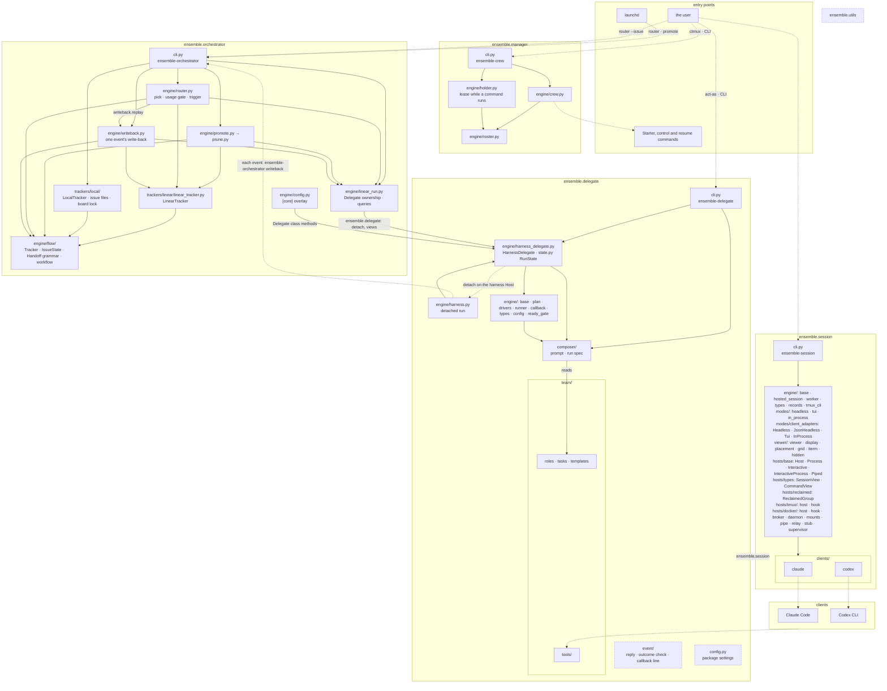
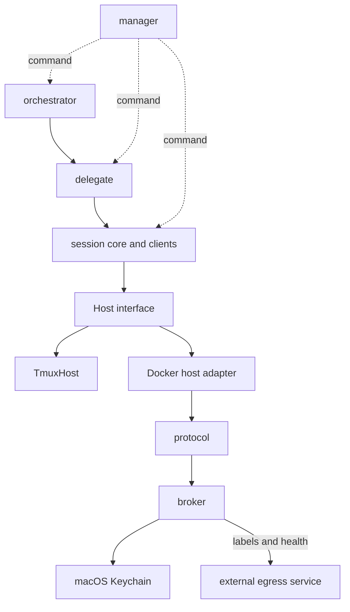

# Core architecture

Five layers in one source tree (`src/ensemble/`): utils < session < delegate < orchestrator < manager. Import rules: `AGENTS.md` › Import rules. The code, by package; terms in `CONTEXT.md`.

Solid arrow: an import, the only direction allowed, or a file read (`reads`); its label names the package imported, by its `__all__`. Dotted: runs a command or process. Dashed: shared modules, their imports not drawn.

## Modules and replacement boundaries

Layer interactions are shown above; import contracts are in `AGENTS.md` › Import rules.
Keeping a module assumes Python, the clients and their command protocols remain available.
Each Host implementation supplies its process capabilities.

| Path | Responsibility | Dependencies | Environment change | Replacement boundary |
|---|---|---|---|---|
| `src/ensemble/orchestrator/` | Board scheduling, state and write-back | delegate, utils | Keep | Public delegate API; tracker contract in `engine/flow/tracker.py` |
| `src/ensemble/delegate/` | Prompts, run plans, harness and result protocol | session, utils | Keep | Public session API and `event/` progress and outcome formats |
| `src/ensemble/session/engine/`, `modes/`, `clients/` | Session lifecycle, run modes and client adapters | Host, utils, client commands | Keep session and client logic | Host, Process, Interactive and Piped capabilities in `hosts/base.py` and data types in `engine/types.py`; tmux operations remain in `engine/tmux_cli.py` and `viewer/` |
| `src/ensemble/session/hosts/tmux/` | Local processes and tmux sessions through `TmuxHost` | Host, `engine/tmux_cli.py`, utils, local tmux | Replace as a unit if local tmux is unavailable | Host start, enumeration, status, input and close semantics; display boundary shown above |
| `src/ensemble/session/hosts/docker/`, `src/broker/`, `src/broker/protocol/` | Docker adaptation, hook relay, worker image, containers and credential injection | Host, Docker Desktop, broker; broker uses macOS Keychain | Replace as a unit | Preserve Host for callers; retaining the broker also requires its protocol JSON schemas, versions, exit codes and shared fixtures |
| `src/ensemble/manager/`, `skills/manage/`, `hooks/` | Crew, Roster, event cursors and commander sessions | utils; commands to other layers | Keep scheduling logic; adapt local display and client hooks | Record ctl and resume commands, CLI output; import relationships shown above |
| `src/ensemble/utils/` | Configuration overlays, shared types, paths and process control | Python standard library | Keep, with the required OS process capabilities | Public exports and shared data formats |
| External `windroc/egress-proxy` | Egress service, outside this repository | Docker labels and health, read by broker start ([`launcher/egress.go`](../src/broker/internal/launcher/egress.go)); `scripts/install.sh` fetches a pinned commit and starts the egress proxy | Replace the independent service as a unit | Versions, label meanings and health semantics in [docs/label-contract.md](https://github.com/windroc/egress-proxy/blob/9ed47580dc9eb4c1fe794d12e54a8f2d3f258831/docs/label-contract.md) |
| `src/broker/internal/broker/keychain_darwin.go` | Read credentials from macOS Keychain for broker injection into containers | macOS Security; storage interface in `keychain.go` | Replace the credential source as a unit | Credentials, CodexCredentials, ProviderKeys and Tokens in `launcher/host.go`; credential readers and lifecycle in [Credentials](credentials.md) |

The **Host boundary** is defined by [`hosts/base.py`](../src/ensemble/session/hosts/base.py).
In [`config.toml`](../src/ensemble/session/config.toml), `[hosts.<name>] implementation = "module.path:Class"`
selects an implementation and `[hosts] default` selects the host. Preserving its capabilities,
return types and error semantics keeps upper session, delegate and orchestrator code unchanged.
Client adaptation remains in `clients/`.

The **egress boundary** is defined by the external [docs/label-contract.md (9ed4758)](https://github.com/windroc/egress-proxy/blob/9ed47580dc9eb4c1fe794d12e54a8f2d3f258831/docs/label-contract.md).
Callers depend only on the proxy's `windroc.egress.*` labels and Docker health, selecting an internal
network and proxy address from the network key's `.name` and `.proxy`. A replacement proxy preserves
the consumed contract version, label meanings and health semantics; the contract lists the complete
startup validation rules. [`launcher/egress.go`](../src/broker/internal/launcher/egress.go) applies them for `workers` before
every [`launcher/start.go`](../src/broker/internal/launcher/start.go) start.

Solid arrows show calls or data contracts; dotted arrows show commands.
