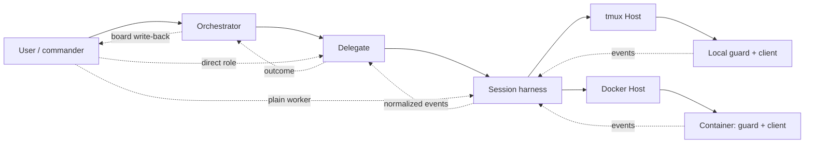

# Architecture

Ensemble separates deciding **what to run** from running a coding client. A person can direct a crew,
run a role directly, or let a board advance work through roles. [CONTEXT.md](../CONTEXT.md) defines the terms.

## Layers

| Layer | Owns |
|---|---|
| [Manager](../src/ensemble/manager/) | The commander's crew, launch records and event cursor; controls other layers through commands |
| [Orchestrator](../src/ensemble/orchestrator/) | Board scheduling, handoffs and write-back through a Linear or local Markdown Tracker |
| [Delegate](../src/ensemble/delegate/) | Role prompts, run policy and interpretation of progress and outcomes |
| [Session](../src/ensemble/session/) | Client lifecycle and normalized events, independent of client and Host |
| [Utils](../src/ensemble/utils/) | Shared configuration, records, paths and process primitives |

Orchestrator calls Delegate's public API; Delegate calls Session's. Import boundaries are enforced in
[`pyproject.toml`](../pyproject.toml). Client adapters translate native client behavior; Hosts supply execution.

## A run

Arrows show runtime flow, not imports. Direct workers have no role outcome or board write-back.

The host-side [session harness](../src/ensemble/session/harness/) owns each worker and delivers events to
registered handlers. The [guard](../src/ensemble/session/harness/guard.py) parents the client; for a TUI it
also owns the terminal. A display only attaches: losing it does not end the worker. Delegate's task attempt
and the worker have separate lifetimes; an outcome does not itself close a TUI.

## Hosts, broker and credentials

| Host | Execution boundary |
|---|---|
| [tmux](../src/ensemble/session/hosts/tmux/) | Local guard/client processes run as you, using local client logins; tmux carries the display |
| [Docker](../src/ensemble/session/hosts/docker/) | Each worker gets a container whose main process is the guard; its harness controls it over one attach channel |

The macOS [broker](../src/broker/) builds images and provisions Docker workers. It keeps long-lived logins
in Keychain and delivers runtime copies on container tmpfs: Claude setup-tokens, Codex access tokens,
OpenCode provider keys, GitHub installation tokens, environment secrets and requested Linear tokens.
App private keys, Codex refresh tokens and enrolled Linear client secrets stay broker-side. Docker access
and processes running as you remain trusted; a container separates the worker from the host, not its tools from its client.

Orchestrated Docker workers re-read current descriptions and comments with `ensemble-orchestrator issue read`,
using tracker settings and each role’s existing app grant delivered through the broker.
Tracker selection and credential specs stay in Orchestrator; existing installations need no configuration change.

Docker networking goes through the external [egress proxy](https://github.com/windroc-labs/egress-proxy),
whose [label contract](https://github.com/windroc-labs/egress-proxy/blob/122d7454d738db4a9b7e0c4a89d2cfa5ff564339/docs/label-contract.md)
the [broker consumes](../src/broker/internal/launcher/egress.go). The broker requires a healthy proxy before starting a worker.

## Next

[Install and quick start](../README.md#install) · [Customize roles and tasks](customizing-roles-and-tasks.md) ·
[Upgrade an installation](upgrading.md) · [Contributor rules](../AGENTS.md)
