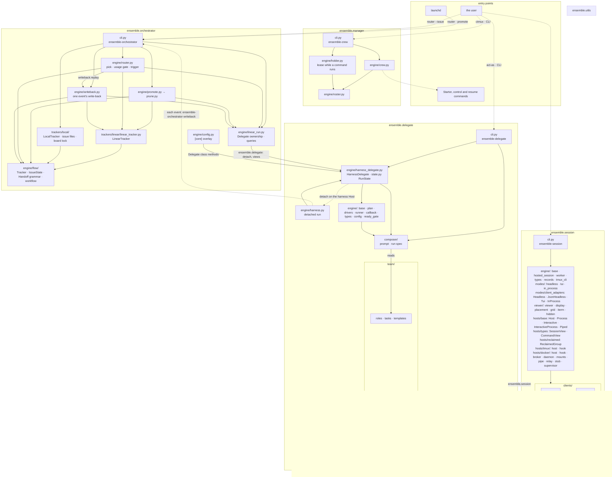
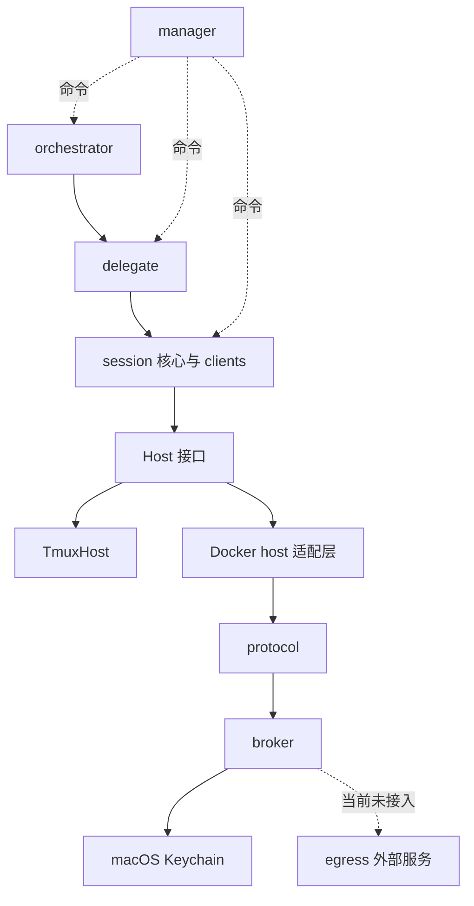

# Core architecture

Five layers in one source tree (`src/ensemble/`): utils < session < delegate < orchestrator < manager. Import rules: `AGENTS.md` › Import rules. The code, by package; terms in `CONTEXT.md`.

Solid arrow: an import, the only direction allowed, or a file read (`reads`); its label names the package imported, by its `__all__`. Dotted: runs a command or process. Dashed: shared modules, their imports not drawn.

## 模块与可替换边界

**模块边界**以本分支源码为准；层内调用关系见上图，导入契约见 `AGENTS.md` 的 Import rules。
“照搬”以保留 Python、客户端和命令协议为前提；**Host（运行宿主）**的进程能力由具体实现提供。

| 路径 | 职责 | 依赖 | 换运行环境 | 替换时守住的边界 |
|---|---|---|---|---|
| `src/ensemble/orchestrator/` | 看板调度、状态与回写 | delegate、utils | 照搬 | delegate 公共接口；tracker 契约见 `engine/flow/tracker.py` |
| `src/ensemble/delegate/` | 提示词、运行计划、harness 与结果协议 | session、utils | 照搬 | session 公共接口与 `event/` 的进度、结果格式 |
| `src/ensemble/session/engine/`、`modes/`、`clients/` | 会话生命周期、运行模式、客户端适配 | Host、utils；各客户端命令 | 照搬会话与客户端逻辑 | `hosts/base.py` 的 Host、Process、Interactive、Piped 能力及 `engine/types.py` 的数据类型；tmux 操作仍归 `engine/tmux_cli.py` 和 `viewer/` |
| `src/ensemble/session/hosts/tmux/` | `TmuxHost` 的本机进程与 tmux 会话 | Host、`engine/tmux_cli.py`、utils、本机 tmux | 环境不提供本机 tmux 时整块替换 | Host 的启动、枚举、状态、输入、关闭语义；显示层边界见上图 |
| `src/ensemble/session/hosts/docker/`、`src/broker/`、`src/broker/protocol/` | Docker 适配、hook relay、worker 镜像、容器与凭据注入 | Host、Docker Desktop、broker；broker 使用 macOS Keychain | 整块替换 | 向上保留 Host；保留 broker 时同时遵守 protocol 的 JSON schema（模式定义）、版本、退出码与 fixtures（共享样例） |
| `src/ensemble/manager/`、`skills/manage/`、`hooks/` | Crew、Roster、事件游标与 commander 会话 | utils；通过命令调用各层 | 照搬调度逻辑；本机显示和客户端 hook 随环境适配 | Record 的 ctl、resume 命令及 CLI 输出；导入关系见上图 |
| `src/ensemble/utils/` | 配置叠加、共享类型、路径、进程控制等基础工具 | Python 标准库 | 照搬；保留所用操作系统进程能力 | 各层公共导出和共享数据格式 |
| 外部 `windroc-labs/egress` | egress（出口服务），不在本仓库 | 当前源码无调用方 | 独立组件；本分支尚未接入 | 当前 broker 未实现 WDRC-107 的 Docker label + health 约定，无法从本分支给出调用方网络契约 |
| `src/broker/internal/broker/keychain_darwin.go` | 从 macOS Keychain 读取凭据，经 broker 注入容器 | macOS Security；`keychain.go` 的存储接口 | 凭据来源整块替换 | `launcher/host.go` 的 Credentials、CodexCredentials、ProviderKeys、Tokens；凭据读者、生命周期见 [Credentials](credentials.md) |

**Host 边界**由 [`hosts/base.py`](../src/ensemble/session/hosts/base.py) 定义；
[`config.toml`](../src/ensemble/session/config.toml) 的 `[hosts.<name>] implementation = "module.path:Class"`
选择实现，`[hosts] default` 选择宿主。实现保持这些能力、返回类型和错误语义，上层会话、delegate 与 orchestrator 无需更改。
客户端适配仍在 `clients/`，不由宿主替代。

**egress 边界**当前不存在于本分支的调用链：[`launcher/start.go`](../src/broker/internal/launcher/start.go)
启动容器时没有 egress 的服务发现、label 或 health 检查，协议 schema 也未声明它们。
因此不能把外部服务的网络约定写成本分支已守住的边界；更换它而上层不改的条件，在当前源码中尚无可核验实现。

实线表示调用或数据契约；虚线按标注表示命令调用或尚不存在的接入，不能作为现有依赖。
