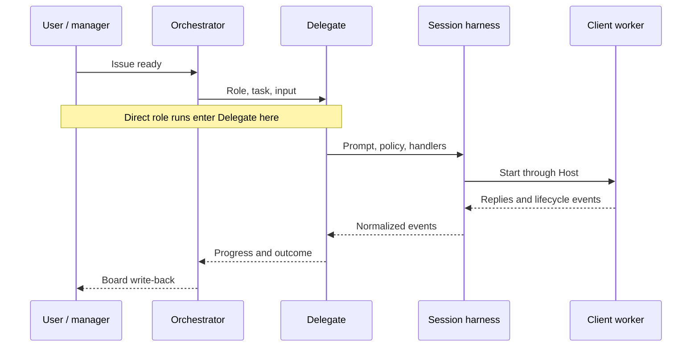

# Architecture

Read this for the shape of a run; use the topic guides below for operations.
[CONTEXT.md](../CONTEXT.md) defines the vocabulary.

## Layers

| Layer | Question it owns | Source |
|---|---|---|
| Manager | What is my crew doing, and how do I control it? | [`manager/`](../src/ensemble/manager/) |
| Orchestrator | Which board issue runs next, and what happens to its outcome? | [`orchestrator/`](../src/ensemble/orchestrator/) |
| Delegate | Which prompt, policy and result protocol does this role need? | [`delegate/`](../src/ensemble/delegate/) |
| Session | How does this client run, emit events and recover on this Host? | [`session/`](../src/ensemble/session/) |
| Utils | Which data and OS primitives do the layers share? | [`utils/`](../src/ensemble/utils/) |

Import boundaries are enforced in [`pyproject.toml`](../pyproject.toml);
[AGENTS.md](../AGENTS.md#import-rules) explains repository constraints.
Manager reaches the other layers through commands. Orchestrator uses Delegate's public API;
Delegate uses Session's. Client adapters and Hosts are separate Session extension points.

## A run

Arrows show runtime flow, not imports. A direct worker starts at Session and has no role outcome.

The session harness owns the worker; a display only attaches to it. Delegate interprets a task attempt,
while Orchestrator owns board transitions. A role outcome and a worker's lifetime are separate:
[session operation and recovery](sessions.md#working-with-a-session) explains when to close or resume.

## Find a topic

| Read when you need to… | Guide |
|---|---|
| Configure trust, control/resume a session, recall a run, extend a Host | [Sessions](sessions.md) |
| Set up or operate a board, edit local issues, understand cleanup | [Boards](board.md) |
| Install/recover Docker workers, operate egress, images and workspaces | [Docker host](docker-host.md) |
| Choose credential grants, rotate logins, understand security limits | [Credentials](credentials.md) |
| Change roles, tasks, providers or the workflow | [Customizing roles and tasks](customizing-roles-and-tasks.md) |
| Run contributor checks or real-machine acceptance | [Testing](testing.md) |
| Move an existing installation to the current release | [Upgrading](upgrading.md) |
