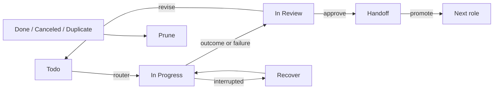
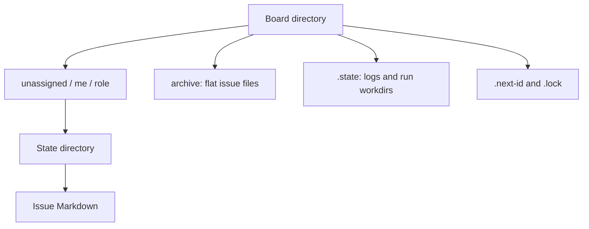

# Boards

[Architecture](architecture.md) · [Role customization](customizing-roles-and-tasks.md#on-the-board)

## Board setup

Use the [installer's board options](../README.md#install) for local Markdown or Linear setup and optional
launchd jobs. For manual configuration, use the `# local:` examples in
[`orchestrator/config.toml`](../src/ensemble/orchestrator/config.toml), the
[Linear presets](upgrading.md#linear-presets), and role [output settings](customizing-roles-and-tasks.md#change-a-roles-run-settings).
Authenticate host `gh` for each target and document host; a local document's `file://` URL is readable only on this host.

Before enabling scheduling, run `bin/ensemble-orchestrator router --dry-run` and
`bin/ensemble-orchestrator promote --dry-run`. To install launchd jobs by hand from this checkout:

```bash
mkdir -p ~/.ensemble/logs
for job in router promote; do
  launchctl bootout gui/$(id -u)/com.windroc.ensemble.$job 2>/dev/null
  sed -e "s|@HOME@|$HOME|g" -e "s|@PATH@|$PATH|" \
    launchd/com.windroc.ensemble.$job.plist \
    > ~/Library/LaunchAgents/com.windroc.ensemble.$job.plist
  launchctl enable gui/$(id -u)/com.windroc.ensemble.$job
  launchctl bootstrap gui/$(id -u) ~/Library/LaunchAgents/com.windroc.ensemble.$job.plist
done
```

This requires `ctmux --install`'s `~/.ensemble/bin`; `bootout` may fail harmlessly when no job is loaded.
The generated plists bind this checkout and shell PATH. Schedule definitions live in [`launchd/`](../launchd/).
To uninstall one, `launchctl bootout gui/$(id -u)/com.windroc.ensemble.<job>`, then remove its installed plist.

## Using the board



Names are Linear's; local directory states are listed below. Exact failure/attempt rules belong to the
[`workflow`](../src/ensemble/orchestrator/engine/flow/workflow.toml) and [`router`](../src/ensemble/orchestrator/engine/router.py).

- **New work:** assign a Todo issue to a role app in the product project; its description is the brief.
  Add `Repo: OWNER/NAME` unless the project has a configured mapping. Unfinished blockers delay claiming.
- **Approve:** move to Handoff and comment what should happen next. Promote's ten-minute delay is an undo window.
  Linear PM handoffs create an engineer `decompose` issue; the source PRD stays in Handoff until the ticket table
  is posted. Other handoffs, including local PM ones, complete their source when promoted.
- **Revise:** comment and move back to Todo. Engineer PR comments/reviews count as input too.
  Moving a run capped by its attempt limit to Todo restarts the count.
- **Recover:** use the board's Recover action for an interrupted attempt; it stays In Progress.
  To inspect a session manually, first move the issue out of In Progress: otherwise the router may resume it
  after 30 idle minutes.
- **Finish:** preserve needed work before Done, Canceled or Duplicate. See [cleanup](#state-cleanup).

Linear comments from everyone except harness/role apps and automation count as user instructions;
the manager app counts as a user. Restrict team membership and guests accordingly.
First-claim related-work search and linked-document input limits belong to
[`engine/inputs.py`](../src/ensemble/orchestrator/engine/inputs.py).

## Task and client labels

The Tasks label picks a task; without it the agent chooses. To upgrade research depth, set the next task's
label (Research uses no label), comment which claims need verification, and move back to Todo.
Task-to-label ids and tier overrides belong to orchestrator config.

An Agent label selects the client; without one the role's default applies. Multiple or unmapped labels need
correction before running; `router --dry-run` shows `client` and `client_source`. OpenCode board runs need Docker:
their cwd is not a trusted project. Configure its [provider](customizing-roles-and-tasks.md#opencode-sessions),
[network access](docker-host.md#opencode-on-docker) and, for engineers, [GitHub App](docker-host.md#create-the-github-app).

## Operating the board

| Need | Command |
|---|---|
| Run one issue now, bypassing role/usage gates | `bin/ensemble-orchestrator router --issue ID` (`--tui` to attend) |
| Inspect / attach | `bin/ensemble-orchestrator status ID` / `attach-command ID` |
| Interrupt / recover | `bin/ensemble-orchestrator close ID` / `resume ID` |
| Issue operations | [`/ensemble:board`](../skills/board/SKILL.md) |

Keep `<work_dir>/logs/runs.jsonl`: resume, Recover, write-back and first-claim search need it.
Router diagnostics go to `<work_dir>/logs/orchestrator.jsonl`.
The commander needs no Linear MCP server: disable the project's Linear entry in `/mcp` when using `/ensemble:board`.

Board role concurrency and usage gates are configured in orchestrator config; client capacity is a separate
[session concern](sessions.md#capacity-and-recovery). A failed host usage probe stops the tick; fix the probe
or explicitly turn that client's usage gate off when it has no dashboard.

## Local board

Use `ensemble-orchestrator issue create --title 'First issue' --body-file FILE` to create an issue.
Each `$ENSEMBLE_BOARD_DIR` (default `~/.ensemble/board/`) is independent; there is no sync.
Without launchd, run the router on demand and `ensemble-orchestrator promote` after the approval undo window;
promote also prunes.



States are `backlog`, `ready`, `running`, `review`, `approved`, `done`, `canceled`.
Only `<role>/ready/` queues work. A file's directory controls assignment and state;
move `review/` to `approved/` to approve, to `ready/` to revise.
The [issue-file parser](../src/ensemble/orchestrator/trackers/local/issue_file.py) owns front matter and field validation;
create with the CLI to get its format. Add a `###` line and text at the end of `Comments` to comment by hand.

An unreadable file stops routing: repair its path or permissions. A `dependency-cycle` names blocker links to
remove. For `launch-error`, fix the selected client/install, then move the issue from `review/` to `ready/`.

## State cleanup

Prune destroys uncommitted and unpushed work. Done runs get two hours; Canceled/Duplicate runs are cleaned on
the next tick, including their Docker workspace volumes and ignored files. After seven days it removes the
remaining issue workdir. An issue in a state other than Todo/In Progress for seven days also loses checkouts
and temp files. Save anything needed before finishing it; prune's forced volume deletion is not a backup check.
Issue archiving waits for eligible sub-issues; exact eligibility is the
[`Tracker` contract](../src/ensemble/orchestrator/engine/flow/tracker.py).

| State | Manual deletion rule |
|---|---|
| Config, run ledger, board files / `.next-id`, customized `docker/worker/` | Preserve |
| `work/ID/agent/`, `tui/NAME/` | Let prune / session close remove them |
| `work/ID/run/`, `writeback.json`, session/client history | Remove only when no future resume/reopen/recovery is needed |
| Router/board locks, `tui/NAME.lock` | Remove only with no relevant operation running |
| `managers/NAME/` | Remove only without a holder; its roster is lost |
| `adhoc/` run | Check `ensemble-delegate status DIR` first; never remove an active run |
| Diagnostic logs, `probe/`, generated `bin/`, hidden display metadata | Disposable; preserve the `logs/` directory |

Linear runtime state uses configured `<work_dir>`; local runtime state uses `<board>/.state/`.
Docker volume recovery/removal is described only in [workspace volumes](docker-host.md#workspace-volumes).
