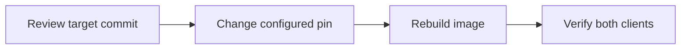
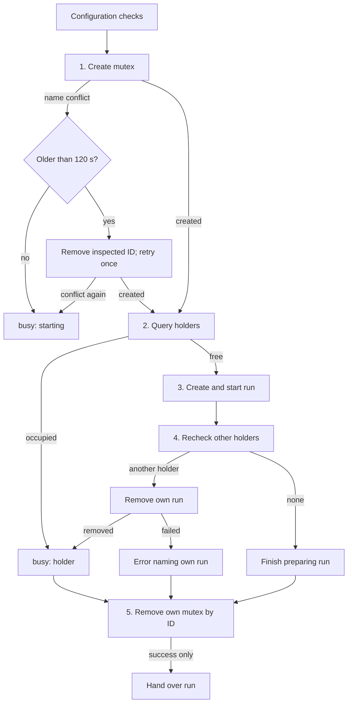

# Docker host

`ensemble-broker` builds the worker image and starts and closes worker containers on macOS (Apple silicon) with
Docker Desktop. It keeps the logins and the GitHub App key in the login keychain and writes credentials only into a
container's tmpfs. Session's Docker Host calls it ([Run workers](#run-workers)); the sections up to [Close](#close)
install the broker by hand; each credential's readers, lifetime
and revocation: [Credentials](credentials.md).

The host needs no Node and no personal Codex: the clients run in the image. On subscriptions a container holds a
model credential; an API key behind a host model relay, so that containers hold none, is not supported.

Run every step as yourself, `HOME` your account home. `B` is `/usr/local/libexec/ensemble/ensemble-broker`; `PKG`
the installed ensemble plugin directory.

## Install

Needs Docker Desktop (running) and `gh` (logged in).

`scripts/install.sh --docker` installs and starts Docker Desktop and the [egress gateway](#egress-gateway).

**Rosetta** stays off and `scripts/install.sh` never installs it: the worker image is arm64. For an amd64-only base image in
your Dockerfile, run `softwareupdate --install-rosetta`, then turn on Docker Desktop › Settings › General › **Use Rosetta
for x86_64/amd64 emulation on Apple Silicon**. Rosetta cannot be uninstalled, so `scripts/install-cleanup.sh` cannot
undo it.

```sh
sh "$PKG/src/broker/install.sh"
```

It downloads the broker asset of the plugin's version, installs it root-owned (`sudo` asks once) only after
`gh attestation verify` proves the ensemble release workflow built it from that version's tag, and seeds
`~/.ensemble/docker/worker/Dockerfile` (your image, edit freely) only if `~/.ensemble/docker/worker` does not exist.
The asset appears a few minutes after a Release is published; until then it exits non-zero: retry. `--build`
instead builds and ad-hoc signs it locally with the hardened runtime (needs Go, `brew install go`, and the Xcode
command line tools).

To upgrade, rerun it (your Dockerfile is never overwritten), then [log in](#log-in) again. Claude Code upgrades with
the image. The image pins `gh`, Codex and OpenCode; rebuild an image whose client is below the broker's minimum version.
A worker runs only that Codex, `/opt/ensemble/bin/codex`, first on `PATH`: a Codex your Dockerfile installs is never run,
so drop it to shrink the image (a Dockerfile seeded before this change has `@openai/codex` in its `npm install -g` line).

### Egress gateway

Selecting Docker in `scripts/install.sh` also fetches private `windroc/egress-proxy` using your logged-in `gh`
access, pinned to commit `9ed47580dc9eb4c1fe794d12e54a8f2d3f258831` (label contract 1). It installs under
`~/.egress/versions/<commit>`, runs that version's `start.sh`, and waits up to 120 seconds for
`egress-proxy` to become healthy. `~/.egress/current` points to the installed version. It does not follow
a branch or tag. No Docker selection means no gateway installation.

The installer creates `~/.egress/config.local.yaml` only when absent, with just `workers` in denylist mode;
an existing config is kept byte for byte. A config symlink is preserved and rejected: the gateway mounts
its containing directory, so host symlink targets may not resolve inside the container. Use a regular file. A healthy same-version rerun keeps the checkout, config and container.
The gateway is shared with other caller networks: ensemble cleanup keeps `~/.egress`. If cleanup also removes
Docker Desktop, the gateway stops and its Docker state may be removed; reinstall Docker before using it again.
The pinned [gateway README](https://github.com/windroc/egress-proxy/blob/9ed47580dc9eb4c1fe794d12e54a8f2d3f258831/README.md)
and `config.example.yaml` in the installed version define the config.

| Operation | Command |
| --- | --- |
| Start, add or remove a caller section | `~/.egress/current/start.sh` (before the first successful install, rerun `scripts/install.sh --docker`) |
| Apply a policy edit within existing sections; after the Mac changes networks | `docker restart egress-proxy` |
| Health in the status column | `docker ps --filter name=egress-proxy` |
| Detailed health | `docker inspect --format '{{json .State.Health}}' egress-proxy` |
| Startup/config errors | `docker logs egress-proxy` |

`start.sh` builds locally and renders caller networks from the local config before `docker compose up -d`;
bare compose lacks those attachments. The gateway uses `restart: unless-stopped`, including after Docker Desktop
restarts; after a Mac reboot, Docker Desktop must start at login. Any policy restart disconnects in-flight
connections on **every** caller network. Running workers keep their proxy settings and need no restart.
An edited config without a gateway restart makes health `unhealthy`. Every `start` needs `egress-proxy` running
and healthy on its internal `workers` network: otherwise, before any credential or container, it fails
`egress_unavailable` (exit 17), naming the gateway and `start.sh`, and never falls back to `bridge`. Fix the
config/startup error, wait for healthy, then start, restart or resume again.

New workers join only the internal network advertised by the `workers` label (`egress-workers` in contract 1).
Both cases of `HTTP_PROXY` and `HTTPS_PROXY` point to the label's proxy (`http://egress-proxy-workers:4750`), and
`NO_PROXY`/`no_proxy` list only container loopback (`localhost,127.0.0.1,::1`): all other traffic, `host.docker.internal`
and LAN addresses included, goes through the gateway's `workers` policy. The gateway allows public destinations and denies private
ranges, the Mac and LAN, including `host.docker.internal`, unless a specific `host:port` exception applies.
Without the gateway there is no worker egress. Tools that ignore proxy variables cannot reach external services
(including direct SSH, raw TCP/UDP and external DNS). Same-network containers can reach each other directly.

The gateway cannot discover the Mac's public IPv4 address or global IPv6 LAN prefix: add those to `deny_ranges`
in the local config. Restart after changing Wi-Fi or another host network. The policy's limits and defaults
are in the pinned README. Image builds still use their existing network and can reach the Mac and LAN.

## Log in

After every install or reinstall, run all three logins: `login claude`, `login github ensemble-bot` and
`login codex` ([Codex](#codex)), plus `login claude <name>` for each other registered
[Claude account](#claude-accounts), `login opencode <name>` for each configured OpenCode provider and
`login env <name>` for each [environment secret](#environment-secrets). A reinstalled broker cannot read the old items without asking; `start` never asks and instead names the login to rerun. Each login asks its terminal questions first, without
echo:

| Login | Terminal | macOS dialog, at most | Click |
|---|---|---|---|
| `login claude [<name>]` | the token; the login keychain password only when the item's access needs a change | one change-access dialog, after the password; one read dialog, announced on the terminal first | Allow; Always Allow |
| `login github ensemble-bot [--key-file <pem> --app-id <ID>]` | the login keychain password, when a step is not yet in place | with `--key-file`, none; else one change-access dialog (Deny / Allow), after the password | Allow |
| `login codex` | the login keychain password, when a step is not yet in place, before the browser opens | one change-access dialog (Deny / Allow), after the password | Allow |
| `login opencode <name>` | the provider's API key; the login keychain password only when the item's access needs a change | at most one change-access dialog (Deny / Allow), after the password | Allow |
| `login env <name>` | the value, hidden, unless stdin is a pipe or file; the login keychain password only when the item's access needs a change, from the terminal | at most one change-access dialog (Deny / Allow), after the password | Allow |
| `start` | none | none: a token or key it cannot read without one names unlocking the login keychain or the login to run (`keychain_failed` for an OpenCode key or an environment secret needing approval; `login_required` for other clients and a missing environment secret) | |

What each login hands a container: [Credentials › Who logs in](credentials.md#who-logs-in).

**Claude**:

```sh
claude setup-token          # copy the token it prints
"$B" login claude           # paste it; nothing echoes
"$B" login claude work      # another registered account's token, from its own subscription
```

It saves the token in `ensemble-claude` / `<name>` (`default` without a name), replacing an earlier one, and makes it trust only the broker. If macOS asks, enter the login keychain password and click Always Allow as the terminal instructs.

**GitHub**: the private key of your one GitHub App ([create it](#create-the-github-app)), whatever its name, must be
a generic-password item in the login keychain, service `ensemble-bot`, account its App ID, content the key. Let the
broker create it from the downloaded `.pem` (`scripts/install.sh` does), so the key never goes on a command line:

```sh
"$B" login github ensemble-bot --key-file <key>.pem --app-id <App ID>   # then delete <key>.pem
"$B" login github ensemble-bot                                          # after a broker reinstall
```

With `--key-file` it refuses an existing `ensemble-bot` item. Without it, the item must exist. If login exits non-zero, rerun it. It prints the App's slug and bot user ID; set `[session.hosts.docker.github] app = "<slug>"` in `~/.ensemble/config.local.toml` (`scripts/install.sh` writes it). The App must be private (installable only on your account): every session gets a token for every repo of every installation.

**OpenCode**: for each `[session.clients.opencode.providers.<name>]` table (Ollama needs none):

```sh
"$B" login opencode strata   # paste strata's API key; nothing echoes
```

It saves the key in broker-only item `ensemble-opencode` / `<name>`, replacing an earlier one. A Docker OpenCode start needs every configured provider's key; a missing one names this login command.

`scripts/install.sh --docker` with OpenCode selected first ensures the local OpenCode API entry, then imports it
into the broker, so a local commander and Docker workers both have credentials with one key entry. To import an
existing local entry manually instead of pasting again:

```sh
"$B" login opencode strata --auth-file "${XDG_DATA_HOME:-$HOME/.local/share}/opencode/auth.json"
```

The installer registers the provider for directly started local OpenCode too
([global provider config](sessions.md#opencode-sessions)); manual broker login only stores its key.

`--auth-file` requires an absolute path and the selected provider's nonempty `type: api` entry in a JSON object
of at most 1 MiB. It reads no key into argv or env; the keychain password may still be requested. Direct login
without this option stores only the broker item. Reruns and cleanup ownership: [Credentials](credentials.md#opencode-provider-api-keys).

### Create the GitHub App

`scripts/install.sh` does not create it. In GitHub › Settings › Developer settings › GitHub Apps › New GitHub App:

1. Owned by you, installable **Only on this account** (private).
2. Webhook: off (clear **Active**).
3. Repository permissions: Contents, Pull requests and Workflows **Read and write**; Checks, Actions, Commit statuses and Metadata **Read-only**: at least each permission in `github.permissions`.
4. Create it, note its **App ID**, then **Generate a private key** (a `.pem` download).
5. **Install App** on only the repositories agents may push to.

Then store the key and run `login github` as [above](#log-in); `scripts/install.sh` asks for the `.pem` and the App ID, does
both and writes the App's slug to `github.app`.

## Build

```sh
"$B" build --ensemble "$PKG"              # Docker's progress on stderr, then {"image":"ensemble-worker:<key>","digest":"sha256:…","rebuilt":true}
"$B" build --ensemble "$PKG"              # the same, "rebuilt":false
"$B" build --ensemble "$PKG" --max-age 0  # rebuild now
"$B" build --ensemble "$PKG" --base-image dummy-env:test --image-plugin dummy-plugin  # see Base images
```

The full form is `build --ensemble DIR [--base-image IMAGE] [--plugin SOURCE]... [--image-plugin NAME]... [--max-age
SECONDS]`, in that order.

A changed Dockerfile or ensemble version gives a new key. No build log shows a secret. Rebuilds skip Docker's cache,
so they install npm's latest Claude Code. `--max-age N` rebuilds an image N or more seconds old under the same key (a
start passes 604800, 7 days); if that rebuild fails (e.g. offline) it keeps the image, printing `ensemble-broker: kept
<image>: refreshing it failed: <reason>`, except `--max-age 0`, which fails.

After a rebuild, `build` removes unused older images, keeping those used by containers or recent builds.

### Plugins

A container’s Claude Code and Codex independently install `[session.hosts.docker] plugins` through their
native marketplace commands. The [packaged default](../src/ensemble/session/config.toml) pins updraft
(the team’s `/updraft:build`, `/updraft:light-build` and `/updraft:review`); `[]`: none. Configure a remote plugin as
`name@plugin-owner/repo#commit::marketplace-owner/repo#commit`, with both commits exactly 40 lowercase hexadecimal
characters. The plugin and its catalogue are pinned together in the same entry; neither follows a moving branch.

```toml
[session.hosts.docker]
plugins = ["updraft@windroc-labs/updraft#33f01c3b9e398e009f1fb1a4554ddcf19209dd4e::windroc-labs/agent-plugins-marketplace#dbea3408ab0c113bd74f414ab3a19d820e0f6e43"]
```

This installs `updraft@windroc` from the configured shared catalogue. Each client fetches the catalogue into
`/opt/ensemble/<client>-plugins/sources/<marketplace-owner>/<repo>`, verifies its detached HEAD, and pins the
catalogue’s existing plugin entry to the configured plugin commit using a Git URL source that both clients
support. The catalogue supplies the marketplace name, `windroc` for the packaged default. The broker has no
repository names, commit constants, or plugin-specific repository matching. Moving a plugin or catalogue requires
updating configuration, with no broker code change. No marketplace manifest is required inside a remote plugin.

Codex’s installed Git HEAD and Claude Code’s native `gitCommitSha` installation record must match the plugin pin;
catalogue HEAD is checked before registration and after installation. The broker records the catalogue’s `name`,
`repo` and `commit`, plus the remote plugin’s `plugin_repo` and `plugin_commit`, in
`/opt/ensemble/plugin-sources.json`. Both repository names and pins affect the image key. It reads no host
installation records or plugin contents. Duplicate plugin names and conflicting plugin or catalogue pins fail
before Docker. Logs report the installed version and verified plugin commit for each client. Private plugin access
requires Git credentials available during the image build.

An entry without the `::marketplace-owner/repo#commit` suffix remains a self-contained marketplace:
`name@marketplace-owner/repo#commit`. Its selected plugin must have a `./` source directory within the pinned
checkout; unconfigured remote sources and paths escaping it are rejected. An old remote-plugin entry that named
only the plugin repository must add its catalogue and pin. The old `updraft`, `name@marketplace` and unpinned
`name@owner/repo` forms remain invalid.
The image never installs ensemble’s own plugin: every session disables it and uses `/opt/ensemble/team`.
A host with only OpenCode gets the same pinned default.

#### Upgrade a plugin



| Action | File or check |
|---|---|
| Choose the commit | Review the source diff; resolve a reviewed tag with `git -C <source-checkout> rev-parse <tag>^{commit}` and use the full commit, not the tag. |
| Set the pin | Your override: `~/.ensemble/config.local.toml`, `[session.hosts.docker] plugins` (replaces the whole list). Packaged default: `src/ensemble/session/config.toml`; Worker image CI reads that same list. Keep all plugins from one plugin or catalogue repo on the same respective pin. |
| Force a build | `/usr/local/libexec/ensemble/ensemble-broker build --ensemble <plugin-dir> --plugin '<name>@<plugin-owner>/<repo>#<commit>::<marketplace-owner>/<repo>#<commit>' --max-age 0`; repeat `--plugin` for every configured entry. Upgrade the broker from this checkout first. |
| Check the result | Build logs must report the configured commit for both `claude` and `codex`. In the image, compare `plugin-sources.json` with `git -c safe.directory=<checkout> -C <checkout> rev-parse HEAD` for both source directories above. For a remote plugin, also compare Codex’s installed Git HEAD and Claude Code’s `gitCommitSha` installation record with `plugin_commit`. Worker image CI checks the catalogue pins and both installed caches; the installer verifies the plugin pins. |
| Exercise a failure | `python3 .github/run_tests.py Unit tests/unit/docker_plugin_install_test.py` with [test setup](tests.md): fake git returns a different commit for each client, before and after installation, and checks the explicit mismatch error. Real configuration and credentials stay untouched. |

Host plugin updates do not change these pins. A default-branch move cannot change a pinned build; if the
configured commit cannot be fetched, the build fails instead of falling back to another revision.

Claude loads its installation through `/opt/ensemble/plugins/<name>`, listed in `CLAUDE_CODE_PLUGIN_DIRS`, with
`/<name>:` commands. OpenCode's container config points `skills.paths` at `/opt/ensemble/plugins`: it discovers the
same original `skills/*/SKILL.md` files and keeps their relative references. Codex loads its own native installation. Source plugin files are root-owned and read-only for `agent`.

Invalid sources and duplicate plugin names fail before Docker; marketplace, installation or metadata failures
fail the image build. Selecting a plugin trusts its code, hooks and servers beside the container's credentials.
`scripts/install.sh --docker` installs ensemble on the host and leaves updraft installation to the image;
`--no-docker` also installs updraft for the selected host Claude/Codex clients.
A base image can also carry plugins of its own: [Base images](#base-images).

### Base images

`--base-image IMAGE` takes a local image tag or ID as stage 1 in place of `~/.ensemble/docker/worker`; the result is
still `ensemble-worker:<key>`. The broker never pulls or rebuilds it: an image absent locally fails the build naming
it. The key covers the base image's local ID, so rebuilding the base image gives a new key and the next build
rebuilds the variant; the same ID under two tags shares one variant. The 7-day refresh (`--max-age`) rebuilds only
the ensemble layer; updating the base image's Claude Code and plugins is yours. The broker tags the base image as
`ensemble-user:<key>`, so removing older images can delete a base image that has no tag of its own once no variant
or container uses it: tag your base images.

Before building, the broker checks the base image, offline and unprivileged, and fails with `build_failed` naming
each missing item:

| Requirement | Why |
|---|---|
| `apt-get`, `dpkg` (Debian) | the ensemble layer installs tini, python3, python3-venv, curl, ripgrep and gh |
| `node`, `npm` | the ensemble layer installs Codex and OpenCode |
| `tmux`, `git`, `claude` (Claude Code) | sessions run them |
| a non-root user `agent` | sessions run as it; the broker reads its UID and GID from the image (1000 works) |

Commands must be on `/home/agent/.npm-global/bin:/usr/local/bin:/usr/bin:/bin`, the container's `PATH` less
`/opt/ensemble/bin`, as `agent` finds them. python3 is not required. A label starting with `windroc.` or `ensemble.`
also fails the build, naming it: those are the broker's.

`--image-plugin NAME` adds a plugin the base image (or `~/.ensemble/docker/worker`) already holds in
`/opt/windroc/plugins/NAME/`, on top of the `--plugin` sources: its `.claude-plugin/plugin.json` must have `"name":
"NAME"` and `agent` must be able to read every file in the directory. Claude Code loads it as `/NAME:` through
`CLAUDE_CODE_PLUGIN_DIRS`, after the source plugins; Codex and OpenCode do not load it. A plugin directory that is
missing, unreadable by `agent`, or whose `plugin.json` names another plugin fails the build naming the plugin; a
name used twice, by either option, fails before Docker. Plugin names are part of the key.

The base image is trusted like `~/.ensemble/docker/worker`: the variant inherits its environment, `ONBUILD`
triggers and binaries, and sessions run in it with their credentials. The checks verify its shape, not its
contents.

## Start

```sh
mkdir -p ~/src/demo ~/.ensemble/docker-state/worker_1/claude
cat > /tmp/worker_1.json <<EOF
{"name": "worker_1", "client": "claude", "generation": "$(openssl rand -hex 16)", "image": "$I",
 "cwd": "$HOME/src/demo", "workspace": "ensemble-ws-worker_1",
 "claude_dir": "$HOME/.ensemble/docker-state/worker_1/claude", "github": null, "labels": {}}
EOF
"$B" start --manifest /tmp/worker_1.json
```

It prints the container name (`C` below) and client versions.

## Environment secrets

Named values a container gets by reference, such as a password, an API key or an ssh private key. Import each once
per broker install:

```sh
"$B" login env dummy                      # type or paste the value; nothing echoes
"$B" login env mini-ssh < ~/.ssh/id_mini  # a pipe or file: stored verbatim, newlines included
```

It saves the value, 1 to 16384 bytes, in broker-only item `ensemble-env/<name>` / `<name>`, replacing an earlier one.
Names match `[a-z0-9][a-z0-9._-]{0,63}`. With a pipe or file on stdin, the keychain password, when needed, is read
from the terminal. The value never goes on a command line. Pipe a long value: the terminal's line mode limits a
typed line (1024 bytes on macOS).

A start manifest lists the secrets it wants, at most 16:

```json
"secrets": [{"item": "ensemble-env/dummy", "file": "dummy.txt"}]
```

`item` must be an `ensemble-env/<name>` reference; any other keychain service, the broker's own and Linear's
included, is `manifest_rejected`. `file` is one name of at most 255 bytes: no `/`, no control character, not `.`
or `..`, and not repeated in the list. The broker checks both itself whatever sent the manifest. It reads each
item at `start` only, after the manifest checks and before any container exists, so a missing or unreadable item
refuses the start, naming it and the login to run. It then writes each value to
`/run/ensemble/secrets/env/<file>` in the container's secrets tmpfs, 0400, owner `agent`, through `docker exec`
stdin: never in the container's env, arguments or image. The copy goes with the container. Who can read the item
and the copy, and how to revoke: [Credentials › Environment secrets](credentials.md#environment-secrets).

## What a container gets

- User `agent`, all capabilities dropped, `no-new-privileges`; no Docker socket.
- Only the gateway's `workers` network, with its proxy variables ([Egress gateway](#egress-gateway)).
- A workspace volume at cwd; Claude and OpenCode have their own client-state bind, Codex only its session history.
- Credentials on tmpfs, readable by the container's processes ([Credentials](credentials.md)); each listed
  [environment secret](#environment-secrets) at `/run/ensemble/secrets/env/<file>`.
- Tools from your `~/.ensemble/docker/worker/Dockerfile`, plus ensemble, clients, plugins and credential wrappers.
- Each checkout runs its own branch's `.githooks/` through `core.hooksPath = .githooks`; a checkout without that directory runs none.
- With GitHub configured, commits use the App's bot identity.

## Close

```sh
"$B" close --container "$C"   # {"container":"…","removed":true}
"$B" close --container "$C"   # removed:false: already gone
```

`docker ps -a --filter name="$C"` lists nothing.

## Audit log

Every `start`, `refresh` and `close` appends to `~/Library/Logs/ensemble/broker.jsonl`, recording credentials issued, renewed, withdrawn or revoked, never a token or key. Past 10 MiB it rotates to `broker.jsonl.1`. An unwritable log may lose records. OpenCode provider keys have no audit line. Each environment secret a start writes is an `env-secret` credential naming its `item`, never its value: `issued` at start, `withdrawn` when close or a failed start removes the container. No container mounts it.

Audit persistence failure adds `audit_warning: "audit_write_failed"` to the broker's JSON
response, alongside the original success fields or error envelope. The operation's exit code,
result and cleanup details still apply: do not repeat a successful start because its audit
write failed. The host logs a fixed warning; interactive maintenance also writes
`credential_audit_warning` to the session event file. Audit records do not replace credential
recovery storage.

`ensemble-broker status` only reads credential status and the stored revocation backlog; it
emits no audit. `ensemble-broker status --cleanup` explicitly retries that backlog and audits
resolved entries, preserving the former status behavior. See [credential status](credentials.md).

```sh
jq 'select(.session=="NAME")' ~/Library/Logs/ensemble/broker.jsonl
```

## Run workers

Make the Docker Host the default in `~/.ensemble/config.local.toml`:

```toml
[session.hosts]
default = "docker"
```

| `[session.hosts.docker]` key | Default | Meaning |
|---|---|---|
| `docker` | `/usr/local/bin/docker` | the docker CLI, an absolute path |
| `plugins` | pinned updraft from packaged config | the plugin payloads every image holds ([Plugins](#plugins)); `[]`: none |
| `github.app` | `""` | the slug of the GitHub App `login github` saved, whose installation tokens every session gets, as `ENSEMBLE_PR_AUTHOR=<app>[bot]` names it; `""`: none |
| `github.permissions` | contents, pull_requests, workflows `"write"`; checks, actions, statuses `"read"` | the repository permissions each token is limited to, `<name> = "read"` or `"write"` as GitHub names them; a start with an unknown name or level fails `manifest_rejected`, and one the App lacks fails `github_failed`. A local table merges key by key: it sets or adds a permission, never removes one |
| `isolated` | `true` | its sessions' clients run in yolo mode ([Permissions](#permissions)); `false`: auto mode, as on tmux |

Then `ensemble-crew worker NAME --client claude` starts NAME in its own container; the other `ensemble-crew` verbs,
the Viewer, `--display none`, `[session.viewer]` and `ls --descendants` work as on tmux. Every docker call goes to
`unix://<account home>/.docker/run/docker.sock`, whatever `DOCKER_HOST`, `DOCKER_CONTEXT` or `DOCKER_CONFIG` say.

In a Docker worker pane, scroll up with the mouse wheel or trackpad, both in iTerm's tmux integration
and in a regular terminal. New workers enable the container tmux's `mouse` option and keep 50,000
history lines, matching `ctmux`. Clients that capture the mouse (Claude Code, for example) keep their
own scrolling; otherwise tmux enters copy mode to show pane history. Scroll back to the bottom to
resume input, or press `q` to leave tmux copy mode. The history is inside the container; the host pane's
scrollbar alone cannot show it. Restart an existing worker to apply these settings; no image rebuild is needed.

Text a client copies in a container's pane (Claude Code's mouse selection, for one) reaches your clipboard by OSC 52:
the container's tmux sets `set-clipboard on` and `allow-passthrough on`. Your terminal must support OSC 52 (Ghostty
does), and a host tmux showing the pane needs `set -g set-clipboard on` in `~/.tmux.conf`.

A session's credentials are renewed by the TUI session's host run supervisor or the headless run's harness;
failures go to the session's events or the harness's log and retry every minute:

| Session | Renewal due | Failure event |
|---|---|---|
| Codex | 10 minutes before the earliest Codex or GitHub expiry | `client_refresh_failed <reason>` for either credential's failure |
| Other clients with GitHub tokens | 10 minutes before the earliest GitHub expiry | `github_refresh_failed <reason>` |

Codex and GitHub renew independently within one broker refresh: a Codex failure still attempts GitHub renewal.
For Codex, the absence of `github_refresh_failed` does not imply GitHub renewal succeeded; inspect
`client_refresh_failed` and the [broker audit](#audit-log). A valid broker error preserves its message and optional
cause. If the published Codex deadline expires, the supervisor reports `client_auth_expired` and closes the container;
GitHub-only renewal keeps retrying across expiry. See [Codex recovery](#recovery).

### Permissions

The container is the isolation boundary, so every Docker session (crew worker, role or headless run; start, restart
and resume) runs its client in yolo mode: no permission prompt or approval; it writes files, runs `gh` and reaches the
network unasked, within the container's reach (workspace volume, the session's GitHub tokens, the network). Flags:
[Client policy](sessions.md#client-policy).

### Role runs

Role runs (`ensemble-crew role`, attended board runs) run their client in a container; their harness stays on the
host, on another Host:

```toml
[delegate.delegates]
harness_host = "tmux"
```

A headless agent (an unattended board run, `ensemble-delegate run` without `--detach`) runs in its own container; `ls`, `attach` and the Viewer do not show it. Its container closes when the client exits or stops; if the harness dies, cleanup waits for the next Docker start or close. Its workspace and history survive revision rounds, and `ensemble-crew reopen` continues them.

Docker role runs refuse a missing or Docker `harness_host`, host `read`/`write` dirs, a role `cwd`, custom `team_dirs` roles and multiple or non-GitHub target repos. They use the image's team at `/opt/ensemble/team`.

Before the first role run, [log in](#log-in) to GitHub and install the App on every repo the runs need, your docs repo
included: every Docker session can read and write exactly those private repos.

An engineer opens its draft PR as the App's bot; the host marks it ready for your review, and revision rounds push to the same branch. Then [review before pulling](#review-before-pulling).

### Codex

Install or upgrade the broker first ([Install](#install)). `<version>` is an exact stable npm version, at least `0.163.0` for both the pinned host installation and the image. A lower host version needs `update-codex`; a lower image needs a [rebuild](#build).

| Action | Command |
|---|---|
| First pinned installation | `sudo /usr/local/libexec/ensemble/ensemble-broker install-codex <version>` |
| Explicit update or native-file repair | `sudo /usr/local/libexec/ensemble/ensemble-broker update-codex <version>` |
| Browser login, as yourself | `/usr/local/libexec/ensemble/ensemble-broker login codex` |
| Inspect | `/usr/local/libexec/ensemble/ensemble-broker status` |

Each start, restart or resume selects the latest supported stable container Codex. The broker stages the integrity-checked platform package's complete vendor tree, including `codex-code-mode-host`, in the executable runtime tmpfs and publishes it with one directory rename. Before injecting credentials it verifies the version and starts the companion with `--help`; the image build checks its npm installation the same way. Lookup, incomplete packages, installation or probe failures restore and verify the image version. A below-minimum host or image is refused. The host installation is upgraded only by your explicit command.

### Claude accounts

A Docker Claude session runs on one Claude account, a subscription whose setup-token the broker keeps: `default`
unless a worker or role selects another. Register each other one in `~/.ensemble/config.local.toml`, then
[log it in](#log-in) (`"$B" login claude work`):

```toml
[session.clients.claude.accounts.work]
dir = "~/.claude-work"   # its CLAUDE_CONFIG_DIR on the host, absolute after ~; absent → ~/.claude
account = "me@work"      # a display string, e.g. its login email
```

No other key and no secret. A name is 1–64 lowercase letters, digits, `.`, `_` or `-`, never `setup-token`.
`default` is always registered, its `dir` `~/.claude` (never written; a `[…accounts.default]` table may set only
`account`). The usage probe reads `dir`: `claude -p /usage` on the host with `CLAUDE_CONFIG_DIR=<dir>`, unset for
`default` and any account whose `dir` is `~/.claude`.

With no selection and two or more accounts registered (`default` counts), a Docker Claude start picks one by usage
left (100 minus the higher of its 5h and weekly used percent):

1. the account under both usage-gate thresholds (5h below 90 %, weekly below 100 %) with the most left;
2. none under: the account with the most left;
3. no reading known: none (`default`).

A tie goes to `default`, then name order. Each account's reading is cached in `~/.ensemble/usage/claude.json` for
5 minutes (a failed probe's for 30 seconds), so a start or gate check within that time probes nothing; each probe prints
`claude usage: account <name>: five_hour=<p>% weekly=<p>%` (or `unknown`) to stderr, and the start
`claude account <name>: picked (…)`. Resumes pick again.

Select one:

- **Worker**: `ensemble-crew worker NAME --client claude --account work` (`ensemble-session start NAME --client claude
  --account work`); restart and resume keep it.
- **Role**: keyed by client, so a run whose client an Agent label switches to Codex or OpenCode gets none:

  ```toml
  [delegate.roles.engineer.accounts]
  claude = "work"
  ```

  `[delegate.accounts]` holds every role's, and for board runs `[orchestrator.core.accounts]` and
  `[orchestrator.core.roles.<role>.accounts]` come after; a later table wins entry by entry, `""` unsets one.
  A Delegate resume, a board run's included, resolves it again from the current config; `ensemble-crew reopen`
  restarts on the account its run record holds.

An unregistered account, an account selected for Codex or OpenCode, or a registered account not logged in fails before a container starts. `--env ENSEMBLE_ACCOUNT=…` and a policy `env` naming it are refused: use `--account` or a role's `accounts` table.

- Config picks the account; it is no access control: any process running as you can start a container with any
  logged-in account ([Credentials › Risks](credentials.md#risks)).
- With two or more accounts on the Docker Host, the usage gate and `--brake` read the account a start with no
  selection picks, so the gate skips Claude runs only when every account is over a threshold (`usage-skip`, reason
  `usage`) or none has a reading (`usage unknown`). A worker's or role's selected account is gated the same way, not
  by its own usage. With one account, or on tmux, the
  gate probes the host's Claude login. The board's limit hold stays per
  client: one account's usage limit holds every board run on Claude.
- The tmux Host checks a selection as above, then ignores it: the session runs on your own Claude login.

### OpenCode

OpenCode sessions run the host's Ollama models, or a configured provider's ([OpenCode sessions](sessions.md#opencode-sessions)).
Ollama needs no login; each configured provider's API key comes from the broker ([Log in](#log-in)), which writes it
to the container's `/run/ensemble/secrets/opencode/<name>.key` at start ([Credentials](credentials.md#who-logs-in)).
A provider is reached through the [gateway](#egress-gateway). Add the `host:port` of each local or LAN provider's
`base_url` to `networks.workers.exceptions` in `~/.egress/config.local.yaml`, then `docker restart egress-proxy`.
Use the URL's default port (80 or 443) when omitted. For example, `http://10.0.0.5:8080/v1` needs `10.0.0.5:8080`;
Ollama needs `host.docker.internal:11434` (or your configured `ollama_port`). `localhost` is the container itself.
The installer does not add these exceptions. They allow that host and port for **every worker**, including Claude
and Codex; other ports and LAN destinations remain denied. Host-side `probe-provider` does not use the gateway,
so it can pass while a worker still lacks its exception. Docker may also need macOS Local Network permission.
An `http://` `base_url` sends the key in plaintext on the permitted path ([Risks](#risks)). Once, on the Mac:

1. Keep Ollama on `127.0.0.1` (its default; leave `OLLAMA_HOST` unset): add its exception above so the gateway can
   reach it through `host.docker.internal`.
2. Set its context length to at least 65536, or tool calls fail: for the Ollama app,
   `launchctl setenv OLLAMA_CONTEXT_LENGTH 65536`, then quit and reopen it; for `ollama serve`, start it with
   `OLLAMA_CONTEXT_LENGTH=65536`. A larger one: set `[session.clients.opencode] ollama_context` to it, or
   OpenCode compacts as for 65536 ([OpenCode sessions](sessions.md#opencode-sessions)).
3. Pull every `ollama/` model of the tiers and `model`, `ollama pull qwen3.6:35b-mlx` by default
   (`[session.clients.opencode.tiers]`; `ollama_port`, default 11434, is its port).

The image supplies OpenCode 1.x and its provider config; none of the Mac's OpenCode install, config or plugins goes into the container. The cwd's own `opencode.json` and `.opencode/` still load: OpenCode has no project trust. An existing `~/.ensemble/docker/worker/Dockerfile` needs no edit. Session state stays in `~/.ensemble/docker-state/<name>/opencode/`. Start a worker with `ensemble-crew worker NAME --client opencode`; board setup: [Board › OpenCode](board.md#opencode). Its window stays at least 40 columns wide because OpenCode 1.19.3's OpenTUI crashes its home screen in a window under 38 columns.

### Lifecycle

Each start, restart or resume runs a new generation in a new container from the current image. `restart` closes the
running container first; `resume` (after `close`, or once the container is gone) starts one in the same cwd. Both
keep the client history and [workspace volume](#workspace-volumes) and continue the conversation; a new start
clears client history, while workspace retention follows [Workspace volumes](#workspace-volumes). A resume whose conversation file is missing or a symlink fails before any container with
`no native history to resume`. Resume with `ensemble-session resume <name>`, never `client-resume`, which runs the
client on the host. Claude, Codex and [OpenCode](#opencode) terminals and headless runs are supported;
other clients, detached sessions and a start while a container of that name exists fail before creation.

**Preflight**, before every start: client and mode supported; the cwd exists; the broker's `version` matches (else it points to
[Install](#install)); `build` succeeds, rebuilding an image 7 or more days old, its progress on stderr. `resume` runs it
before touching anything; `restart` closes first, so after a failed preflight `resume` continues the worker once
fixed. Missing client credentials fail at the broker's `start`, before creation, naming the host
`ensemble-broker login` command to run; the start is not retried.

**Waits**: `ensemble-crew` waits up to 1920 s for a start or resume (a rebuild alone may take 1800 s), then sends
SIGTERM and, 60 s later, SIGKILL. From just before the broker's `start` until the client runs, a start holds SIGTERM,
SIGINT and SIGHUP back (an ignored one stays ignored); on one it removes its container, then the signal acts. Stopped
later, it leaves its worker running.

**Probes**: each tmux call is one `docker exec`. A running session's handle (the delegate harness's, polling every
0.5 s) shares one pane probe and one screen capture between its liveness, exit code and screen reads; while the probe
and screen stay unchanged, the interval doubles from 0.5 s to 3 s, and a change, `send` or key press resets it.
An idle session costs at most 1 exec per second (about 0.7), a busy one 2 per 0.5 s tick (5 before). A client
exit or a dialog or usage limit on screen is seen within 3.5 s plus the exec time (0.5 s before); turn ends and other
hook events arrive through the hook journal, unaffected. That handle's status, liveness and unsized screen may be up
to 3 s old, but the opening is sent only after a fresh capture shows no dialog; a new handle (another
`ensemble-session` command) probes at once. Waiting for a killed client checks every 0.1 s, backing off to 1 s.

**Claude settings**: a new start copies the host's model and effort settings, plus its web-search limit. No other host setting, credential, hook, plugin, status line or permission reaches it. `--model`/`--effort` and role config still win; a resume keeps the session's settings.

### Recovery

- **Host hook failed** (timeout, could not start, callback failure or non-zero exit): the supervisor
  sends each event, with its ID `<gen>.<seq>`, as one line to a resident `ensemble-session hook --serve DIR`,
  one process per supervisor, started by its first hook and again by the first after it exits; a
  callback failure replies `{"ok": false}` (`hook exit 1`), and a call past 60 s kills the process
  (`hook timeout`). Ordinary client hook calls retain their default exit 0. The `hooks.jsonl` record carries
  the event; a retry whose event is that file's last record skips the client callback and the journal
  and reruns only the Host callback with the journaled payload. The supervisor logs the failure in
  `rejected.jsonl` without advancing the successful sequence. Its `ok: false, retry: true` reply keeps the
  event at the relay queue's head and retries on the same connection every 10 s until success or session
  end; later events wait behind it. Success records the sequence, so acknowledged replays do not rerun
  the hook. Malformed requests, wrong generations and wrong directories remain terminal rejections.
- **Supervisor or daemon gone** (killed, not a host reboot): the worker's next `attach`, `read`, `send`, `status`,
  `restart` or `close` starts both and replays the queue; an event arrives once, or twice if its hook ran just before
  the kill, never lost. `next-event` restarts nothing: it reads only the events file. Until the daemon is restarted,
  the hook stub gives up on an event after 10 s and it is lost; `status` still shows the worker running, replies still come from
  the transcript.
- **Older image** after an upgrade or rebuild: the command warns `restart it to upgrade`; restart the worker.
- **Container gone** (Docker Desktop restart, `docker rm`): the worker shows `dead`; `ensemble-session resume NAME`
  continues the conversation in a new container. Events queued in the old one are lost.
- **Egress gateway not ready** (`egress_unavailable`): run `~/.egress/current/start.sh` (the installed egress-proxy
  checkout the broker's `./start.sh` hint means; before a first successful install, rerun `scripts/install.sh --docker`), wait for
  `docker ps --filter name=egress-proxy` to show `(healthy)`, then start, restart or resume again ([Egress gateway](#egress-gateway)).
- **Codex authentication expired** (`client_auth_expired`): run `/usr/local/libexec/ensemble/ensemble-broker login codex` on the host, then `ensemble-session resume NAME`; native history is kept. Renewal failures (`client_refresh_failed`) retry each minute until expiry, when the generation closes. No run logs in or uses another identity.

## Broker locks

A broker `start` manifest may add `"lock": "dummy-lock", "lock_owner": "worker_1"`.
Lock names match `[a-z0-9][a-z0-9_.-]{0,62}`; `lock_owner` is nonempty readable text
(ensemble callers send the session name). Both fields must appear together. The broker
validates them again and rejects caller labels prefixed with `windroc.` or `ensemble.`
as `manifest_rejected`.

A holder has `windroc.lock=<lock>` and state **running**, **paused** or **restarting**;
`windroc.lock.owner` names its owner. Other states release the lock. Stopped containers
remain in Docker and are never removed to acquire a lock. Every broker-created mutex
and run container with a lock uses restart policy `no` (`--restart no`).


Every exit after acquiring a mutex, including errors and cancellation, attempts step 5.

The mutex is a never-started `windroc-lock-<lock>` container on the checked local image
being started, created with `--pull never --network none --restart no` and labels
`windroc.lock.mutex=<lock>` and `windroc.lock.since=<host epoch seconds>`. Docker's unique
container name serializes ordinary starts. On conflict, only a timestamp strictly more
than 120 seconds old permits removal, using the inspected ID, followed by one create
retry. Missing or malformed timestamps stay busy. A killed starter can therefore leave
same-lock starts busy until this expiry; successful cleanup leaves no mutex behind.
ID-based cleanup protects a later starter's same-name mutex.

The run receives `windroc.lock` and `windroc.lock.owner` at creation. The post-start
recheck happens before bootstrap, credential injection and handover; it protects against
overlapping starts after mutex expiry. Both starters may see each other and yield.
Failure to remove a yielding run is `start_failed`, naming that container; stop it before
retrying. A mutex cleanup failure also reports an error and rolls back a successful run.
Claude token and image checks run before step 1, so their refusals retain their configuration
error codes and are never busy.

Busy is a distinct stderr protocol error (`code: "busy"`, exit 75), with a
`holder` object containing `container` and `owner`; a mutex conflict reports
`windroc-lock-<lock>` / `starting`. `ensemble-broker lock-query --lock dummy-lock` only
reads Docker: it returns `{"holder": {"container": "…", "owner": "…"}}` or
`{"holder": null}`, creates nothing and takes no lock. It queries run holders, so an
in-progress start may still have an empty result; `start` always acquires and checks again.

Release a holder with `docker stop <container>` (or close its session). A manual
`docker start` of a stopped lock container bypasses this acquisition protocol and can
create concurrent holders; start a fresh container through the broker instead.

## Workspace volumes

A worker's workspace is a Docker volume, `ensemble-ws-<name>`, never a host directory, where it could plant files
host tools run ([Review before pulling](#review-before-pulling)). It is mounted at the session's cwd; the host path
stays untouched. A new workspace starts empty; the worker clones with the App's tokens, and its work reaches the host only through
GitHub. npm, uv and pip caches go to `.ensemble-cache` in it.

A volume already mounted by another container or carrying foreign labels fails the start.

```sh
"$B" workspace-rm --volume ensemble-ws-worker_1           # {"volume":"…","removed":true}
"$B" workspace-rm --volume ensemble-ws-worker_1 --force   # skips the check
```

Without `--force` a check runs first in the newest worker image, offline, the volume read-only: a repo up to three
levels down with uncommitted, stashed or unpushed work, or a directory it cannot list, keeps the volume: exit 12
`workspace_dirty`, naming each repo and the `--force` command. The check sees only git: ignored files (updraft plan
docs, progress logs) go with the volume. An absent volume is `removed:false`.

- **New start**: keeps the volume, so a session of the same name finds its checkouts; only a volume mounted at another
  cwd is deleted first, and unsaved work there fails the start, before its config dir is cleared, with that message
  and `or start it in <old cwd> again`.
- **Reclaim**: `close` starts a detached background pass over all workspace volumes whose cwd is gone
  from the host, without waiting for their broker checks (up to 120 s each). A non-waiting lock allows
  only one pass at a time; the broker keeps volumes used by running containers. Warnings go to
  `~/.ensemble/docker-state/reclaim.log`: `docker workspace <volume> kept: …`.
  Unsaved work is kept and warned about once until you delete it with `--force` once saved.
  Other failed checks are kept for 24 hours before a later close can retry them; they warn once per attempt.
  A kept or failed volume does not stop the rest of the pass.
- So a crew worker whose cwd stays keeps its volume for good (`workspace-rm` it), and a board issue that switches
  client gets a new name and empty volume; the old one goes when the issue is pruned, so fetch its unpushed work by
  hand.

## Review before pulling

A worker's branch can carry files your tools run. Review a bot PR on GitHub first; only then `gh pr checkout <number>`
in your own clone, and before running anything there read every change to:

- `Makefile` and `package.json` scripts;
- `.claude/` (settings hooks, commands, `CLAUDE.md`) and `.vscode/` (tasks, settings);
- `.envrc`;
- hooks config: `.githooks/`, `.husky/`, `.pre-commit-config.yaml`, `core.hooksPath`, `core.fsmonitor`.

Likewise for an output repo pm and researcher runs push straight to `main` (such as your docs repo): `git fetch`, then
`git diff --stat HEAD @{upstream}`, before `git pull`. The target repo's `push` and `pull_request` workflows run a
worker's changed scripts with the repo's secrets before you review: require approval for workflow runs, or keep
secrets in environments that need it.

## Live acceptance

Run `tests/session/live_docker.py` only through mini-op on the test Mac mini, from the repo root with
`PYTHONPATH` as in [Tests](tests.md). Never run real-machine acceptance on a developer's Mac.
It needs a healthy [gateway](#egress-gateway), the broker installed and
logged in ([Install](#install), [Log in](#log-in)), for Codex also `install-codex` and
`login codex` ([Codex](#codex)), for OpenCode the host's Ollama on `127.0.0.1` with the
tier model pulled and `OLLAMA_CONTEXT_LENGTH` ≥ 65536, `[session.hosts] default =
"docker"` and `[delegate.delegates] harness_host = "tmux"` ([Run workers](#run-workers),
[Role runs](#role-runs)), and an authorized test repo with the App installed.

Run `worker` once per client (Claude, Codex, OpenCode). It verifies the contract labels, gateway health,
internal `workers` network, the worker's sole network attachment and both cases of proxy variables; public HTTPS
must pass via the proxy and direct public IP access must fail. It starts temporary empty HTTP listeners on
the mini's loopback and private LAN IPv4 address, proves each is reachable on the host, then requires a proxy
407 denial and failed direct access from the worker. It prints no response body. A NAS already refusing the
mini is not an isolation control. Allow a local-network/firewall prompt for these temporary listeners if needed.
These gateway checks have not yet been run on the mini; the earlier bridge results do not validate them.

| Command | Checks |
|---|---|
| `python3 tests/session/live_docker.py worker --client claude\|codex\|opencode CWD [NAME]`, from a manager session | a second build reuses the image; with no `--host`, the worker runs in a container; its security flags (`--cap-drop ALL`, only the egress gateway's `workers` network, no extra hosts) and mounts match the plan, and the [unreachable](credentials.md#what-a-container-cannot-reach) resources stay so; a supervisor killed mid-turn delivers its event once; restart, close then resume, and `docker rm -f` then resume each answer a prompt; every close revokes the generation's GitHub tokens and withdraws its client credential; no revocation stays pending but the removed container's, whose tokens it reports; for OpenCode also: the first turn leaves `~/.ensemble/docker-state/<NAME>/opencode/opencode/opencode.db`, Ollama listens on `127.0.0.1` only (`lsof`), the container holds only GitHub secrets and each configured provider's key (`find /run/ensemble/secrets`), and each resume continues the same OpenCode session |
| `python3 tests/session/live_docker.py role --repo OWNER/NAME [--timeout S] [NAME]` | a headless engineer run on the test repo gets one forced token refresh, opens a draft PR as `windroc-bot[bot]` after it, and its close reclaims its credentials |
| `python3 tests/session/live_docker.py pr URL` | the PR, such as an unattended board run's, was opened as a draft by `windroc-bot[bot]` |

Each prints a `PASS` line per check and per-generation timings. It stops with exit 1 at
the first failed check. The keychain, Linear preset and board-run checks stay manual
([Live checks](credentials.md#live-checks)).

## Risks

- Container credentials are readable by every process in the container and by any process running as you
  ([Credentials](credentials.md)); each restart and resume writes them into a new container.
- A broker reinstall needs all three logins, each `login claude <name>` and each `login opencode <name>` again
  ([Log in](#log-in)); until then starts fail (`login_required`, or `keychain_failed` for the GitHub items).
- An OpenCode provider at an `http://` `base_url` gets its API key and every prompt in plaintext: anyone on the LAN
  path can capture them. Prefer `https://`, or a key that only that server accepts.
- A GitHub token the broker could not revoke stays valid until it expires (an hour); `"$B" status` lists it.
- Every Docker session can push to any unprotected branch of every repo the App is installed on, your docs repo's
  `main` included.
- The [audit log](#audit-log) is yours to change: it records what the broker did, not that nothing else happened.
- Git in a container runs each checkout's own `.githooks/` (`core.hooksPath`), as `agent`, on its branch's
  version: a target repo's hooks run with the container's GitHub tokens in reach.
- Image builds trust the client vendors' npm packages.
- A resume after an upgrade runs a newer Claude than the one that wrote the conversation; if it cannot read it, the
  resume fails rather than starting anew. Claude may show an onboarding prompt after a rebuild.
- Docker Desktop file sharing must include `~/.ensemble/docker-state` (Settings > Resources > File sharing), or start
  fails with `start_failed`.
- A kept dirty volume takes disk until you act. Volumes are plain files in the Docker Desktop VM: anyone with Docker
  access reads them.
- Claude's client state is a read-write bind: a worker can leave settings, hooks, `CLAUDE.md`, symlinks or large files there for
  its later generations; host readers must not follow symlinks.
- A headless run's output comes from its container, where client and tools share uid `agent`: a forged rate-limit line
  pauses the board for that client until its reset time, as a forged transcript record can for a TUI run.
- A harness killed with `kill -9` leaves its headless client running, with its token, until the next Docker start or
  close.
- A worker reaches the Mac's services, `127.0.0.1`-only ones included, and the LAN only through the egress gateway's
  `workers` exceptions, and each exception holds for every worker, an injected agent included: keep the list narrow.
  Before the gateway, on 2026-10-18, a worker-like
  container (bridge, `--cap-drop ALL`, no mounts or credentials) got Ollama's `/api/version` while Ollama listened only
  on `127.0.0.1:11434`: the host side of such a connection belongs to `com.docker.backend`, running as you, so pf cannot
  tell container traffic apart ([Docker networking](https://docs.docker.com/desktop/features/networking/)), and the Mac
  has no Docker gateway address to listen on instead
  ([Docker networking how-tos](https://docs.docker.com/desktop/features/networking/networking-how-tos/)). A worker
  started before the gateway keeps that reach until its next start, restart or resume
  ([Upgrading](upgrading.md#egress-gateway)).
- A gateway restart breaks connections on every caller network; a bad policy section can make the whole gateway
  unhealthy and prevent new workers.
