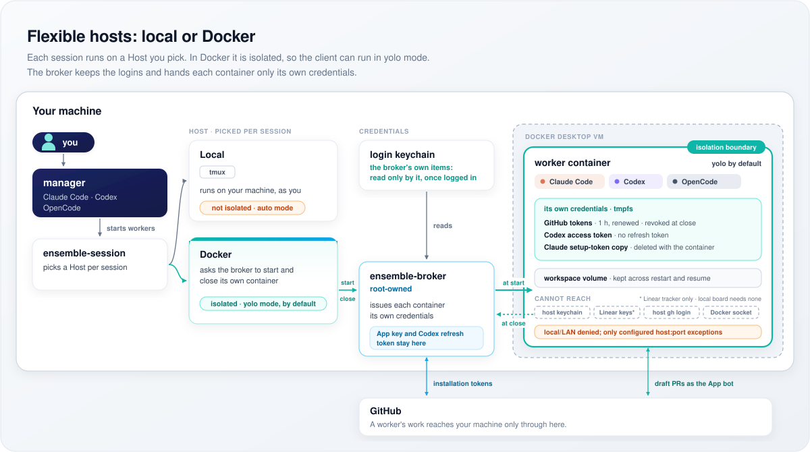

# Ensemble

[English](../../README.md) · [Español](README.es.md) · [Français](README.fr.md) · [日本語](README.ja.md) · [한국어](README.ko.md) · [Português](README.pt.md)

Ensemble 让你与编程智能体以团队方式协作。你可以与指挥官对话、向角色委派任务，
或让看板在角色之间分派工作。Claude Code、Codex 和 OpenCode 共用同一套会话控制功能。

<a id="what"></a>
## 可以运行什么


选择所需的范围。工作者是一段客户端对话；角色在此基础上增加职责约定、任务和经过检查的结果；
看板安排角色运行，并将结果写回 issue。看板可以使用 Linear 或本地 Markdown。

<a id="why"></a>
## 为什么使用团队


分别运行智能体时，需要有人分派工作并跟进回复。指挥官通过 Crew，在一段对话中启动、
检查和恢复这些运行。哪些工作可以授权、哪些需要审查，仍由你决定。

<a id="how-it-works"></a>
## 工作原理




控制、凭据交付和网络路径各自独立。[架构概览](../architecture.md)说明了职责归属与信任关系；
实现细节见其中链接的源代码。

<a id="install"></a>
## 安装

在 Apple silicon Mac 上，运行 [windroc 插件市场](https://github.com/windroc-labs/agent-plugins-marketplace/blob/main/.claude-plugin/marketplace.json)
所固定版本的安装程序。
将 `<tag>` 替换为该文件中 ensemble 的 `source.ref`：

```sh
curl -fsSL https://raw.githubusercontent.com/windroc-labs/ensemble/<tag>/scripts/install.sh | bash
```

安装程序会询问使用哪些客户端、工作者在本地还是 Docker 中运行，以及是否设置看板。
它会安装所选依赖和插件、请求所需的登录，并设置 `ctmux`。
安装中断后，重新运行即可完成。要查看选项，请在仓库检出目录中运行 `bash scripts/install.sh --help`；
已有安装的用户应先阅读[升级指南](../upgrading.md)。

请使用所选客户端要求的模型账号或提供商。OpenCode 的提供商与网络设置见
[自定义角色和任务](../customizing-roles-and-tasks.md#opencode-sessions)。
宿主机上的 `gh` 需要对目标仓库具有推送和 PR 操作权限：经典令牌需要 `repo`、`read:org` 和 `gist`；
细粒度令牌还需要 Actions 读取权限，以查看检查结果。

### GitHub App

Docker 工作者使用 GitHub App，而非宿主机上的 `gh` 登录。安装程序不会创建 App。
在 GitHub Settings › Developer settings › GitHub Apps 中创建仅可安装到你自己账号的私有 App，
并关闭 webhook。其仓库权限必须涵盖 [Session 配置](../../src/ensemble/session/config.toml)中的 `github.permissions`。
只将它安装到允许工作者推送的仓库，包括文档输出仓库。

生成私钥，记下 App ID，然后将它们导入：

```sh
/usr/local/libexec/ensemble/ensemble-broker login github ensemble-broker-bot \
  --key-file KEY.pem --app-id APP_ID
```

导入后删除 PEM。[凭据轮换](../upgrading.md#credential-rotation)介绍了替换和吊销方法。

<a id="quick-start"></a>
## 快速开始

要执行单个任务，请在已安装客户端的对话中输入：

```text
/ensemble:act-as dummy-tester:echo hello
```

要使用团队，请打开指挥官 shell 并启动客户端：

```sh
ctmux work
claude
```

如果你使用的客户端是 `codex` 或 `opencode`，请用它替换 `claude`。在该对话中调用：

```text
/ensemble:manage
```

描述工作内容和期望的交付物。指挥官通过 Crew 协调工作者和角色运行。
使用看板时，`/ensemble:board` 用于操作 issue；[自定义工作流](../customizing-roles-and-tasks.md#on-the-board)
说明了如何选择阶段。

<a id="docs"></a>
## 文档

| 需要了解…… | 参阅 |
|---|---|
| 系统分层、执行边界与信任边界 | [架构](../architecture.md) |
| 模型、提供商、角色设置、自定义任务或工作流 | [自定义角色和任务](../customizing-roles-and-tasks.md) |
| 现有安装需要进行的变更 | [升级指南](../upgrading.md) |
| 贡献者约定与检查入口 | [AGENTS.md](../../AGENTS.md) |
