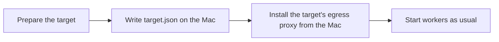

# Remote Docker target

Run Docker workers on another machine: a Linux host with Docker Engine, or a Windows PC with Docker Desktop. The
manager, the broker, the Keychain, tmux and mini-op workers stay on the Mac. Workers on the target send their outbound
traffic through an egress proxy on the target.



Do the steps in this order. The rules for `~/.ensemble/docker/target.json` (address form, SSH options, the check
before each start) are in [Upgrading › Broker protocol 40](upgrading.md#broker-protocol-40-docker-target). A session
stays on the daemon that made it: switching the target to another machine leaves earlier sessions there, to resume or
reclaim after switching back ([Upgrading › Broker protocol 41](upgrading.md#broker-protocol-41-a-docker-target-is-its-daemon)).

The target needs Docker Engine 26 or newer, an SSH server that accepts only keys, and `docker` on the PATH of the SSH
login shell: `docker --host ssh://…` runs `ssh <host> docker system dial-stdio` there. It needs no bash, `gh`, GitHub
login or registry login.

## Linux target

On the target:

1. Check the Engine: `docker version --format '{{.Server.Version}}'` prints 26 or higher.
2. Pick the login user the Mac will use and add it to the `docker` group: `sudo usermod -aG docker <user>`.
3. Add the Mac's public key (for example `~/.ssh/id_ed25519.pub`) to that user's `~/.ssh/authorized_keys`.
4. Turn off password login. sshd keeps the first value it reads, and `/etc/ssh/sshd_config` usually starts with
   `Include /etc/ssh/sshd_config.d/*.conf`, where a file such as Ubuntu's `50-cloud-init.conf` may turn passwords
   on. So write a drop-in that sorts first:

   ```sh
   printf 'PasswordAuthentication no\nKbdInteractiveAuthentication no\n' | sudo tee /etc/ssh/sshd_config.d/00-ensemble.conf
   sudo systemctl reload ssh   # sshd on some distributions
   sudo sshd -T | grep -Ei '^(passwordauthentication|kbdinteractiveauthentication) '
   ```

   Both values must print `no`.
5. Keep the Docker API off the network: no `-H tcp://…` in dockerd's service and no `tcp://` entry under `hosts` in
   `/etc/docker/daemon.json`. `sudo ss -ltnp | grep dockerd` prints nothing.
6. Note the host key's fingerprint: `ssh-keygen -lf /etc/ssh/ssh_host_ed25519_key.pub`.

On the Mac:

1. Scan the host key once, compare it, and add that same scan only if it matches (with a port other than 22, add
   `-p <port>` to `ssh-keyscan`):

   ```sh
   key=$(mktemp)
   ssh-keyscan -t ed25519 <host> > "$key"
   ssh-keygen -lf "$key"            # must print the fingerprint from step 6
   cat "$key" >> ~/.ssh/known_hosts # only after it matched
   rm "$key"
   ```
2. Check the key login: `ssh <user>@<host> docker version` prints the server version, without asking for a password.
3. Check that passwords are refused:
   `ssh -o PubkeyAuthentication=no -o PreferredAuthentications=password,keyboard-interactive <user>@<host> true`
   fails with `Permission denied` and asks for no password.
4. Write `{"host": "ssh://<user>@<host>"}` to `~/.ensemble/docker/target.json`, then install the egress proxy
   ([Egress proxy on the target](#egress-proxy-on-the-target)).

## Windows target

This uses only the PC's existing Docker Desktop (WSL 2 backend) and Windows' built-in OpenSSH Server. It creates no
WSL distro or VM and changes nothing in the CI runner's configuration. Run the commands in an administrator
PowerShell on the PC.

1. Check the Engine: `docker version --format '{{.Server.Version}}'` prints 26 or higher.
2. Install and start OpenSSH Server: `Add-WindowsCapability -Online -Name OpenSSH.Server~~~~0.0.1.0`, then
   `Start-Service sshd` and `Set-Service sshd -StartupType Automatic`.
3. Add the Mac's public key. For an administrator account it goes in
   `C:\ProgramData\ssh\administrators_authorized_keys`, which only Administrators and SYSTEM may read:
   `icacls.exe C:\ProgramData\ssh\administrators_authorized_keys /inheritance:r /grant Administrators:F /grant SYSTEM:F`.
   For any other account it goes in `%USERPROFILE%\.ssh\authorized_keys`.
4. Set the SSH default shell, so `ssh://` can run docker:

   ```powershell
   New-ItemProperty -Path HKLM:\SOFTWARE\OpenSSH -Name DefaultShell -Value 'C:\Windows\System32\WindowsPowerShell\v1.0\powershell.exe' -PropertyType String -Force
   ```

   `docker.exe` must be on the system PATH (Docker Desktop adds `C:\Program Files\Docker\Docker\resources\bin`).
   This shell setting is not yet verified on the PC: the acceptance run checks that `docker system dial-stdio` works
   through it. If it does not, this step changes; installing bash is not part of the fix.
5. Turn off password login. In `C:\ProgramData\ssh\sshd_config`, put `PasswordAuthentication no` and
   `KbdInteractiveAuthentication no` above the first `Match` line: the default file ends in a
   `Match Group administrators` block, and a line after it applies only to that group. Then:

   ```powershell
   Restart-Service sshd
   & "$env:WINDIR\System32\OpenSSH\sshd.exe" -T | Select-String -Pattern '^(passwordauthentication|kbdinteractiveauthentication) '
   ```

   Both values must print `no`.
6. Keep the Docker API off the network: in Docker Desktop's settings, "Expose daemon on tcp://localhost:2375 without
   TLS" stays off. `Get-NetTCPConnection -State Listen -LocalPort 2375,2376 -ErrorAction SilentlyContinue` prints
   nothing.
7. Note the host key's fingerprint: `ssh-keygen -lf C:\ProgramData\ssh\ssh_host_ed25519_key.pub`.

On the Mac, do the [Linux target](#linux-target)'s Mac steps: compare and add the host key
(`known_hosts`) from one scan, check the key login, check that `PreferredAuthentications=password,keyboard-interactive` is refused,
write the target, install the egress proxy.

## Outside the LAN

Use the target's Tailscale address or MagicDNS name in `target.json`. Add its host key under that name too, by the
[Linux target](#linux-target)'s Mac step 1 with that name: `known_hosts` entries are per name.

## Egress proxy on the target

The broker starts a worker only when the target runs a healthy egress proxy; without one, start fails
`egress_unavailable` and names this command. Install or upgrade it from the Mac, after `target.json` is written:

```sh
bash <ensemble plugin directory>/scripts/install-target-egress.sh
```

or `curl -fsSL https://raw.githubusercontent.com/windroc-labs/ensemble/<tag>/scripts/install-target-egress.sh | bash`.

It fetches egress-proxy's `egress-install` with the Mac's `gh` and runs it against the target, through the broker's
ssh wrapper, so the same SSH rules apply. The image comes from the Mac: `egress-install` fetches it by digest there
and loads it on the target, which never pulls. The install directory is `~/.egress-target` on the Mac. To change the
policy, edit `~/.egress-target/config.local.yaml`, then apply it with the wrapper first on PATH, as the script prints:

```sh
PATH=/usr/local/libexec/ensemble/ssh:$PATH ~/.egress-target/start.sh
PATH=/usr/local/libexec/ensemble/ssh:$PATH docker --host ssh://<user>@<host> logs egress-proxy
```

Until egress-proxy publishes a release with remote install, the script has no pinned version: pass one with
`--version X.Y.Z --digest sha256:<digest>`. `scripts/install.sh --docker` still installs the Mac's own proxy, which
mini-op workers use.

## Network rules

- Worker containers join only the internal `egress-workers` network and publish no port, so the LAN cannot reach
  them. Their only way out is the proxy.
- The Docker API listens on no TCP port. The Mac reaches it only over SSH with a key; the target refuses passwords.

## Nothing to keep on the target

Preparing the target leaves no GitHub login, no registry login and no Docker client registry config there: the egress
image is loaded, not pulled. The broker on the Mac writes worker credentials into a worker's container, in its tmpfs,
only while the worker runs.

## Sharing Docker Desktop with the CI runner

On a PC whose Docker Desktop also runs the GitHub CI runner, workers and runner containers share one daemon. The
isolation rests on the runner's own configuration
([github-CI-runners `compose.yaml`](https://github.com/windroc-labs/github-CI-runners/blob/main/compose.yaml),
[`docs/isolation.md`](https://github.com/windroc-labs/github-CI-runners/blob/main/docs/isolation.md)): the runner
container has no Docker socket, a job runs with no capabilities, and its root filesystem is read-only. A CI job
therefore cannot reach the daemon, worker containers or their volumes. This was read from that repository's
configuration, not checked on the PC.

Never give a runner the Docker socket. With it, a CI job could read worker credentials and volumes, and delete them
with `docker system prune --volumes`.
