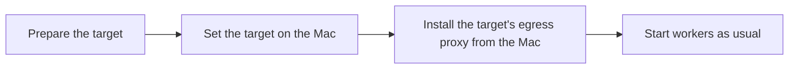

# Remote Docker target

Run Docker workers on another machine: a Linux host with Docker Engine, or a Windows PC with Docker Desktop. The
manager, the broker, the Keychain, tmux and mini-op workers stay on the Mac. Workers on the target send their outbound
traffic through an egress proxy on the target.



Do the steps in this order. The rules for the `[docker]` table in `~/.ensemble/config.local.toml` (address form, `local_secrets`, SSH
options, the check before each start) are in [Upgrading › Broker protocol 43](upgrading.md#broker-protocol-43-remote-docker-target);
`ensemble-broker target` shows how the broker reads it. A session stays on the daemon its first start chose:
switching the target to another machine leaves earlier sessions there, to resume or reclaim after switching back.

The target needs Docker Engine 26 or newer, an SSH server that accepts only keys, and `docker` on the PATH of the SSH
login shell: `docker --host ssh://…` runs `ssh <host> docker system dial-stdio` there. It needs no bash, `gh`, GitHub
login or registry login.

## Linux target

On the target:

1. Check the Engine: `docker version --format '{{.Server.Version}}'` prints 26 or higher.
2. Pick the login user the Mac will use and add it to the `docker` group: `sudo usermod -aG docker <user>`.
3. Add the Mac's public key (for example `~/.ssh/id_ed25519.pub`) to that user's `~/.ssh/authorized_keys`.
4. Turn off password login. sshd keeps the first value it reads, and `/etc/ssh/sshd_config` usually starts with
   `Include /etc/ssh/sshd_config.d/*.conf`, where a file such as Ubuntu's `50-cloud-init.conf` may turn passwords
   on. So write a drop-in that sorts first:

   ```sh
   printf 'PasswordAuthentication no\nKbdInteractiveAuthentication no\n' | sudo tee /etc/ssh/sshd_config.d/00-ensemble.conf
   sudo systemctl reload ssh   # sshd on some distributions
   sudo sshd -T | grep -Ei '^(passwordauthentication|kbdinteractiveauthentication) '
   ```

   Both values must print `no`.
5. Keep the Docker API off the network: no `-H tcp://…` in dockerd's service and no `tcp://` entry under `hosts` in
   `/etc/docker/daemon.json`. `sudo ss -ltnp | grep dockerd` prints nothing.
6. Note the host key's fingerprint: `ssh-keygen -lf /etc/ssh/ssh_host_ed25519_key.pub`.

On the Mac:

1. Scan the host key once, compare it, and add that same scan only if it matches (with a port other than 22, add
   `-p <port>` to `ssh-keyscan`):

   ```sh
   key=$(mktemp)
   ssh-keyscan -t ed25519 <host> > "$key"
   ssh-keygen -lf "$key"            # must print the fingerprint you noted on the target
   cat "$key" >> ~/.ssh/known_hosts # only after it matched
   rm "$key"
   ```
2. Check the key login as the broker makes it: `ssh -F none <user>@<host> docker version` prints the server version,
   without asking for a password. The broker ignores `~/.ssh/config` and tries only the default key files and the
   ssh-agent at `SSH_AUTH_SOCK`: a key elsewhere must be in the agent (`ssh-add <key>`).
3. Check that passwords are refused:
   `ssh -o PubkeyAuthentication=no -o PreferredAuthentications=password,keyboard-interactive <user>@<host> true`
   fails with `Permission denied` and asks for no password. Against Windows OpenSSH, a warning about post-quantum
   key exchange ending in "The server may need to be upgraded" comes first; that is expected.
4. Set the target in `~/.ensemble/config.local.toml`, then install the egress proxy
   ([Egress proxy on the target](#egress-proxy-on-the-target)):

   ```toml
   [docker]
   host = "ssh://<user>@<host>"
   local_secrets = ["ensemble-broker-env/mini-op-password", "ensemble-broker-env/mini-op-ssh-key"]
   ```

   `local_secrets` lists the secrets the broker never gives a worker on the target ([Workers that stay on the
   Mac](#workers-that-stay-on-the-mac)).

## Windows target

This uses only the PC's existing Docker Desktop (WSL 2 backend) and Windows' built-in OpenSSH Server. It creates no
WSL distro or VM and changes nothing in the CI runner's configuration. Run the commands in an administrator
PowerShell on the PC.

1. Check the Engine: `docker version --format '{{.Server.Version}}'` prints 26 or higher.
2. In Docker Desktop's settings, turn on "Start Docker Desktop when you sign in to your computer": otherwise the target
   has no Docker after the PC restarts.
3. Install OpenSSH Server, without starting it yet: `Add-WindowsCapability -Online -Name OpenSSH.Server~~~~0.0.1.0`.
   The SSH default shell stays `cmd.exe`, which runs `docker system dial-stdio`; `docker.exe` must be on the system
   PATH (Docker Desktop adds `C:\Program Files\Docker\Docker\resources\bin`).
4. Check the firewall rule the install adds: it applies to the Private profile only, so the PC's network must be
   Private.

   ```powershell
   Get-NetFirewallRule -Name OpenSSH-Server-In-TCP | Select-Object Enabled, Profile   # True, Private
   Get-NetConnectionProfile | Select-Object Name, NetworkCategory                     # Private
   ```
5. Start sshd once to create its files, and stop it at once: `Start-Service sshd; Stop-Service sshd`. The first start creates
   `C:\ProgramData\ssh` with its access rules, `sshd_config` and the host keys; the default config allows passwords,
   so stop it at once.
6. Add the Mac's public key. For an administrator account it goes in
   `C:\ProgramData\ssh\administrators_authorized_keys`, which only Administrators and SYSTEM may read:
   `icacls.exe C:\ProgramData\ssh\administrators_authorized_keys /inheritance:r /grant Administrators:F /grant SYSTEM:F`.
   For any other account it goes in `%USERPROFILE%\.ssh\authorized_keys`.
7. Turn off password login. In `C:\ProgramData\ssh\sshd_config`, put `PasswordAuthentication no` and
   `KbdInteractiveAuthentication no` above the first `Match` line: the default file ends in a
   `Match Group administrators` block, and a line after it applies only to that group. Check it; both values must
   print `no`:

   ```powershell
   & "$env:WINDIR\System32\OpenSSH\sshd.exe" -T | Select-String -Pattern '^(passwordauthentication|kbdinteractiveauthentication) '
   ```

   Only then start sshd for good: `Start-Service sshd; Set-Service sshd -StartupType Automatic`.
8. Keep the Docker API off the network: in Docker Desktop's settings, "Expose daemon on tcp://localhost:2375 without
   TLS" stays off. `Get-NetTCPConnection -State Listen -LocalPort 2375,2376 -ErrorAction SilentlyContinue` prints
   nothing.
9. Note the host key's fingerprint: `ssh-keygen -lf C:\ProgramData\ssh\ssh_host_ed25519_key.pub`.

On the Mac, do the [Linux target](#linux-target)'s Mac steps: compare and add the host key
(`known_hosts`) from one scan, check the key login, check that `PreferredAuthentications=password,keyboard-interactive` is refused,
write the target, install the egress proxy.

## Outside the LAN

Use the target's Tailscale address or MagicDNS name as `host`. Add its host key under that name too, by the
[Linux target](#linux-target)'s Mac step 1 with that name: `known_hosts` entries are per name.

## Egress proxy on the target

The broker starts a worker only when the target runs a healthy egress proxy; without one, start fails
`egress_unavailable` and names this command. Install or upgrade it from the Mac, after the target is set:

```sh
bash <ensemble plugin directory>/scripts/install-target-egress.sh
```

or `curl -fsSL https://raw.githubusercontent.com/windroc-labs/ensemble/<tag>/scripts/install-target-egress.sh | bash`.

It takes the target's address from `ensemble-broker target`, fetches egress-proxy's `egress-install` with the Mac's
`gh` and runs it against the target, through the broker's ssh wrapper, so the same SSH rules apply. A target the broker
cannot reach stops it before anything is installed. The image comes from the Mac: `egress-install` fetches it by digest there
and loads it on the target, which never pulls. The install directory is `~/.egress-target` on the Mac. To change the
policy, edit `~/.egress-target/config.local.yaml`, then apply it with the wrapper first on PATH, as the script prints:

```sh
PATH=/usr/local/libexec/ensemble/ssh:$PATH ~/.egress-target/start.sh
PATH=/usr/local/libexec/ensemble/ssh:$PATH docker --host ssh://<user>@<host> logs egress-proxy
```

The policy starts with no exceptions, so workers on the target reach no LAN address. A model provider on the LAN
needs an `exceptions:` entry for its `host:port`, for example OpenCode's provider at `192.168.1.40:8080`; without one,
those workers get `Proxy Authentication Required … denied by rule 'Deny: User Configured'`. Add it under the existing
`workers:` network, then apply it with `start.sh` as above:

```yaml
networks:
  workers:
    mode: denylist
    exceptions:
      - 192.168.1.40:8080
```

The script installs the egress-proxy release it pins, 0.1.2; `--version X.Y.Z --digest sha256:<digest>` installs
another one. The image is `ghcr.io/windroc-labs/egress-proxy`, and its GitHub package must stay Public: otherwise the
fetch fails `no access to ghcr.io/windroc-labs/egress-proxy` on a Mac whose `gh` login cannot read the package.
`scripts/install.sh --docker` still installs the Mac's own proxy, which mini-op workers use.

## Workers that stay on the Mac

A worker whose environment sets `daemon = "local"` runs on the Mac's Docker Desktop, never on the target: the packaged
mini-op environment does, so the verifier and the test Mac mini's password and SSH key stay on the Mac. Its image,
egress proxy, prefetch and credential refresh are the Mac's, and its session belongs to the local Docker Desktop.
`local_secrets` guards the rest: the broker refuses to start a worker on the target with any listed secret.

The Mac's worker and the target's workers share one view:

- `ensemble-session ls` lists both daemons' workers, and sweep closes ended ones on either.
- A lock held on one daemon makes a start on the other `busy`, naming the holder and its daemon.
- While one daemon cannot be reached, `ls` names it on stderr and lists the other's workers. Sweep and reclaim leave
  its containers and volumes alone, so they are there when it comes back. A start with a lock fails
  `docker_unreachable`, naming that daemon, rather than taking the lock as free.

## Network rules

- Worker containers join only the internal `egress-workers` network and publish no port, so the LAN cannot reach
  them. Their only way out is the proxy.
- The Docker API listens on no TCP port. The Mac reaches it only over SSH with a key; the target refuses passwords.

## Nothing to keep on the target

Preparing the target leaves no GitHub login, no registry login and no Docker client registry config there: the egress
image is loaded, not pulled. The broker on the Mac writes worker credentials into a worker's container, in its tmpfs,
only while the worker runs.

A GitHub login from before is not removed. On the target, `gh auth status` must report no login, when `gh` is
installed; log each account out with `gh auth logout -h github.com -u <user>`. With a login left, the remote target's
[live check](upgrading.md#live-checks) fails.

## Sharing Docker Desktop with the CI runner

On a PC whose Docker Desktop also runs the GitHub CI runner, workers and runner containers share one daemon. The
isolation rests on the runner's own configuration
([github-CI-runners `compose.yaml`](https://github.com/windroc-labs/github-CI-runners/blob/main/compose.yaml),
[`docs/isolation.md`](https://github.com/windroc-labs/github-CI-runners/blob/main/docs/isolation.md)): the runner
container has no Docker socket and its root filesystem is read-only. It drops no capabilities: on the PC,
`docker inspect gh-runner-1` shows no socket mount, a read-only root filesystem and `CapDrop=[]`, so a job keeps
Docker's default capabilities. With no socket and no Docker API on TCP, a CI job still cannot reach the daemon, worker
containers or their volumes.

Never give a runner the Docker socket. With it, a CI job could read worker credentials and volumes, and delete them
with `docker system prune --volumes`.
