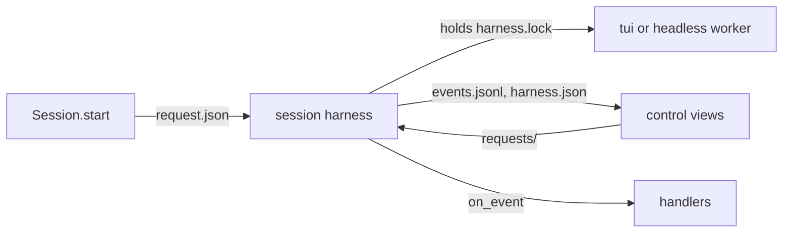
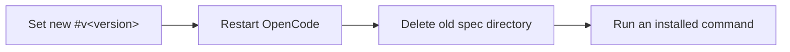

# Sessions and client policy

How the sessions ensemble starts are set up, how to list and show them, and the flags role runs pass their client.

## Session settings

Every session ensemble starts, agent runs and workers, loads your user settings with every plugin except `ensemble` (`[clients.<client>] flags` in `src/ensemble/session/config.toml`; OpenCode's plugin turns itself off: [OpenCode commander](#opencode-commander)): only a client you start, the commander, has `/ensemble:manage`. Each such session's client also carries `ENSEMBLE_AGENT_SESSION=1`, under which `ensemble-crew` `run`/`worker`/`reopen`/`issue`/`role`/`hold`/`resume`, `ensemble-session` `start`/`restart`/`resume`/`client-resume`, `ensemble-delegate` `run`/`resume` and `ensemble-orchestrator` `router`/`resume` exit 2 (their forms that start nothing, such as `--dry-run`, `--list` and `--brake`, still run), even run by a checkout's `bin/` path: a guard against slips, not isolation (`env -u` clears it). Agent runs load no MCP servers your Claude or Codex config names, user or project, so none can write past the outcome: `--strict-mcp-config` in `[policy.claude]`, `-c mcp_servers={}` in `[policy.codex]` (`src/ensemble/delegate/config.toml`; [Client policy](#client-policy)); workers keep them. A trusted cwd adds its project settings (`trusted_dirs` in `src/ensemble/delegate/config.toml`).

Codex sessions also start without its built-in browser, computer use, Apps and plugin suggestions, so a run cannot open a web page or a third-party service to act outside its outcome; web search, image generation, subagents and your own plugins stay. Checked against Codex 0.163.0, whose plugin ids can change with a release:

| Tool | Packaged `[clients.codex] flags` entry |
|---|---|
| Browser and Chrome (MCP server `node_repl`) | `-c plugins.<id>@openai-bundled.enabled=false`, `<id>` each of `browser`, `chrome`, `chrome-dev`, `chrome-internal` |
| Computer use (`node_repl`, `cua_repl`) | the same, `<id>` each of `computer-use`, `unified-computer-use` |
| Apps (`codex_apps` connectors, the browser connector among them) | `--disable apps` |
| Plugin suggestions, which can install a plugin | `--disable tool_suggest` |

The feature flags `browser_use`, `computer_use` and `in_app_browser` do not turn these off, and `--disable plugins` would turn off your plugins too. To get a tool back, drop its entry from a `[session.clients.codex] flags` list in `~/.ensemble/config.local.toml`: a local list replaces the packaged one whole, so copy the rest. Every launch reads this list, a resume and `client-resume` included, so a change reaches sessions started before it.

A Codex resume keeps the run's own flags (`[policy.codex]` in `src/ensemble/delegate/config.toml`) from its start, where Claude's takes the current ones. Codex's recovery state records each session's launch, its writable grants among them, and a resume replays that record rather than take new grants or a new run policy from its caller. The list above is read again because it is the client's own setting, not the run's; it refuses `--add-dir` and `--`, so it can neither widen a session's grants nor pass literal arguments.

In the commander's Claude Code session the plugin's mod always hides Monitor tool-call rows and notices, plus Bash tool-call rows whose command contains `ensemble-crew next-event` or `ensemble-crew ack`. Other tools, Bash commands and notices draw as usual; the model's content is unchanged. Ctrl+o shows Monitor notices; the hidden tool-call rows stay hidden.

`ensemble-crew next-event` (including `--follow`) exits 1 on a malformed complete event line and reports its file path and physical line number. Inspect the file with `pending`; reads never acknowledge handling. A final line without a newline waits until completed.

A commander under `ensemble-crew hold` gets a re-arm prompt at startup, resume, compact and clear. Claude Code uses Monitor. Codex uses Manual mode: run `ensemble-crew pending --content` at the beginning of every active turn before status reports or new launches; there are no idle notifications. Only a background tool whose runtime contract guarantees notifications to this conversation may run `attach`'s `next-event:` command, without `--follow`; after handling and acking each event, run `attach` again and use its newly printed command. A commander restarted outside its `hold`, or one giving `--manager` to each command without `hold`, gets no prompt. OpenCode uses Manual mode too ([OpenCode commander](#opencode-commander)).

After installing or updating the Codex plugin, open `/hooks`, review and trust the ensemble SessionStart command before relying on this prompt; installation alone does not trust plugin hooks. A changed hook definition needs review and trust again. [Codex plugin hooks](https://developers.openai.com/plugins/build/plugins#bundled-mcp-servers-and-lifecycle-hooks) describes this trust requirement.

## ensemble-session

`bin/ensemble-session --help` lists its subcommands. `ls` prints a header, then one tab-separated row per session: `name`, `state` (`working`, `done`, `blocked`, `dead`, `unknown` when its host could not tell), `client`, `sid`, `display`, with `-` for an empty value.

Sessions run on `[session.hosts] default`: `tmux`, or `docker` ([Docker host](docker-host.md)).

`start --account NAME` (also `ensemble-crew worker`'s) runs a Claude session on a registered Claude account
([Docker host › Claude accounts](docker-host.md#claude-accounts)). Restart and resume keep the account; `--env
ENSEMBLE_ACCOUNT=…` and a `[delegate.policy.<client>] env` naming it are refused (exit 2).

`start --display none` starts a worker without a pane, still opened by the caller, and hidden. Hidden (from that, `hide`, or closing its pane by hand; not from losing the manager's window or detaching its viewer) lasts through `restart` and `resume` until `show`.

Text sent to a Codex or Claude tui session mid-turn joins that turn. Codex takes it at once; Claude queues it until the running tool returns. Text sent after a Claude turn ended starts a new turn. When the session has an events file, `ensemble-crew pending --content` and `next-event --content` print mid-turn replies; reply text stays for 30 days.

A Codex or Claude turn that fails ends a role run's attempt at once. A usage limit stays a usage limit.

## Run limits

Set a client's simultaneous session limit in `~/.ensemble/config.local.toml`:

```toml
[session.clients.opencode]
max_runs = 1

[session.clients.claude]
max_runs = 3
```

`max_runs` is a whole number >= 0. Zero (the packaged default) or an omitted key means unlimited. The setting belongs to the session layer's `[clients.<client>]` table in `src/ensemble/session/config.toml`, and is removed before configuration reaches the client adapter.

Every `Session.start` shares admission for that client across processes using the same user state directory, regardless of caller, Host, mode, name or resume flag. Board runs, `router --issue`, ad-hoc role runs and crew workers all count. The check and start hold one client admission lock; a full client raises the existing `SessionError` before launching or recording a new session, naming the client, limit and holding names (session ids for unnamed runs). There is no capacity queue. Preflight, inspect and attaching to an existing session reserve nothing.

TUI sessions count while their client is alive, including `done` between turns and `blocked`; an unknown state keeps its slot. Close a retained TUI when it should stop using capacity. Headless and in-process modes hold a lease until their mode ends or is stopped/closed, even when nobody reads events. A failed start releases its reservation once shutdown is confirmed; an unconfirmed TUI shutdown retains its reservation until matching Host inventory proves the client is gone. TUI ownership survives its launcher; transient leases belong to their caller process, or to its session harness for a harnessed headless run. An abnormal caller exit does not add a recovery protocol for orphaned children.

Admission checks all configured Hosts; an unavailable inventory fails closed. Shared TUI reservations from a Host configuration the caller does not have remain counted until a caller with the matching configuration confirms the session ended. Close the original session or retry using its original Host configuration to reconcile it. Changing an unrelated Host setting changes that configuration's identity, so close its sessions before changing its settings.

The orchestrator's [role limits](board.md#run-limits) and usage gate remain separate. Direct client commands outside `Session.start`, including `client-resume`'s native client handoff, do not create ensemble sessions.

## Session harness

A built-in Claude, Codex or OpenCode tui or headless session with no `Spec.environment` runs under a session harness of its own on the `tmux` Host, and on the `docker` Host a Claude tui or any headless one, when the session class is configured with its default callables (a test that injects a class loader, probe, Host factory or viewer factory keeps the earlier path). Every other start (a Codex or OpenCode tui on Docker, whose hooks are not yet verified through the guard; any environment) starts as before, and refuses non-empty `Spec.handlers`. `Session.preflight` finds each handler module without importing it. An `in_process` session runs under one too (no Host).

`Session.start` writes the start to `~/.ensemble/harness/<32 hex>/request.json` (mode 0600; it holds `Spec.env`, and the harness deletes it once read), runs `python3 -P -s -m ensemble.session.harness.process [--caller FD] <dir>` detached (the caller's interpreter), and returns a control view once the harness runs the worker. A start error in the harness, or an interrupt at any point after the harness is spawned, is raised in the caller, the harness ended and its dir removed; SIGHUP, SIGTERM and SIGINT are held across the spawn itself, so one that arrives during it is handled the same way. The tui session's `session.json` names the dir as `owner`; a headless run, the harness's own child, has no `session.json` and stays nameless unless its spec names it. A harness that does not start is sent SIGTERM (headless) or killed.



The harness holds `harness.lock` for life. It records each event in `events.jsonl` before calling each handler's `on_event`; ids are `<generation>:<seq>` and turns `<generation>:t<n>`. A turn started while one is open fails that one (`TurnFailed("superseded")`); an exit mid-turn fails it (`TurnFailed("exited")`) before the one `Exited`. A handler that raises is retried with the same ids after 1 s, doubling to 30 s, while the others go on; `deliveries.jsonl` keeps failed attempts 1, 2, 4, … and the delivered one. `Stderr` and `ClientBound` stay in the log. After the worker's exit the harness waits up to 30 s for its handlers, then writes `exited`, answers the waiting `stop` and `close` requests, and exits; `harness.json` says `starting`, `running`, `draining` (the worker ended, its handlers still called; with `returncode`), `exited` (with `returncode` and `pending`) or `failed` (with the start `error`), `opening` while the client's opening line is unsent, and `up` once its guard reported the client up ([Guard protocol](#guard-protocol)); each pump of the worker writes its status to `harness.json` before its events are logged, so a view acting on an event reads the status it came with. SIGTERM and SIGHUP close the worker, as does EOF on a headless start's caller pipe (`--caller FD`); the harness unblocks the signals its caller held across the spawn.

The control view never owns the worker: for a tui session, its caller exiting, its `events()` iterator closing or a display detaching leaves the harness supervising. A headless run dies with its caller, as a piped client did: the starting view holds the write end of a pipe whose read end only the harness has, so once the view is dropped or its process ends, even by SIGKILL, the harness closes the worker. `events()` reads `events.jsonl`, accepting only the worker's generation in order. `stop`, `close` and `Session.retire` (also once its terminal is gone, its sid then checked against `session.json`) write a request to `requests/` and return once the harness confirms the worker ended and logged `Exited` and, past its handlers' drain, lets go of its lock (a handler's own request returns at the confirmed exit, since the drain waits for that handler), else raise `SessionError` (`Unanswered` when it cannot tell). `Session.retire` asks a bound owner before any Host probe but a listed terminal of another sid, so a worker whose tmux session is gone is still closed through it. A refused or unconfirmed stop or close leaves the harness supervising and sets `harness.json` `close_failed` (`op`, `error`, `at`); `ensemble-session close` then exits 1, even for a Record that looks stale on its Host. `send`, `press`, `screen`, `show` and `status` still reach a tmux worker's display, the tmux session, directly; every tui `send` and `press` holds the session's send lock (`send.lock` in its tui dir) over its whole input, so senders in any thread or process never interleave; the harness types the opening under it, never waiting for it, and only once no turn runs, a launch prompt's turn has started, and every send went in before the hook of a turn's start or end began (its `hooks.jsonl` record carries the sends seen as that hook began, a Docker worker's as its harness took the hook from the guard), so it never lands inside a turn: a start with a prompt gets it once its first turn ends. A send failing after its first action raises `Unanswered`, never retried. A Docker tui worker is remote (`harness.json` `"remote": true`): only its harness reaches it, so `send` (`{"text"}`, up to 1 MiB), `press` (`{"keys"}`, 1 to 64 key names) and `screen` (`{"lines"}`, null or 1 to 10000) are requests in `requests/` the harness serves through the worker; a bad field or a failure is a refusal that leaves the worker up, and after the exit they are refused. `display` (any worker, no fields), served the same way, opens the worker's display again where it is gone, answering `{"reopened"}`; a session of its name it does not own is refused, left alone. A headless view has no terminal: `send` and `press` raise `SessionError`, `screen`, `show` and `content` raise `NotShowable`; `alive` and `status` come from `harness.json`, `info` and `session_status` from the run's record, and an exception in its `events()` (not closing the iterator) stops the worker, as an unharnessed headless run does. `Session.attach` gives a control view only while the `owner` harness holds its lock and its `harness.json` names that session, sid and generation; any other `owner` is ignored, and a worker whose harness exited or died is attached and closed the earlier way.

A tui worker runs under the guard ([Guard protocol](#guard-protocol)), and only its harness holds the guard's lifecycle pipe: `kill -9` of the harness ends guard and client, and its display (a tmux worker's: the tmux session of its name) ends no worker when killed. Its `session.json`, display and dir go only with their own worker generation. Resume (`ensemble-session resume`, a crew or delegate resume) of a worker whose harness runs returns its Record and starts nothing; it first asks that harness to open its display again where it was killed (a tmux worker's tmux session, or the `guard.py --attach` in it), on the same guard and generation, and shows a reopened one unless hidden; a refusal is said on stderr, the Record still returned; after a crash it starts a new harness, guard and client on the same sid, transcript, cwd, client, account and flags, waiting up to 10 s for a reaping guard. It is refused while the old generation is unknown (busy, exit 75; a guard killed before it confirmed its client's exit) and when the client keeps no transcript of the conversation (exit 2), never starting an empty one. `ensemble-session close` of such a worker without a running harness removes its record only once its generation is gone: it waits out reaping and fails busy, the record kept, while unknown. A tmux worker's way out of a permanent unknown: once no client of it is left, remove its guard dir, `<ENSEMBLE_CONTROL_ROOT, else the temp dir>/eg-<uid>/<key>` (`hosts/tmux/managed.py` `location`).

An `in_process` adapter runs on a thread of the harness, so it ends with the harness; its control view has no terminal (`send`, `press`, `screen`: `SessionError`; `show`, `hide`, `attach_command`: `NotShowable`) and is alive while its harness holds its lock and has not logged `Exited`.

Any process of the user that can write the 0700 harness dir can stop or close its worker, the same trust as the user's tmux socket: the harness serves every well-formed request and authenticates none.

## Session harness interfaces

Frozen for WDRC-199 (WDRC-226): a session harness will own each worker from start to close and call the handlers its caller registers. Every TUI and headless adapter yields `TurnStarted`. [Session harness](#session-harness) runs it for the starts that section names, calling their handlers. The harness launches a tui worker through `TmuxHost.worker` or `DockerHost.worker`, the managed transport below ([Harness-owned workers](docker-host.md#harness-owned-workers)), and a headless one on `Host.pipe`; every other start keeps the legacy path. No other client, Host or mode reads `Spec.handlers` yet. The tickets that implement each part change none of these signatures.

**Handlers.** `Spec.handlers` is an ordered tuple of `HookCallback(module, state, roots)`, default `()`. The harness records each event before it calls each handler module's `on_event(EventCall)` in event order; a failure is retried with the same ids and never stops supervision. `EventCall` carries `session` (an `ensemble.session.Session` to send, stop or close through), `event`, `sid`, `generation` (the worker's start), `event_id`, `turn` (`None` outside a turn) and the handler's `state`. `on_event` returns `None`; returning or failing never closes the worker, only a close request through `session` does. Every event field (reply text, Blocked reason, TurnFailed detail) is untrusted worker output.

**Events.** `SessionEvent` is `TurnStarted | Activity | Reply | TurnEnd | TurnFailed | Blocked | LimitHit | Exited`. `TurnStarted` marks a turn its client accepted (the first prompt, a `send` or text typed into its terminal), never a replayed record. Tui adapters normalize `HookKind.TURN_STARTED`; headless adapters derive acceptance from native structured records. In-process `run()` will yield it when that adapter is migrated. `TurnEnd(reply, pending)` carries the turn's full last reply; `TurnFailed` and `TurnEnd` exclude each other within a turn; `Exited` comes once, last.

Claude and Codex use accepted-prompt hooks; Codex also observes native turn records, including failures without Stop. Codex turn ids reconcile the two sources and reject late old-turn terminal hooks. OpenCode starts a turn on a new root user-message id; busy/tool steps do not start turns, and asynchronous replies retain that id. Replay restores state without publishing a new `TurnStarted`.

Headless streams replies and diagnostics while retaining terminal candidates until both output streams drain and the exit code is known. Success requires native completion and exit 0. Nonzero exit, missing completion, native failure or an uninteractive permission request produces `TurnFailed` before `Exited`; a partial reply or EOF alone cannot succeed. Claude checks result subtype, error and permission-denial fields; Codex checks turn completion/failure; OpenCode requires a final `step_finish` with reason `stop`. A permission/question request stops the headless worker rather than waiting for an answer.

**Managed workers.** `Host.worker(name, launch, *, terminal, display=None, events=None, metadata=None) -> InteractiveProcess` replaces the worker-launch paths `terminal`, `detach` and `pipe`. It evolves the existing `InteractiveProcess`, which already inherits `send(action: Paste | Key)`, `press(keys: Sequence[KeyPress])`, `screen(lines=None)`, `state() -> Liveness`, `close() -> None` and `returncode() -> int | None`; there is no parallel `WorkerHandle`. Managed `close()` returns only after confirmed worker exit, else raises `SessionError` (`Unanswered` when unknown); `returncode()` supplies the confirmed exit code, never a guessed SIGHUP code. Headless handles reject `send`, `press` and `screen` with `NotShowable`; their input uses `write`.

Only the channel has new members: `generation: str` identifies the worker start; `read(timeout: float) -> list[WorkerMessage]` returns ordered messages, `[]` on timeout and nothing after the last `WorkerExit`; a broken transport raises `Unanswered` until exit is confirmed. `write(data: bytes) -> None` writes headless stdin. `tick(now: float) -> float | None` runs the Host's periodic duty and returns its next due time (the default `None` means no duty). The local handle drains stdout continuously into an 8 MiB queue. Overflow closes its lifecycle pipe, continues draining, and reports `Unanswered`; it never silently drops output and reports success. The guard ([Guard protocol](#guard-protocol)) is the client's direct parent and owns its PTY when `terminal=True`.

The new channel records have no previous public owner: `WorkerHook(label: str, payload: Mapping[str, object], delivery_id: str)` replaces the Docker relay's hook envelope and retry identity, `WorkerOutput(data: bytes, stream: str="stdout")` replaces separate headless stdout/stderr pipe readers, and `WorkerExit(returncode: int)` replaces host exit probes. `WorkerMessage` is their union. All payloads are untrusted; retain size/shape, sid and generation binding checks (FR-36). `Host.worker_liveness(name, generation) -> Liveness` replaces attach/reclaim probes after a harness dies: `LIVE` or `UNKNOWN` refuses a second owner, `ABSENT` permits resume. Local admission serializes starts and checks the prior generation's lease and completion record. An unconfirmed guard death remains `UNKNOWN`, even after its known PIDs disappear. Missing, damaged or mismatched existing records also remain `UNKNOWN`; there is no live-process adoption. The session harness must validate the original transcript and preserve sid, workspace, client and account before constructing a new launch.

| Host | Channel | Display |
|---|---|---|
| tmux | the guard's stdin and stdout over local pipes | a tmux session running `guard.py --attach` on its display socket |
| Docker | `docker exec -i` into the container, the guard there | `docker exec -it … guard.py --attach`; `tick` returns the next time its maintenance thread calls the broker, never calling it |

A Docker handle reports `UNKNOWN` from a broken channel until its container's removal is confirmed, then `ABSENT`; `returncode()` is the guard's `x` code, `None` when none came; after the removal `read()` returns `[]`.

**Extension migration.** The old methods remain callable only during this implementation transition. The final Host must implement `worker` and `worker_liveness`; there is no permanent unowned fallback. Adapt an existing `InteractiveProcess` subclass to the guard channel and confirmed-close contract. Move status/Record publication to the harness and display targeting to `Host.attach_target`; remove the obsolete methods below. A Tui maps its accepted-prompt hook to `HookKind.TURN_STARTED`; headless `events` and in-process `run` yield `TurnStarted` on accepted input. Native `on_hook(HookCall)` stays separate from registered `on_event(EventCall)`: the former converts client payloads, the latter receives normalized events. `EventCall` lives in `harness/types.py`, depending on `Session`; shared `engine.types` never imports the session API. Session users keep the default empty handlers tuple and handle the added event in exhaustive matches.

### End-state removals

These are approved-list candidates for deletion, not optional deprecations. This interface-only PR leaves used legacy paths executable; the implementation tickets remove them after their replacements work. `InteractiveProcess` survives as the sole managed handle. Its existing `Process`/`Interactive` bases are folded into it, preserving the reused declarations rather than duplicating them.

| Removed interface | Replacement | Deletion owner |
|---|---|---|
| `Host.terminal`, `Host.detach`, `Host.pipe` | `Host.worker` (`terminal=True` or `False`) | WDRC-204/206 local, headless unassigned (WDRC-205 kept it on `Host.pipe`), WDRC-207 Docker; delegate callers once every start is owned (WDRC-208 keeps the `-drive`); WDRC-211 removes ABCs |
| `Host.attach`, `Host.reclaim` | `Session.attach` control view and `Host.worker_liveness` for crash-resume admission | WDRC-206/207; WDRC-210 crew callers; WDRC-211 ABCs |
| `Host.events_path`, `Host.prepare_events`, `Host.hook_callback` | harness-owned records/dispatch and `WorkerHook` on the guard channel | WDRC-204/207; WDRC-211 ABCs |
| public `Process` (both session surfaces), `Interactive` (extension), their exported members | fold preserved `name`, `send`, `press`, `screen`, `state`, `close`, `returncode` into existing `InteractiveProcess` | WDRC-211 after WDRC-204..210 migrate callers |
| `InteractiveProcess.alive`, `.wait_exit`, `.kill`, `.identity`, `.token`, `.session_identity` | channel `state`, `generation`, `read`/`WorkerExit`, confirmed `close`; no caller-owned kill | WDRC-206/207 implementations; WDRC-211 base cleanup |
| `InteractiveProcess.activity`, `.status`, `.mark`, `.row`, `.record`, `.publish`, `.display` | harness event/state/Record ownership; `Host.attach_target` retains display targeting | WDRC-204/207; WDRC-211 base cleanup |
| extension `Piped`, `Lines`, all their exported members; internal `LocalPiped` | `InteractiveProcess.read`/`write`, `WorkerOutput`/`WorkerExit` | WDRC-205/207; WDRC-211 exports/ABC cleanup |
| Docker `supervisor.py` (`Supervisor`, `main`) and Host `_spawn_supervisor` | harness dispatch/lifecycle; the Docker handle's maintenance thread (`hosts/docker/maintenance.py`) and `hooks.HookWorker` | WDRC-207 for harness-owned sessions; deleted once a harness owns every Docker tui client (Codex and OpenCode still use it) |
| Docker `relay.py` (`Queue`, `Daemon`, `answer`, `pump`, `connect`, `main`, relay request/reply protocol) and Host `_serve_relay` | guard hook socket and the same worker's long-lived `h`/output/exit channel | WDRC-207 for harness-owned sessions, with equivalent input validation; deleted with the supervisor |
| delegate harness worker ownership, runner-driven supervision/attempt lifetime | session `Spec.handlers`/`EventCall`; attempt-only Result and delegation policy | WDRC-208; WDRC-209 consumes attempt events |

For WDRC-211, the cumulative snapshot diff against `wdrc-199-session-harness` must be this freeze's additions/changes **plus** the removals above: delete `ensemble.session.Process` and every `Process.*` key; delete extension `Process`, `Interactive`, `Piped`, `Lines` and all their member keys; delete the eight Host methods above on both surfaces; delete the listed obsolete `InteractiveProcess` members; change its base to `abc.ABC` after folding the preserved members. No other exports, fields, defaults or signatures change. `tests/delegate_interface.json` stays byte-for-byte unchanged. These removals are not claimed as already implemented in this PR.

**Ownership.** `Session.start` will create the owner; `Session.attach` gets a control view, never a second owner; `events()` only observes, so closing its iterator, the caller exiting or a display detaching leaves a tui worker supervised (a headless run dies with its caller: [Session harness](#session-harness)); `stop`, `close` and `Session.retire` ask the owner and return only once it confirmed the worker ended, else raise `SessionError` (`Unanswered` when it cannot tell), so a caller releases a lock or removes a roster entry only after a confirmed end (FR-16, FR-23, FR-24).

**Delegate.** `Delegate.run`, `alive`, `status`, `resume` and `close` keep their signatures and the `Result` and `Outcome` formats. `run()` returns once a task attempt has its Result while the session and its handler go on; `alive()` and `Status.alive` say whether an attempt is active, so a run waiting on `needs_input` is not alive. `resume(input=...)` (CLI `--input`) accepts an answer or continuation even while the unlocked TUI/harness lives; the active-attempt check must not reject it just because the owner lives. If the worker died, resume creates new processes from the original transcript and refuses a live/unknown old generation. A directly accepted input after a terminal attempt opens the next attempt through `TurnStarted`; resume has already counted its attempt, so the same event does not count twice. In-attempt nudges/repair and replay never open another attempt.

Each attempt preserves `Begun`/`Progress`/one `Finished`, the existing Result/Outcome formats and Record `ctl`/`resume` control routing; subsequent attempts do not reuse the previous outcome or its completion marker. `close()` ends an active attempt once, never emits another failure for an ended attempt, and asks the session owner to close. Locks and roster entries remain until confirmed resource termination; close failures remain traceable. Delegate persisted `plan.session.handlers` lists are restored to tuples only when the key exists; old records default to `()`.

Implemented (WDRC-208) for **owned runs**, the tui runs a session harness owns: the Delegate preflights the start with the handler `ensemble.delegate.engine.handler` registered as `{"workdir", "worker": n}` (`n`, the attempt whose call starts the worker); a refused preflight plans the run without it, and the run keeps the earlier caller loop (every other mode, client and Host, and every run with an environment: a session harness owns no start with `Spec.environment`, so a locked Docker run is planned unowned and its caller loop closes it and releases its lock as before). Each attempt has one owner: the call that starts a worker owns it while opening, that worker's first handled call binds it to the handler, and the handler's `TurnStarted` after an ending opens the next attempt (`delegate.json` keeps the earlier one's Result as `previous`); calls of another sid or worker are ignored. An ending stores the Result, then writes its notes (the attempt's own and `result`/`end`) and the run's outcome line, then sends `Finished`; an ending another owner stored first writes and sends nothing; for a locked run, should one be owned, it first closes it through the owner's view and claims the release only once that close returns. `run()` (a detached run's `-drive`) starts the worker and waits for its attempt's Result; it ends the attempt itself only while opening past `idle_timeout` (a give-up) or once its worker has been gone 35 s. A signal before it sends `Begun` (its TUI start) stores the stopped ending, then closes the worker; a signal after leaves the attempt to the handler. A stale out it cannot set aside is stored as the attempt's Result, with `closing` set, before its worker is stopped. A completed run is not alive from its `Finished` on, though its drive holds the run lock until it returns; meanwhile `status` reports it `working`, and `resume()` (and `resume(input=...)` unless a live worker takes the input) waits up to 30 s for that lock before it sweeps and starts. `resume(input=...)` on a live owned worker only sends the input; `resume()` and a replacing `run` first retire a gone worker outside the run mutex, under the run lock (which every start takes) and only while `delegate.json` still names the attempt they checked, so they follow its harness's end (its handler's last write-back) before the callback sweep. `close()` holds a shared lock, `run/delegate.close.lock`, from before it attaches the worker until the owner's close returns: meanwhile a `TurnStarted` opens no follow-up, and the client's exit the close causes (`TurnFailed("exited")`, `Exited`) ends an active attempt as a stop (`stopped: Stopped: 143`, its `Finished` sent once), never as a failure, while other endings keep their own Result. Once the close is confirmed, or its worker is gone, `delegate.json` `closing` is set (no follow-up of that worker until `resume(input=...)` or a new run clears it) and an attempt still active ends as that stop (a locked run's `release` first). A refused close drops the lock and leaves `closing` unset; input taken on an ended attempt during it opens no follow-up, the next does. `delegate.json` must hold `previous`, `bound` and the bool `closing`, and the callback lock both pids (`<child> <parent>`); anything else is invalid. Board write-back of each attempt: `docs/board.md` › Using the board.

### Guard protocol

`src/ensemble/session/harness/guard.py` is the standard-library-only guard program, run by path. `guard.py [--terminal [--display-grace]] --hook-socket PATH [--display-socket PATH] -- ARGV...` runs ARGV, with the cwd and environment it is given, in a session of its own; with `--terminal` the guard owns its PTY. `--display-grace`, which the tmux Host passes because it starts the display at launch (Docker starts one only when someone attaches), keeps a guard whose client exited before any display connected up for the display grace (2 s), so its first display still gets the final screen. `guard.py --attach PATH` connects the calling terminal to a running guard's display socket: a display only, so detaching or killing it never ends the worker; an unreachable socket prints one line (`guard: display PATH: <reason>`) and exits 1. `--lease PATH`, for a guard `docker exec` starts (which passes no descriptors), makes PATH's directory (0700), holds PATH locked for life and writes `state.json` beside it; a held lease exits 1 (`guard: lease held`). `guard.py --probe DIR` prints `live` (a guard holds `DIR/lease`), `exited` (free, `state.json` confirms the exit), `absent` (no DIR) or `dead`. Local managed launches expose the hook endpoint as `ENSEMBLE_GUARD_HOOK_SOCKET`. Only the harness holds the lifecycle pipe's write end; the guard's client launch closes all other descriptors, including the generation lease. Display clients receive raw terminal output, while the screen request returns current terminal cells, with bounded scrollback for an explicit line count; erasing a dialog removes it from the current screen. New displays receive a bounded snapshot before live output.

The channel is the guard's stdin (from its harness) and stdout (to it): frames of one kind byte, a 4-byte big-endian payload length (at most 64 MiB) and the payload; a JSON payload is one UTF-8 object.

| From | Kind | Payload |
|---|---|---|
| harness | `i` input | raw bytes for the PTY, else the client's stdin |
| harness | `q` screen | `{"lines": int or null}` |
| harness | `c` close | `{}`: end the client, then `x` |
| guard | `s` started | `{"pid": int}`, once, after exec |
| guard | `u` up | `{}`, once, when its client still runs 5 s after exec (checked right after reaping it), so never for a client that exited sooner |
| guard | `h` hook | `{"label": str, "payload": object, "delivery_id": str}`, retry-stable identity |
| guard | `o`, `e` output | raw bytes a headless client wrote to stdout, stderr |
| guard | `v` view | `{"text": str}`: the PTY's last `q` lines, control sequences removed |
| guard | `x` exit | `{"returncode": int}`, last; -N for signal N |

EOF on its stdin is a close: its harness closed the channel or died. The guard tracks descendants by PID and kernel start time, sends SIGHUP, escalates to SIGTERM after 0.5 s and SIGKILL after 1.5 s, and reaps adopted children. Linux requires `PR_SET_CHILD_SUBREAPER` and uses pidfds for signaling. Its stdout is non-blocking, with an 8 MiB limit; pressure stops client/hook reads without stopping lifecycle monitoring. After confirmed tree exit, available output precedes one final `x`. Unconfirmed exit produces a broken channel, never a guessed successful exit. No frame starts a host process.

**macOS limitation (approved WDRC-203 decision, 2026-10-26).** Closing the guard's PTY hangs up the foreground client. There is no subreaper or PID namespace: own-process-group, HUP-ignoring and setsid descendants can survive a killed guard; a fast setsid daemon can escape even a live guard. The macOS display's `pane-died` hook runs `tmux kill-session`, best effort; a surviving harness also closes the matching display on channel failure. This does not guarantee removal of escapees. No uid-per-run scheme is used. Docker's final backstop is stopping its container (WDRC-207); the Linux guard alone cannot replace that containment after it is killed. These decisions use the WDRC-203 mini report; real-client crash/resume acceptance on the mini is WDRC-212's.

A hook invocation creates one `delivery_id` (32 lowercase hex characters) before its first send and keeps it through retries; a different invocation has a fresh id even with identical label/payload. It connects to `--hook-socket`, writes one `{"label", "payload", "delivery_id"}` line and gets `{"ok": true, "delivery_id": str}` once the guard has written its `h` frame. A missing or mismatched acknowledgement retries the same request/id. The harness deduplicates by the trusted channel's generation and delivery_id; the Docker handle journals each id once, its first content winning. Identity is never inferred from label/payload equality. This replaces the relay's generation/sequence acknowledgement contract; it does not add dispatch behavior here.

## Recall a closed run

`ensemble-crew close <ID>` ends a board run's sessions and drops its roster entry once each session's owner confirmed its end; its conversation stays. A failed close keeps the entry, exits 1 and appends one JSON line (`at`, `name`, `sid`, `ctl`, `reason`) to `~/.ensemble/managers/<manager>/close-failures.jsonl`. To continue it:

```sh
ensemble-crew reopen [--work-dir <work_dir>] <ID> [--display D]
```

It reads the run record, `<work_dir>/work/<ID>/run/delegate.json` (`--work-dir` only when the board's `work_dir` is not `~/.ensemble`), and resumes its session id as worker `<agent name>` on the run's Host, client, cwd and Claude account: a Docker run comes back in a new container with its client history and [workspace volume](docker-host.md#workspace-volumes). The worker is tracked like any other; `ensemble-crew close <agent name>` ends it. It brings back the conversation, not the run: where its start is owned (a Claude tui on tmux or Docker; other clients as their session harness lands), it runs under a [session harness](#session-harness) of its own with no handlers, so its events are only logged: no outcome or write-back, and the board is untouched. A conversation known only by its session id: `ensemble-crew worker <name> --resume <sid> --client <client> --cwd <cwd> [--host <host>]`.

These do not recall it:

- `ensemble-crew resume <ID>` resumes roster entries only, and `close` removed it: `not in roster; a closed issue run: ensemble-crew reopen --manager=<manager> <ID>`.
- `ensemble-orchestrator resume <ID>` continues an interrupted run only; a run with an outcome prints its Record, starts nothing and says so on stderr.
- The run comment's `ensemble-session client-resume …` runs the client on this machine, outside ensemble; a Docker run's history is not there.

`reopen` fails when:

- the issue finished and prune cleaned it: prune deletes the run's agent files, its cwd among them, at once ([State cleanup](board.md#state-cleanup)), and the run record 7 days later;
- `work/<ID>/run/delegate.json` is gone (pruned, or deleted by hand): `no run record` (exit 1);
- the run, or a session holding its session id, is still alive, or its liveness is unknown (a status or the session listing failed): exit 2; close it first, or `ensemble-crew forget` an entry whose work is gone;
- its client history is gone: a Docker run's is in `~/.ensemble/docker-state/<agent name>/` (`no native history to resume`). A removed workspace volume comes back empty.

`reopen` brings back the issue's latest run; an earlier run's conversation: by its session id, above.

To check a recall, from the commander's `ensemble-crew hold` shell (elsewhere add `--manager <manager>` to each `ensemble-crew` command): close a finished dummy-tester run with `ensemble-crew close <ID>`, run `ensemble-crew reopen <ID>`, then `ensemble-session ls` shows `<agent name>` with the run's sid, and `ensemble-session send <agent name> 'What was your input?'` gets an answer from the earlier conversation (`ensemble-session read <agent name>`).

## Client policy

Role runs' client flags are `[policy.<client>]` in `src/ensemble/delegate/config.toml` (`[policy.claude]`, `[policy.codex]`; none packaged for OpenCode, so none unless a local `[delegate.policy.opencode]` sets them), after the session's `[clients.<client>] flags` and permission mode. Their system-prompt flag (`--append-system-prompt`, Codex's `developer_instructions`) tells a role run its final reply is the outcome block alone; OpenCode has no such flag, its config being the session's. A local list replaces the default whole: copy that flag into it, and the MCP one.

A Codex launch fails, naming the file, when a config layer is unreadable or invalid, or names an MCP server outside `[A-Za-z0-9_-]`: rename it. Servers defined by a `-c` flag, bundled in your Codex plugins, or managed by MDM still load. Turning a plugin off also drops its skills.

A role run's TUI turn end without an outcome gets one nudge, and later ones count toward giving up. Claude Code waits for reported background work; Codex reports none.

A Claude or Codex session's `client-resume` (its resume command, on this machine, in `auto` mode) replays its launch, these flags included. Codex's replays its snapshot, the config flags of its launch with them. Claude's replays the run's flags (`--strict-mcp-config`, the system prompt), Access (setting sources and the `--mcp-config` beside them, dirs, allowed tools), model, effort, name and env with this machine's current `[clients.claude] flags` and `allow`, since it runs here, not on the launch's Host; it opens the TUI without ensemble's hooks, which serve only an ensemble session.

Every session, crew workers and role runs, gets one permission mode from the Host it runs on: an `isolated` Host (`[hosts.docker] isolated = true`) `yolo`, every other Host `auto`. Each mode's flags are the client's, in `[clients.<client>.modes]` in `src/ensemble/session/config.toml`, the only home of permission flags; a start, restart and resume each get the mode of the Host they run on, and `client-resume` (this machine) `auto`:

| Client | `auto` | `yolo` |
|---|---|---|
| Claude | `--permission-mode auto` | `--dangerously-skip-permissions --settings '{"skipDangerousModePermissionPrompt": true}'` (no first-start dialog) |
| Codex | `-s danger-full-access -c approval_policy="on-request" -c approvals_reviewer="auto_review"` | `--dangerously-bypass-approvals-and-sandbox` |
| OpenCode | none: its config's `permission.bash = "ask"` asks for every shell call but the run's pre-approved commands; headless refuses the call, the TUI shows the ask and the session is `blocked` | `--auto`, plus backend `allow` for `bash`, `read`, `external_directory` and `doom_loop`; edit denies stay |

OpenCode's pre-approved commands match a command's text without its redirections, so an allowed `git status` also allows `git status > <file>`. An OpenCode run edits only its cwd and Access dirs, never `.git` or OpenCode's own config, and reads its Access reads without editing them; a refused call does not end its turn. External-directory grants cover both supplied symlink paths and resolved targets, so installed-plugin tasks under `~/.ensemble/links/` remain readable; read-only edit denies cover both spellings. Write-directory edit grants remain resolved-only: use the resolved path for writes through a supplied directory alias. OpenCode matches these paths case-sensitively: on a case-insensitive disk (macOS's default) only `.git` is denied in every spelling, so `OPENCODE.JSON` or a read dir spelled in another case stays editable, and its `apply_patch` tool (models named `gpt-…`) checks only a moved file's source.

`yolo` asks for nothing: no permission prompt, approval or sandbox; the container is the boundary ([Docker host](docker-host.md#permissions)). OpenCode approves tools at the backend, so toggling its TUI approval mode cannot restore those prompts; question dialogs still wait for an answer. When the selected OpenCode mode includes `--auto`, permission requests emit no `blocked`; questions still do, as do permission requests in modes without `--auto`. Claude refuses it as root; the container's clients run as `agent`. `danger-full-access` ignores writable roots and team dirs; a Docker container cannot run Codex's sandbox ([Permissions](docker-host.md#permissions)). For `workspace-write` outside the Docker Host:

```toml
[session.clients.codex.modes]
auto = ["-s", "workspace-write", "-c", 'approval_policy="on-request"', "-c", 'approvals_reviewer="auto_review"', "-c", "sandbox_workspace_write.network_access=false", "-c", "sandbox_workspace_write.writable_roots=[]"]
```

## OpenCode sessions

OpenCode sessions run on every Host, but outside an `isolated` Host (tmux, or `[hosts.docker] isolated = false`) only in a trusted cwd (a role run's: under `trusted_dirs`, so given by `--cwd`, as its default cwd, the workdir's `agent/`, never is): OpenCode 1.x has no project trust, so in any cwd it runs `.opencode/plugins/*.js` and installs the npm plugins `opencode.json` lists, and `OPENCODE_DISABLE_PROJECT_CONFIG` does not stop it. A start, TUI or headless, and a resume in an untrusted cwd there fail before OpenCode starts: run it on the Docker Host or in a trusted cwd. On the tmux Host both modes run `[clients.opencode] executable` (default `opencode`) and refuse to start when its `--version` is not 1.x: where PATH finds a 2.x (Homebrew's `opencode` is 2.x), set it to a 1.x install's absolute path in `~/.ensemble/config.local.toml`'s `[session.clients.opencode]`. On the Docker Host they run the image's `/opt/ensemble/bin/opencode` instead (`executable` is ignored; the broker checks its version), in yolo mode, with Ollama at `host.docker.internal`. A long message shows as `[Pasted ~N lines]` in the TUI but is sent in full.

Each launch enables only the `ollama` provider and the `[clients.opencode.providers.<name>]` ones: OpenCode's built-in providers, OpenCode Zen's included, stay off, so `opencode models` under that config lists only these. Every launch passes `--model`: its tier's (`[clients.opencode.tiers]`), else `[clients.opencode] model` (default `ollama/qwen3.6:35b-mlx`), never OpenCode's own pick. Each of these names `ollama/<model>` or `<name>/<model>` of a providers table, else the client refuses its config. A provider is any OpenAI-compatible server, such as one on your LAN:

```toml
# ~/.ensemble/config.local.toml
[session.clients.opencode.providers.strata]
base_url = "http://<LAN host>:8080/v1"
models = ["qwen3.8-flash-next"]   # beside the models tiers and model map to it
context = 204800                          # its context window in tokens; default 65536

[session.clients.opencode.tiers]
1 = "strata/qwen3.8-flash-next"
```

Its API key, on the tmux Host, stays OpenCode's: run `opencode auth login` once, pick Other and enter the provider's name (`strata`), and OpenCode keeps the key in its `auth.json`. The availability probe reads the selected provider's API entry and sends it only in the HTTP Authorization header; it returns no key or response body. On the Docker Host the broker keeps it: `ensemble-broker login opencode strata` once, for every configured provider ([Docker host › OpenCode](docker-host.md#opencode)). A name is up to 64 letters, digits, `.`, `_` or `-`.

`scripts/install.sh --docker` with OpenCode selected configures both local OpenCode (including a commander) and
the broker from one key entry; it imports the local API entry instead of asking for the key twice
([Credentials](credentials.md#opencode-provider-api-keys)).

With OpenCode selected, the installer also adds the provider's URL, model and context to the global
`$XDG_CONFIG_HOME/opencode/opencode.jsonc` (default `~/.config/opencode/opencode.jsonc`), or the existing
`opencode.json` when there is no JSONC file. Direct `opencode models <provider>` and
`opencode run --model <provider>/<model>` then use it without an ensemble session. An existing provider
in either file is left as-is, including on reruns; the default model is unchanged. Provider filters that
exclude the selected name must be adjusted by the user before adding it. Config edits preserve symlinks
and support JSONC comments, trailing commas, UTF-8 BOM and duplicate keys (last value wins). Installer cleanup removes
the provider it added if its definition is unchanged. Plugin cleanup then restores the configuration
backup from before the first plugin install, including the user's original providers and settings;
edits made after that backup revert. A configuration created by this installation stays recorded as
created across upgrades and is removed with the plugin's added files (`node_modules`, `package.json`,
`package-lock.json`, `.gitignore`), including after repeated install/cleanup cycles. Preexisting
`package.json`, `package-lock.json` and `.gitignore` are also backed up before the first plugin install
and restored by cleanup.
The cleanup list also includes newly created OpenTUI data, gh cache/state, uv cache and
`~/.homebrew/trust.json`; it respects `XDG_DATA_HOME`, `XDG_CACHE_HOME`, `XDG_STATE_HOME` and
`UV_CACHE_DIR` for those tool directories. Existing tool directories and trust files are kept.

Set each provider's `context` and `[clients.opencode] ollama_context` to the server's real context window (Ollama's `OLLAMA_CONTEXT_LENGTH`): a smaller value compacts early, a larger one lets a request overflow. Both default to 65536.

A crew worker's cwd is always trusted (you pick it), so `ensemble-crew worker NAME --client opencode --cwd DIR` starts on tmux in any `DIR`; a role run only under `trusted_dirs`; a board run never (its cwd is the workdir's `agent/`): run OpenCode board runs on the Docker Host ([Linear board › OpenCode](board.md#opencode)).

On the tmux Host OpenCode needs the host's Ollama for `ollama/` models ([Docker host › OpenCode](docker-host.md#opencode) steps 1–3) and an OpenCode 1.x. With none on PATH, `npm install -g opencode-ai@1.19.3`; ignore npm's warning that its postinstall did not run. Beside a 2.x, install 1.x under its own prefix, leaving the 2.x as it is, and point `executable` at it:

```bash
npm install -g --prefix ~/.local/opencode-1 opencode-ai@1.19.3
~/.local/opencode-1/bin/opencode --version   # 1.19.3
```

```toml
# ~/.ensemble/config.local.toml
[session.clients.opencode]
executable = "/Users/<you>/.local/opencode-1/bin/opencode"   # absolute: ~ is not expanded
```

TUI runs deliver every completed main-thread assistant text to the Delegate, including intermediate progress reports; child sessions' replies are excluded. The final text also ends the turn, and the Delegate records it once.

OpenCode keeps no jsonl transcript: its sessions are in `opencode.db` (tmux: `${XDG_DATA_HOME:-~/.local/share}/opencode/opencode.db`; a Docker Host session's: `~/.ensemble/docker-state/<name>/opencode/opencode/opencode.db`, which a resume needs). To see what a session holds, or whether a `send` reached it:

```bash
python3 -I src/ensemble/session/clients/opencode/transcript.py <ses_id> [--db <path>] [--limit N]
```

It prints the session's newest `N` (default 100) user and assistant texts, oldest first, one JSON line each: `{"time": "2026-10-18T12:00:00.123Z", "role": "user", "text": "…"}`. A missing db or unknown session: exit 1 and one `opencode transcript: …` line on stderr. The `ses_…` id is the last `client_session` line's `client_id` in the run's `<workdir>/run/run.jsonl`.

## OpenCode commander

A commander can run in OpenCode 1.x (checked against 1.19.3). Install ensemble in `~/.config/opencode/opencode.json`, `<version>` a release:

```json
{"plugin": ["ensemble@git+https://github.com/windroc-labs/ensemble.git#v<version>"]}
```

OpenCode installs that tag once, into `${XDG_CACHE_HOME:-~/.cache}/opencode/packages/<spec>/node_modules/ensemble`, and never refreshes the same spec. A checkout instead: `"plugin": ["file://<checkout>/.opencode-plugin/ensemble.js"]`. `opencode plugin` installs npm packages only. Installed commands keep their selected plugin path ([Install](../README.md#install)); start `opencode` in the `ctmux` shell, then run `/ensemble:manage`.

For a manual release upgrade:



When the old selected directory is gone, the next installed command selects and records the newest installed ensemble copy from OpenCode and reports its path on stderr; no installer rerun is needed. To select a different ref while the old directory remains, rerun the installer or the new plugin's `skills/manage/scripts/ctmux --install`; older refs require the installer ([Upgrading](upgrading.md)).

The plugin adds:

- `/ensemble:act-as`, `/ensemble:board` and `/ensemble:manage`: commands with the corresponding skill text.
- this plugin's `bin/` first on the shell tool's `PATH`.
- the SessionStart re-arm ([Session settings](#session-settings)): for a commander under `ensemble-crew hold`, a prompt at startup, resume and after compaction. Sub-agent sessions get none.

It turns itself off, adding nothing, under `ENSEMBLE_AGENT_SESSION`: an OpenCode worker or role run on the tmux Host loads your global `opencode.json`, and `[clients.opencode] flags` cannot turn a plugin off.

Limits:

- Manual monitoring only (`/ensemble:manage` › Start): OpenCode has no Monitor, and its shell tool has no background mode and no completion notification. The commander reads events with `ensemble-crew pending --content` at the start of each active turn; nothing wakes an idle commander.
- The skills' `allowed-tools` and `disable-model-invocation` mean nothing to OpenCode: its own `permission` settings decide which commands ask. The three are commands, never skills the model loads itself.
- No mod hides the `ensemble-crew` tool calls.
