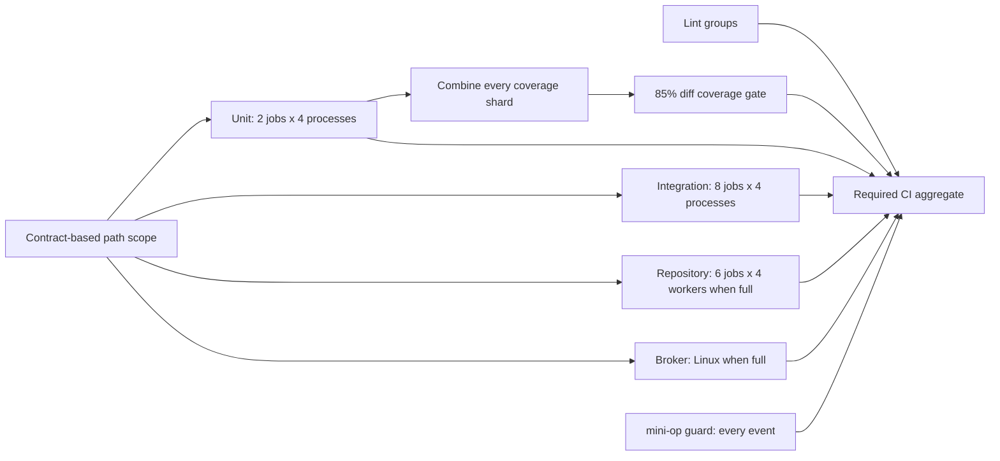

# Tests

```bash
export PYTHONPATH=.:.github:src   # from the repo root
```

Lint (tool versions pinned in `.github/workflows/test.yml`):

```bash
python3 .github/comment_budget.py
python3 .github/mini_op_guard.py
ruff check --no-cache
ruff format --check --no-cache
python3 -m tests.unit_imports
pyright
lint-imports --no-cache
pylint --disable=all --enable=cyclic-import,duplicate-code src/ensemble
vulture
python3 -m tests.checks
python3 .github/run_tests.py "Repository integration" tests/integration
python3 .github/integration_jobs.py --check
actionlint -shellcheck= -pyflakes=
typos --config pyproject.toml
```

`.github/mini_op_guard.py` rejects private and CGNAT IPv4 addresses, email addresses, UUIDs, `.local`
host names and literal keychain item names in every file under `.mini-op/` (mini-op's project runbooks);
it permits `noreply@anthropic.com` and GitHub's ID-based `<id>+<login>@users.noreply.github.com` addresses.
On a pull request that changes `.mini-op/` it also scans the PR's title, body and commit messages. CI's
`mini-op guard` job runs it on every event, whatever the test scope, and the `edited` trigger reruns it
when a title or body changes. Its findings name the place and the pattern, never the matched text.
An item name counts only when it holds a digit or one of `-._@:+`, so prose after a command name passes;
names of letters only, and names that look like no pattern (a team key, a workspace slug), need a
search by value before a PR.

Pre-commit hook, enabled once per clone with `git config core.hooksPath .githooks`: `.githooks/pre-commit`
runs `ruff check --fix`, then `ruff format`, on the staged version of each staged `.py` file, re-stages
the result and fails the commit on lint ruff cannot fix. Unstaged edits stay out of the commit and in the
working tree. Its ruff is CI's: the `ruff==` pin in `.github/workflows/test.yml` (keep every pin there
equal); `ruff` on `PATH` at that version, else `uvx ruff@<version>` (or `uv tool run`); with neither,
it prints a hint and commits.
Agent checkouts: every Docker Host checkout runs it, the worker image's `/etc/gitconfig` setting
`core.hooksPath = .githooks` ([What a container gets](docker-host.md#what-a-container-gets)); a tmux Host
worktree of a `[local_clones]` clone shares the clone's setting; a fresh tmux Host clone (an unlisted repo)
has none, and CI's Ruff step still catches it.

| Suite | Command |
|---|---|
| one project's unit tests | `python3 .github/run_tests.py "Session unit" tests/session/unit` |
| all unit tests | `python3 .github/run_tests.py Unit --unit` |
| one unit shard | `python3 .github/run_tests.py Unit --unit --shard 1/8` |
| one four-process unit job | `python3 .github/run_tests.py Unit --unit --parallel 4 --shard 1/2` |
| one balanced four-process repository job | `python3 .github/run_tests.py Repository tests/integration --durations .github/test_durations.json --parallel 4 --shard 1/6` |
| one complete test ID | `python3 .github/run_tests.py Integration tests.manager.integration.crew_close_all_integration_test.CloseAllTest.test_close_all_closes_what_mgr_opened_and_only_that` |
| one test file | `python3 .github/run_tests.py Integration tests/manager/integration/crew_close_all_integration_test.py` |
| one repository integration shard | `python3 .github/run_tests.py 'Repository integration 1' tests/integration --shard 1/8` |
| integration shard (labels in `.github/workflows/test.yml`) | `python3 .github/integration_jobs.py <N>` |

Run tests only through these supervised, sandboxed entries; they retain diagnostics and cleanup.

A session harness outlives the start that made it (a tui's until its worker ends or is closed) and
writes its dir, the workdir's run log and its handlers' records after its close reply.
`tests/session/harnesses.py`'s `end(home)` closes the harnesses under a HOME and waits for each to
exit. The tmux `Server` fixture (before it kills the server), each project's `Case` (before its HOME
goes) and each fixture with a HOME or workdir of its own register it, so no cleanup removes what a
harness still writes.

Single-test and file selection need the same repository-root `PYTHONPATH` above and the
selected test's dependencies (tmux for live tmux tests; `node` for the OpenCode TUI tests, which run its plugin and skip without it). Copy the complete ID from the
failure annotation or summary; no shard number is needed. Files must be repository test
files named `*_test.py`; invalid, missing, empty or ambiguous selections fail without
running a broader suite.
Directory and file selections accept a trailing `--shard N/TOTAL`, using sorted test IDs
with complete, disjoint coverage. Invalid, empty or duplicate-ID shards fail.
Subtest annotations use the method ID and keep parameters in the error text; selecting
that method runs all its subtests.

The `repository` matrix runs six jobs, each with four independently supervised workers.
The unit matrix keeps two jobs with four workers each. Both use
`--durations .github/test_durations.json` to assign the longest estimated tests to the least loaded
worker, with deterministic tie-breaking. Discovery supplies every test exactly once;
missing IDs default to 0.01 seconds and stale hints never select tests. Without
`--durations`, `--shard` retains its sorted-ID slicing behavior.
The timing table's provenance and approximations are in `.github/test_durations.sources.json`.
Repository artifacts retain each worker's log and per-test durations for later tuning.
Each repository guard is a separate unit test using the same `tests.checks.checks` entry
as the design lint. Guard discovery creates every test once; unknown selected names fail.
`fail-fast: false`, source protection, cleanup, unchanged-checkout guards and the
aggregate's dependency on the entire matrix remain in force.
CLI help retains both flags and all three entry modes. The isolated-import check splits
its complete module list into four disjoint slices, retaining fresh children, empty
HOME/cwd, layer-specific paths and unchanged `sys.path` assertions for every module.
Compare job times including setup and cleanup; the target is about 2.5 minutes.
Runner tool setup tries the existing apt index first, refreshing it only if installation
fails. This retains zsh/tmux coverage without refreshing unrelated repositories on every job.

Docker protocol fixtures need `python3 -m pip install jsonschema==4.26.0` (test only).
Run `python3 .github/run_tests.py Protocol tests/unit/docker_broker_protocol_test.py`.
The Go broker (`src/broker/`, Go from `src/broker/go.mod`): `sh with-go-state.sh gofmt -l .`,
`sh with-go-state.sh go vet ./...`, `sh with-go-state.sh go test ./...`,
`sh with-go-state.sh go run honnef.co/go/tools/cmd/staticcheck@v0.8.2 ./...` in `src/broker/`; run every
Go tool through `src/broker/with-go-state.sh` (state in `.cache/go/`). CI's required
`Broker ubuntu-24.04` job runs them on Linux and builds the Linux binary for full scope, including changes to
`src/broker/**`, `src/broker/protocol/docker-broker/**`, `.github/workflows/test.yml`, and every push to
`main`. Docs-only, version-only and upper-layer-only PRs skip the Linux broker runner.
The required `CI` aggregate depends on that job and validates its result against scope;
`Worker image` retains its own scope check. The independent `Broker macOS` workflow
(`.github/workflows/broker-macos.yml`) runs the same Go checks on `macos-15`, builds the
darwin/arm64 binary and uploads its artifact on pushes to `main`, pull requests that change
`src/broker/` or the workflow, and manual dispatch. It reports no merge-group checks and does not
block required CI. Broker tests use
fakes for credentials; they never call the real macOS keychain or Security API.
Installer and launcher changes also run the separate `Installer macOS` PR workflow:
`python3 .github/run_tests.py 'Installer macOS' tests/integration/install_integration_test.py tests/manager/integration/ctmux_integration_test.py --parallel 4 --shard 1/1`.
It uses fake clients and credential storage in isolated homes, plus a private tmux server.

Integration jobs upload `integration-<run-id>-<attempt>-<job>` artifacts containing
the discovered IDs, assigned IDs, expected load, Python/tmux versions, runner type, supervised
exit status and per-test seconds. A failed attempt remains available for diagnosis;
only complete successful Ubuntu attempts can regenerate the timing table.
Regeneration requires full scope; upper-only artifacts remain diagnostic samples.
Each matrix job runs `INTEGRATION_WORKERS` independently supervised workers. Their
numbered shard directories retain separate logs and timing manifests; the coordinator
waits for every worker and fails if any worker fails to launch, run or clean up.
`integration_jobs.py --check` validates all worker shards against the actual matrix.

To recollect, open a PR and let the entire `CI` workflow finish. Run
`gh run rerun <run-id> --repo windroc-labs/ensemble` after each completed attempt for more samples.
For each attempt, download into a separate empty directory, replacing the angle-bracket values:

```bash
gh run download <run-id> --repo windroc-labs/ensemble --pattern 'integration-<run-id>-<attempt>-*' --dir /tmp/integration-samples/<attempt>
gh api repos/windroc-labs/ensemble/actions/runs/<run-id>/attempts/<attempt> > /tmp/integration-samples/<attempt>/run.json
python3 .github/integration_timings.py /tmp/integration-samples
python3 .github/integration_timings.py /tmp/integration-samples --output .github/integration_durations.json
python3 .github/integration_jobs.py --check
```

Validation compares every attempt against this checkout's discovery and rejects mixed
commits/environments/events, missing or duplicate shards/tests, failures and invalid seconds.
The downloaded `run.json` must identify the same completed, successful workflow attempt,
including its other required checks. Regeneration uses the per-test median and writes
`.github/integration_durations.sources.json` with source runs, commits, versions and shard
labels. Normal tests never rewrite either file. Keep failed attempts
outside the regeneration input, alongside their original logs and workflow/job metadata.

A PR's added and changed `*/src` lines need unit coverage (lines and branches) of at least `THRESHOLD` in `.github/coverage_gate.py` (CI job `Coverage`). With coverage.py installed (version: `COVERAGE_VERSION` in `.github/workflows/test.yml`):

```bash
RUN_TESTS_COVERAGE=/tmp/coverage-data python3 .github/run_tests.py Unit --unit
python3 .github/coverage_gate.py /tmp/coverage-data origin/main
```


Unit and repository workers use timing hints; integration shards use recorded durations. Every ID
occurs exactly once. Coverage applies to pull requests and merge groups; `CI` requires every applicable result.

| Change/event | Unit and integration tests | Repository tests |
|---|---|---|
| PR touching only `src/ensemble/manager/`, `src/ensemble/orchestrator/`, their `tests/<layer>/`, `skills/manage/`, `skills/board/`, `hooks/` and `launchd/` | both upper layers | intentionally skipped |
| PR touching only root `*.md` files and/or `docs/` | upper skill unit tests in `Lint style` (they check the docs skills cite); unit matrix, coverage, integration, broker and design jobs skipped; no type check | intentionally skipped |
| PR changing only the release `version` (`X.Y.Z`) of `.claude-plugin/plugin.json`, `.codex-plugin/plugin.json` and/or `package.json` | skipped, with coverage; every lint runs (`Lint design` checks the versions agree) | intentionally skipped |
| PR touching a lower layer, `tests/`, `.github/`, shared config, an unknown path, or an empty diff | all layers, plus shared unit tests | run |
| push to `main` or `merge_group` | all layers, plus shared unit tests | run |

`.github/ci_scope.py` derives layer names from the import-linter `layers` contract and
their `src/ensemble/<layer>/` packages. Layers before `ensemble.delegate` form the upper group; every
other path selects the full suite. Renames consider both endpoints. Version-only scope reads
each version file at the merge base and the head: any other byte changed, a reformat included,
selects the full suite, and `--paths` (no content) never selects it. `TEST_PROJECTS`
passes the selected group to discovery. Merge groups always select full scope and collect
unit coverage, comparing changed source lines against `merge_group.base_sha`.
Static lint remains required; `Lint style` checks
unit import boundaries on every change and upper skill units for docs-only changes.
Code changes also run Pyright in that runner; `Lint design` keeps the architecture checks.
`docs/credentials.md`, read by repository checks, still selects full scope.
`CI` accepts a skipped repository job only for
a non-full decision, skipped unit, coverage and integration jobs only for the decision that
allows them, and rejects failures,
cancellation or unexpected skips. The explicit `broker` output controls Go steps;
`CI` validates it against full and docs scope in `.github/ci_scope.py`. The Linux broker
must succeed when selected and must be skipped otherwise. The aggregate's `always()`
condition checks failures and cancellations even when dependencies fail or are skipped.
No broker API polling, workflow cancellation or write permission is needed.

```bash
python3 .github/ci_scope.py --event pull_request --paths skills/manage/SKILL.md
python3 .github/ci_scope.py --event pull_request --paths src/ensemble/session/cli.py
```

`Worker image` (`.github/workflows/worker-image.yml`, its own README badge) runs the real
`ensemble-broker build` on Ubuntu, with the broker's Docker Desktop paths linked to the
runner's Docker, then checks the image's labels, that `docker history` holds no `sk-ant`,
that the image holds only ensemble's `@openai/codex` package (logging the image size), and that a
container runs as non-root without `sudo`, prints every client version, has
`/opt/ensemble/bin/with-secrets`, and runs `/opt/ensemble/team/tools/repo.py` with the image's
`python3`. Every run on `main` builds: a push changing an image
input (the workflow's `push.paths`), the weekly schedule, or a manual dispatch. Every PR and merge group
gets the check; it builds only when the combined diff changes an image input and passes at once
otherwise. Require it beside `CI` in the default-branch ruleset only once the workflow is
on `main`: a PR without the workflow never reports it.

Measure the whole workflow from its start until every job completes, including
scheduling, setup and cleanup. Report observed times and flakes; no hard timing gate.

`# pragma: no cover` is allowed only in the header (`def` through its colon) of a function that only integration tests run, registered with a reason in `NO_COVER_ALLOWED` of its layer's `tests/guard_data/<package>.py` (check: `tests/guard_checks/suppressions.py` `coverage_pragmas`).

| | Unit | Integration |
|---|---|---|
| Tests | pure logic, with fakes and recorded output | real tools in `tests/utils/sandbox.py` |
| Limits | no processes, no sockets, writes only in the runner's temp dir | tmux only on `tests/session/live_tmux.py` servers |

## Live tests

Live tests run a real client by hand, outside CI: [Docker host › Live acceptance](docker-host.md#live-acceptance), [Credentials › Live checks](credentials.md#live-checks). OpenCode on the host's Ollama ([Docker host › OpenCode](docker-host.md#opencode)) runs them without spending quota. A local model's result gates only a test that needs just a running agent; for one that depends on the reply protocol it is reported, not a gate: a weak model may drop a mark (haiku once lost one in 9 runs).

| Live test | Needs only a running agent | Depends on the reply protocol |
|---|---|---|
| Docker Host lifecycle: `tests/session/live_docker.py worker --client opencode` (start, send, read, status, restart, close, resume, `rm -f`, isolation baseline) | ✅ a turn-end event after each prompt is enough | |
| crew: `worker`, `send`, `read`, `next-event`, `close`; the Viewer | ✅ | |
| board recovery (`session_status`), usage gate | ✅ | |
| delegate harness: a missing outcome takes "no outcome" | ✅, though whether a weak model omits it is not controllable | |
| delegate harness: `[ensemble-progress:…]` marks, `ensemble-outcome` parsing, one fix-up resume | | ✅ |
| `live_docker.py role --repo` (a headless engineer's PR URL) | | ✅, and needs coding ability |
| orchestrator write-back (outcome → Linear comments and state; usage-limit notification), `live_docker.py pr` | | ✅ |
