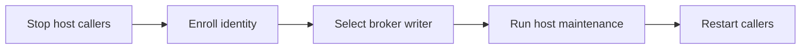
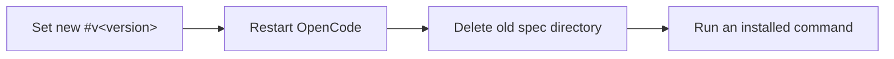

# Upgrading

## tmux Host Claude starts run on `~/.claude` again

A Claude start on the tmux Host that selects no account now runs on your own `~/.claude`, as
before 0.7.0: its plugins, user settings and login. The session sets no `CLAUDE_CONFIG_DIR` and
reads no usage for it, and it needs no registered account. `[session.clients.claude] account` now
applies to the Docker Host only. A tmux start selects an account with `--account` or the new
`local_account`; it then runs on that account's `dir`, checked live against its `max_usage`:

```toml
[session.clients.claude]
local_account = "work"
```

A tmux resume of a conversation recorded in an account's `dir` still runs on that account, and one
recorded in `~/.claude` resumes there with no `CLAUDE_CONFIG_DIR`, even when an account's `dir` is
`~/.claude`. If you set `account` for tmux starts, move it to
`local_account`, or keep both for the two Hosts.

## Register each Claude account explicitly

The session registers only the Claude accounts you list. There is no implicit `default`
account, and `~/.claude` is no longer registered on its own. Each account needs a `dir` and
may set `max_usage`, the percent of each usage window (five-hour and weekly alike) it may
reach; it defaults to 100. Before the next run, in `~/.ensemble/config.local.toml`:

1. List every subscription under its own name, its `dir` the `CLAUDE_CONFIG_DIR` logged in to it.
   To keep using `~/.claude`, register it under a name:

   ```toml
   [session.clients.claude.accounts.work]
   dir = "~/.claude-work"
   max_usage = 80

   [session.clients.claude.accounts.home]
   dir = "~/.claude"
   ```

2. A table without `dir` is now a configuration error, one named `default` included. A
   `[session.clients.claude] account = "default"` needs a registered `default`; prefer a real name.
3. On the Docker Host, log each name in to the broker: `ensemble-broker login claude work`.
4. On the tmux Host, a start selecting an account (`--account` or `local_account`, above) runs on
   its login: `CLAUDE_CONFIG_DIR` is that account's `dir`. Log each `dir` in with
   `CLAUDE_CONFIG_DIR=<dir> claude auth login`. A tmux resume stays on the account whose `dir`
   holds its conversation; another account chosen by `--account` or `local_account` refuses the
   resume.
5. Delete the old usage readings, holds and their locks; nothing reads them any more:

   ```sh
   find ~/.ensemble/usage -maxdepth 1 -type f \( -name '*.json' -o -name '*.json.lock' \) -delete
   rmdir ~/.ensemble/usage
   ```

   Either fails harmlessly when the directory is gone or holds anything else. Account dirs,
   broker credentials and other `~/.ensemble` state are untouched.

Before launching, every Docker Host Claude start, and every tmux one on an account, reads each
registered account's usage once, live, and compares it with that account's `max_usage`.
`--account`, else `[session.clients.claude] account` (Docker) or `local_account` (tmux), runs only
while that account is below its limit in every window, and is never replaced by another. With
neither, a Docker start picks the account with the most usage left, a tie by name. With no account
usable, or every reading failed, the start fails with `usage: no available account` and starts
nothing. A Docker Host Claude start with no account registered is a configuration error. Nothing
is cached or held: a run that hits a usage limit marks nothing, and the next start reads again.
There are no separate start thresholds besides `max_usage`.

## Usage is decided only in the session

The orchestrator's board-start usage gate and its switch are gone. The orchestrator and the
delegate only request a run: a start the session refuses for usage (`usage: no available account`)
is an ordinary failed attempt, logged with that text whole, and the issue follows the same recovery
as any other launch failure. There is no `usage-skip` line, no `resume blocked by usage gate`, and
no usage-specific rollback, retry or issue state. A login whose `/usage` prints only a cost summary
(an API key or gateway) has no usage panel and is never refused for usage.

1. Delete `[orchestrator.usage_limit]` from `~/.ensemble/config.local.toml`; do not move it to
   another layer. A leftover table is a configuration error (`unknown key 'usage_limit' in [orchestrator]`).
2. `Delegate.usage`, `HarnessDelegate.usage`, `Session.usage` and the `Headroom` type are gone,
   with no per-account replacement. Remove custom calls and `from ensemble.session import Headroom`:
   request the run instead and handle its ordinary failure, a `SessionError` whose text is the
   session's.

This change ships with the other session account and usage changes in one compatible
release; do not release it separately.

## Broker protocol 38: named Claude accounts only

The broker has no implicit `default` Claude account any more:

- `ensemble-broker login claude <name>` needs the name; `login claude`, `login claude --expires <date>` and
  `login claude --fresh-token` fail as usage errors (exit 2) before touching a credential.
- A Claude manifest without a valid `claude_account` is `manifest_rejected`, before any credential read. A worker
  started before this release has no account in its manifest: it is refused, not guessed.
- `ensemble-broker status` lists under `claude` each account logged in by name, and only those; the static list and
  its notices name them, and every repair command carries the name.
- An account you log in as `default` is an ordinary account like any other.
- `scripts/install.sh` no longer logs Claude in, natively or to the broker: log each account in yourself (step 4).
  A Docker start with no account registered, or any start selecting an unregistered one, fails with a configuration
  error naming the table.

The plugin and its broker ship as one compatible release: a protocol 37 broker and a protocol 38 client refuse each
other. Upgrade in this order:

1. Stop scheduling new work, then finish or close every running worker (`ensemble-crew close <name>`).
2. Register each subscription (see [Register each Claude account explicitly](#register-each-claude-account-explicitly)),
   for example:

   ```toml
   [session.clients.claude.accounts.work]
   dir = "~/.claude-work"
   max_usage = 80

   [session.clients.claude.accounts.home]
   dir = "~/.claude-home"
   ```

3. Install the matching plugin and broker: rerun `scripts/install.sh` (with `--docker` on the Docker Host).
4. Log each account in: `CLAUDE_CONFIG_DIR=<dir> claude auth login` for each `dir`, and on the Docker Host
   `ensemble-broker login claude work`, then `ensemble-broker login claude home` (each after
   `CLAUDE_CONFIG_DIR=<dir> claude setup-token`). Start one worker on each name and close it again:
   `ensemble-crew worker check --client claude --account work`, then `ensemble-crew close check`.
5. Once a named start works, delete the old unnamed broker item. This does not touch your Claude Code login:

   ```sh
   security delete-generic-password -s ensemble-broker-claude -a default ~/Library/Keychains/login.keychain-db
   ```

6. With no worker running, so no broker command is writing its static metadata, remove the old item's whole record
   (its version, expiry and notice state) from `~/.ensemble/docker/static-secrets.json`, keeping every other entry,
   under the broker's own lock:

   ```sh
   python3 -I - ~/.ensemble/docker/static-secrets.json <<'EOF'
   import fcntl, json, os, sys
   path = sys.argv[1]
   if os.path.exists(path):
       with open(os.path.join(os.path.dirname(path), "static-secrets.lock"), "a") as lock:
           fcntl.flock(lock, fcntl.LOCK_EX)
           with open(path) as f:
               data = json.load(f)
           if data.get("secrets", {}).pop("ensemble-broker-claude/default", None) is not None:
               with open(path + ".tmp", "w") as f:
                   json.dump(data, f, indent=2)
               os.chmod(path + ".tmp", os.stat(path).st_mode & 0o777)
               os.replace(path + ".tmp", path)
   EOF
   ```

   Afterwards `ensemble-broker status` has no `default` under `claude`, no `ensemble-broker-claude/default` in
   `static` and no notice naming it, unless you logged an account in as `default` yourself. Delete the old usage
   readings, holds and their locks as step 5 of
   [Register each Claude account explicitly](#register-each-claude-account-explicitly) says.
7. Resume scheduling.

## Remove custom research quota brakes

Remove `ensemble-orchestrator router --brake ROLE` from custom callers and remove
quota commands before the second deep-research round. The old option now exits 2
without querying usage. The built-in researcher no longer receives a caller-supplied
quota brake and no longer skips its second round because of usage.

Remove `gate` keys from custom delegate overlays and remove `gate=` arguments to
`RunConfig`. The delegate rejects `gate` overlays and no longer defines the `<gate>`
prompt parameter. Update custom research instructions that use that parameter.

Before upgrading, use the previous plugin to finish or close every existing run,
including runs with an empty gate. The new plugin does not read or migrate the old
gate fields. Start new runs after upgrading.

This change ships with the other session account and usage changes in one compatible
release; do not release it separately.

## Credential rotation

Broker [command usage](../src/broker/main.go) owns login syntax; replacing a stored login is not upstream revocation.

| Credential | External action |
|---|---|
| Host `gh` login | Revoke GitHub CLI access in GitHub Settings › Applications; `gh auth logout` only removes local access |
| GitHub App key | Generate a replacement and delete the old key in the App settings, then import the replacement |
| OpenCode provider key / environment secret | Revoke or rotate at its source, then import the new value; close existing containers to replace their static copies |
| Claude setup-token / broker Codex login | Neither has a documented upstream revocation route; obtain a new token/login after suspected exposure |
| Linear app | Rotate its client secret in Linear API Applications; this invalidates all app tokens. Follow the configured writer's [renewal procedure](#linear-broker-renewal) |

## PRD acceptance as Gherkin scenarios

A PRD's acceptance is now its Acceptance scenarios section (`@S-<n>` Gherkin scenarios), not a Check column, and decompose quotes on each engineer ticket the scenarios tagged with a requirement in its `Covers:`. A PRD written before this has no scenarios, so its engineer tickets would get no acceptance: before decomposing it, revise it with the `pm` role's `product-design` task.

## dummy-tester role and echo task removed

The `dummy-tester` role and its `echo` task are gone. A `[delegate.roles.dummy-tester]` table left in `~/.ensemble/config.local.toml` makes `ensemble-delegate run --list` and every orchestrator config load fail with `roles.dummy-tester: no charter roles/dummy-tester.md in core or team_dirs`: delete the table. A run naming the role now fails with `unknown role 'dummy-tester'`; for a smoke test, run `researcher` with its `light-research` task instead.

## Docker workers: per-client Docker config

Docker workers no longer copy `model`, `effortLevel`, `modelSettings` or `env.CLAUDE_CODE_MAX_WEB_SEARCHES_PER_SESSION` from your `~/.claude/settings.json`. Each client's Docker workers now start from its Docker config: `~/.ensemble/docker-config/<client>/`, else a packaged default ([Docker worker client settings](customizing-roles-and-tasks.md#docker-worker-client-settings)). To keep those keys, copy [the Claude default](../src/ensemble/session/clients/claude/docker-settings.json) to `~/.ensemble/docker-config/claude/settings.json` and set them. Never put credentials there (`env.ANTHROPIC_API_KEY`, `apiKeyHelper`): it is copied in plaintext into every worker's home. Running workers keep their settings; new starts use the Docker config. A Codex worker now keeps its copy across resumes, like the others. One started before this change resumes with no copy, so Codex loads no user config until its next new start.

## tmux Host workers listed from guard records

The tmux Host now lists and shows its workers from their guard records, and the Viewer owns their displays.
A tmux worker an older release started has no such record: it is not listed or shown, and its name stays busy until
it exits. Before upgrading, list sessions with `ensemble-session ls`, then close each tmux crew worker with
`ensemble-crew close [--manager <manager>] NAME` and every other tmux session with `ensemble-session close NAME`.
Conversations stay: resume them after the upgrade.

## attach-command removed

`ensemble-session attach-command`, `ensemble-delegate attach-command` and `ensemble-orchestrator attach-command` are
gone; each now fails as an unknown command. The same layer's `status` prints the same command in its `attach` field,
with no side effect: `ensemble-session status NAME`, `ensemble-delegate status WORKDIR`,
`ensemble-orchestrator status ISSUE`. `ensemble-crew attach` lists it per entry in its `attach` column. Do not use
`show` for this: inside tmux it opens a pane instead of printing. An attended `ensemble-orchestrator router --tui` run
prints its `router.py: <ID>: attach: <command>` line on stderr, without the per-session `ensemble-session` line. A
session whose state cannot be read has a null `attach` field: it cannot be attached until its state reads again.

## Worker panes attach directly

Workers no longer get a tmux view session: `tmux ls` lists none, and a grid, split or stack pane runs the Host's
attach command itself (the `attach` field of `ensemble-session status NAME`). `tmux attach -t =NAME` no longer
attaches a worker, so a custom delegate `show` command running `tmux attach -t {{session}}` no longer works; run the
attach command instead: `tmux split-window "$(ensemble-session status {{session}} | jq -r .attach)"`. A worker pane has one
tmux prefix; scroll back with the manager's copy mode or mouse. Its name shows in the window's bottom pane border
(Docker Host always, tmux Host with `[hosts.tmux] status_line = true`). A worker started by an earlier version keeps
running: its first `show` from tmux, `hide` or `close` removes its old view session and nested pane, dropping their
scrollback, and from then on its pane attaches directly.

## ensemble list

`ensemble list` prints every manager in `~/.ensemble/managers/`, with its holder state, client, cwd and entries. On a
terminal it then asks which manager to open, and attaches to its session or resumes its recorded conversation under its
hold. A manager named `list` can no longer be opened with `ensemble list`: attach to its session with
`tmux attach -t =list`, or start it under another name.

## ctmux is now ensemble

The command that opens a manager's tmux session is now `ensemble <name>`. After updating the plugin, rerun
`scripts/install.sh` or `<plugin dir>/skills/manage/scripts/ensemble --install` to install `~/.ensemble/bin/ensemble`.
Neither removes the old launcher, which no longer runs: delete it with `rm ~/.ensemble/bin/ctmux`. Sessions it
opened keep running; `ensemble <name>` attaches to them.

## Broker protocol 37: unused broker commands removed

Protocol 37 removes `ensemble-broker lock-query`, which nothing called, and the `refresh` and `notices` stubs left by
protocol 29; each now fails as an unknown command. Upgrade the broker with the plugin: `scripts/install.sh --docker`.

## Broker protocol 36: GitHub grants without repo

Close running Docker workers before upgrading, then run `scripts/install.sh --docker`; the Docker Host refuses a
protocol 35 broker. A GitHub credential declaration is `app` and `permissions` only: its token reaches every
repository of the App's installations, so where the App is installed decides what every role reaches. The broker
rejects a declaration that still sets `repo` (`github has no "repo" key`). Delete `repo` from each `credentials.github`
table in `~/.ensemble/config.local.toml` (role, task and environment) and from any `--credentials` value. The verifier
keeps prefetch beside its declaration. `[delegate.roles.<role>.output] repo` is unchanged.

## Broker protocol 35: explicit GitHub credentials

Close running Docker workers before upgrading, then run `scripts/install.sh --docker`. Protocol 35 removes the
manifest's top-level `github` grant and replaces the start response's `github_user_id` with a generic `env` map.
Upgrade the broker and plugin together; old manifests and old brokers are rejected.

There is no automatic configuration migration:

| Old configuration | Required replacement in `~/.ensemble/config.local.toml` |
|---|---|
| `[session.hosts.docker.github]` | Delete the table; move its App slug and permissions to `[orchestrator.roles.engineer.credentials.github]`. Keeping it causes `unknown key 'github' in [hosts.docker]` |
| Verifier output-derived GitHub grant | Keep `[delegate.roles.verifier.output] repo`, and explicitly declare `[orchestrator.roles.verifier.credentials.github]` |

The installer writes the engineer declaration after GitHub App enrollment, with the former default permissions;
existing permission values are preserved. To move customized global permissions, copy them explicitly:

```toml
[orchestrator.roles.engineer.credentials.github]
app = "<App slug>"
permissions = { contents = "write", pull_requests = "write", workflows = "write", checks = "read", actions = "read", statuses = "read" }

[orchestrator.roles.verifier.credentials.github]
app = "<App slug>"
permissions = { contents = "write" }
```

The verifier App must be installed on that output repo; delegate no longer derives credentials from `[output]`.
Each declaration reaches every repository of the App's installations. Commits and PRs still use the App's bot
identity.

Workers, `ensemble-delegate run` and `ensemble-session start` have no default GitHub grant. Direct starts must pass
`--credentials '{"github":{"app":"<App slug>","permissions":{"contents":"write"}}}'` when needed; orchestrated
roles and `ensemble-crew role` use their role/task declarations. To start a verifier directly, pass its declaration
with `--credentials`. Saved declarations are reused on resume; changed declarations affect new runs.

Also migrate environment secrets using [environment credential declarations](#environment-credential-declarations)
below. GitHub and environment files now use the same merged credential request; neither has a legacy grant path.

## Broker protocol 34: credential requests

Before upgrading, close workers started before this release; they cannot be resumed after it.
Install the current broker with `scripts/install.sh --docker`. For GitHub configuration, follow protocol 35 above.

### Environment credential declarations

In `~/.ensemble/config.local.toml`, replace each `[[delegate.environments.<name>.secrets]]`
with `[[delegate.environments.<name>.credentials.env]]`, keeping its `item` and `file` values.
For example:

```toml
[[delegate.environments.mini-op.credentials.env]]
item = "ensemble-broker-env/mini-op-password"
file = "mini-password"

[[delegate.environments.mini-op.credentials.env]]
item = "ensemble-broker-env/mini-op-ssh-key"
file = "mini-ssh-key"
```

Remove old `secrets` keys from environment defaults and role environment overrides too;
put any retained entries under that table's `credentials.env`. Removed keys are configuration errors,
with no automatic migration. The packaged mini-op declaration already uses the new shape.
Custom session callers must remove `EnvironmentSpec.secrets` and send a separate
`environment_credentials` JSON-text value; custom broker callers must replace manifest `secrets`
with `env` inside `credentials` or `environment_credentials`.

Keep Keychain items under `ensemble-broker-env/*`; container paths stay
`/run/ensemble/secrets/env/<file>`. A caller's `env` replaces the environment's entire `env` list,
so an explicit override must include every entry that run needs. Existing workers cannot resume after
this upgrade; close them before installing, as above.

### Linear container credentials

Issue runs use their role app’s existing grant and board settings through the broker’s credential spec path.
Existing installations need no new app, configuration, installation or upgrade step for issue re-reads.
No client secret is delivered to a worker. A failed re-read reports an error; the manager sends the current
description and comments through the run’s existing input channel.
Transport-owned apps keep their existing host renewal; the broker copies the current role token without enrollment
or root-secret access. Worker close does not revoke this shared token. Broker-owned apps keep separate worker tokens.

For request validation, delivery paths and modes, the maintenance swap, and revocation, see
[Broker credential implementation](../src/broker/internal/credential). The worker CLI consumes these files directly.

## Claude account selection is the session's

Account operation: [Session account configuration](../src/ensemble/session/config.toml). Before the next run:

1. Remove every `[delegate.accounts]`, `[delegate.roles.<role>.accounts]`, `[orchestrator.core.accounts]` and
   `[orchestrator.core.roles.<role>.accounts]` from `~/.ensemble/config.local.toml`. A left one is a configuration
   error: `unknown key 'accounts' …; moved to [session.clients.<client>] account`.
2. To fix one account for every start, set it in the session instead; leave it out to let each start pick:

   ```toml
   [session.clients.claude]
   account = "work"
   ```

`ensemble-crew reopen` no longer restores a run's recorded account: pass `--account` to choose one.

## Verifier reports on GitHub; orchestrator destination removed

The `verifier` now publishes its report with the `github` destination, to `Verification/` on `main` of a repo you name,
and its outcome carries only the verdict (its ✅, ❌ or ⚠️ mark and one line) and the report's `url`. Before the next
verifier run:

1. Name the repo in `~/.ensemble/config.local.toml`; without it every verifier run and `ensemble-delegate run --list`
   stop with a configuration error naming `output.repo`. Install the ensemble bot GitHub App on that repo.

   ```toml
   [delegate.roles.verifier.output]
   repo = "<owner>/<name>"
   ```

2. Add exactly these two entries to `networks.mini-op.allow` in `~/.egress/config.local.yaml`, then run
   `~/.egress/current/start.sh`:

   ```yaml
       - github.com
       - api.github.com
   ```

3. Declare verifier credentials and upgrade as in [Broker protocol 35](#broker-protocol-35-explicit-github-credentials);
   without the explicit verifier declaration the verifier cannot push its report.
4. Remove `deliverable = true` from a local `verifier` stage: the outcome has no deliverable, so write-back reports
   it cannot post one.

The `orchestrator` destination is removed: a local `[output] type = "orchestrator"` is a configuration error. Use
`local` or `github`.

## Broker protocol 33: short-lived credentials off the Keychain

Broker protocol 33 keeps no short-lived credential in the Keychain: GitHub tokens are issued and written per command
and revoked from memory or, at `close`, read back from the container; Codex logins keep no per-container record
([broker storage](../src/broker/internal/broker/)). `ensemble-broker status` loses `revocations`, and `status --cleanup` is
gone. Run `scripts/install.sh --docker`: before `broker re-trust` it deletes the leftover `ensemble-broker-tokens`,
`ensemble-broker-revocations` and `ensemble-broker-codex-grants` items and prints how many. Then close and resume every
running Docker session: one an older broker started fails its next renewal. A token an older broker recorded is no
longer revoked and expires within the hour.

## Broker protocol 32: the guard is the Docker container's main process

The broker now starts each worker container with the guard as its main process, and the harness reaches it over
`docker attach` ([Docker worker](../src/ensemble/session/hosts/docker/worker.py)), so a killed harness no longer leaves
its container running. Install this release's broker with its plugin (`scripts/install.sh` does both); the plugin
refuses an older broker. Close every running Docker session first (`ensemble-session ls`, then
`ensemble-session close NAME`): an older container has no guard for this release's harness to attach to.
Conversations stay: resume them after the upgrade.

## The delegate's drive: harness_host removed

A detached run's drive (`<agent>-drive`) now runs as a local process the delegate starts itself
([drive implementation](../src/ensemble/delegate/engine/harness.py)), never as a session on a harness Host, so
`[delegate.delegates] harness_host` is gone and any key under `[delegate.delegates]` is refused
(`[delegates] harness_host: the delegate takes no keys`). Delete that line, and the `[delegate.delegates]` table, from
`~/.ensemble/config.local.toml`; `scripts/install.sh --docker` no longer writes it. Let detached runs end first: a run an
older release detached reads as invalid; its other runs read as before.

## Session harness: close every session first

This release runs every tui and headless worker, on every Host, under its [session harness](../src/ensemble/session/harness/process.py)
and drops the in-session tmux start and the Docker relay and supervisor. An extension Host runs sessions only once it implements `Host.worker`
([Session Host contract](../src/ensemble/session/hosts/base.py)). It keeps no compatibility with sessions an
older release started, so before upgrading:

1. List them: `ensemble-session ls`.
2. Close each crew worker with `ensemble-crew close [--manager <manager>] NAME`, which also drops its roster entry,
   and every other session with `ensemble-session close NAME`.

Conversations stay: resume them after the upgrade. A session missed is not supported afterwards: on Docker it is not
listed, and the next Docker start removes its container as debris.

## Broker protocol 31: output-repo token beside prefetch

Historical protocol 31 behavior; protocol 35 replaces the grant with an explicit credential declaration above.

Broker protocol 31 adds the start manifest's optional `github.repo`: a [prefetching](../src/ensemble/delegate/config.toml) run
whose `[output]` is `type = "github"` (the `verifier`'s, once set so) gets one GitHub App token for that repo alone,
`contents: write`. Close every running Docker session, then run `scripts/install.sh --docker` to install the new broker;
the Docker Host refuses a protocol 30 broker. Install the GitHub App on that output repo, or the run's start fails
`github_failed`.

## Broker protocol 30: Keychain rename

Broker protocol 30 renames every broker keychain item to start with `ensemble-broker-` (`ensemble-claude` →
`ensemble-broker-claude`, `ensemble-bot` → `ensemble-broker-bot`, `ensemble-env/<name>` → `ensemble-broker-env/<name>`
and so on: [broker Keychain services](../src/broker/internal/broker/keychain.go)), and the static secret references with
them: an `env` credential item names `ensemble-broker-env/<name>`, and one naming
`ensemble-env/<name>` is rejected (`manifest_rejected`). Upgrading from v0.4.1 or earlier, the maintainer gives you a
one-time rename step; in this order:

1. Close every running Docker session while the protocol 29 broker is still installed: it still reads the old names
   and revokes the sessions' GitHub tokens.
2. Run the one-time rename step: it renames the keychain items and the keys of `~/.ensemble/docker/static-secrets.json`.
3. Run `scripts/install.sh --docker`: it installs the new broker and runs `ensemble-broker retrust`, which asks the
   login keychain password once, then shows one macOS dialog per item an earlier broker wrote, once: click Allow.
   Until step 2 is complete, every broker command refuses to run and names that step.
4. Resume the sessions closed in step 1.

Close first: after step 2 a protocol 29 broker no longer finds its items, so its session's renewal or close revokes
nothing, and the protocol 30 broker rejects the old session's manifest. A session missed in step 1: close it with the
new broker right after step 3; `close` revokes its GitHub tokens from the renamed record, and its audit log lacks the
environment secrets' `Withdrawn` entries. Every later upgrade: `install.sh` runs `retrust` on each new broker, which
asks the login keychain password once and shows no dialog ([Broker installer](../src/broker/install.sh)).

A broker below protocol 30 cannot read the renamed items, so once a protocol 30 broker is installed,
`scripts/install.sh` refuses a `--ref` (an older release or branch) whose broker speaks below 30, before it replaces
the broker or `~/.egress/current`.

## Release changes

The built-in `verifier` now accepts every configured client, including Codex, OpenCode and Claude; board runs
use their Agent label. Rebuild `mini-op:env` from mini-op's plain-skill version (WDRC-195) before starting one:
it must contain `/opt/windroc/mini-op/skills/mini-op/SKILL.md`. Remove any local `fixed_client` role key and
any `mini-op` entry in an environment's `plugins`; the packaged environment no longer requests that plugin.
Update the broker with the plugin so its worker image includes the new client skill bootstrap.

The broker release asset no longer has a GitHub provenance attestation: the maintainer builds it and uploads it with
`ensemble-broker-darwin-arm64.tar.gz.sha256`, and `src/broker/install.sh` installs it only when the download matches
that sha256. Nothing to do: install or upgrade the broker as before (`gh` still downloads it).

Broker protocol 29 replaces `refresh` and `notices` with `maintain`: the broker now decides when each session's
credentials renew ([Docker maintenance](../src/ensemble/session/hosts/docker/maintenance.py)). Upgrade the broker with the
plugin, then restart (close and resume) every Docker session that was running: until then its old supervisor's
renewals fail, its GitHub tokens lapse within the hour and a Codex session closes at its
old deadline. The events `client_refresh_failed`, `github_refresh_failed` and `credential_notice_failed` become
`credential_refresh_failed` and `credential_maintenance_failed`. To go back to protocol 28, install its plugin and
broker, then close and resume every Docker session started under 29: a protocol 28 supervisor cannot read their
records. Pending GitHub revocations are kept either way.

Broker protocol 28 adds `notices` and `status`'s `static`, and records each Claude token's, OpenCode key's and
environment secret's expiry ([static credential registration](../src/broker/internal/credential/static.go)). Upgrade the
broker with the plugin. Existing items keep working with an unknown expiry; to record one, rerun the login with
`--fresh-token` (Claude, after `claude setup-token`), `--issued` or `--expires`.

Broker protocol 27 adds the start manifest's optional `gateway` (the caller network, default `workers`) and `prefetch`
([Environment configuration](../src/ensemble/delegate/config.toml)). Upgrade the broker with the plugin: sessions refuse a broker of
another protocol.

Broker protocol 26 drops `start`'s `client_update`: a start never updates Codex; the image carries Claude Code,
Codex and OpenCode at their latest releases and `ensemble-broker check-clients` rebuilds it when one moves
([Worker image implementation](../src/broker/internal/launcher/build.go)). Upgrade the broker with the plugin. Drop
`npm install -g @anthropic-ai/claude-code` (and `@openai/codex`) from `~/.ensemble/docker/worker/Dockerfile` to shrink
the image: the ensemble layer installs its own, and a base image no longer needs `claude`.

Broker protocol 25 makes `start` require the egress proxy ([Egress setup](upgrading.md#egress-proxy)): without it running and healthy, a start fails
`egress_unavailable` (exit 17) before any credential. Upgrade the broker with the plugin, then rerun
`scripts/install.sh --docker` to start the proxy ([Egress proxy](#egress-proxy)).

Broker protocol 24 adds the start manifest's optional `secrets` ([Environment configuration](../src/ensemble/delegate/config.toml)).
Upgrade the broker with the plugin: sessions refuse a broker of another protocol.

Broker protocol 23 makes `ensemble-broker status` read-only. Upgrade the broker with the
plugin, and change automation that relied on status retrying GitHub revocations to
`ensemble-broker status --cleanup`. The installer already uses this compatibility option.
Protocol 23 also carries optional `audit_warning: "audit_write_failed"` metadata independently
of success or failure; custom clients must display it while preserving the operation result.
Its `build` adds `--base-image IMAGE` and `--image-plugin NAME` ([Broker command help](../src/broker/main.go)); a build without them is unchanged.

## Client run limits

Move every entry in `[orchestrator.client_max_runs]` in `~/.ensemble/config.local.toml` to its client's session table, then delete the old table:

```toml
# Previously: [orchestrator.client_max_runs] with opencode = 1
[session.clients.opencode]
max_runs = 1
```

Zero or an omitted `max_runs` means unlimited. The old local table is now an unknown key: orchestrator commands refuse the configuration until it is deleted (only write-back ignores it, with a warning), and it no longer limits launches. Stop and restart headless/in-process runs started by the previous version before relying on the new limit, because they have no session-layer leases. Existing TUI sessions on configured Hosts are counted immediately. The limit now covers ad-hoc role runs, crew workers and `router --issue` too; a refused board start is a normal failed attempt. See [Session capacity implementation](../src/ensemble/session/engine/capacity.py) for counting and reconciliation.

## Egress proxy

After updating the plugin, rerun `scripts/install.sh --docker`: it installs the pinned private
`windroc-labs/egress-proxy` with your `gh` access, creates `~/.egress/config.local.yaml` only if absent, starts the
proxy and waits for healthy. Existing configs are preserved, so one without `networks.workers` stops the installer: add it first ([Egress setup](upgrading.md#egress-proxy)). Add Ollama and local/LAN provider exceptions before starting their workers
([Egress setup](upgrading.md#egress-proxy)).

The pinned proxy now builds the image as `egress-proxy`. After the installer succeeds, remove the
old image it leaves behind:

```sh
docker image rm egress-proxy-proxy
```

An already running worker stays on `bridge` during the upgrade; it is not forcibly migrated or stopped.
Its next start, restart or resume creates a container on the proxy's internal `workers` network.
List running broker workers still on `bridge`:

```sh
docker ps --filter network=bridge --filter label=ensemble.session
```

This filters out containers without the broker's session label. Restart or close/resume a listed worker when
its current work can be interrupted. Until then, it retains its old local/LAN network access.

## Unified source layout

After updating the plugin to the `src/ensemble/` layout, refresh the launchers once:
`<plugin dir>/skills/manage/scripts/ensemble --install`. Use the plugin path directly because an
older installed launcher still looks for its script under `manager/skills/manage/scripts/`.
Rerunning `scripts/install.sh` after the plugin update does this automatically, including when
all five launchers already exist. Python imports and user configuration stay the same.

Docker-host users must rerun `scripts/install.sh` after the release containing this layout change
to reinstall the broker. An older broker fails on the new layout with `session/src unreadable`.

## Linear presets

What a Linear board needs in its team. `scripts/install.sh --board linear` then fills each id ([Installer](../scripts/install.sh)); by hand, put each in `~/.ensemble/config.local.toml` as a `linear.<key>` under
`[orchestrator.linear]` (`linear.states.todo` is `todo` in `[orchestrator.linear.states]`, `linear.roles.pm.client_id`
is `client_id` in `[orchestrator.linear.roles.pm]`).

| Create in Linear | Config key |
|---|---|
| the team | `linear.team` |
| workflow states Backlog, Todo, In Progress, In Review, Handoff, Done, Canceled | `linear.states.<state>`: `backlog`, `todo`, `in_progress`, `in_review`, `handoff`, `done`, `canceled` |
| a `Tasks` label group, its id from `issueLabels { nodes { id name isGroup } }` | `linear.task_label_group` |
| `decompose` under `Tasks`, required for PM promotion; other task labels (`build`, `light-build`, …) optional | `linear.task_labels.decompose`, `linear.task_labels.<task>` |
| an `Agent` label group and one label per client, optional; both or neither | `linear.agent_label_group`, `linear.agent_labels` |
| the harness's, manager's and each role's OAuth app (below) | `client_id`, `secret_service`, `token_service`, `user_id` of `linear.harness`, `linear.manager` and `linear.roles.<role>` |
| the humans subscribed on In Review | `linear.human_members` |
| the human PM and decompose questions are assigned to, optional: their Linear user id | `linear.assignee_id` |
| the Linear project of each product repo, optional | `linear.project_repos` |

Each OAuth app:

1. Linear › Settings › API › Applications › New: Client credentials on, Public and Webhooks off (the app page has no
   team-access setting). Its Client ID → `client_id`.
2. Store its client secret, then paste it (nothing echoes):

   ```sh
   security add-generic-password -s <secret_service> -a <secret_service> -w
   ```

3. Its Linear user id → `user_id`; runtime commands never fetch it. The first non-dry call as the app requests and
   stores its token.

The installer does steps 2 and 3 for each transport-owned app, with the services `linear-app-<slot>-secret` and
`linear-app-<slot>-token` unless configured, reuses a token with over five days left, and leaves an enrolled app's
token to the broker; cleanup removes only the items it created. A key the orchestrator does not know, in
`[orchestrator.linear]` or an app table, stops it ([Linear apps](#linear-apps)). Once every app has a usable token,
`bin/ensemble-orchestrator router --dry-run`, `bin/ensemble-orchestrator promote --dry-run` and
`bin/ensemble-orchestrator issue list` report no configuration error.

## Linear apps

The Linear board's harness, manager and roles are OAuth apps now; member accounts and personal API keys are gone.
On a Linear board, switch once, in this order:

1. Create the five apps (harness, manager, one per role) in Linear › Settings › API › Applications: Client
   credentials on, Public and Webhooks off ([Linear presets](#linear-presets)).
2. Stop the board's launchd jobs and start no router by hand; wait until no run is left.
3. Write down the value of each old setting, `linear.harness_key`, `linear.manager_key` and each
   `[orchestrator.linear.roles.<role>]` `key`: it names the Keychain item holding that personal key. Unset, it
   was `linear-<slot>` (`linear-harness`, `linear-manager`, `linear-<role>`). Then delete those settings and each
   role's `account` from `~/.ensemble/config.local.toml`: the installer and the orchestrator refuse them as unknown keys.
4. Update ensemble, then rerun `scripts/install.sh --board linear`: it asks each app's Client ID and client secret.
5. Delegate every issue not Done, Canceled or Duplicate from a role's member account to that role's app, and
   from the harness's to the manager app: Linear's bulk edit, or `ensemble-orchestrator issue edit <ID> --role <role>`
   (`--role me` for the manager app).
6. Start the jobs again and let each role run one round ([Live checks](#live-checks)).
7. Revoke the old personal keys in Linear › Settings › Account › Security & Access, run
   `security delete-generic-password -s <service>` for each item written down in step 3, deactivate the old member
   accounts and remove their emails from `linear.human_members`. If the manager's old key was your own account's,
   revoke only that key: keep your account and email.

## Linear broker renewal

This optional cutover keeps existing identity/service names and fixed scopes. Upgrade the plugin and install its
broker first (`sh <plugin dir>/src/broker/install.sh`), even on hosts that do not run Docker workers.
Switch one configured identity at a time:


Stop launchd router/promote jobs, manual host commands and active role write-back before enrollment so no old process
holds a root secret in memory. Docker workers receive Linear material only when their credential request declares it.

Copy the identity's six public values from its config table into a local `linear-identity.json` (no secret):

```json
{
  "name": "harness",
  "kind": "harness",
  "client_id": "<configured client_id>",
  "user_id": "<configured user_id>",
  "secret_service": "<configured secret_service>",
  "token_service": "<configured token_service>"
}
```

`kind` is `harness`, `manager` or `role` (verifier included). The name and services are 1–128 ASCII letters, digits
or `._@+-`, not `.` or `..`; the client ID 1–256 printable ASCII characters without whitespace; the user ID a lowercase
UUID. The secret and token services differ and are no broker service; enrollment rejects an alias of another identity
before changing access. Enroll it:

```sh
/usr/local/libexec/ensemble/ensemble-broker login linear < linear-identity.json
```

It may ask the login Keychain password on the terminal, then open a macOS SecurityAgent dialog to change the client
secret item's access: enter the login Keychain password and click **Allow**. It records a pending binding before
changing access, so after a failure rerun the same enrollment.
Then set `renewal = "broker"` in its `[orchestrator.linear.harness]`, `[orchestrator.linear.manager]` or
`[orchestrator.linear.roles.<role>]` table in `~/.ensemble/config.local.toml` and, callers still stopped, run
`/usr/local/libexec/ensemble/ensemble-broker linear-maintain < linear-identity.json`; success contains version 1,
`renewed` and `expires_at`, never a token. Then restart callers. Repeat for the next identity, including verifier when configured. An unconfigured
verifier is not an error. If enrollment/maintenance fails, complete recovery while that identity's callers stay
stopped; do not change its writer back as an automatic fallback.

An interrupted enrollment keeps its reservation and pending record. Rerun the exact same enrollment to complete
root trust; a changed client ID, user ID or service is rejected. After broker reinstallation, rerun enrollment to
repair the registry, selected app record, host grant and root trust. This repair accepts only metadata restricted
to a prior broker code identity at the installed path; permissive or foreign-reader records stay refused. It asks
for the login Keychain password once per enrollment, preserves reservations and cached tokens, and releases the
registry transaction before interactive repair. Failed publication retains authoritative material; rerun maintenance. For a deliberate
identity replacement, stop callers and remove only that identity's reservation from `ensemble-broker-linear` / `registry`
and its `app/<token_service>` and host grant records through a controlled Keychain recovery; preserve every other
identity and all GitHub recovery material. There is no automatic rebinding command.

To rotate an enrolled app's secret, stop its host callers, rotate it at Linear, replace only its root item in Keychain
Access, and delete its published token, its `ensemble-broker-linear` / `app/<token_service>` and its
`ensemble-broker-linear-grants` / `host/<token_service>`, keeping `registry` and every other identity's items. Store
the new root at the configured service and account, rerun `login linear` and `linear-maintain`, then restart callers.
Deleting only the published token would republish the broker's cached access token.

Downgrade is explicit: stop the host callers, keep the broker's records, and remove `renewal` from each switched
local app table before loading an older plugin (which rejects the new key). In Keychain Access restore only that
identity's root item to its previous `/usr/bin/security` reader and partition settings, or recreate the root item
with the same service/account using the old installer's hidden prompt. Do not resume the old writer until its root
access is restored. Broker-only access never silently changes because a process selected the old writer. Re-enroll
before selecting broker again. This does not delete or migrate pending GitHub revocations.

## Live checks

Manual, for the manager and the user, through mini-op on the test Mac mini with Docker Desktop, never on a developer's
Mac; the `tests/session/live_docker.py` checks: [Docker acceptance entry](../tests/session/live_docker.py).

- [ ] Set up as in
  [Verifier reports on GitHub](#verifier-reports-on-github-orchestrator-destination-removed), one
  verifier run publishes its report under `Verification/` and returns only `status`, `title`, `summary` and `url`;
  its target checkout's `HEAD` and `git diff HEAD` are unchanged.
- [ ] Fresh `scripts/install.sh --docker` ends with `egress-proxy` healthy; rerunning keeps the proxy's ID and start
  time, pinned checkout, and config bytes, mode and modification time. Repeat with an existing config.
- [ ] After changing or recreating `~/.egress/config.local.yaml`, rerunning `scripts/install.sh --docker` makes the
  proxy serve the new config; with no change, the proxy keeps its start time.
- [ ] [Linear presets](#linear-presets) in a new Linear team, from only that section and the config: both dry-runs
  report no configuration error. Deferred until there is a new Linear team.
- [ ] [Linear apps](#linear-apps), before cutover: the harness app claims, moves, comments (the comment's `user` has
  `isMe` true), creates an issue, a relation and an attachment, archives, and subscribes the user.
- [ ] Before cutover: the manager app creates and edits issues, comments (`user` is the manager app user) and moves an
  issue (the move's actor is recognisable by its app user id).
- [ ] Before cutover: the harness and manager apps both fail to read or write another team's issue.
- [ ] After cutover: each role app fails on another team's issue and runs one round: claim, write-back, Handoff, next
  role's claim.
- [ ] After cutover: [Linear apps](#linear-apps) step 7 is done: the old credentials revoked in Linear and every
  Keychain item written down in its step 3 deleted.

A failed before-cutover check stops the cutover; report it to the user.

## With scripts/install.sh

On a machine already set up, by hand or by [`scripts/install.sh`](../README.md#install), run the [install command](../README.md#install) again
with the `<tag>` the `windroc` marketplace pins now, adding `--ref <ref>` for another branch or tag (OpenCode only: Claude Code and Codex take only `<tag>`): it reads your answers from its last run, else from `~/.ensemble/config.local.toml`, else
asks; skips what is installed and logged in; installs what the configuration lacks; and shows and asks before each
change to your config or shell profile. Flags change the configuration (`--clients`, `--docker`/`--no-docker`, the
`--opencode-*` flags); it removes nothing chosen before.

Each run refreshes the selected Claude Code/Codex marketplaces and updates their ensemble plugins to the served ref
before reading installed files. An update or version check failure stops with the client's name and reason.
For OpenCode, when `--ref` (default `<tag>`) names a newer commit than the one it last downloaded, it deletes
OpenCode's copy and downloads it again. Each successful install selects its plugin for all `~/.ensemble/bin` commands,
ignoring other clients’ caches and older OpenCode packages ([launcher](../skills/manage/scripts/launcher)).
Rerun the installer once to refresh older launchers and record that selection, even if their files already exist.
After a client plugin update removes the selected directory, the next command selects that same client's newest
installed ensemble copy, records its path and reports it on stderr; no installer rerun is needed. It never selects
another client's copy, nor an OpenCode copy of another ref (its package's `#<ref>`, none meaning `main`). If no such
copy is left, the command keeps the selected-plugin error and the selection: rerun the installer.
Equal versions use sorted paths to break ties. A ref older than v0.5.0 installs its own launcher, which ignores the selection.
After plugin refresh, when
the plugin's broker sources changed, or the installed broker speaks another protocol, it reinstalls the broker, reusing ready Codex
credentials and requesting any missing logins ([broker command usage](../src/broker/main.go)). It logs no Claude
account in: see [Broker protocol 38](#broker-protocol-38-named-claude-accounts-only).
It does not edit config keys a release renames.

For OpenCode with `--docker`, rerunning the installer also ensures the local `auth.json` entry for a commander,
then imports it into the broker without a second key entry. A broker-only install needs one local login;
existing local API entries are reused, including after a broker reinstall. Both entries follow the install ledger's
cleanup ownership ([OpenCode sessions](customizing-roles-and-tasks.md#opencode-sessions)).

With OpenCode selected, an existing stable 1.x executable on `PATH` at or above the minimum version is reused.
Otherwise, the installer installs a private copy and offers a shell profile addition for `~/.ensemble/opencode/bin`;
accept it, then open a new terminal to run `opencode` directly. Existing executable paths, the selected provider
and credentials are kept on rerun.

## OpenCode plugin by hand

OpenCode installs the `#v<version>` tag of ensemble's `plugin` entry
([OpenCode operating limits](customizing-roles-and-tasks.md#opencode-operating-limits)) once, into
`${XDG_CACHE_HOME:-~/.cache}/opencode/packages/<spec>/node_modules/ensemble`, and never refreshes the same spec.
Installed commands keep their selected plugin path ([Install](../README.md#install)). For a release upgrade:



When the old selected directory is gone, the next installed command selects and records the newest installed ensemble
copy from OpenCode and reports its path on stderr; no installer rerun is needed. To select a different ref while the
old directory remains, rerun the installer or the new plugin's `skills/manage/scripts/ensemble --install`; older refs
require the installer ([With scripts/install.sh](#with-scriptsinstallsh)).
