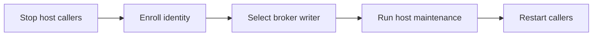

# Upgrading

The built-in `verifier` now accepts every configured client, including Codex, OpenCode and Claude; board runs
use their Agent label. Rebuild `mini-op:env` from mini-op's plain-skill version (WDRC-195) before starting one:
it must contain `/opt/windroc/mini-op/skills/mini-op/SKILL.md`. Remove any local `fixed_client` role key and
any `mini-op` entry in an environment's `plugins`; the packaged environment no longer requests that plugin.
Update the broker with the plugin so its worker image includes the new client skill bootstrap.

Broker protocol 29 replaces `refresh` and `notices` with `maintain`: the broker now decides when each session's
credentials renew ([Docker host › Credential renewal](docker-host.md#credential-renewal)). Upgrade the broker with the
plugin, then restart (close and resume) every Docker session that was running: until then its old supervisor's
renewals fail, each asking for that restart, its GitHub tokens lapse within the hour and a Codex session closes at its
old deadline. The events `client_refresh_failed`, `github_refresh_failed` and `credential_notice_failed` become
`credential_refresh_failed` and `credential_maintenance_failed`. To go back to protocol 28, install its plugin and
broker, then close and resume every Docker session started under 29: a protocol 28 supervisor cannot read their
records. Pending GitHub revocations are kept either way.

Broker protocol 28 adds `notices` and `status`'s `static`, and records each Claude token's, OpenCode key's and
environment secret's expiry ([Docker host › Static secret expiry](docker-host.md#static-secret-expiry)). Upgrade the
broker with the plugin. Existing items keep working with an unknown expiry; to record one, rerun the login with
`--fresh-token` (Claude, after `claude setup-token`), `--issued` or `--expires`.

Broker protocol 27 adds the start manifest's optional `gateway` (the caller network, default `workers`) and `prefetch`
([Docker host › Prefetch](docker-host.md#prefetch)). Upgrade the broker with the plugin: sessions refuse a broker of
another protocol.

Broker protocol 26 drops `start`'s `client_update`: a start never updates Codex; the image carries Claude Code,
Codex and OpenCode at their latest releases and `ensemble-broker check-clients` rebuilds it when one moves
([Docker host › Client releases](docker-host.md#client-releases)). Upgrade the broker with the plugin. Drop
`npm install -g @anthropic-ai/claude-code` (and `@openai/codex`) from `~/.ensemble/docker/worker/Dockerfile` to shrink
the image: the ensemble layer installs its own, and a base image no longer needs `claude`.

Broker protocol 25 makes `start` require the egress proxy ([Docker host › Egress
proxy](docker-host.md#egress-proxy)): without it running and healthy, a start fails
`egress_unavailable` (exit 17) before any credential. Upgrade the broker with the plugin, then rerun
`scripts/install.sh --docker` to start the proxy ([Egress proxy](#egress-proxy)).

Broker protocol 24 adds the start manifest's optional `secrets` ([environment secrets](docker-host.md#environment-secrets)).
Upgrade the broker with the plugin: sessions refuse a broker of another protocol.

Broker protocol 23 makes `ensemble-broker status` read-only. Upgrade the broker with the
plugin, and change automation that relied on status retrying GitHub revocations to
`ensemble-broker status --cleanup`. The installer already uses this compatibility option.
Protocol 23 also carries optional `audit_warning: "audit_write_failed"` metadata independently
of success or failure; custom clients must display it while preserving the operation result.
Its `build` adds `--base-image IMAGE` and `--image-plugin NAME` ([Docker host › Base
images](docker-host.md#base-images)); a build without them is unchanged.

## Egress proxy

After updating the plugin, rerun `scripts/install.sh --docker`: it installs the pinned private
`windroc/egress-proxy` with your `gh` access, creates `~/.egress/config.local.yaml` only if absent, starts the
proxy and waits for healthy. Existing configs are preserved. Add Ollama and local/LAN provider exceptions before starting their workers
([Egress proxy operations](docker-host.md#egress-proxy)).

An already running worker stays on `bridge` during the upgrade; it is not forcibly migrated or stopped.
Its next start, restart or resume creates a container on the proxy's internal `workers` network.
List running broker workers still on `bridge`:

```sh
docker ps --filter network=bridge --filter label=ensemble.session
```

This filters out containers without the broker's session label. Restart or close/resume a listed worker when
its current work can be interrupted. Until then, it retains its old local/LAN network access.

## Unified source layout

After updating the plugin to the `src/ensemble/` layout, refresh the launchers once:
`<plugin dir>/skills/manage/scripts/ctmux --install`. Use the plugin path directly because an
older installed `ctmux` launcher still looks for `manager/skills/manage/scripts/ctmux`.
Rerunning `scripts/install.sh` after the plugin update does this automatically, including when
all five launchers already exist. Python imports and user configuration stay the same.

Docker-host users must rerun `scripts/install.sh` after the release containing this layout change
to reinstall the broker. An older broker fails on the new layout with `session/src unreadable`.

## Linear apps

The Linear board's harness, manager and roles are OAuth apps now; member accounts and personal API keys are gone.
On a Linear board, switch once, in this order:

1. Create the five apps (harness, manager, one per role) in Linear › Settings › API › Applications: Client
   credentials on, Public and Webhooks off ([Linear presets](credentials.md#linear-presets)).
2. Stop the board's launchd jobs and start no router by hand; wait until no run is left.
3. Write down the value of each old setting, `linear.harness_key`, `linear.manager_key` and each
   `[orchestrator.linear.roles.<role>]` `key`: it names the Keychain item holding that personal key. Unset, it
   was `linear-<slot>` (`linear-harness`, `linear-manager`, `linear-<role>`). Then delete those settings and each
   role's `account` from `~/.ensemble/config.local.toml`: the installer and the orchestrator refuse them as unknown keys.
4. Update ensemble, then rerun `scripts/install.sh --board linear`: it asks each app's Client ID and client secret.
5. Delegate every issue not Done, Canceled or Duplicate from a role's member account to that role's app, and
   from the harness's to the manager app: Linear's bulk edit, or `ensemble-orchestrator issue edit <ID> --role <role>`
   (`--role me` for the manager app).
6. Start the jobs again and let each role run one round ([Live checks](credentials.md#live-checks)).
7. Revoke the old personal keys in Linear › Settings › Account › Security & Access, run
   `security delete-generic-password -s <service>` for each item written down in step 3, deactivate the old member
   accounts and remove their emails from `linear.human_members`. If the manager's old key was your own account's,
   revoke only that key: keep your account and email.

## Linear broker renewal

This optional cutover keeps existing identity/service names and fixed scopes. Upgrade the plugin and install its
broker first (`sh <plugin dir>/src/broker/install.sh`), even on hosts that do not run Docker workers.
Switch one configured identity at a time:


Stop launchd router/promote jobs, manual host commands and active role write-back before enrollment so no old process
holds a root secret in memory. Docker workers themselves receive no Linear material.

Use that identity's public JSON, commands and terminal/dialog approval instructions from
[Credentials › Linear broker renewal](credentials.md#linear-broker-renewal).
After `login linear` succeeds, set `renewal = "broker"` in its `[orchestrator.linear.harness]`,
`[orchestrator.linear.manager]` or `[orchestrator.linear.roles.<role>]` table in `~/.ensemble/config.local.toml`.
Run `linear-maintain` while callers remain stopped; success contains version 1, `renewed` and `expires_at`, never a
token. Then restart callers. Repeat for the next identity, including verifier when configured. An unconfigured
verifier is not an error. If enrollment/maintenance fails, complete recovery while that identity's callers stay
stopped; do not change its writer back as an automatic fallback.

An interrupted enrollment keeps its reservation and pending record. Rerun the exact same enrollment to complete
root trust; a changed client ID, user ID or service is rejected. After broker reinstallation, rerun enrollment to
repair the registry, selected app record, host grant and root trust. This repair accepts only metadata restricted
to a prior broker code identity at the installed path; permissive or foreign-reader records stay refused. It asks
for the login Keychain password once per enrollment, preserves reservations and cached tokens, and releases the
registry transaction before interactive repair. Failed publication retains authoritative material; rerun maintenance. For a deliberate
identity replacement, stop callers and remove only that identity's reservation from `ensemble-linear` / `registry`
and its `app/<token_service>` and host grant records through a controlled Keychain recovery; preserve every other
identity and all GitHub recovery material. There is no automatic rebinding command.

Downgrade is explicit: stop the host callers, keep the broker's records, and remove `renewal` from each switched
local app table before loading an older plugin (which rejects the new key). In Keychain Access restore only that
identity's root item to its previous `/usr/bin/security` reader and partition settings, or recreate the root item
with the same service/account using the old installer's hidden prompt. Do not resume the old writer until its root
access is restored. Broker-only access never silently changes because a process selected the old writer. Re-enroll
before selecting broker again. This does not delete or migrate pending GitHub revocations.

## With scripts/install.sh

On a machine already set up, by hand or by [`scripts/install.sh`](../README.md#install), run the [install command](../README.md#install) again
with the `<tag>` the `windroc` marketplace pins now, adding `--ref <ref>` for another branch or tag (OpenCode only: Claude Code and Codex take only `<tag>`): it reads your answers from its last run, else from `~/.ensemble/config.local.toml`, else
asks; skips what is installed and logged in; installs what the configuration lacks; and shows and asks before each
change to your config or shell profile. Flags change the configuration (`--clients`, `--docker`/`--no-docker`, the
`--opencode-*` flags); it removes nothing chosen before.

Each run refreshes the selected Claude Code/Codex marketplaces and updates their ensemble plugins to the served ref
before reading installed files. An update or version check failure stops with the client's name and reason.
For OpenCode, when `--ref` (default `<tag>`) names a newer commit than the one it last downloaded, it deletes
OpenCode's copy and downloads it again. The `~/.ensemble/bin` commands follow [launcher precedence](../README.md#commands),
so updating OpenCode's copy alone may not change the code they run. After plugin refresh, when
the plugin's broker sources changed, or the installed broker speaks another protocol, it reinstalls the broker, reusing locally usable Claude and ready Codex
credentials and requesting any missing logins ([Log in](docker-host.md#log-in)).
It does not edit config keys a release renames.

For OpenCode with `--docker`, rerunning the installer also ensures the local `auth.json` entry for a commander,
then imports it into the broker without a second key entry. A broker-only install needs one local login;
existing local API entries are reused, including after a broker reinstall. Both entries follow the install ledger's
cleanup ownership ([Credentials](credentials.md#opencode-provider-api-keys)).

With OpenCode selected, an existing stable 1.x executable on `PATH` at or above the minimum version is reused.
Otherwise, the installer installs a private copy and offers a shell profile addition for `~/.ensemble/opencode/bin`;
accept it, then open a new terminal to run `opencode` directly. Existing executable paths, the selected provider
and credentials are kept on rerun.
