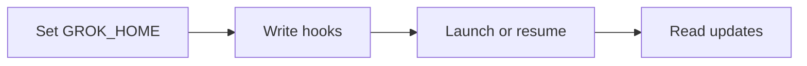

# Report: [Reference] [Title]

<type>: <task> · <web|local|mixed>

> [!IMPORTANT]
> **<one-sentence answer>** (<overall confidence>)
>
> - <reason 1>
> - <reason 2, optional>
> - <reason 3, optional>
>
> <Next step, translated>: <action>
>
> <Risk, translated>: <main risk>

## Template rules

Instruction sections: omit Template rules and Filled example from the report. Start with the H1, type line, then the alert, with no Conclusion heading between them.

- Title: no gloss; `[Title]` never repeats `[Reference]`. Combining reports: each id appears once, in its sub-report's heading.
- Type line: `<type>` is Light Research, Research or Deep Research, translated; `<task>` is the selected task name. For local or mixed, append ` · <repo>@<12-character sha>` for each repo; web has no repo segment. Task depth:

| Type | Verification |
|---|---|
| Light Research | One pass by one agent; no subagents or verification stage |
| Research | One parallel round; each agent checks its findings; no independent verification |
| Deep Research | Research workflows; independent votes on key claims |

- Alert: one bold answer with confidence; at most 3 reasons; Next step and Risk each one line. No synthesis label inside it.
- Body: text where detail is needed; a figure (Mermaid, or SVG: [Researcher › Standards › Figures](#standards)) or table wherever it makes the report easier to read. Be concise; avoid long essay-style paragraphs. Outside Findings, one fact per list item. Keep only material relevant to the research question. Mark synthesis at most once per section, outside the alert.
- Length: display columns. Outside Findings: lists/paragraphs 80; table last column 80, other cells 30. Findings: no per-line cap; the `
` block (keep that id) at most 6000 in total. W/F characters in `unicodedata.east_asian_width` count 2, others 1. URLs, link targets, `[n]` and Markdown markers do not count. Code/Mermaid blocks, headings, type line and HTML tag lines are exempt; text inside `
` is checked. Soft-wrapped text shares one item's budget. Delivery check: [Researcher › Standards › Concise](#standards).

## Comparison table

Optional; omit when the input asks for no comparison. A table ([Principles › Writing › Diagrams and tables](#writing)), labeled as your synthesis. Score cells with ✅⚠️❌ plus short values; below it, a one-line legend. Remove rows whose compared values are the same; combine them below as `<Both have, translated>: …`. Over the list/paragraph limit → that label followed by short list items instead.

## Findings

Findings (<count>)

One subsection per part of the question; the findings the conclusion depends on first. Each finding is one **bold claim** line, then 1–3 sentences: the evidence (what was measured, on what, how big), why it holds, and what it means for the research question; they end with `(<confidence: high, medium or low>; [n]…; <single-source or unverified, when so>)`. Translate the label names, keeping the listed values English. Sources disagree → name both and which you favor, and why; confidence at most medium.

## What it means for us

Optional; omit when the input asks no decision. 1–3 list items tying the findings to that decision: what they favor, rule out or still require.

## Corrections to known claims

Optional; omit when the input states no known claims. One list item per claim: the claim → the correction, its sources (`[n]`).

## Gaps

Optional; omit when none. Two columns, translated; conclusion-changing gaps first:

| Impact | Gap |
|---|---|
| Could change conclusion | <uncovered, unverified, refuted or open point> |
| Does not change conclusion | <point> |

## Sources

Sources (<count>)

Numbered in first-citation order, numbers matching in-text `[n]`: `1. [<Short title>](<URL or code permalink>) (primary|secondary|code)`.

## Filled example

# Report: Cursor CLI or Grok Build for ensemble

Light Research: light-research · mixed · windroc-labs/ensemble@f597b17033e7

> [!IMPORTANT]
> **Prefer Grok Build for the next client.** (medium)
>
> - Caller-chosen session ids simplify integration.
> - Claude-style hooks reduce adapter work.
> - Account isolation has documented storage paths.
>
> Next step: verify interactive hooks before implementing.
>
> Risk: interactive session creation remains untested.

## Comparison table

- Synthesis: compare integration differences.

| Need | Cursor CLI | Grok Build |
|---|---|---|
| New session id | ⚠️ create-chat first | ✅ caller UUID via -s |
| Hooks | ⚠️ CLI coverage unclear | ✅ Claude-style payloads |
| Account isolation | ⚠️ config only documented | ✅ GROK_HOME |
| Source access | ❌ closed | ✅ Apache-2.0 |

- Legend: ✅ supported; ⚠️ gap or extra work; ❌ unavailable.
- Both have: interactive terminals, resume by id, headless output.

## Findings

Findings (8)

### Existing client contract

**A new client must supply hooks, caller-known session ids and recorded replies.**

The client base class requires launch, reply, session_id and observe, and maps every hook event to a HookKind [1]. Claude meets it by choosing the session id itself and injecting its hooks at launch [2][3], so a client that allows both can reuse Claude's adapter shape. (high; [1][2][3])

### Cursor CLI

**Every launch needs an extra call to get a session id.**

Cursor's parameter reference has create-chat return a new id, which --resume then restores [4]. Ensemble would run and parse create-chat before each launch, a step Claude does not need. (high; [4])

**Replies arrive on a separate hook, which the CLI may not emit.**

Cursor's hook reference puts the reply text on afterAgentResponse, not on stop [5], so observe must join two events per turn. NVIDIA's guide says the CLI emits fewer hooks than the editor [6]; if so, headless runs could lose replies. (medium; [5][6]; single-source)

**Per-account isolation is undocumented.**

Cursor documents only where its config lives, not its sessions or credentials, so separating accounts would rest on guesses. (low; unverified)

### Grok Build

**Session ids and hooks map one-to-one onto the contract.**

Grok's session guide has -s create a session under a caller UUID and -r resume it [7]; its Stop hook carries lastAssistantMessage, and StopCancelled marks an interrupted turn [8]. That covers session_id, reply and observe with no extra call. (high; [7][8])

**One GROK_HOME per account isolates sessions and credentials.**

GROK_HOME holds auth.json beside the sessions [7][10], so one directory per account separates both. Grok also runs inherited Claude and Cursor hooks unless their ENABLED flags are off [8][9], so the adapter must turn them off. (high; [7][8][9][10])

### Integration work

**Reuse Claude's adapter shape with account-scoped hook files.**

Synthesis: mapping Grok's docs onto Claude's adapter gives these four steps; hooks filter by sessionId, since one GROK_HOME serves several sessions. [3][7][8]

**observe's input format is still unknown.**

The docs do not list the fields of updates.jsonl. Grok Build is Apache-2.0 [11], so they can be read in its source before observe is implemented. (low; unverified)

## What it means for us

- Grok Build fits today's adapter: ids, replies and isolation map directly.
- Cursor would add an id call, a two-hook join and guessed isolation.

## Gaps

| Impact | Gap |
|---|---|
| Could change conclusion | Neither interactive hook path was tested. |
| Does not change | Interactive -s is untested; fallback increases work. |
| Does not change | Cursor isolation and CLI hook coverage remain unverified. |
| Does not change | updates.jsonl fields still need source inspection. |
| Does not change | Current beta status could not be confirmed. |

## Sources

Sources (11)

1. [Client contract](src/ensemble/session/clients/base.py#L116-L192) (code)
2. [Claude ids](src/ensemble/session/clients/claude/__init__.py#L18-L19) (code)
3. [Claude hooks](src/ensemble/session/clients/claude/tui.py#L63-L106) (code)
4. [Cursor parameters](https://cursor.com/docs/cli/reference/parameters) (primary)
5. [Cursor hooks](https://cursor.com/docs/agent/hooks) (primary)
6. [NVIDIA CLI caveats](https://docs.nvidia.com/nemo/relay/v0.4.0/nemo-relay-cli/cursor) (secondary)
7. [Grok sessions](https://github.com/xai-org/grok-build/blob/2bdd1d6a6369de0e8c68132ea4539e9abd9e14a8/crates/codegen/xai-grok-pager/docs/user-guide/17-sessions.md#L18-L42) (primary)
8. [Grok hooks](https://github.com/xai-org/grok-build/blob/2bdd1d6a6369de0e8c68132ea4539e9abd9e14a8/crates/codegen/xai-grok-pager/docs/user-guide/10-hooks.md#L60-L435) (primary)
9. [Grok config](https://github.com/xai-org/grok-build/blob/2bdd1d6a6369de0e8c68132ea4539e9abd9e14a8/crates/codegen/xai-grok-pager/docs/user-guide/05-configuration.md#L21-L30) (primary)
10. [Grok authentication](https://github.com/xai-org/grok-build/blob/2bdd1d6a6369de0e8c68132ea4539e9abd9e14a8/crates/codegen/xai-grok-pager/docs/user-guide/02-authentication.md#L44-L53) (primary)
11. [Grok repository](https://github.com/xai-org/grok-build) (primary)

