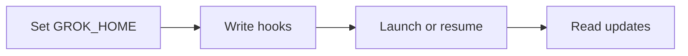

# Report: [Reference] [Title]

<type>: <task> · <web|local|mixed>

> [!IMPORTANT]
> **<one-sentence answer>** (<overall confidence>)
>
> - <reason 1>
> - <reason 2, optional>
> - <reason 3, optional>
>
> <Next step, translated>: <action>
>
> <Risk, translated>: <main risk>

## Template rules

Instruction sections: omit Template rules and Filled example from the report. Start with the H1, type line, then the alert, with no Conclusion heading between them.

- Title: no gloss; `[Title]` never repeats `[Reference]`. Combining reports: each id appears once, in its sub-report's heading.
- Type line: `<type>` is Light Research, Research or Deep Research, translated; `<task>` is the selected task name. For local or mixed, append ` · <repo>@<12-character sha>` for each repo; web has no repo segment. Task depth:

| Type | Verification |
|---|---|
| Light Research | One pass by one agent; no subagents or verification stage |
| Research | One parallel round; each agent checks its findings; no independent verification |
| Deep Research | Research workflows; independent votes on key claims |

- Alert: one bold answer with confidence; at most 3 reasons; Next step and Risk each one line. No synthesis label inside it.
- Body: text where detail is needed; a figure (Mermaid, or SVG: [Researcher › Standards › Figures](#standards)) or table wherever it makes the report easier to read. No essay paragraphs. Outside Findings, one fact per list item. Keep only material relevant to the research question. Mark synthesis at most once per section, outside the alert.
- Citations: `[n]` is source number n in Sources, written as a link to that source, `[[n]](<URL or code permalink>)`, the same target as its Sources item, so a click opens it. Put it right after the sentence or cell it supports, never in a trailing pile.
- Length, in display columns: W/F characters in `unicodedata.east_asian_width` count 2, others 1. URLs, link targets, `[n]` and Markdown markers do not count. Code/Mermaid blocks, headings, type line and HTML tag lines are exempt. Soft-wrapped text shares one item's budget.
  - Outside Findings: lists/paragraphs 80; table last column 80, other cells 30.
  - Findings: limits in [Findings](#findings) below. Delivery check: [Researcher › Standards › Concise](#standards).

## Comparison table

Optional; omit when the input asks for no comparison. A table ([Principles › Writing › Diagrams and tables](#writing)), labeled as your synthesis. A compared project with its own address is a link to it, wherever the table names it: `[<name>](<URL>)`, the URL its official code repository, else its official homepage; no address → plain text. Score cells with ✅⚠️❌ plus short values; below it, a one-line legend. Remove rows whose compared values are the same; combine them below as `<Both have, translated>: …`. Over the list/paragraph limit → that label followed by short list items instead.

## Findings

Findings: <A> aspects, <F> findings

The body of the report: the evidence behind the alert, organized so a reader can open one aspect and read it alone.

**Aspects.** One aspect per part of the research question, named after that part (e.g. "What it is for", "How to use it", "Practice in real projects", "How <person> uses it"), in the question's order. Every finding belongs to exactly one aspect; if it bears on another, that aspect says `see <n.m>` instead of repeating it. Number aspects 1, 2, 3…; findings inside aspect n are n.1, n.2…; the summary line counts both (`<A>` aspects, `<F>` findings), translated.

**Aspect layout.** Each aspect, in this order:

1. A blank line, then `---` on its own line, then a blank line (the blank line before `---` is required: without it the line above becomes a heading).
2. `### <n>. <Aspect name>`.
3. `> **<Answer, translated>:** <this aspect's answer, 1–2 sentences> (<confidence>)`. It answers this part of the question only; it does not repeat the alert.
4. Optional orientation, at most 2 sentences: the scope of the aspect or what the reader needs to know first (a term, a timeline).
5. Findings, the ones this aspect's answer depends on first. Each: `#### <n.m> <claim>`, the claim one plain sentence; then a body of 2–5 sentences: the evidence (what, measured on what, how big, quoted where wording matters), why it holds, what it means for this aspect; then the trailer line `(<confidence: high, medium or low>; <single-source, unverified or sources disagree, when so>)`. Translate labels; keep the listed values English.
6. Optional, at most one per aspect: a table, figure or example that the prose would otherwise describe badly, placed after the finding it belongs to and referenced by it.

**Shape by aspect kind.** Pick the supporting element that fits; prose alone is fine when nothing fits.

| Aspect kind | Best supporting element |
|---|---|
| What it is, why it exists | Quote of the defining source; timeline |
| How to use it | Minimal example (code ≤ 15 lines); pipeline figure |
| Practice, pitfalls | Do / avoid table with the reason per row |
| How a person or project does it | Steps figure; table mapping their parts to ours |
| Option vs option | Small table on this aspect's criteria only |

**Rules.**

- Sources disagree → name both, which you favor and why; confidence at most medium.
- Every sentence carries a fact, a number, a name or a consequence. No warm-up ("It is worth noting"), no restating the claim heading, no summary sentence at the end of an aspect.
- A finding that does not bear on the research question goes; a weak one stays only if it is flagged low.
- More than 7 findings in an aspect → split the aspect or cut the weakest.

**Limits** (display columns, counted as in Template rules; this whole block at most 15000):

| Item | Limit |
|---|---|
| Aspect answer | 160 |
| Orientation | 160 |
| Claim heading | 80 |
| Finding body | 5 sentences, 480 |
| One aspect, everything in it | 3500 |
| Code example | 15 lines (exempt from columns) |
| Table cells | 30; last column 80 |

## What it means for us

Optional; omit when the input asks no decision. 1–3 list items tying the findings to that decision: what they favor, rule out or still require. Point to findings by number (`see 2.3`) rather than restating them.

## Corrections to known claims

Optional; omit when the input states no known claims. One list item per claim: the claim → the correction, its sources (`[n]`).

## Gaps

Optional; omit when none. Two columns, translated; conclusion-changing gaps first:

| Impact | Gap |
|---|---|
| Could change conclusion | <uncovered, unverified, refuted or open point> |
| Does not change conclusion | <point> |

## Sources

Sources (<count>)

Numbered in first-citation order, numbers matching in-text `[n]`: `1. [<Short title>](<URL or code permalink>) (primary|secondary|code)`.

## Filled example

# Report: Cursor CLI or Grok Build for ensemble

Light Research: light-research · mixed · windroc-labs/ensemble@f597b17033e7

> [!IMPORTANT]
> **Prefer Grok Build for the next client.** (medium)
>
> - Caller-chosen session ids simplify integration.
> - Claude-style hooks reduce adapter work.
> - Account isolation has documented storage paths.
>
> Next step: verify interactive hooks before implementing.
>
> Risk: interactive session creation remains untested.

## Comparison table

- Synthesis: compare integration differences.

| Need | [Cursor CLI](https://cursor.com/cli) | [Grok Build](https://github.com/xai-org/grok-build) |
|---|---|---|
| New session id | ⚠️ create-chat first | ✅ caller UUID via -s |
| Hooks | ⚠️ CLI coverage unclear | ✅ Claude-style payloads |
| Account isolation | ⚠️ config only documented | ✅ GROK_HOME |
| Source access | ❌ closed | ✅ Apache-2.0 |

- Legend: ✅ supported; ⚠️ gap or extra work; ❌ unavailable.
- Both have: interactive terminals, resume by id, headless output.

## Findings

Findings: 4 aspects, 7 findings

---

### 1. What a new client must provide

> **Answer:** hooks for every turn event, a session id known before launch, and the reply text of each turn. (high)

The contract is ensemble's client base class; Claude is the only client that implements it today.

#### 1.1 The base class requires launch, reply, session_id and observe

Every client implements these four methods, and every hook event it emits maps to a HookKind [[1]](src/ensemble/session/clients/base.py#L116-L192). So a candidate client is judged by whether it exposes a turn's end and its reply, not by its feature list. (high)

#### 1.2 Claude meets it by choosing the session id and injecting hooks at launch

Ensemble generates the id itself and passes it in [[2]](src/ensemble/session/clients/claude/__init__.py#L18-L19), then writes hook settings before the process starts [[3]](src/ensemble/session/clients/claude/tui.py#L63-L106). A new client that accepts a caller id and launch-time hooks can reuse this adapter shape unchanged. (high)

---

### 2. How Cursor CLI fits

> **Answer:** it fits with extra work: an id call per launch, a two-hook join per turn, and guessed account isolation. (medium)

#### 2.1 Every launch needs an extra call to get a session id

Cursor's parameter reference has create-chat return a new id, which --resume then restores [[4]](https://cursor.com/docs/cli/reference/parameters). Ensemble would run and parse create-chat before each launch, a step Claude does not need, and handle its failure separately. (high)

#### 2.2 Replies arrive on a separate hook that the CLI may not emit

Cursor's hook reference puts the reply text on afterAgentResponse, not on stop [[5]](https://cursor.com/docs/agent/hooks), so observe must join two events per turn. NVIDIA's guide says the CLI emits fewer hooks than the editor [[6]](https://docs.nvidia.com/nemo/relay/v0.4.0/nemo-relay-cli/cursor); if afterAgentResponse is among the missing ones, headless runs lose replies. (medium; single-source)

#### 2.3 Per-account isolation is undocumented

Cursor documents only where its config lives, not its sessions or credentials, so separating accounts would rest on guesses about the remaining paths. (low; unverified)

---

### 3. How Grok Build fits

> **Answer:** it maps one-to-one onto the contract; one directory per account isolates everything. (high)

#### 3.1 Session ids and hooks map directly onto the contract

Grok's session guide has -s create a session under a caller UUID and -r resume it [[7]](https://github.com/xai-org/grok-build/blob/2bdd1d6a6369de0e8c68132ea4539e9abd9e14a8/crates/codegen/xai-grok-pager/docs/user-guide/17-sessions.md#L18-L42). Its Stop hook carries lastAssistantMessage, and StopCancelled marks an interrupted turn [[8]](https://github.com/xai-org/grok-build/blob/2bdd1d6a6369de0e8c68132ea4539e9abd9e14a8/crates/codegen/xai-grok-pager/docs/user-guide/10-hooks.md#L60-L435). The mapping:

| Contract | Grok mechanism |
|---|---|
| session_id | caller UUID via -s [[7]](https://github.com/xai-org/grok-build/blob/2bdd1d6a6369de0e8c68132ea4539e9abd9e14a8/crates/codegen/xai-grok-pager/docs/user-guide/17-sessions.md#L18-L42) |
| reply | Stop.lastAssistantMessage [[8]](https://github.com/xai-org/grok-build/blob/2bdd1d6a6369de0e8c68132ea4539e9abd9e14a8/crates/codegen/xai-grok-pager/docs/user-guide/10-hooks.md#L60-L435) |
| observe (interrupt) | StopCancelled [[8]](https://github.com/xai-org/grok-build/blob/2bdd1d6a6369de0e8c68132ea4539e9abd9e14a8/crates/codegen/xai-grok-pager/docs/user-guide/10-hooks.md#L60-L435) |

(high)

#### 3.2 One GROK_HOME per account isolates sessions and credentials

GROK_HOME holds auth.json beside the sessions [[7]](https://github.com/xai-org/grok-build/blob/2bdd1d6a6369de0e8c68132ea4539e9abd9e14a8/crates/codegen/xai-grok-pager/docs/user-guide/17-sessions.md#L18-L42)[[9]](https://github.com/xai-org/grok-build/blob/2bdd1d6a6369de0e8c68132ea4539e9abd9e14a8/crates/codegen/xai-grok-pager/docs/user-guide/02-authentication.md#L44-L53), so one directory per account separates both. Grok also runs inherited Claude and Cursor hooks unless their ENABLED flags are off [[8]](https://github.com/xai-org/grok-build/blob/2bdd1d6a6369de0e8c68132ea4539e9abd9e14a8/crates/codegen/xai-grok-pager/docs/user-guide/10-hooks.md#L60-L435)[[10]](https://github.com/xai-org/grok-build/blob/2bdd1d6a6369de0e8c68132ea4539e9abd9e14a8/crates/codegen/xai-grok-pager/docs/user-guide/05-configuration.md#L21-L30); the adapter must turn them off or each turn fires duplicate events. (high)

---

### 4. Integration work

> **Answer:** reuse Claude's adapter in four steps; observe's input format must be read from source first. (medium)

Synthesis: mapping Grok's docs (see 3.1, 3.2) onto Claude's adapter (see 1.2).

#### 4.1 updates.jsonl fields are undocumented

The docs do not list the fields observe would read from updates.jsonl. Grok Build is Apache-2.0 [[11]](https://github.com/xai-org/grok-build), so they can be read in its source before observe is written; hooks must also filter by sessionId, since one GROK_HOME serves several sessions [[7]](https://github.com/xai-org/grok-build/blob/2bdd1d6a6369de0e8c68132ea4539e9abd9e14a8/crates/codegen/xai-grok-pager/docs/user-guide/17-sessions.md#L18-L42). (low; unverified)

## What it means for us

- Grok fits the adapter: ids, replies and isolation map directly (see 3.1, 3.2).
- Cursor adds an id call, a two-hook join and guessed isolation (see 2.1–2.3).

## Gaps

| Impact | Gap |
|---|---|
| Could change conclusion | Neither interactive hook path was tested. |
| Does not change conclusion | Interactive -s is untested; fallback increases work. |
| Does not change conclusion | Cursor isolation and CLI hook coverage remain unverified. |
| Does not change conclusion | updates.jsonl fields still need source inspection. |

## Sources

Sources (11)

1. [Client contract](src/ensemble/session/clients/base.py#L116-L192) (code)
2. [Claude ids](src/ensemble/session/clients/claude/__init__.py#L18-L19) (code)
3. [Claude hooks](src/ensemble/session/clients/claude/tui.py#L63-L106) (code)
4. [Cursor parameters](https://cursor.com/docs/cli/reference/parameters) (primary)
5. [Cursor hooks](https://cursor.com/docs/agent/hooks) (primary)
6. [NVIDIA CLI caveats](https://docs.nvidia.com/nemo/relay/v0.4.0/nemo-relay-cli/cursor) (secondary)
7. [Grok sessions](https://github.com/xai-org/grok-build/blob/2bdd1d6a6369de0e8c68132ea4539e9abd9e14a8/crates/codegen/xai-grok-pager/docs/user-guide/17-sessions.md#L18-L42) (primary)
8. [Grok hooks](https://github.com/xai-org/grok-build/blob/2bdd1d6a6369de0e8c68132ea4539e9abd9e14a8/crates/codegen/xai-grok-pager/docs/user-guide/10-hooks.md#L60-L435) (primary)
9. [Grok authentication](https://github.com/xai-org/grok-build/blob/2bdd1d6a6369de0e8c68132ea4539e9abd9e14a8/crates/codegen/xai-grok-pager/docs/user-guide/02-authentication.md#L44-L53) (primary)
10. [Grok config](https://github.com/xai-org/grok-build/blob/2bdd1d6a6369de0e8c68132ea4539e9abd9e14a8/crates/codegen/xai-grok-pager/docs/user-guide/05-configuration.md#L21-L30) (primary)
11. [Grok repository](https://github.com/xai-org/grok-build) (primary)

