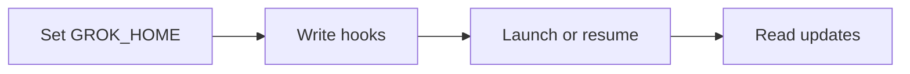

# Report: Cursor CLI or Grok Build for ensemble

Light Research: light-research · mixed · windroc-labs/ensemble@f597b17033e7

> [!IMPORTANT]
> **Prefer Grok Build for the next client.** (medium)
>
> - Caller-chosen session ids simplify integration.
> - Claude-style hooks reduce adapter work.
> - Account isolation has documented storage paths.
>
> Next step: verify interactive hooks before implementing.
>
> Risk: interactive session creation remains untested.

## Comparison table

- Synthesis: compare integration differences.

| Need | [Cursor CLI](https://cursor.com/cli) | [Grok Build](https://github.com/xai-org/grok-build) |
|---|---|---|
| New session id | ⚠️ create-chat first | ✅ caller UUID via -s |
| Hooks | ⚠️ CLI coverage unclear | ✅ Claude-style payloads |
| Account isolation | ⚠️ config only documented | ✅ GROK_HOME |
| Source access | ❌ closed | ✅ Apache-2.0 |

- Legend: ✅ supported; ⚠️ gap or extra work; ❌ unavailable.
- Both have: interactive terminals, resume by id, headless output.

## Findings

Findings: 4 aspects, 7 findings

---

### 1. What a new client must provide

> **Answer:** hooks for every turn event, a session id known before launch, and the reply text of each turn. (high)

The contract is ensemble's client base class; Claude is the only client that implements it today.

#### 1.1 The base class requires launch, reply, session_id and observe

Every client implements these four methods, and every hook event it emits maps to a HookKind [[1]](src/ensemble/session/clients/base.py#L116-L192). So a candidate client is judged by whether it exposes a turn's end and its reply, not by its feature list. (high)

#### 1.2 Claude meets it by choosing the session id and injecting hooks at launch

Ensemble generates the id itself and passes it in [[2]](src/ensemble/session/clients/claude/__init__.py#L18-L19), then writes hook settings before the process starts [[3]](src/ensemble/session/clients/claude/tui.py#L63-L106). A new client that accepts a caller id and launch-time hooks can reuse this adapter shape unchanged. (high)

---

### 2. How Cursor CLI fits

> **Answer:** it fits with extra work: an id call per launch, a two-hook join per turn, and guessed account isolation. (medium)

#### 2.1 Every launch needs an extra call to get a session id

Cursor's parameter reference has create-chat return a new id, which --resume then restores [[4]](https://cursor.com/docs/cli/reference/parameters). Ensemble would run and parse create-chat before each launch, a step Claude does not need, and handle its failure separately. (high)

#### 2.2 Replies arrive on a separate hook that the CLI may not emit

Cursor's hook reference puts the reply text on afterAgentResponse, not on stop [[5]](https://cursor.com/docs/agent/hooks), so observe must join two events per turn. NVIDIA's guide says the CLI emits fewer hooks than the editor [[6]](https://docs.nvidia.com/nemo/relay/v0.4.0/nemo-relay-cli/cursor); if afterAgentResponse is among the missing ones, headless runs lose replies. (medium; single-source)

#### 2.3 Per-account isolation is undocumented

Cursor documents only where its config lives, not its sessions or credentials, so separating accounts would rest on guesses about the remaining paths. (low; unverified)

---

### 3. How Grok Build fits

> **Answer:** it maps one-to-one onto the contract; one directory per account isolates everything. (high)

#### 3.1 Session ids and hooks map directly onto the contract

Grok's session guide has -s create a session under a caller UUID and -r resume it [[7]](https://github.com/xai-org/grok-build/blob/2bdd1d6a6369de0e8c68132ea4539e9abd9e14a8/crates/codegen/xai-grok-pager/docs/user-guide/17-sessions.md#L18-L42). Its Stop hook carries lastAssistantMessage, and StopCancelled marks an interrupted turn [[8]](https://github.com/xai-org/grok-build/blob/2bdd1d6a6369de0e8c68132ea4539e9abd9e14a8/crates/codegen/xai-grok-pager/docs/user-guide/10-hooks.md#L60-L435). The mapping:

| Contract | Grok mechanism |
|---|---|
| session_id | caller UUID via -s [[7]](https://github.com/xai-org/grok-build/blob/2bdd1d6a6369de0e8c68132ea4539e9abd9e14a8/crates/codegen/xai-grok-pager/docs/user-guide/17-sessions.md#L18-L42) |
| reply | Stop.lastAssistantMessage [[8]](https://github.com/xai-org/grok-build/blob/2bdd1d6a6369de0e8c68132ea4539e9abd9e14a8/crates/codegen/xai-grok-pager/docs/user-guide/10-hooks.md#L60-L435) |
| observe (interrupt) | StopCancelled [[8]](https://github.com/xai-org/grok-build/blob/2bdd1d6a6369de0e8c68132ea4539e9abd9e14a8/crates/codegen/xai-grok-pager/docs/user-guide/10-hooks.md#L60-L435) |

(high)

#### 3.2 One GROK_HOME per account isolates sessions and credentials

GROK_HOME holds auth.json beside the sessions [[7]](https://github.com/xai-org/grok-build/blob/2bdd1d6a6369de0e8c68132ea4539e9abd9e14a8/crates/codegen/xai-grok-pager/docs/user-guide/17-sessions.md#L18-L42)[[9]](https://github.com/xai-org/grok-build/blob/2bdd1d6a6369de0e8c68132ea4539e9abd9e14a8/crates/codegen/xai-grok-pager/docs/user-guide/02-authentication.md#L44-L53), so one directory per account separates both. Grok also runs inherited Claude and Cursor hooks unless their ENABLED flags are off [[8]](https://github.com/xai-org/grok-build/blob/2bdd1d6a6369de0e8c68132ea4539e9abd9e14a8/crates/codegen/xai-grok-pager/docs/user-guide/10-hooks.md#L60-L435)[[10]](https://github.com/xai-org/grok-build/blob/2bdd1d6a6369de0e8c68132ea4539e9abd9e14a8/crates/codegen/xai-grok-pager/docs/user-guide/05-configuration.md#L21-L30); the adapter must turn them off or each turn fires duplicate events. (high)

---

### 4. Integration work

> **Answer:** reuse Claude's adapter in four steps; observe's input format must be read from source first. (medium)

Synthesis: mapping Grok's docs (see 3.1, 3.2) onto Claude's adapter (see 1.2).

#### 4.1 updates.jsonl fields are undocumented

The docs do not list the fields observe would read from updates.jsonl. Grok Build is Apache-2.0 [[11]](https://github.com/xai-org/grok-build), so they can be read in its source before observe is written; hooks must also filter by sessionId, since one GROK_HOME serves several sessions [[7]](https://github.com/xai-org/grok-build/blob/2bdd1d6a6369de0e8c68132ea4539e9abd9e14a8/crates/codegen/xai-grok-pager/docs/user-guide/17-sessions.md#L18-L42). (low; unverified)

## What it means for us

- Grok fits the adapter: ids, replies and isolation map directly (see 3.1, 3.2).
- Cursor adds an id call, a two-hook join and guessed isolation (see 2.1–2.3).

## Gaps

| Impact | Gap |
|---|---|
| Could change conclusion | Neither interactive hook path was tested. |
| Does not change conclusion | Interactive -s is untested; fallback increases work. |
| Does not change conclusion | Cursor isolation and CLI hook coverage remain unverified. |
| Does not change conclusion | updates.jsonl fields still need source inspection. |

## Sources

Sources (11)

1. [Client contract](src/ensemble/session/clients/base.py#L116-L192) (code)
2. [Claude ids](src/ensemble/session/clients/claude/__init__.py#L18-L19) (code)
3. [Claude hooks](src/ensemble/session/clients/claude/tui.py#L63-L106) (code)
4. [Cursor parameters](https://cursor.com/docs/cli/reference/parameters) (primary)
5. [Cursor hooks](https://cursor.com/docs/agent/hooks) (primary)
6. [NVIDIA CLI caveats](https://docs.nvidia.com/nemo/relay/v0.4.0/nemo-relay-cli/cursor) (secondary)
7. [Grok sessions](https://github.com/xai-org/grok-build/blob/2bdd1d6a6369de0e8c68132ea4539e9abd9e14a8/crates/codegen/xai-grok-pager/docs/user-guide/17-sessions.md#L18-L42) (primary)
8. [Grok hooks](https://github.com/xai-org/grok-build/blob/2bdd1d6a6369de0e8c68132ea4539e9abd9e14a8/crates/codegen/xai-grok-pager/docs/user-guide/10-hooks.md#L60-L435) (primary)
9. [Grok authentication](https://github.com/xai-org/grok-build/blob/2bdd1d6a6369de0e8c68132ea4539e9abd9e14a8/crates/codegen/xai-grok-pager/docs/user-guide/02-authentication.md#L44-L53) (primary)
10. [Grok config](https://github.com/xai-org/grok-build/blob/2bdd1d6a6369de0e8c68132ea4539e9abd9e14a8/crates/codegen/xai-grok-pager/docs/user-guide/05-configuration.md#L21-L30) (primary)
11. [Grok repository](https://github.com/xai-org/grok-build) (primary)

